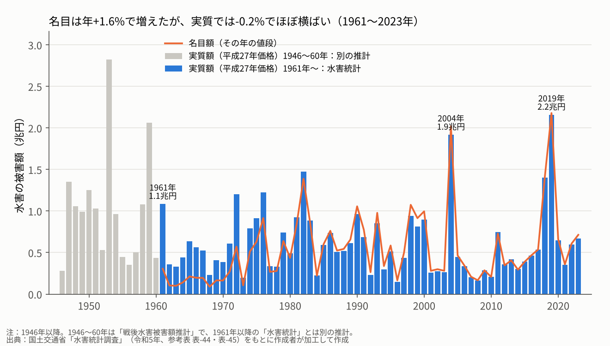
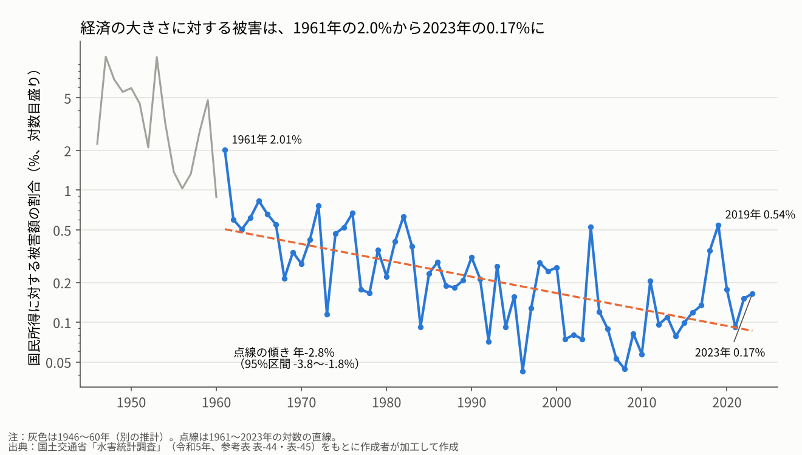
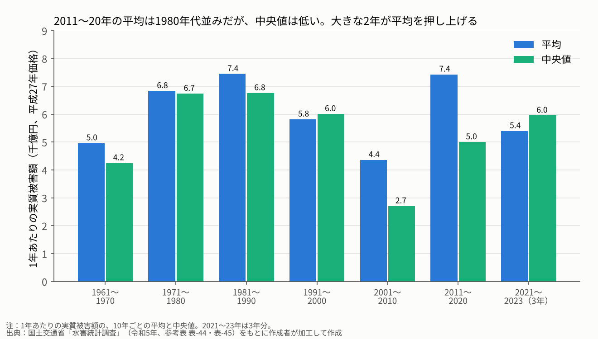
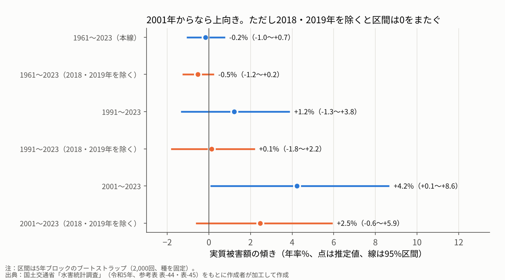

# F349 水害の被害額は、本当に大きくなったのか？ 名目では年1.6%ずつ増えたが、物価で割り引くと1961年からほぼ横ばい（年−0.2%）。経済の大きさに対しては2.0%から0.17%に

## 結論（先に）
- 水害の被害額（名目）は、1961〜2023年に年1.6%ずつ増えました。
- 物価で割り引いた実質額（平成27年価格）では、傾きは年−0.2%で、95%区間（−1.0〜+0.7%）は0をまたぎます。60年余りで見ると、大きくなったとは言えません。
- 国民所得（実質）に対する割合は、1961年の2.0%から2023年の0.17%へ下がりました（年−2.8%）。経済の大きさに比べた被害は小さくなっています。
- ただし、いちばん少なかった2001〜10年から見ると上向きです（年+4.2%、区間 +0.1〜+8.6%）。この上向きは2019年（2.2兆円）と2018年（1.4兆円）の2年に強く引っ張られていて、2つを除くと区間は0をまたぎます。

## 問い
「近年、水害が大きくなった」という説明はよく見ます。しかし被害額には、物価が上がった分や、守るべき資産（経済の大きさ）が増えた分も入ります。それらを割り引いても大きくなったのか、それとも大きな年が数年あるだけなのか。保険・不動産・建設・自治体の計画などで被害額の数字を目にする人が、数字の読み方を確かめるための記事です。

## データ（出典）
- 国土交通省「水害統計調査」（令和5年、e-Stat）の参考表。
  - 表-44 明治以降の水害被害額等の推移：名目額と平成27年価格の実質額（1875〜2023年）。
  - 表-45 国民所得に対する水害被害額の割合：国民所得の名目・実質と被害率（1879〜2023年）。
- 本線は1961〜2023年（63年）。1961年からは「水害統計」による同じ調べ方の数字で、それより前は別の推計なので図で参考に示すだけにしました。
- 被害額は、一般の資産（家屋・家財・事業所など）、公共土木施設、公益事業などの被害の合計です。表-44 の人的被害の列は使っていません。

## 事前の計画
[PLAN.md](PLAN.md)（2026-11-16 07:45、集計の前に作成）。

| 仮説 | 外れの基準 | 結果 | 判定 |
|---|---|---|---|
| H1 名目額は増えている | 傾きが0以下 | 年+1.6%（区間 +0.4〜+2.9%） | 支持 |
| H2 実質額では増えているとは言えない | 傾きが正で区間が0を含まない | 年−0.2%（区間 −1.0〜+0.7%） | 支持 |
| H3 国民所得に対する割合は下がっている | 傾きが0以上 | 年−2.8%（区間 −3.8〜−1.8%） | 支持 |
| H4 近年の平均が高いのは上位の数年による | 2014〜23年の平均から上位2年を除いた値が、1961〜2013年の10年ごとの平均の最大を上回る | 2014〜23年の平均7,516億円、上位2年（2019・2018）を除くと4,946億円。10年ごとの最大は1981〜90年の7,444億円 | 支持 |

## やったこと
1. 表-44・表-45 から、年ごとの名目額・実質額・国民所得を取り出し、単位をそろえました（02_build.py）。表-45 の被害率と、自分で計算した割合の差は最大 0.000%（一致）。
2. 1961〜2023年について、名目額・実質額・国民所得に対する割合の対数の傾き（年率）を、最小二乗とタイル・セン（2年の組の傾きの中央値）で出しました。区間は5年ブロックのブートストラップ（2,000回、種 20261116）（03_analysis.py）。
3. 10年ごとの平均と中央値、上位の年が合計に占める割合を出しました。
4. 結果を見てから、期間を区切った傾きと「大きな年」の回数を足しました（03b_requestion.py）。

## 分かったこと

### 1. 名目は増えたが、実質ではほぼ横ばい（図1）

名目額は1961年の3,047億円から2019年の2兆1,792億円まで振れながら増え、傾きは年+1.6%です。平成27年価格の実質額では、1961年が1.1兆円、2004年が1.9兆円、2019年が2.2兆円で、傾きは年−0.2%でした。最小二乗でもタイル・セン（年−0.3%）でも、ほぼ0です。

### 2. 経済の大きさに対しては、はっきり下がった（図2）

実質の国民所得は1961年から2023年に7.5倍になりました。それに対する被害の割合は2.0%から0.17%に下がり、傾きは年−2.8%で区間も0を含みません。2019年でも0.54%で、1960年代の半分以上の年より低い値です。なお、名目額を名目の国民所得で割っても同じ値になりました（被害額と国民所得の実質化に同じ物価の指標を使っているためと考えられる。推測）。

### 3. 平均は上位の年に引っ張られる（図3）

10年ごとの1年あたりの実質額は、平均で 1961〜70年 5.0千億円、1981〜90年 7.4千億円、2001〜10年 4.4千億円、2011〜20年 7.4千億円でした。中央値では2011〜20年は5.0千億円で、1971〜90年（6.7〜6.8千億円）より低くなります。63年の合計のうち、上位3年（2019・2004・1982年）が14%、上位10年が35%を占めます。

## 問い直し（結果を見てから足した）

### 2001年からなら上向き。ただし2つの年が大きく効く（図4）

1961年からでは横ばいだが、期間を1991年からに絞ると傾きが正になりました（頑健性の表）。2000年代が低かっただけなのか、近年に上がっているのかを確かめました。
- 2001〜2023年：年+4.2%（区間 +0.1〜+8.6%）。2018・2019年を除くと年+2.5%（区間 −0.6〜+5.9%）。
- 1991〜2023年：年+1.2%（区間 −1.3〜+3.8%）。2018・2019年を除くと +0.1%。
- 2011〜23年の平均は6,957億円だが、2018・2019年を除くと4,987億円で、1961〜2000年の平均6,264億円より低い。
- 実質1兆円以上の「大きな年」は63年で7回です。10年ごとに 1・2・1・0・1・2・0（2021〜23年）回で、2010年代の2回は1970年代と同じです。

いちばん低かった2000年代からは上がっていますが、それを「流れ」と言えるかは2018・2019年の2年しだいで、今のデータでは決められません。

## 頑健性

| 確かめ方 | 実質額の傾き（最小二乗） | 実質額の傾き（タイル・セン） | 国民所得比の傾き（最小二乗） | 国民所得比の傾き（タイル・セン） |
|---|---|---|---|---|
| 本線 1961〜2023年 | −0.2% | −0.3% | −2.8% | −2.9% |
| 1946〜2023年（前は別の推計） | −0.7% | −0.7% | −4.7% | −4.7% |
| 1976〜2023年 | −0.4% | −0.7% | −1.9% | −2.0% |
| 1991〜2023年 | +1.2% | +1.6% | +0.5% | +1.1% |
| 上位3年を除く（1961〜2023年） | −0.4% | −0.4% | −3.1% | −3.1% |

1991年からに絞った場合を除き、実質額は横ばいか少し下向き、国民所得比は下向きで、結論は変わりません。1991年からの傾きは、問い直しで確かめたとおり区間が0をまたぎます。

## 言えないこと
- 被害額は「起きた被害の額」で、雨の強さや回数を直接は表しません。堤防・ダムなどの対策で減った分と、雨が強くなって増えた分は、この表だけでは分けられません。横ばいは「雨が変わっていない」ことを意味しません。
- 国民所得は守るべき資産の量そのものではなく、目安にすぎません。浸水しやすい場所の家屋・事業所の増減は見ていません。
- 調べ方・集計の範囲の変化（2010年に公共土木施設の統計を統合したことなど）が、年どうしの比べ方に影響することがあります。津波の被害がどの年にどこまで入っているかも、この表からは確かめていません。
- 63年は、まれな大水害がどれくらいの間隔で起きるかを調べるには短い期間です。大きな年が1つ増えるだけで、期間を区切った傾きは大きく変わります。
- 全国の合計なので、地域ごとの違いは分かりません。

## 仕事で使うなら
- 「被害額が増えた」という数字を見るときは、名目か実質か、どの期間の比較かを確かめると読み違えにくくなります。この表では、名目の増え方の大半は物価の分で、1961年からの実質はほぼ横ばいです。
- 近年の比較では、2018・2019年を入れるかどうかで傾きが大きく変わる。期間ごとの傾きと区間は results/requestion_windows.csv にあります。

## 計画からの変更
- 問い直し（期間を区切った傾き、大きな年の回数）は結果を見てから足しました。計画にはありません。
- 計画の頑健性5「割り引き方を変える」のうち、名目÷名目は実質÷実質と同じ値になったので、表から省きました（results/trend.csv には残しています）。

## 再現のしかた
```
sh src/run_all.sh        # オフライン。所要約3秒
python3 src/01_fetch.py  # 元データを取り直すときだけ（ネットを使う）
```

| ファイル | 中身 |
|---|---|
| src/02_build.py | data/raw から data/flood_damage.csv を作る（単位をそろえる） |
| src/03_analysis.py | 傾き・区間・10年ごと・上位の年・頑健性 → results/main.json・trend.csv・decades.csv・top_years.csv・robustness.csv・series.csv |
| src/03b_requestion.py | 問い直し → results/requestion.json・requestion_windows.csv・requestion_big_years.csv |
| src/04_figures.py | 図4枚 |

repro_check：/tmp/rep_F349_r1 に写して流し、14ファイル（results 9、figures 4、data の CSV 1）がすべて cmp で一致しました（results/repro_check.txt）。乱数の種は 20261116 です。


## 関連する記事

- F256「自然災害の保険金は、この30年でどれだけ大きくなったのか」：損害保険の支払額を割り引いた記事。本記事は国土交通省の水害統計で、公共土木施設を含む水害の被害額を1961年から見た点が違います。
- F284「豪雨の増え方を、火災保険の料率はどこまで追いかけているのか」：雨の強さと料率の関係を見た記事。本記事は雨そのものではなく、起きた被害の額の流れを見ています。

## レビューで直したこと

| # | 指摘 | 直し方 |
|---|---|---|
| 1 | README が「だ・である」調で、指示書のです・ます調になっていなかった | README の本文をです・ます調に直した（数字は変更なし） |
| 2 | 既存の記事 F256（自然災害の保険金を物価と建物の数で割り引く）・F284（豪雨と火災保険の料率）と問いが近いのに、関連の記載がなかった | 「関連する記事」の節を足し、違いを1文ずつ書いた |

## 出典
- 国土交通省「水害統計調査」令和5年 参考表 表-44 明治以降の水害被害額等の推移：https://www.e-stat.go.jp/stat-search/file-download?statInfId=000040302510&fileKind=0
- 同 表-45 国民所得に対する水害被害額の割合：https://www.e-stat.go.jp/stat-search/file-download?statInfId=000040302511&fileKind=0

（いずれも 国土交通省「水害統計調査」をもとに作成者が加工して作成）
