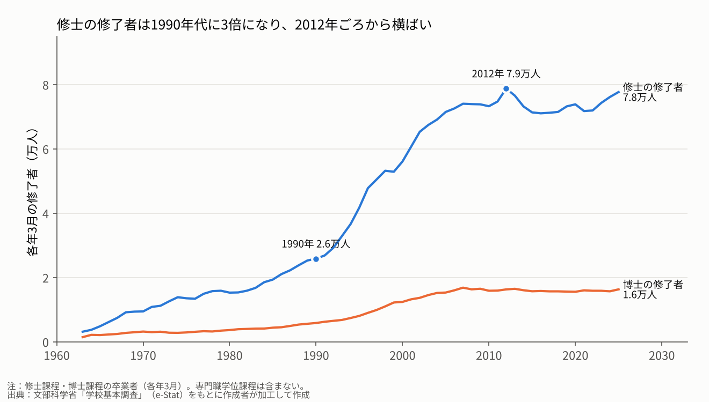
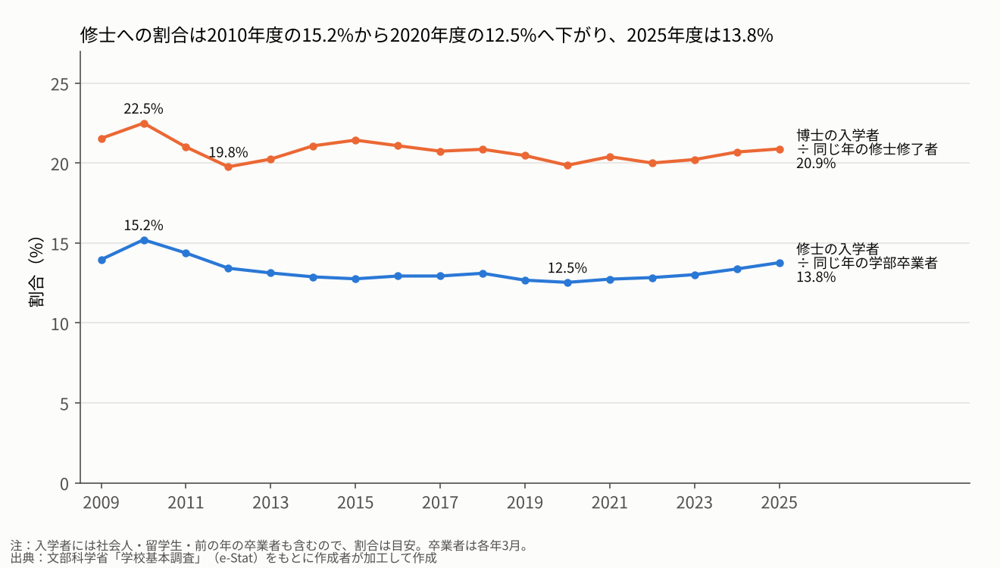
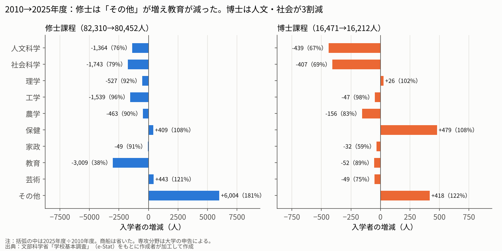
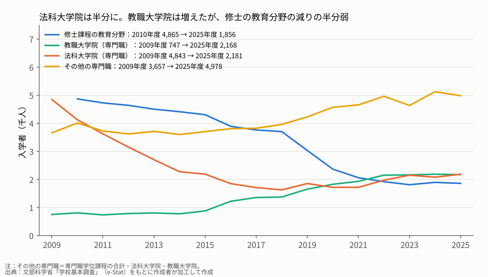

# F350 大学院に進む人は、減っているのか？ 修士の入学者は2020年度の7.2万人から2025年度の8.0万人に戻り、2010年度（8.2万人）の98%。減ったのは人文・社会と教育の分野で、博士の人文・社会は3割減

## 結論（先に）
- 修士課程の入学者は、2010年度の82,310人から2020年度の71,954人まで減り、2025年度は80,452人に戻りました（2010年度の98%）。博士課程も16,471人→14,382人（2022年度）→16,212人（98%）です。「減り続けている」わけではありません。
- ただし学部卒業者も増えたので、割合（修士の入学者÷同じ年の学部卒業者）は2010年度の15.2%から2020年度の12.5%に下がり、2025年度は13.8%です。2010年度ほどには戻っていません。
- 長い目で見ると、修士の修了者は1990年の2.6万人から2012年の7.9万人に3倍に増え、そこから横ばいです。2010年度ごろは、ふくらんだ山のいちばん上でした。
- 分野で見ると、修士は「その他」（学際・情報など）が6,004人増え、教育が3,009人、社会科学が1,743人、人文科学が1,364人減りました。博士は人文科学と社会科学がどちらも約3割減り、保健と「その他」が増えました。
- 修士の教育分野の減りの一部は、教員養成の大学院が専門職の教職大学院に移った分です（教職大学院は805人→2,168人）。合わせても教育分野は5,670人→4,024人に減っています。

## 問い
「大学院離れ」「博士が減った」とよく言われます。人数の話なのか、割合の話なのか、どの課程・分野の話なのかで、見え方は変わります。大学・企業の採用や研究開発の人材計画にかかわる人、進学を考える学生や家族が、分けて知るための記事です。

## データ（出典）
- 文部科学省「学校基本調査」（e-Stat）
  - 各年度の「専攻分野別 大学院入学状況」：修士課程・博士課程・専門職学位課程の入学志願者と入学者（男女、国公私立、専攻分野別）。2010〜2025年度の16年分です。各表に前の年度の合計の行があるので、合計は2009年度からあります。専門職は法科大学院・教職大学院の再掲も使いました。
  - 年次統計 表13 卒業者数（1948〜2025年、各年3月）と 表11 大学院の在籍者数（1950〜2025年）。

## 事前の計画
[PLAN.md](PLAN.md)（2026-11-16 07:54、集計の前に作成）。下見で修士・博士の入学者の合計の一部を見たことは PLAN に書いました。

| 仮説 | 外れの基準 | 結果 | 判定 |
|---|---|---|---|
| H1 修士の割合（÷学部卒業者）は下がっていない | 2025年度が2010年度より1ポイント以上低い | 15.2% → 13.8%（−1.4ポイント） | 外れ |
| H2 博士の割合（÷修士修了者）は下がった | 2025年度が2010年度以上 | 22.5% → 20.9% | 支持 |
| H3 博士の減りは理学・工学の方が保健より大きい | 理学＋工学の2025/2010 が保健以上 | 理学＋工学 99.5%、保健 108% | 支持（ただし理学・工学もほぼ減っていない。減ったのは人文・社会） |
| H4 専門職の入学者は減った | 2025年度が2010年度以上 | 8,931 → 9,327 | 外れ |

## やったこと
1. 16年分の入学状況の表から、課程・分野・設置者ごとの入学志願者と入学者を取り出しました（02_build.py）。分野の合計と合計の行は全年度で一致し、同じ年度の合計が2つの表（その年度の表と、次の年度の表の前年度の行）で食い違わないことも確かめました。
2. 入学者の推移、割合（修士÷同じ年3月の学部卒業者、博士÷同じ年3月の修士修了者）、分野ごとの2010→2025年度の増減を出しました（03_analysis.py）。
3. 結果を見てから、専門職を法科大学院・教職大学院・それ以外に分け、修了者の長い系列で割合の長い流れを見ました（03b_requestion.py）。

## 分かったこと

### 1. 修了者は1990年代に3倍、2012年ごろから横ばい（図1）

修士の修了者は1980年の1.5万人、1990年の2.6万人から、2000年に5.6万人、2012年に7.9万人と増え、2025年は7.8万人です。博士の修了者は2007年の16,801人が最も多く、2025年は16,278人です。修士の修了者を2年前の学部卒業者で割った長い目安は、1990年の6.7%から2012年の14.5%まで上がり、2025年は13.2%です。

### 2. 割合は2010年度から下がり、ここ数年で少し戻った（図2）

修士の入学者÷学部卒業者は、2010年度15.2%、2020年度12.5%、2025年度13.8%です。学部卒業者は54.1万人から58.4万人に増えたので、人数が2010年度に近づいても割合は戻りきっていません。博士の入学者÷修士修了者は22.5%から、2012年度に19.8%まで下がり、2025年度は20.9%です。

### 3. 分野で見ると、減ったのは人文・社会と教育（図3）

修士は「その他」が7,433人から13,437人へ1.8倍になった一方、教育が38%、人文科学が76%、社会科学が79%になりました。博士は人文科学67%、社会科学69%、農学83%で、理学102%、工学98%、保健108%です。博士から保健を除くと93%になります。

## 問い直し（結果を見てから足した）

### 法科大学院と教職大学院（図4）

専門職が減っていない（H4 外れ）ことと、修士の教育分野が6割減ったことの理由を見るために、専門職を分けました。
- 法科大学院は2009年度4,843人から2018年度1,624人まで減り、2025年度は2,181人です。
- 教職大学院は2009年度747人から2025年度2,168人です。修士の教育分野は2010年度4,865人から2025年度1,856人です。両方を合わせると5,670人→4,024人で、教員養成の大学院も、移った分を足してなお3割減っています。
- 法科大学院・教職大学院以外の専門職（経営・会計・公共政策など）は3,657人→4,978人に増えました。専門職の合計が2010年度を上回ったのは、この増えた分と教職大学院によるものです。

## 頑健性

| 確かめ方 | 修士 2025÷基準 | 博士 2025÷基準 |
|---|---|---|
| 本線：入学者 2025÷2010年度 | 98% | 98% |
| 入学志願者で | 105% | 97% |
| 基準を2009年度に | 103% | 102% |
| 基準を2015年度に | 112% | 106% |
| 博士から保健を除く | — | 93% |
| 国立だけ | 95% | 98% |
| 公立だけ | 107% | 111% |
| 私立だけ | 100% | 97% |
| 割合（修士÷学部卒、博士÷修士修了）で | 91% | 93% |
| 博士の割合の分母を2年前の修士入学者に（基準は2012年度） | — | 112% |

人数では、どの基準年でも2025年度は基準の±10%ほどの中にあり、「大きく減った」とは言えません。割合では修士・博士ともに1割弱下がりました。博士の割合は、分母を2年前の修士入学者にすると逆に上がります（2010年度の修士入学者が特に多かったため）。

## 言えないこと
- 入学者には社会人・留学生・前の年の卒業者も入ります。この表では分けられないので、「日本の学部を卒業してすぐ進む人」が減ったかどうかは直接は言えません。割合は目安です。
- 専攻分野は大学の申告で、新しい学際の研究科は「その他」に入りやすいです。「その他」の増加の中身（情報系か、ほかの学際か）は、この表では分かりません。
- 進学の理由（就職の状況、学費や生活費、研究の環境）は分かりません。2010年度の山がリーマン・ショック後の就職の厳しさによるものかどうかも、ここでは確かめていません（推測にとどまります）。
- 2009年度より前の入学者は集めていません。長い流れは修了者で見ており、修了者は入学の2年（修士）・3年（博士）ほどあとに出ます。
- 女性の割合（修士28.4%→30.8%、博士31.8%→33.3%）は出したが、分野ごとには見ていません。

## 仕事で使うなら
- 「大学院進学が減った」という話を読むときは、人数か割合か、どの年度と比べているかで結論が変わります。2010年度は山の年なので、そこを起点にすると減って見えやすいです。
- 分野別の増減は results/field_change.csv、年度ごとは results/field_by_year.csv にあります。

## 計画からの変更
- 問い直し（専門職の内訳、修了者の長い系列での割合）は結果を見てから足しました。計画にはありません。
- 専門職の表には法科大学院・教職大学院の再掲が下にあり、初めの集計では分野の行を二重に数えていました（分野の合計と合計の行のずれで気づいた）。再掲の前で分野の行を止めるよう直し、再掲は別に取り出しました。分野別の比較は修士・博士だけにし、専門職は合計と再掲で見ました。

## 再現のしかた
```
sh src/run_all.sh        # オフライン。所要約3秒
python3 src/01_fetch.py  # 元データを取り直すときだけ（ネットを使う）
```

| ファイル | 中身 |
|---|---|
| src/02_build.py | 18の Excel から data/admission_by_field.csv・admission_total.csv・graduates.csv・enrollment.csv と2つの確認の表を作る |
| src/03_analysis.py | 推移・割合・分野別・仮説・頑健性 → results/main.json・totals_by_year.csv・field_change.csv・field_by_year.csv・robustness.csv |
| src/03b_requestion.py | 問い直し → results/requestion.json・requestion_prof_edu.csv・requestion_long_rates.csv |
| src/04_figures.py | 図4枚 |

repro_check：/tmp/rep_F350_r1 に写して流し、18ファイル（results 8、figures 4、data の CSV 6）がすべて cmp で一致（results/repro_check.txt）。乱数は使っていない。


## レビューで直したこと

| # | 指摘 | 直し方 |
|---|---|---|
| 1 | README が「だ・である」調で、指示書のです・ます調になっていなかった | README の本文をです・ます調に直した（数字は変更なし） |

## 出典
- 文部科学省「学校基本調査」各年度 専攻分野別 大学院入学状況（e-Stat、2010〜2025年度。URL は data/raw/SOURCES.md）
- 同 年次統計 表13 卒業者数：https://www.e-stat.go.jp/stat-search/file-download?statInfId=000031852313&fileKind=0
- 同 年次統計 表11 大学院の在籍者数：https://www.e-stat.go.jp/stat-search/file-download?statInfId=000031852324&fileKind=0

（いずれも 文部科学省「学校基本調査」をもとに作成者が加工して作成）
