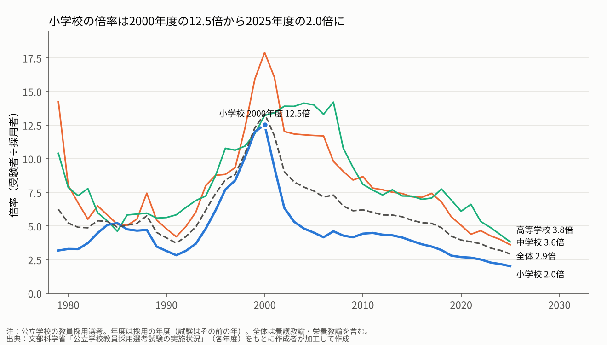
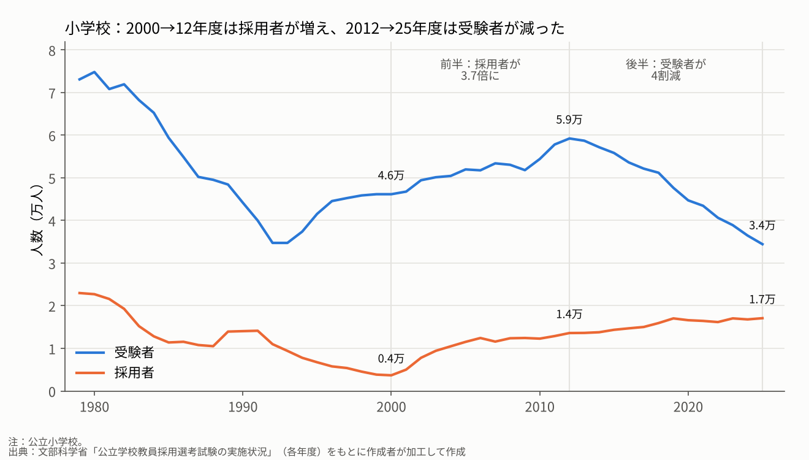
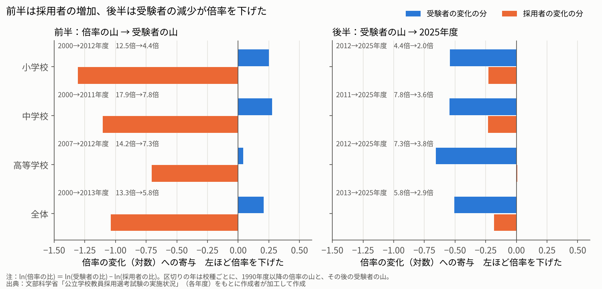
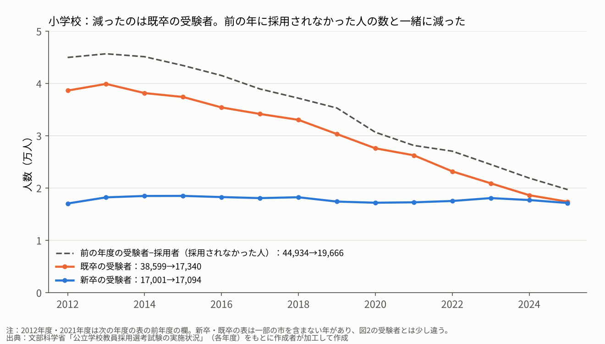

# F351 教員の採用倍率は、なぜ下がったのか？ 小学校は2000年度の12.5倍から2025年度の2.0倍に。前半は採用者が3.7倍に増えたため、後半は受験者が4割減ったためで、減ったのはほぼ全部が既卒の受験者

## 結論（先に）
- 公立小学校の採用倍率（受験者÷採用者）は、2000年度の12.5倍から2012年度に4.4倍、2025年度に2.0倍になりました。
- 2000→2012年度の下がりは、採用者が3,683人から13,598人へ3.7倍に増えたことによる（受験者はむしろ28%増えていた）。
- 2012→2025年度の下がりは、7割が受験者の減り（59,230人→34,434人）、3割が採用者の増え（→17,078人）による。中学校・全体でも同じ形です。
- 小学校の受験者の減りは、ほぼ全部が既卒者（前の年までに大学などを出た人）の減りでした。新卒の受験者は2012年度17,001人、2025年度17,094人でほぼ同じです。
- 既卒の受験者は、毎年「前の年度に受けて採用されなかった人の数」の85〜93%で動いています。採用が増えると、翌年に受け直す人の元になる数が減り、それが受験者の減りになった、と読めます（推測を含みます。同じ人を追った数字ではない）。

## 問い
「教員の倍率が過去最低」という見出しは、「先生になりたい人が減った」と読まれがちです。しかし倍率は割り算なので、受験者が減っても、採用者が増えても下がります。どちらがどれだけ効いたのか、受験者のうち誰が減ったのかを分けて知りたい人（教員を目指す学生、教員養成の大学、教育委員会の採用の担当など）のための記事です。

## データ（出典）
- 文部科学省「令和7年度 公立学校教員採用選考試験の実施状況」参考資料1（PDF）の第7表「受験者数、採用者数、競争率（採用倍率）の長期的推移」（1979〜2025年度）と第5表「新規学卒者・既卒者の内訳」。
- 同じ調査の2013〜2024年度の資料（PDF）の「新規学卒者・既卒者の内訳」の表です。2012〜2025年度をつないでした（2021年度の資料は字が取り出せなかったので、2021年度の値は2022年度の資料の前年度の欄から取りました）。
- 文部科学省「学校基本調査」年次統計の大学（学部）の卒業者。
- 年度は採用の年度です（試験はその前の年の夏ごろ）。

## 事前の計画
[PLAN.md](PLAN.md)（2026-11-16 08:04、分解の計算の前に作成）。ただし第7表の数字はすべて、新卒・既卒の表は一部を下見で見てから仮説を立てたので、仮説は「見通しを確かめる」性格のもので、事前の予想としての重みは小さいです。

| 仮説 | 外れの基準 | 結果 | 判定 |
|---|---|---|---|
| H1 前半（2000→2012年度）は主に採用者の増え | 採用者の寄与が半分未満 | 採用者の寄与 124%（受験者は逆に倍率を上げる向き） | 支持 |
| H2 後半（2012→2025年度）は主に受験者の減り | 受験者の寄与が半分未満 | 受験者 70%、採用者 30% | 支持 |
| H3 受験者の減りの多くは既卒者 | 既卒者の分が半分未満 | 減った21,166人のうち既卒者が21,259人（新卒は93人増） | 支持 |
| H4 新卒の受験者は全体ほど減っていない | 新卒の減り方が全体以上 | 新卒 101%、全体 62%（2025÷2012年度） | 支持 |

## やったこと
1. PDF から第7表（47年度×7区分）と、各年度の新卒・既卒の表を pdfplumber で取り出し、CSV にしました（02_build.py）。受験者÷採用者を計算し直して、表の倍率と小数1桁で全部一致することを確かめました。
2. ln(倍率の比) ＝ ln(受験者の比) − ln(採用者の比) で、倍率の変化を受験者の分と採用者の分に分けました。区切りは校種ごとに、1990年度以降の倍率の山と、その後の受験者の山としました（03_analysis.py）。
3. 小学校の受験者の減りを、新卒と既卒に分けました。
4. 結果を見てから、既卒の受験者を「前の年度の受験者−採用者」と比べました（03b_requestion.py）。

## 分かったこと

### 1. 倍率の長い流れ（図1）

小学校の倍率は1990年代に上がり、2000年度に12.5倍の山でした。そこから2012年度の4.4倍まで急に下がり、その後もゆっくり下がって2025年度は2.0倍です。中学校（2000年度17.9倍→3.6倍）、高等学校（2007年度14.2倍→3.8倍）、全体（13.3倍→2.9倍）も同じ向きです。

### 2. 前半は採用者、後半は受験者（図2・図4）


小学校の前半（2000→2012年度）は、採用者が3.7倍になったことが倍率を下げました。同じ時期に受験者は46,156人から59,230人に増えていて、倍率を上げる向きに働いていました。後半（2012→2025年度）は、受験者が42%減り、これが倍率の下がりの70%を占めます。中学校も前半は採用者（133%）、後半は受験者（70%）でした。高等学校の後半は採用者がほぼ変わらず、受験者の減りがすべてです。

## 問い直し（結果を見てから足した）

### 減ったのは既卒の受験者で、前の年に採用されなかった人と一緒に動く（図3）

受験者の減りのほぼ全部が既卒者だったので、既卒者がどこから来るのかを見ました。
- 小学校の既卒の受験者は2012年度38,599人から2025年度17,340人に減りました。同じ時期、前の年度の「受験者−採用者」（採用されなかった人の数）は44,934人から19,666人に減りました。
- 既卒の受験者は、毎年その85〜93%の範囲にあります（年ごとの変化どうしの相関 0.65）。中学校（72〜82%）、高等学校（75〜83%）、全体（80〜88%）も同じ形です。
- 採用者に占める新卒者の割合は、小学校で2012年度38%から2025年度58%に上がりました。
- つまり、採用が増える → 不合格の人が減る → 翌年に受け直す既卒者が減る → 受験者が減る、という流れで説明がつきます。新卒で受ける人の数はほとんど変わっていません（同じ人を追った数字ではないので、この流れは推測を含みます）。

## 頑健性

| 確かめ方 | 結果 |
|---|---|
| 前半・後半の区切りを2010年度に | 前半の採用者の寄与：小 116%・中 129%・高 92%・全体 116%。後半の受験者の寄与：小 58%・中 54%・高 76%・全体 56% |
| 区切りを2012年度に | 後半の受験者の寄与：小 70%・中 71%・高 101%・全体 73% |
| 区切りを2013年度に | 後半の受験者の寄与：小 70%・中 74%・高 93%・全体 73% |
| 新卒・既卒の基準を2013年度に（小学校） | 受験者の減りのうち既卒者 95%。新卒 94%、全体 59%（2025÷2013年度） |
| 全校種の合計で新卒・既卒 | 既卒 118,886→64,556人、新卒 50,039→44,567人（2012→2025年度） |
| 受験者を大学（学部）の卒業者で割る（小学校） | 卒業者1,000人あたり 2000年度 86人、2012年度 106人、2025年度 59人。大学の卒業者は増えているので、受験者の減りは卒業者の減りではない |
| 同じ年度の新卒・既卒の値を2つの資料で比べる | 31か所で違いがあった（2024年度は次の年度の資料で社会人向けの選考の受験者を足して直されている、など）。本線はその年度の資料の値。data/new_vs_prior_crosscheck.csv |

区切りの年を変えても「前半は採用者、後半は受験者」は変わりません。区切りを早く（2010年度）すると後半の受験者の寄与は5〜6割に下がります。

## 言えないこと
- 受験者は、同じ人が複数の県市を受けると重なって数えられている可能性があります（表の注では確かめていません）。既卒者の中に、講師として働きながら受け直す人がどれだけいるかも分かりません。
- 「前の年に採用されなかった人」と「翌年の既卒の受験者」は、同じ人を追った数字ではありません。既卒者には、前から受けていた人のほか、卒業後しばらくして初めて受ける人もいます。
- 新卒・既卒の表は、年度によって一部の市の数字を含まず（2012・2013年度など）、第7表の受験者とは少し違う。
- 倍率の高さと、採用された人の力の関係は、ここでは分かりません。
- 県市ごとの違い（試験日程の前倒し、大学3年生向けの選考など）は分けていません。

## 仕事で使うなら
- 「倍率が下がった」を見るときは、受験者と採用者のどちらが動いたかを分けると読み違えにくいです。2012年度以降の小学校では、新卒の受験者はほぼ横ばいで、減ったのは既卒の受験者です。
- 年度ごと・校種ごとの分解は results/decomposition.csv、既卒と前の年の不合格の比は results/requestion_prior_vs_not_hired.csv にあります。

## 計画からの変更
- 問い直し（既卒の受験者と前の年の不合格の人数の比較）は結果を見てから足しました。
- 2021年度の資料は新卒・既卒の表の字が取り出せなかったので使わず、2022年度の資料の前年度の欄を使いました。
- 計画の頑健性3（大学の卒業者で割る）は小学校だけで行った。

## 再現のしかた
```
sh src/run_all.sh        # オフライン。所要約23秒（PDF から数字を取り出す時間が大半）
python3 src/01_fetch.py  # 元データを取り直すときだけ（ネットを使う）
```

| ファイル | 中身 |
|---|---|
| src/02_build.py | PDF と Excel から data/long_term.csv・new_vs_prior.csv・new_vs_prior_crosscheck.csv・univ_graduates.csv を作る |
| src/03_analysis.py | 倍率の分解・新卒既卒・仮説・頑健性 → results/main.json・decomposition.csv・robustness.csv など |
| src/03b_requestion.py | 問い直し → results/requestion.json・requestion_prior_vs_not_hired.csv |
| src/04_figures.py | 図4枚 |

repro_check：/tmp/rep_F351_r1 に写して流し、17ファイル（results 9、figures 4、data の CSV 4）がすべて cmp で一致（results/repro_check.txt）。乱数は使っていない。


- 大きなデータのファイル（`data/raw/mext_kyoin_saiyo_2024_tables.pdf`）は、GitHub の1ファイルの上限に合わせて `.part000` などに分けて置いています。`run_all.sh` が最初に `src/00_join_parts.py` でつなぎ直し、sha256 で元と同じことを確かめます。

## 関連する記事

- 148「小学校の先生の年齢構成は、『ふたコブ』からどう変わったか？」：在職する先生の年齢の分布を見た記事。本記事は採用試験の受験者と採用者から、倍率が下がった理由を分けた点が違います。

## レビューで直したこと

| # | 指摘 | 直し方 |
|---|---|---|
| 1 | README が「だ・である」調で、指示書のです・ます調になっていなかった | README の本文をです・ます調に直した（数字は変更なし） |
| 2 | 既存の記事148（小学校の先生の年齢構成）と題材が近いのに、関連の記載がなかった | 「関連する記事」の節を足し、違いを1文で書いた |

## 出典
- 文部科学省「令和7年度（令和6年度実施）公立学校教員採用選考試験の実施状況等について」参考資料1：https://www.mext.go.jp/content/20261001-kyoikushokuin-000046447_2.pdf
- 同 各年度の実施状況（平成25〜令和6年度。URL は data/raw/SOURCES.md）：https://www.mext.go.jp/a_menu/shotou/senkou/1243159.htm
- 文部科学省「学校基本調査」年次統計 表13 卒業者数：https://www.e-stat.go.jp/stat-search/file-download?statInfId=000031852313&fileKind=0

（いずれも 文部科学省「公立学校教員採用選考試験の実施状況」「学校基本調査」をもとに作成者が加工して作成）
