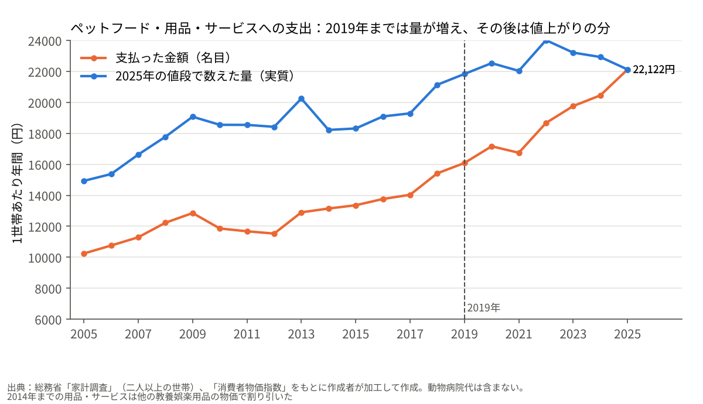
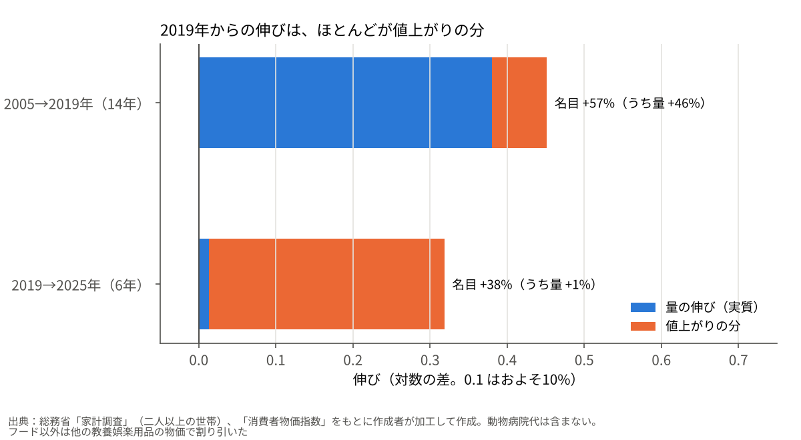
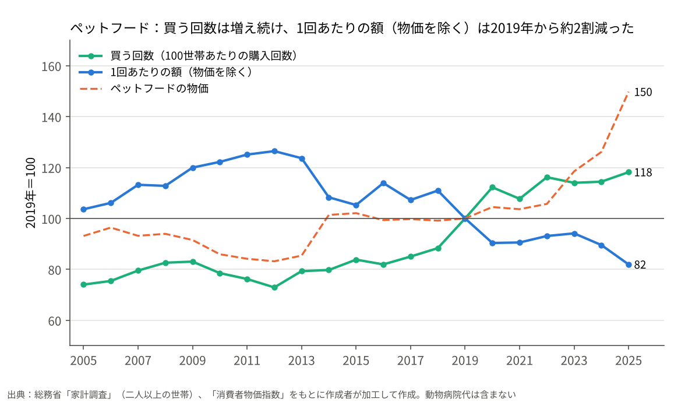
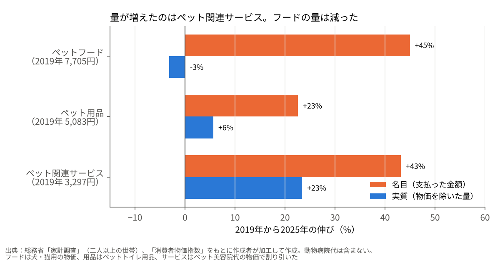

# F352 ペットにかける支出は、どれだけ増えたのか？ 2019年から名目で38%増えたが、物価を除くと4%。フードは買う回数が18%増え、1回あたりの実質の額は約2割減った

## 結論（先に）

- 二人以上の世帯が、ペットフード・ペット用品・ペット関連サービス（動物病院代は除く）に払った金額は、2025年に1世帯あたり年22,122円でした。2005年（10,240円）の2.2倍、2019年（16,085円）の1.38倍です。
- 2005年から2019年の伸び（名目 +57%）は、ほとんどが量の伸びでした。物価を除いても **+46%** です。
- 2019年から2025年の伸び（名目 **+38%**）は、ほとんどが値上がりの分でした。品目ごとの物価で割り引くと、量は **+4%** にとどまります。名目の伸びのうち約9割が物価の分です。
- ペットフードは、2019年から2025年に物価が50%上がりました。買う回数（100世帯あたりの購入回数）は18%増えましたが、1回あたりの額を物価で割ると **約2割減**（−18%）で、フードの量は全体で3%減りました。
- 量がはっきり増えたのは、ペット関連サービス（+23%）でした。年齢・収入による伸び方の違いは、コロナ前の1年の揺れより小さいか同じくらいで、はっきりした差は言えませんでした。

## 問い

経済産業省の「ひと言解説」（2025年6月）は、犬の登録頭数は2009年度末をピークに減っていること、ペット・ペット用品の販売額は名目で増えても、物価を除いた実質では2022年度から下がっていることを紹介しています（出典を参照）。売る側の統計では「金額は伸びても量は伸びていない」という見え方です。

では、家計の側から見るとどうでしょうか。ペットフードや用品のメーカー・小売の人、家計の消費を分析する人は、家計の支出の伸びのうち、どれだけが値上がりで、どれだけが量なのか、買う回数と1回の額のどちらが動いたのかを知りたいはずです。

この記事は、総務省の家計調査で、家計がペットにかける支出（動物病院代を除く）を、(1) 物価と量、(2) 買う回数と1回あたりの額、(3) 世帯主の年齢・年間収入に分けて見ます。動物病院代は扱いません。

## データ（出典）

- 総務省「家計調査」家計収支編 二人以上の世帯 詳細結果表（年）
  - 第4-6表 世帯主の年齢階級別（2005〜2025年）、第4-3表 年間収入五分位階級別（2015〜2025年）
  - 品目：ペットフード、ペット・他のペット用品、他のペット関連サービス（1世帯あたり年間の支出金額と購入頻度）
- 総務省「消費者物価指数」2025年基準 品目別（暦年の年平均。家計調査と同じ1〜12月の平均）：ペットフード（ドッグフード・キャットフード）、ペットトイレ用品、ペット美容院代、他の教養娯楽用品（類）、総合

**品目の分類の変わり目**：2014年までは用品とサービスが1つの品目（他の愛がん動物・同用品）でした。2015年から用品とサービスに分かれています。また2004年までは、この品目に動物病院代が含まれていたので、2005年から使います。長い期間は「フード」と「用品＋サービス」の2つで見ました。

**物価の割り引き方**：フードは、ドッグフードとキャットフードの物価指数を CPI のウエイトで平均したもの。2015年からの品目別は、用品をペットトイレ用品、サービスをペット美容院代の物価で割り引きました。2014年以前を含む長い期間の用品＋サービスは、他の教養娯楽用品（類）の物価で割り引きました。

## 事前の計画

計画は [PLAN.md](PLAN.md) に、分解・年齢・収入の集計をする前に書きました（2026-11-16）。ただし、品目の行の場所と分類の変わり目を確かめるときに、全体の名目の支出額と、ペット関連の物価指数を見ています。そのため「名目で増えた」「物価も大きく上がった」は知ったうえで、まだ見ていない分け方について仮説を立てました（PLAN.md に開示）。

| 仮説 | 外れの基準 | 結果 | 判定 |
|---|---|---|---|
| H1 2005→2019年に実質で20%以上増えた | 届かなければ外れ | +46% | 支持 |
| H2 フードの購入回数の増え方は10%未満で、伸びの大半は1回あたりの額 | 回数が10%以上増えたら外れ | 回数 +18% | 外れ |
| H3 2019→2025年の実質の増加の半分以上は、世帯主60歳以上の世帯の寄与 | 半分未満なら外れ | 基本は170%だが、確かめ方で29〜170%と大きく揺れる | 判定できず（全体の増え方が小さく、割合が不安定） |
| H4 収入の高い2割の実質の伸びは、低い2割より10ポイント以上大きい | 届かなければ外れ | 第V −3.6%、第I +0.4%（差 −4.0） | 外れ |

## やったこと

1. 家計調査の第4-6表（2002〜2025年）と第4-3表（2015〜2025年）から、ペット関連の3品目の支出金額と購入頻度、世帯数の分布、世帯人員を取り出しました。動物病院代の行は読み出していません。全体の平均の値が2つの表で一致すること、分類の変わり目の前後で品目名が想定どおりであることを、プログラムの中で確かめています。
2. 支出金額を物価指数で割り、「2025年の値段で数えた量」（実質）にしました。
3. 1世帯あたりの支出を「購入頻度÷100（1世帯あたりの回数）×1回あたりの額」に分けました。
4. 年齢別の値を世帯数の分布で重みづけして、全体の伸びへの年齢ごとの寄与を出しました。収入は五分位（各2割）ごとの伸びを比べました。家計調査は標本調査なので、コロナ前の1年（2018→2019年）の動きを「ふだんの揺れ」として並べました。

## 分かったこと

### 図1 2019年までは量が増え、その後は値上がりの分



- 名目の支出は、2005年 10,240円 → 2019年 16,085円 → 2025年 22,122円でした。
- 2025年の値段で数えた量は、2005年の14,930円分から2019年の21,833円分まで増えました。その後は2022年に24,014円分まで上がったあと、2025年は22,122円分で、2019年とほぼ同じ水準です（2019年の1.01倍）（この図の割り引き方による）。

### 図2 2019年からの伸びは、ほとんどが値上がりの分



- 2005→2019年：名目 +57%、量 +46%。ペットフードの物価はこの14年で7%しか上がっていません。
- 2019→2025年：名目 +38%。量は、品目ごとの物価で割り引くと +4.1%、用品・サービスを他の教養娯楽用品の物価で割り引くと +1.3% でした。どちらでも、伸びのほとんどが値上がりの分です（品目ごとの割り引きで約9割）。

### 図3 フードは、回数は増え、1回あたりの量は減った



- ペットフードの購入回数は、100世帯あたり年908回（2019年）から1,073回（2025年）に18%増えました。2005年は672回で、コロナ前から増え続けています。
- 1回あたりの額は849円から1,041円に23%上がりました。しかし、フードの物価は50%上がっていて、物価で割ると1回あたりの額は18%減りました。
- 名目のフードの支出は+45%、量は−3%でした。

### 図4 量が増えたのはペット関連サービス



- 2019年から2025年に、ペット関連サービスは名目 +43%、量 +23%。ペット用品は名目 +23%、量 +6% でした。
- 世帯主の年齢別の量の伸びは、60〜69歳 +21%、70歳以上 +12%、40〜49歳 −5%、50〜59歳 −8% などでした。ただし、コロナ前の1年（2018→2019年）でも年齢の間に32ポイントの開きがあり、この差は「ふだんの揺れ」の範囲と区別できません。
- 2025年の名目の支出の水準は、世帯主が50〜59歳（30,020円）と60〜69歳（31,574円）の世帯で高く、70歳以上（15,399円）や30〜39歳（14,236円）の世帯の2倍ほどでした。収入では第V五分位（31,471円）が第I五分位（13,637円）の2.3倍です。

## 問い直し（結果を見てから足した）

結果を見て、「フードの1回あたりの実質の額が減ったのは、コロナ前からの流れか、値上がりの時期に重なる動きか」を確かめました（`src/03b_requestion.py`）。

- 1回あたりの実質の額は、2005→2019年には1年に0.3%しか減っていませんでしたが、2019→2025年には1年に3.3%減りました。同じ期間のフードの物価の伸びは、1年に0.5%と7.0%です。購入回数の伸びは1年に2.2%と2.8%で、あまり変わりません。
- 年ごとの変化（2006〜2025年の20年）で見ると、フードの物価が1上がった年に、名目の1回あたりの額は約0.38しか上がっていませんでした（95%区間 0.05〜0.71）。物価が5%超上がった年（2014・2023・2024・2025年）は、1回あたりの実質の額が平均で約6.5%（対数の差）減っていました。
- 値上がりの年に、1回に買う量を減らしたか、安い商品に替えた可能性があります（推測。家計調査には商品の量や種類がありません）。また、実質の額は名目を物価で割って作るので、物価の測り方の誤差があると、この関係は見かけ上も負になりやすい点に注意が要ります。

## 頑健性

| 確かめ | 基本 | 変えたとき | 結論は変わったか |
|---|---|---|---|
| 2019→2025年の量の伸び | +4.1% | 他の教養娯楽用品で一括：+12.0%／総合で一括：+22.8%／2年平均どうし：+6.2%／2024年まで：+5.0%／1人あたり：+7.7%／サービスを除く：−0.2% | 品目ごとの物価で割り引けば「量はほぼ横ばい」は変わらない。総合の物価で割ると+23%で、割り引き方で大きく変わる |
| H1 2005→2019年の量の伸び | +46% | 総合で一括：+50%／1人あたり：+56%／3年平均どうし：+33% | 変わらない（どれも20%以上） |
| H3 60歳以上の寄与の割合 | 170% | 他の教養娯楽用品で一括：99%／名目：67%／2024年まで：29%／2018年から：83% | 揺れが大きい。判定できず |
| H4 第V−第I五分位（ポイント） | −4.0 | 一括：−8.8／2年平均どうし：+0.7／2024年まで：+3.4／1人あたり：−5.4／サービスを除く：−8.0 | 変わらない（どれも10未満で外れ） |

## 言えないこと

- **ペットを飼う世帯の数**：家計調査には、ペットを飼っているかどうかがありません。購入回数の増加が、飼う世帯が増えたからか、1世帯が買う回数が増えたからかは分けられません。
- **犬と猫の内訳**：品目に動物の種類はありません。
- **1回あたりの量の中身**：減ったのが量か、商品の値段の帯（安い商品への切り替え）かは分けられません。
- **単身世帯**：二人以上の世帯だけです。
- **動物病院代**：扱っていません。
- **基準の年の選び方**：2019年は、フードの購入回数が前の年より13%多い年でした。2019年を基準にすると、回数の増え方や1回あたりの額の減り方の見え方が変わる可能性があります（2年平均どうしの比べ方も頑健性の表に入れています）。
- **細かい区分の誤差**：年齢・収入別の値は標本の揺れが大きく、誤差の幅は公表の表から分かりません。

## 仕事で使うなら

- ペット関連の売上の伸びを見るときは、2019年以降は物価の伸びが大きいので、名目の伸びと量の伸びを分けて見ると、読み違いが少なくなります。
- フードは「回数」と「1回あたりの額」で動きが逆でした。客数と客単価を分けて見るときの手がかりになります。
- これは数字の読み方の説明で、商品・価格の判断の助言ではありません。

## 計画からの変更

- 題材のたたき台にあった「世帯人員別」は、家計調査の品目別の表に世帯人員別がないため、計画の段階で年間収入五分位別に替えました。「支出する世帯の割合」も家計調査にないため、購入頻度（回数）と1回あたりの額に分けました。
- H3（年齢の寄与の割合）は、全体の量の増え方が小さい（+863円）ため、割合が100%を超えたり29%になったりしました。計画の基準では「支持」になりますが、判定できずとしました。
- 「ふだんの揺れ」（2018→2019年）の比較は、計画になく、結果を見てから足しました。
- 図2の2019→2025年は、長い期間と同じ割り引き方（用品・サービスは他の教養娯楽用品）で描きました。品目ごとの割り引き方の値（+4.1%）は本文と表に書いています。

## 再現のしかた

```
pip install -r requirements.txt
sh src/run_all.sh        # オフライン。02 → 03 → 03b → 04
python3 src/01_fetch.py  # （元データを取り直すときだけ。ネットが必要）
```

| ファイル | 中身 |
|---|---|
| `src/01_fetch.py` | 元データの取得（run_all.sh からは呼ばない） |
| `src/kakei_parse.py` | 家計調査の表（旧・新の形式）を読む関数 |
| `src/02_build.py` | ペット関連の品目と物価指数を取り出す（動物病院代は読まない） |
| `src/03_analysis.py` | 物価と量・回数と1回の額・年齢と収入、仮説の判定、頑健性 → `results/main.json` と CSV |
| `src/03b_requestion.py` | 問い直し（値上がりの年の1回あたりの額）→ `results/requestion.json` |
| `src/04_figures.py` | 図4枚 |
| `data/raw/` | 元データ（SOURCES.md に URL と取得日） |

所要時間は約14秒（CPU 1つ）。/tmp に写して results・figures・data の中間ファイルを消してから流し直し、results と figures の13ファイルがバイト単位で一致しました（`results/repro_check.txt`）。2026-11-18 の訂正のあとも、同じ手順で流し直して一致しました。

## レビューで直したこと

別の目で見る気持ちで、数字の照合・計算の中身・元データ・図・書かないこと・重なり・再実行・文章を自分で確かめ、次を直しました。

| # | 指摘 | 直し方 |
|---|---|---|
| 1 | 動物病院代を除く説明に、扱わない話題に当たる言葉が入っていた | README・PLAN・note から言葉を除いた（PLAN は言葉だけの修正で、中身は変えていない） |
| 2 | 2019年はフードの購入回数が前の年より13%多い年で、基準の年の影響の説明がなかった | 「言えないこと」に書き、頑健性の2年平均どうしの比べ方を示した |
| 3 | 以前の題材の note 原稿（md）が md/ に残っていた | rejected/ に移した |
| 4 | （独立レビュー）H3 の判定が README では「判定できず」なのに、results/main.json では計画の基準のまま「支持」で、結果の表と本文が食い違っていた | 03_analysis.py で、確かめ方の値が基準0.5をまたぐときは「判定できず」とし、計画の基準での判定は `H3_plan_rule` に残した |
| 5 | （独立レビュー）直し1の説明の行に、除いたはずの言葉がそのまま書かれていた | 言葉を使わない書き方にした |
| 6 | （公開後の点検、2026-11-18）消費者物価指数の表（statInfId=000040482959、品目別価格指数）は**年度平均**（4月〜翌3月）の表で（2025年の総合が100.4）、暦年の家計調査の支出を割り引くのに使っていた | 暦年の年平均の表（statInfId=000040482831、2025年の総合が100.0。行・列の並びは同じ）に取り直し、`01_fetch.py`・`SOURCES.md` を直して流し直した。2019→2025年の量 +3.3% → +4.1%（題名の「3%」→「4%」）、他の教養娯楽用品で割り引いた量 −0.3% → +1.3%、フードの物価 +54% → +50%、フードの量 −6% → −3%、1回あたりの実質 −20% → −18%（題名を「約2割減」に）、2005→2019年の量 +45% → +46%、物価が5%超上がった年（2013・2014・2023・2025年 → 2014・2023・2024・2025年）など、物価で割った数字をすべて直した。H1〜H4 の判定と結論（2019年からの伸びはほとんどが値上がりの分）は変わらない |

## 出典

- 総務省「家計調査」（e-Stat）：https://www.e-stat.go.jp/stat-search/files?toukei=00200561&tstat=000000330001
- 総務省「消費者物価指数」（e-Stat。品目別価格指数の暦年の年平均 statInfId=000040482831）：https://www.e-stat.go.jp/stat-search/files?tstat=000001243876
- 経済産業省 経済解析室「ペットブームのその後は？」（ひと言解説、2025年6月）：https://www.meti.go.jp/statistics/toppage/report/minikaisetsu/hitokoto_kako/20250606hitokoto.html

（いずれも 総務省「家計調査」「消費者物価指数」 をもとに作成者が加工して作成）
