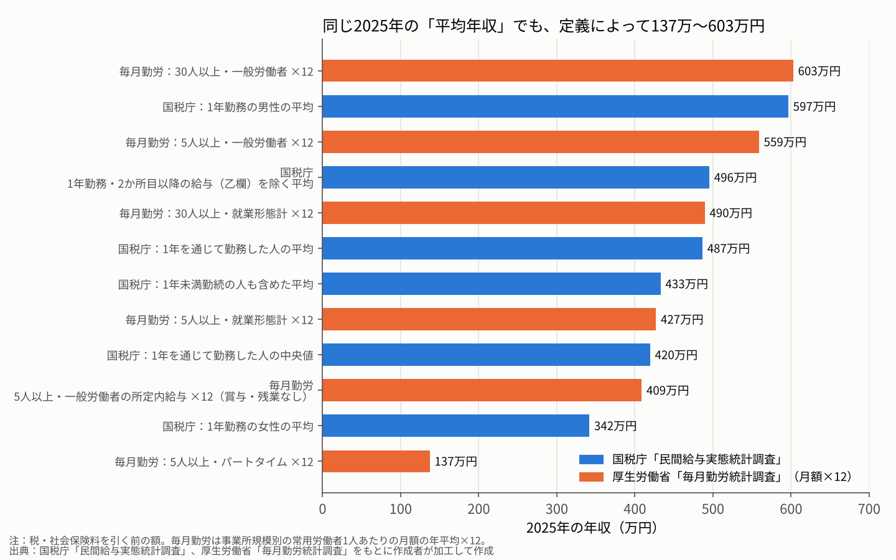
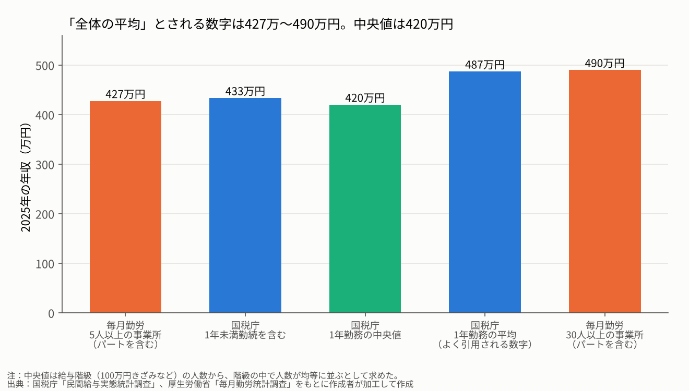
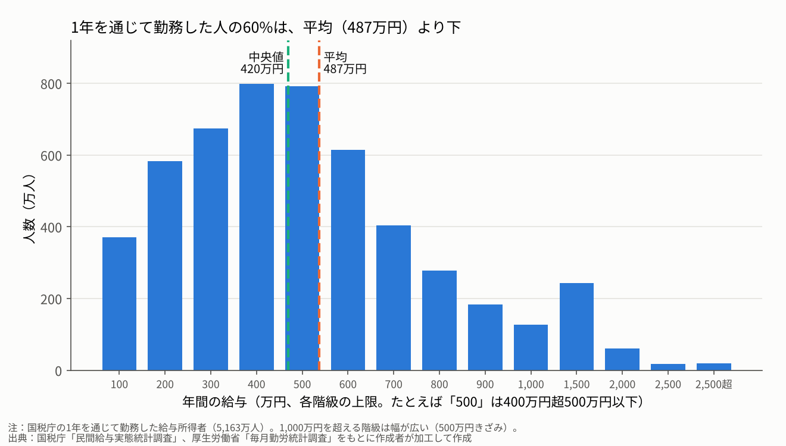
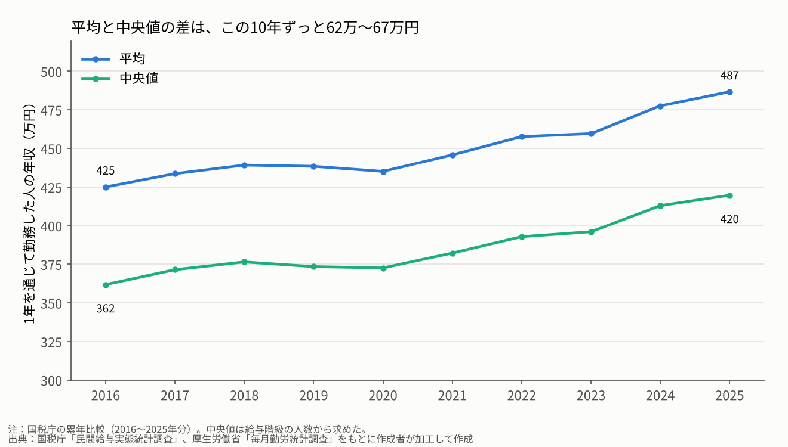

# F353 「平均年収○○万円」は、統計によってどれだけ違うのか？ 2025年の「全体の平均」は427万〜490万円、中央値は420万円。定義を変えると137万〜603万円まで広がり、いちばん効くのはパートを含むかどうか

## 結論（先に）
- 2025年の「平均年収」として使われうる数字を2つの統計から12通り並べると、137万円（毎月勤労のパートタイム）から603万円（毎月勤労の30人以上の事業所の一般労働者）まで広がります。
- 「働く人全体の平均」とされる数字に限ると、427万円（毎月勤労・5人以上の事業所）、433万円（国税庁・1年未満勤続を含む）、487万円（国税庁・1年を通じて勤務、よく引用される数字）、490万円（毎月勤労・30人以上）で、差は1.15倍です。
- いちばん大きく効くのは、パートタイムを含むかどうか（毎月勤労の5人以上で、含む427万円と含まない559万円の差132万円）。次に、1年未満勤続の人を含むかどうか（国税庁で54万円）、事業所の大きさ（毎月勤労の5人以上と30人以上で63万円）。
- 国税庁の1年勤務の人の中央値は420万円で、平均より67万円低いです。6割の人が平均より下にいます。この差は2016〜2025年の10年間、62万〜67万円でほとんど変わっていません。

## 問い
ニュースや求人の記事には「日本人の平均年収は○○万円」がよく出てくるが、同じ年でも数字が違う。どの統計の、どの定義の数字なのかで、どれだけ違うのかを並べて確かめる。給与の水準を比べる人事・家計の相談の仕事の人、自分の年収を「平均」と比べたい人のための記事。

## データ（出典）
- 国税庁「民間給与実態統計調査」令和7年分 第3表（給与階級別の総括表）：1年を通じて勤務した給与所得者と1年未満勤続の給与所得者の、給与階級別の人数・給与総額（男女別）。乙欄適用者（2か所目以降の勤め先の給与）を除いた表と、2016〜2025年分の累年比較も。
- 厚生労働省「毎月勤労統計調査」令和7年分結果確報 第1表（月間現金給与額の年平均）：事業所規模5人以上・30人以上、就業形態計・一般労働者・パートタイム労働者の現金給与総額、きまって支給する給与、所定内給与、特別に支払われた給与と前年比。

## 事前の計画
[PLAN.md](PLAN.md)（2026-11-16 08:21、計算の前に作成）。国税庁の概要の文と、毎月勤労の第1表の一部の数字は下見で見ていました。

| 仮説 | 外れの基準 | 結果 | 判定 |
|---|---|---|---|
| H1 「全体の平均」とされる数字は1.5倍以上違う | 最大÷最小が1.5未満 | 490÷427＝1.15倍 | 外れ |
| H2 国税庁の中央値は平均より70万円以上低い | 差が70万円未満 | 487−420＝67万円 | 外れ（ぎりぎり） |
| H3 パートを含むかどうかの差は、国税庁と毎月勤労の差より大きい | パートの差の方が小さい | 132万円 対 60万円 | 支持 |
| H4 1年未満勤続を含めると50万円以上下がる | 下がりが50万円未満 | 487→433万円（54万円） | 支持 |

## やったこと
1. 2つの統計の表から、2025年の「年収」を同じ単位（万円/年）にそろえました（02_build.py）。毎月勤労は月額の年平均×12です。国税庁は給与総額÷人数です。
2. 国税庁の中央値は、給与階級（100万円または500万円きざみ）の人数から、階級の中で人数が均等に並ぶとして求めました（03_analysis.py）。
3. 定義の違い（パート、1年未満勤続、事業所の大きさ、賞与、平均か中央値か）ごとに差を並べました。
4. 結果を見てから、平均と中央値の差が年によって変わるかを、2016〜2025年分で確かめました（03b_requestion.py）。

## 分かったこと

### 1. 定義によって137万〜603万円（図1）

12通りの数字のうち、国税庁の1年勤務の男性の平均（597万円）と女性の平均（342万円）の差は255万円です。毎月勤労の一般労働者（5人以上、559万円）のうち、賞与などの特別給与は117万円、残業代などの所定外給与は33万円で、所定内給与だけ×12なら409万円になります。

### 2. 「全体の平均」でも60万円の幅（図2）

- 毎月勤労（5人以上）427万円：事業所の常用労働者1人あたり。パートを含み、月の途中で入った人なども含む。
- 国税庁（1年未満勤続を含む）433万円：1年の途中で勤め始めた・辞めた人（916万人、平均131万円）を含めると下がります。
- 国税庁（1年勤務）487万円：よく引用される数字。1年を通じて同じ勤め先にいた5,163万人の平均。
- 毎月勤労（30人以上）490万円：小さな事業所を除くと上がります。

### 3. 6割の人が平均より下（図3）

1年勤務の人の給与は、300万円超400万円以下（799万人）と400万円超500万円以下（792万人）にいちばん多く、1,000万円を超える人（340万人）が平均を引き上げています。中央値は420万円、平均を下回る人は60%です。

## 問い直し（結果を見てから足した）

### 平均と中央値の差は、10年間ほぼ同じ（図4）

中央値が平均より67万円低かったので、この差が広がっているのかを確かめました。2016年の平均425万円・中央値362万円（差63万円）から、2025年は平均487万円・中央値420万円（差67万円）になりました。10年間の差は62万〜67万円、平均を下回る人の割合は60%前後で、ほとんど変わっていません。この10年で平均は15%、中央値は16%上がりました。

## 頑健性

| 確かめ方 | 値（万円） |
|---|---|
| 中央値：階級の中で直線に並ぶ（本線） | 420 |
| 中央値：階級の中で対数で並ぶ | 418 |
| 中央値：1年未満勤続を含む | 372 |
| 男性：平均／中央値 | 597／513 |
| 女性：平均／中央値 | 342／304 |
| 2024年 国税庁 1年勤務の平均／中央値 | 478／413 |
| 2024年 毎月勤労 5人以上・就業形態計×12（前年比から逆算） | 418 |
| 2024年 毎月勤労 5人以上・一般労働者×12（前年比から逆算） | 543 |
| 国税庁 1年勤務・乙欄を除く平均 | 496 |

中央値の求め方を変えても2万円しか変わらない。2024年でも、毎月勤労（パートを含む）＜国税庁の中央値＜国税庁の平均＜毎月勤労の一般労働者、という並びは同じ。

## 言えないこと
- 国税庁は「人」の1年間の給与で、2か所から給与をもらう人は別々に数えられることがあります。毎月勤労は「事業所の常用労働者1人あたりの月額」です。数えている単位が違うので、差のすべてを定義の違いに分けることはできません。
- 公務員は国税庁のこの調査に入りません。どちらも税や社会保険料を引く前の額で、手取りではありません。
- 中央値は給与階級の人数から補ったもので、個人のデータから出した値ではありません。1,000万円を超える階級は幅が広く、上の方の形は粗くしか分かりません。
- 計画で予定していた「賃金構造基本統計調査」「就業構造基本調査」は使っていません（下の「計画からの変更」）。それらの定義（所定内給与×12＋年間賞与、所得の階級など）での数字は、この記事の幅の外に出る可能性があります。
- 正社員・正社員以外の分け方による平均（国税庁の概要の文にある559万円・210万円）は、この記事で使った表からは作っていません。

## 仕事で使うなら
- 「平均年収」の数字を見るときは、(1) パートを含むか、(2) 1年を通じて勤めた人だけか、(3) 小さな事業所を含むか、(4) 平均か中央値か、を確かめると、数十万〜百数十万円の違いの理由が分かります。
- 定義ごとの値は results/definitions_2025.csv、年ごとの平均と中央値は results/requestion_mean_median_years.csv にあります。

## 計画からの変更
- 計画では4つの統計（国税庁・賃金構造・毎月勤労・就業構造）を使う予定だったが、時間の都合で国税庁と毎月勤労の2つに絞った。
- 問い直し（平均と中央値の差の10年の動き）は結果を見てから足しました。

## 再現のしかた
```
sh src/run_all.sh        # オフライン。所要約3秒
python3 src/01_fetch.py  # 元データを取り直すときだけ（ネットを使う）
```

| ファイル | 中身 |
|---|---|
| src/02_build.py | data/raw から data/nta_brackets_2025.csv・nta_brackets_years.csv・maikin_2025.csv を作る |
| src/03_analysis.py | 定義ごとの値、中央値、仮説、頑健性 → results/main.json・definitions_2025.csv・robustness.csv |
| src/03b_requestion.py | 問い直し → results/requestion.json・requestion_mean_median_years.csv |
| src/04_figures.py | 図4枚 |

repro_check：/tmp/rep_F353_r1 に写して流し、12ファイル（results 5、figures 4、data の CSV 3）がすべて cmp で一致（results/repro_check.txt）。乱数は使っていない。


## レビューで直したこと

| # | 指摘 | 直し方 |
|---|---|---|
| 1 | README が「だ・である」調で、指示書のです・ます調になっていなかった | README の本文をです・ます調に直した（数字は変更なし） |

## 出典
- 国税庁「民間給与実態統計調査」令和7年分 第3表：https://www.nta.go.jp/publication/statistics/kokuzeicho/minkan2025/excel/2025_03.xlsx
- 厚生労働省「毎月勤労統計調査」令和7年分結果確報 第1表：https://www.mhlw.go.jp/toukei/itiran/roudou/monthly/r07/25cr/xls/25cc01r.xlsx

（いずれも 国税庁「民間給与実態統計調査」、厚生労働省「毎月勤労統計調査」をもとに作成者が加工して作成）
