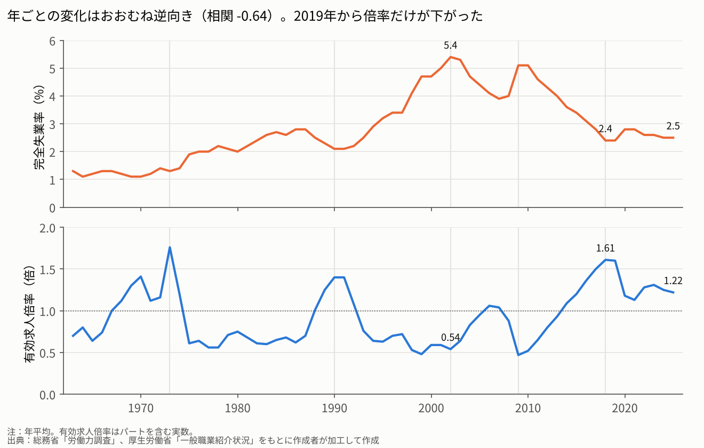
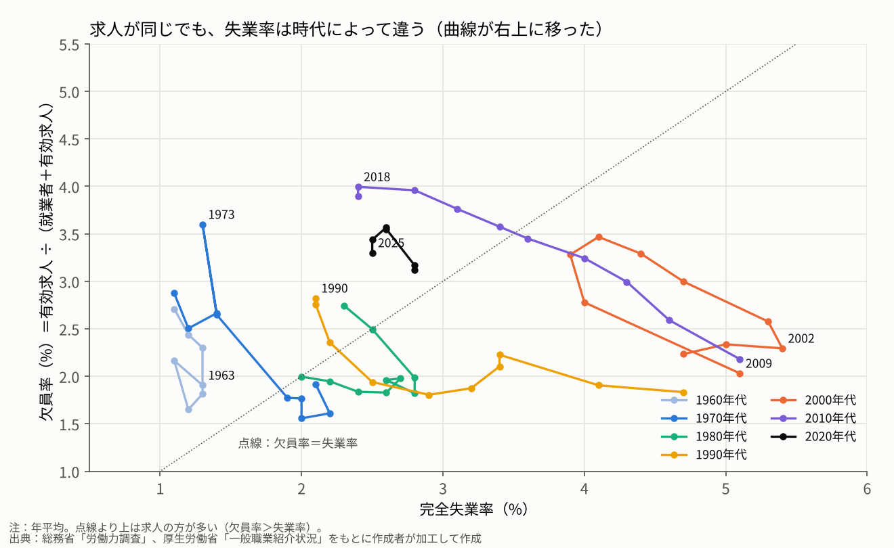
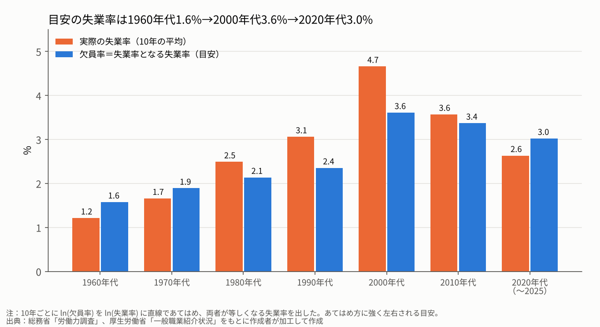
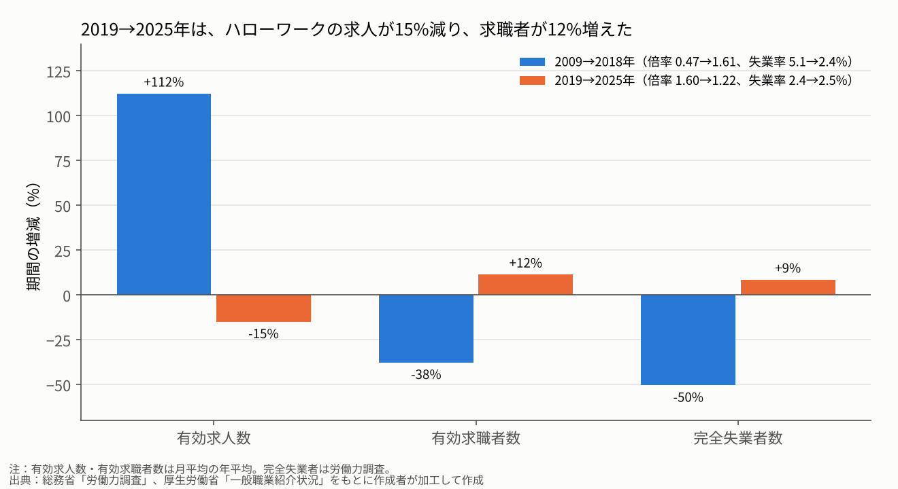

# F354 失業率と求人倍率は、同じ景気を見ているのか？ 年ごとの変化はおおむね逆向き（相関 −0.64）だが、同じ求人の多さでも失業率は時代で違い、目安の失業率は1960年代1.6%から2000年代3.6%へ。2019年からは倍率だけが1.60→1.22に下がった

## 結論（先に）
- 1964〜2025年の年ごとの変化で見ると、完全失業率と有効求人倍率はおおむね逆向きに動く（変化どうしの相関 −0.64、1990年以降は −0.78）。
- ただし水準で見ると、1963年からの相関は −0.39 と弱いです。同じ求人の多さ（欠員率）でも、時代によって失業率が違うからで、欠員率と失業率が等しくなる失業率（目安）は、1960年代1.6%、1990年代2.4%、2000年代3.6%、2020年代3.0%と動いました。
- 2019年から2025年に、有効求人倍率は1.60から1.22に下がったが、失業率は2.4%から2.5%でほとんど動いていません。倍率の下がりの6割はハローワークの有効求人数の減り（−15%）、4割は有効求職者数の増え（+12%）によるものです。
- ハローワークの求職者を完全失業者で割った比は、2000年代の0.78から2020年代の1.05に上がりました。「ハローワークに登録する人が減って倍率が高く出る」という見方とは逆でした。一方、ハローワークを通じた就職件数は2012年の月18.1万件から2025年の9.2万件に半減しました。

## 問い
雇用のニュースでは、失業率と有効求人倍率が並んで出てくる。二つは同じ景気を見ているのか、ずれるのはどんなときか。採用や人材の仕事の人、雇用の数字を読む人のための記事。

## データ（出典）
- 総務省「労働力調査」長期時系列表2（年平均、1953〜2025年）：就業者、完全失業者、完全失業率。1973年は沖縄県を含む値を使いました。
- 厚生労働省「一般職業紹介状況」長期時系列表 第1表（年平均、1963〜2025年）：有効求人倍率、新規求人倍率、有効求人数、有効求職者数、就職件数（いずれも実数、パートを含む）。
- 欠員率 ＝ 有効求人数 ÷（就業者 ＋ 有効求人数）。

## 事前の計画
[PLAN.md](PLAN.md)（2026-11-16 08:22、集計の前に作成）。

| 仮説 | 外れの基準 | 結果 | 判定 |
|---|---|---|---|
| H1 年ごとの変化は逆向き（相関 −0.6 以下） | 相関が −0.6 より大きい | −0.64 | 支持 |
| H2 ベバリッジ曲線が動いた（目安の失業率の最大−最小が1ポイント以上） | 差が1ポイント未満 | 3.6% − 1.6% ＝ 2.0ポイント | 支持 |
| H3 有効求職者÷完全失業者は2000年代より2020年代の方が低い | 2020年代の平均が2000年代以上 | 0.78 → 1.05 | 外れ |
| H4 求人倍率の変化は失業率の変化より1年早い | 同じ年の相関の方が強い | 同じ年 −0.64、1年ずらし −0.44 | 外れ |

## やったこと
1. 二つの長期時系列から、1963〜2025年の年平均の表を作った（02_build.py）。
2. 年ごとの変化の相関、1年ずらした相関、10年ごとのベバリッジ曲線（ln 欠員率 ＝ a ＋ b ln 失業率）と、欠員率＝失業率となる失業率を出しました（03_analysis.py）。
3. 結果を見てから、2019年以降の倍率の下がりを、有効求人数と有効求職者数の変化に分けました（03b_requestion.py）。

## 分かったこと

### 1. 変化はおおむね逆向き（図1）

失業率は2002年の5.4%が最も高く、有効求人倍率は1973年の1.76倍が最も高いです。2002年（5.4%、0.54倍）、2009年（5.1%、0.47倍）、2018年（2.4%、1.61倍）のように、山と谷はおおむね逆の位置にあります。

### 2. 同じ求人でも、失業率は時代で違う（図2・図3）


1960〜70年代は欠員率2〜3%で失業率1〜2%、2000年代は欠員率2〜3.5%で失業率4〜5%と、曲線が右に移りました。2010年代は左上へ動き、2018年は欠員率4.0%・失業率2.4%です。目安の失業率は、2000年代の3.6%から2020年代の3.0%に下がったが、1980年代（2.1%）より高いです。

## 問い直し（結果を見てから足した）

### 2019年からは、倍率だけが下がった（図4）

2019年から2025年に、有効求人倍率は1.60から1.22に下がったのに、失業率はほとんど動いていません。そこで倍率の下がりを分けました。
- 有効求人数は15%減り、有効求職者数は12%増えました。対数で分けると、倍率の下がりの60%が求人の減り、40%が求職者の増えです。同じ時期に完全失業者は9%増えました。
- 2009→2018年の倍率の上がり（0.47→1.61倍）は、求人の倍増（+112%）が62%、求職者の減り（−38%）が38%でした。
- ハローワークを通じた就職件数は、2012年の月18.1万件から2025年の9.2万件に減りました。就業者1万人あたりの年間の就職件数でも、1990年の218件、2012年の347件から、2025年の161件に下がりました。
- つまり近年の倍率の下がりは、失業が増えたことよりも、ハローワークに出る求人が減ったことの影響が大きいと考えられます（ハローワーク以外の求人の動きはこの統計では見えません）。

## 頑健性

| 確かめ方 | 値 |
|---|---|
| 失業率と有効求人倍率の変化の相関（1964年〜、本線） | −0.64 |
| 同（1970年〜） | −0.65 |
| 同（1990年〜） | −0.78 |
| 失業率と新規求人倍率の変化の相関 | −0.62 |
| 失業率と欠員率の変化の相関 | −0.61 |
| 失業率と「完全失業者あたりの有効求人」の変化の相関 | −0.54 |
| 水準の相関：失業率と有効求人倍率（1963年〜／1990年〜） | −0.39／−0.77 |

どの指標でも変化は逆向きです（−0.5〜−0.8）。水準の相関は、期間を1990年以降にすると強くなります。曲線の位置が時代で動いたためと考えられます。

## 言えないこと
- 有効求人はハローワークに出た求人だけで、民間の求人サイトや紹介会社の求人は入りません。近年の求人の減りが、求人そのものの減りなのか、ハローワーク以外への移りなのかは、この統計では分けられません。
- 有効求職者には働きながら転職先を探す人も入り、完全失業者とは同じ人の集まりではありません。
- 均衡失業率の目安は、10年ごとの直線のあてはめに強く左右されます（傾きが年代で −0.3〜−1.2 と大きく違います）。精密な推計ではありません。
- 年平均なので、月ごとの細かい先行・遅行は見ていません。

## 仕事で使うなら
- 求人倍率と失業率は、変化の向きはおおむねそろうが、水準の比べ方には注意がいます。2019年以降のように、倍率が下がっても失業率が動かない時期があります。
- 年ごとの指標は results/annual_indicators.csv、10年ごとの目安は results/beveridge_by_decade.csv にあります。

## 計画からの変更
- 問い直し（2019年以降の倍率の分解、就職件数の推移）は結果を見てから足しました。
- 計画の頑健性3（完全失業者あたりの有効求人）は相関の比較として行った。

## 再現のしかた
```
sh src/run_all.sh        # オフライン。所要約2秒
python3 src/01_fetch.py  # 元データを取り直すときだけ（ネットを使う）
```

| ファイル | 中身 |
|---|---|
| src/02_build.py | data/raw から data/annual.csv を作る |
| src/03_analysis.py | 相関・ベバリッジ・仮説・頑健性 → results/main.json・annual_indicators.csv・beveridge_by_decade.csv・robustness.csv |
| src/03b_requestion.py | 問い直し → results/requestion.json・requestion_ratio_split.csv・requestion_hw_long.csv |
| src/04_figures.py | 図4枚 |

repro_check：/tmp/rep_F354_r1 に写して流し、12ファイル（results 7、figures 4、data の CSV 1）がすべて cmp で一致（results/repro_check.txt）。乱数は使っていない。


## レビューで直したこと

| # | 指摘 | 直し方 |
|---|---|---|
| 1 | README が「だ・である」調で、指示書のです・ます調になっていなかった | README の本文をです・ます調に直した（数字は変更なし） |

## 出典
- 総務省「労働力調査」長期時系列表 表2-1：https://www.e-stat.go.jp/stat-search/file-download?statInfId=000001082681&fileKind=0
- 厚生労働省「一般職業紹介状況」長期時系列表 第1表：https://www.e-stat.go.jp/stat-search/file-download?statInfId=000040518981&fileKind=0

（いずれも 総務省「労働力調査」、厚生労働省「一般職業紹介状況」をもとに作成者が加工して作成）
