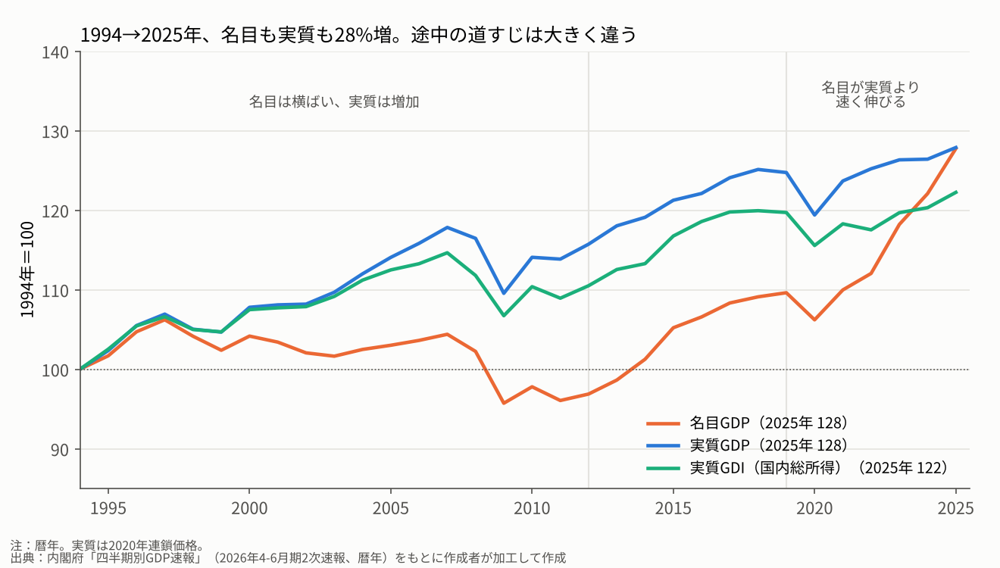
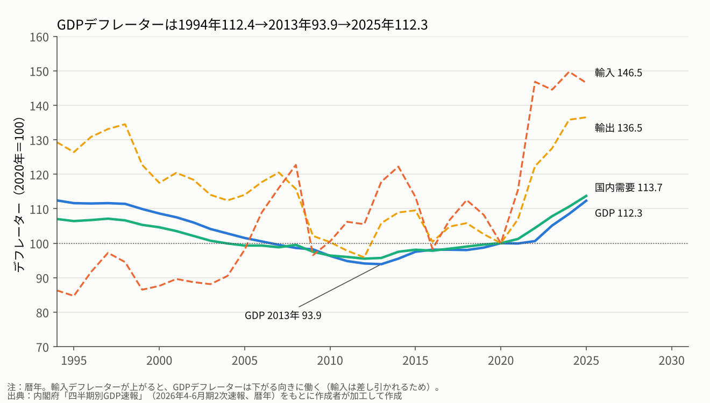
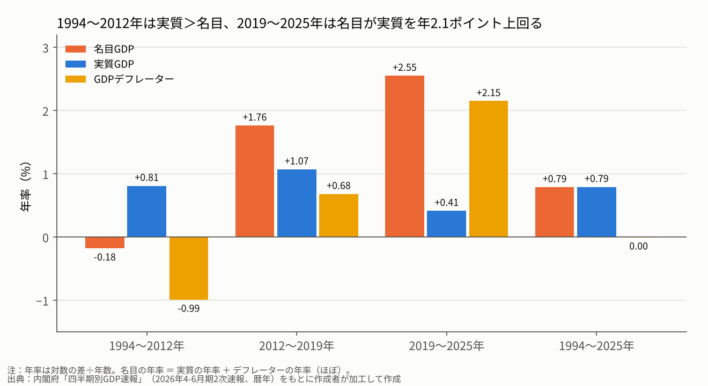
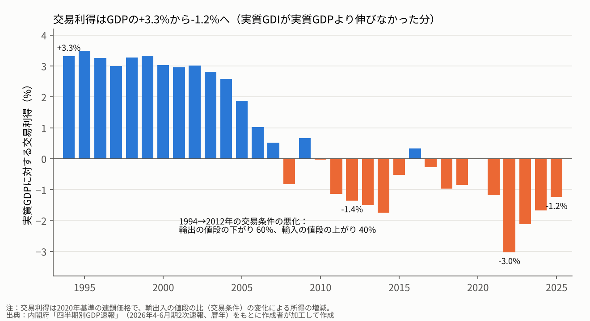

# F355 名目と実質で、日本の成長の見え方はどれだけ変わるのか？ 1994→2025年は名目も実質も28%増でGDPデフレーターは同じ水準に戻ったが、1994〜2012年は実質が年0.8%増・名目が年0.2%減、2019〜2025年は名目が実質を年2.1ポイント上回った

## 結論（先に）
- 1994年から2025年の31年間で、名目GDPも実質GDPも28%増えました。GDPデフレーターは1994年112.4、2013年93.9、2025年112.3で、31年かけて元の水準に戻りました。
- ただし途中の見え方は大きく違います。1994〜2012年は実質が年0.81%増えたのに名目は年0.18%減りました。2019〜2025年は名目が年2.55%、実質が年0.41%で、名目が実質を年2.1ポイント上回りました。
- 実質国内総所得（GDI）は31年で22%増にとどまり、実質GDP（28%）より伸びが小さいです。交易利得はGDPの+3.3%（1994年）から−1.2%（2025年）に下がりました。
- この交易条件の悪化はほとんどが1994〜2012年に起きました。そのうち6割は輸出の値段の下がり、4割は輸入の値段の上がりによるものです。2019〜2025年は輸出入の値段がどちらも3割強上がり、ほぼ打ち消し合いました。

## 問い
「名目GDPは過去最高」「実質ではマイナス」というニュースを、どう読み比べればよいか。名目と実質の差（物価の分）が、どの時期に、何によって生まれたのかを確かめる。企業の計画や賃金の議論で名目と実質を使い分ける人のための記事。

## データ（出典）
- 内閣府「四半期別GDP速報」2026年4-6月期2次速報の暦年の表（1994〜2025年）。
  - 名目暦年：GDP、国内需要、国民総所得、民間最終消費支出。
  - 実質暦年（2020年連鎖価格）：GDP、国内需要、交易利得、国内総所得（GDI）、国民総所得（GNI）、開差。
  - 暦年デフレーター（2020年＝100）：GDP、国内需要、民間最終消費支出、輸出、輸入。
- 名目÷実質×100 と表のGDPデフレーターの差は最大0.05で、表どうしは整合しています。

## 事前の計画
[PLAN.md](PLAN.md)（2026-11-16 08:24、集計の前に作成）。期間（1994〜2012、2012〜2019、2019〜2025年）は先に決めました。

| 仮説 | 外れの基準 | 結果 | 判定 |
|---|---|---|---|
| H1 1994〜2012年は実質の伸びが名目より大きい | 実質 ≦ 名目 | 実質 +0.81%、名目 −0.18%（年率） | 支持 |
| H2 2019〜2025年は名目が実質を年2ポイント以上上回る | 差が2ポイント未満 | 2.14ポイント | 支持（ぎりぎり） |
| H3 2019〜2025年は実質GDIの伸びが実質GDPより小さい | GDI ≧ GDP | GDI +0.35%、GDP +0.41% | 支持（差は小さい） |
| H4 2019〜2025年はGDPデフレーターの上がりが国内需要デフレーターより小さい | GDPの方が大きい | GDP +2.15%、国内需要 +2.21% | 支持（差は小さい） |

## やったこと
1. 3つの暦年の表から、1994〜2025年の名目・実質・デフレーターの表を作った（02_build.py）。
2. 期間ごとの年率（対数の差÷年数）を出しました。名目の年率は、実質の年率とデフレーターの年率の和にほぼ等しくなります（03_analysis.py）。
3. 交易利得を実質GDPに対する割合で見ました。
4. 結果を見てから、交易条件（輸出デフレーター÷輸入デフレーター）の変化を、輸出の値段と輸入の値段に分けました（03b_requestion.py）。

## 分かったこと

### 1. 31年の両端は同じでも、道すじは違う（図1）

名目GDPは1997年の554兆円をこえられず、2012年には505兆円まで下がりました。その間も実質GDPは増え続けました。2012年以降は名目の方が速く伸び、2025年には名目666兆円、実質594兆円（2020年価格）で、1994年からの増え方がそろいました。

### 2. GDPデフレーターは一度下がって元に戻った（図2）

GDPデフレーターは2013年に93.9まで下がり、2025年に112.3に戻りました。国内需要デフレーターは107.0から113.7へ、31年で少し上がっています。輸入デフレーターは86.3から146.5に上がり、輸入の値段の上がりはGDPデフレーターを下げる向きに働きます（輸入はGDPから差し引かれるため）。

### 3. 期間で見ると、名目と実質の順番が入れ替わる（図3）

| 期間 | 名目GDP | 実質GDP | GDPデフレーター | 実質GDI |
|---|---|---|---|---|
| 1994〜2012年 | −0.18% | +0.81% | −0.99% | +0.55% |
| 2012〜2019年 | +1.76% | +1.07% | +0.68% | +1.14% |
| 2019〜2025年 | +2.55% | +0.41% | +2.15% | +0.35% |
| 1994〜2025年 | +0.79% | +0.79% | 0.00% | +0.65% |

## 問い直し（結果を見てから足した）

### 交易利得が下がったのは主に2012年まで（図4）

2019〜2025年の実質GDIとGDPの差は年0.07ポイントと小さく、31年の差の大部分は1994〜2012年（年0.26ポイント）でした。そこで交易条件の変化を分けました。
- 交易条件（輸出÷輸入のデフレーター）は1994年の150から2012年の91に下がりました。その下がりの60%は輸出の値段の下がり、40%は輸入の値段の上がりです。
- 2019〜2025年は、輸出の値段も輸入の値段も3割強上がり、交易条件は95から93へ少し下がっただけでした。交易利得のGDP比は2022年に−3.0%まで下がったあと、2025年は−1.2%です。
- つまり「実質GDPほど所得が増えていない」は、主に2000年代までの輸出品の値下がりと輸入品の値上がりの結果で、近年の円安・資源高の時期は、輸出の値段の上がりで多くが打ち消されました。

## 頑健性

| 確かめ方 | 名目 | 実質 | デフレーター | 実質GDI |
|---|---|---|---|---|
| 区切りを1年ずらす：1997〜2013年 | −0.46% | +0.62% | −1.08% | +0.34% |
| 2013〜2020年 | +1.06% | +0.16% | +0.90% | +0.38% |
| 2020〜2025年 | +3.69% | +1.37% | +2.32% | +1.12% |
| 幾何平均の年率：2019〜2025年 | +2.58% | +0.42% | +2.17% | +0.35% |
| 家計の物価（民間最終消費支出デフレーター）で割った名目GDP：1994〜2012年／2019〜2025年 | +0.40%／+0.24% | | | |
| 実質GNI（海外からの所得を含む）：1994〜2012年／2019〜2025年 | +0.66%／+0.71% | | | |

区切りを1年ずらしても「前半は実質＞名目、後半は名目＞実質」は変わりません。2020年を起点にすると、コロナ禍の落ち込みからの戻りで実質の伸びが大きく出ます。海外からの所得を含む実質GNIは、2019〜2025年に実質GDPより速く伸びました。

## 言えないこと
- GDPの速報値は、この先の年次推計や基準改定で書き換わります。1994年より前はこの表にありません。
- 実質値は連鎖方式で、内訳を足しても全体と一致しない（開差）。交易利得の大きさも計算のしかたに依存する。
- 物価の差がどの品目から来たかは、輸出・輸入・国内需要という大まかな分け方でしか見ていません。
- 成長の良し悪しや、政策・為替の評価はしません。円安がよいか悪いかも、この記事からは言えません。

## 仕事で使うなら
- 「名目」と「実質」のどちらの伸びかで、同じ期間でも見え方が逆になることがあります（1994〜2012年は名目が減り、実質は増えました）。比べる期間と、どの物価で割っているかを確かめると読み違えにくいです。
- 期間ごとの年率は results/period_rates.csv、年ごとの指標は results/annual_indicators.csv にあります。

## 計画からの変更
- 問い直し（交易条件の輸出・輸入への分解）は結果を見てから足しました。
- 計画の頑健性2（年度の値）は行わず、暦年の対数の年率と幾何平均の年率の比較にしました。

## 再現のしかた
```
sh src/run_all.sh        # オフライン。所要約1秒
python3 src/01_fetch.py  # 元データを取り直すときだけ（ネットを使う）
```

| ファイル | 中身 |
|---|---|
| src/02_build.py | 3つの CSV（cp932）から data/annual.csv を作る |
| src/03_analysis.py | 期間ごとの年率・交易利得・仮説・頑健性 → results/main.json・period_rates.csv・annual_indicators.csv・robustness.csv |
| src/03b_requestion.py | 問い直し → results/requestion.json・requestion_terms_of_trade.csv |
| src/04_figures.py | 図4枚 |

repro_check：/tmp/rep_F355_r1 に写して流し、11ファイル（results 6、figures 4、data の CSV 1）がすべて cmp で一致（results/repro_check.txt）。乱数は使っていない。


## レビューで直したこと

| # | 指摘 | 直し方 |
|---|---|---|
| 1 | 2012〜2019年の名目（1.765%）と2019〜2025年の実質（0.415%）の丸めが、本文・note（1.77・0.42）と図3（1.76・0.41）で食い違っていた | README と note を図にそろえて1.76%・0.41%に直した（幾何平均の行はそのまま） |
| 2 | README が「だ・である」調で、指示書のです・ます調になっていなかった | README の本文をです・ます調に直した（数字は変更なし） |

## 出典
- 内閣府「四半期別GDP速報」2026年4-6月期2次速報 名目暦年：https://www.esri.cao.go.jp/jp/sna/data/data_list/sokuhou/files/2026/qe262_2/tables/gaku-mcy2622.csv
- 同 実質暦年：https://www.esri.cao.go.jp/jp/sna/data/data_list/sokuhou/files/2026/qe262_2/tables/gaku-jcy2622.csv
- 同 暦年デフレーター：https://www.esri.cao.go.jp/jp/sna/data/data_list/sokuhou/files/2026/qe262_2/tables/def-cy2622.csv

（いずれも 内閣府「四半期別GDP速報」をもとに作成者が加工して作成）
