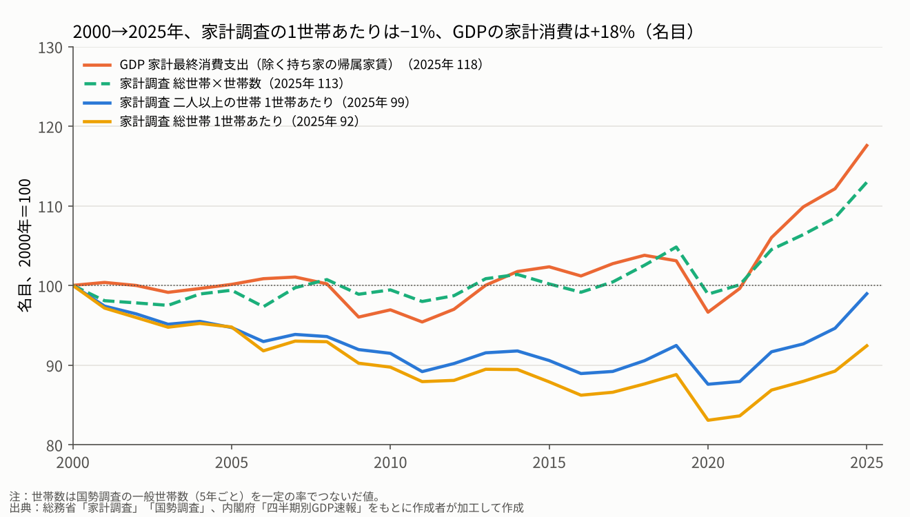
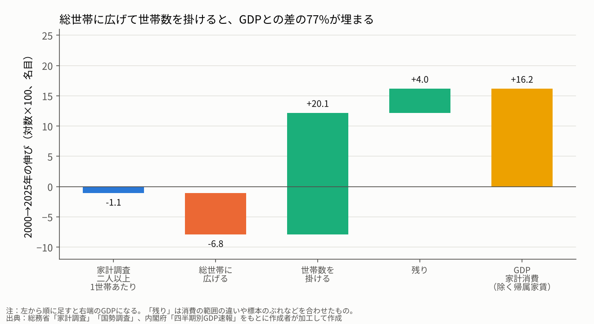
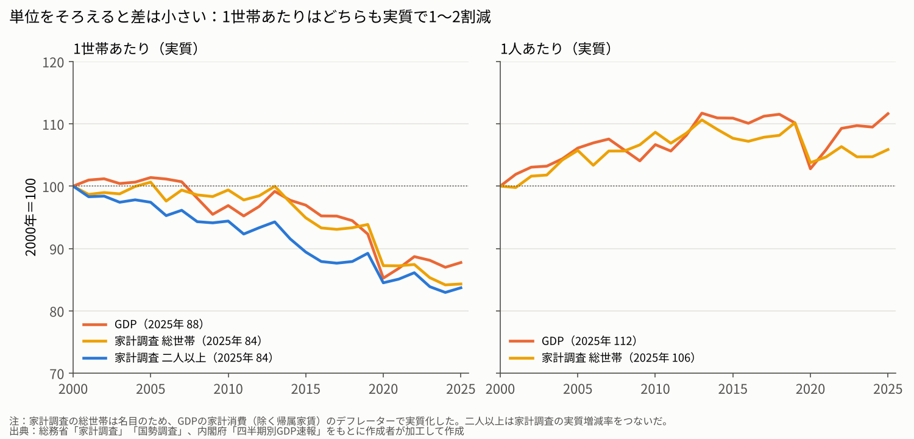
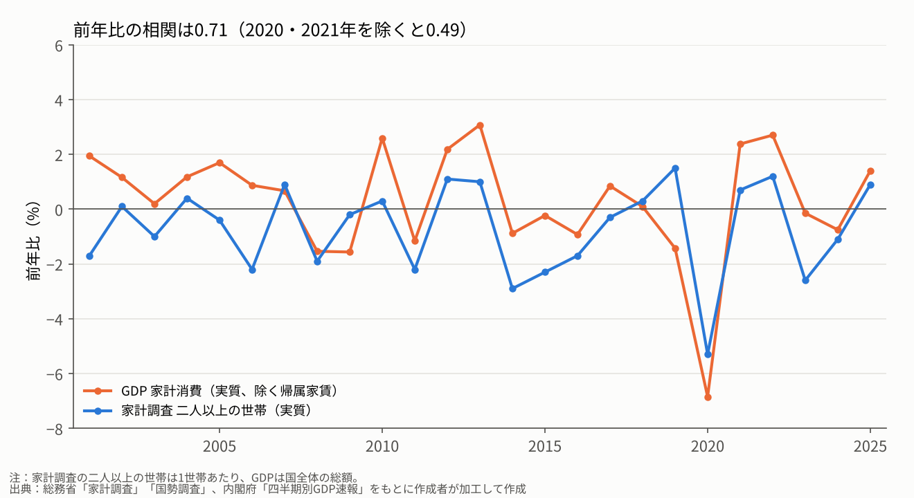

# F356 「消費が弱い」は、家計調査とGDPでどれだけ違って見えるのか？ 2000→2025年、家計調査の1世帯あたりは名目−1%、GDPの家計消費は+18%。差の77%は「総世帯×世帯数」で埋まり、1世帯あたりの実質はどちらも1〜2割減

## 結論（先に）
- 2000年から2025年に、家計調査の二人以上の世帯の1世帯あたり消費支出（名目）は1%減りました。同じ期間、GDPの家計最終消費支出（除く持ち家の帰属家賃、名目）は18%増えました。
- この差（対数で17.2ポイント）は、(1) 二人以上から総世帯に広げると6.8ポイント広がり、(2) 世帯数（一般世帯が4,678万→5,718万）を掛けると20.1ポイント縮み、(3) 残り4.0ポイントが残る。総世帯×世帯数にすると、差の77%が埋まる。
- 単位をそろえて実質で比べると、1世帯あたりは GDP で12%減、家計調査（総世帯）で16%減、二人以上で16%減。1人あたりは GDP で12%増、家計調査で6%増。「家計調査は弱く、GDPは強い」に見える大部分は、世帯が増えて1世帯が小さくなったことによる。
- 前年比の相関は0.71と高いが、コロナ禍の2020・2021年を除くと0.49に下がります。

## 問い
「家計調査の消費支出が前年割れ」と「GDPの個人消費は増えた」というニュースは、同じ時期にどちらも出てくる。二つの統計の見え方の差が、何から来ているのかを分けて確かめる。小売・サービスの需要を見積もる人、消費のニュースを読み比べる人のための記事。

## データ（出典）
- 総務省「家計調査」長期時系列：二人以上の世帯の用途分類（年、消費支出の月平均と実質増減率）、総世帯の品目分類（年、消費支出の年額と世帯人員）。2000〜2025年です。
- 内閣府「四半期別GDP速報」2026年4-6月期2次速報の暦年：家計最終消費支出と「除く持ち家の帰属家賃」（名目・実質）。
- 総務省「国勢調査」：一般世帯数と一般世帯人員（2000〜2025年の5年ごと）。間の年は一定の率でつないでした。
- 家計調査には持ち家の帰属家賃（家賃を払っていない持ち家の住まいを家賃に置き直した額）が入らないので、GDP は「除く持ち家の帰属家賃」を本線にしました。

## 事前の計画
[PLAN.md](PLAN.md)（2026-11-16 08:28、集計の前に作成）。総世帯の消費支出の行、国勢調査の世帯数、GDP の民間消費の両端の値は、下見やほかの記事の作業で見ていました。

| 仮説 | 外れの基準 | 結果 | 判定 |
|---|---|---|---|
| H1 二人以上の1世帯あたりは減り、GDPは増えた（名目） | どちらかが当てはまらない | 二人以上 −1%、GDP +18% | 支持 |
| H2 総世帯×世帯数で差の半分以上が埋まる | 半分未満 | 77% | 支持 |
| H3 実質：二人以上は10%以上減、GDPの1人あたりは±5%の中 | どちらかが当てはまらない | 二人以上 −16%、GDP 1人あたり +12% | 外れ |
| H4 前年比の相関は0.5未満 | 0.5以上 | 0.71（2020・21年を除くと0.49） | 外れ |

## やったこと
1. 家計調査・GDP・国勢調査から、2000〜2025年の年の表を作った（02_build.py）。
2. 2000年＝100 の指数を作り、GDP との差を「総世帯に広げる」「世帯数を掛ける」「残り」に対数で分けました（03_analysis.py）。二人以上の実質は、実質増減率をつないで指数にしました。
3. 前年比の相関を出しました。
4. 結果を見てから、1世帯あたり・1人あたりに単位をそろえて実質で比べ直しました（03b_requestion.py）。家計調査の総世帯は名目しかないので、GDP の家計消費（除く帰属家賃）のデフレーターで実質化しました。

## 分かったこと

### 1. 名目でも見え方が違う（図1）

2000年＝100 として2025年は、GDP の家計消費 118、家計調査の総世帯×世帯数 113、二人以上の1世帯あたり 99、総世帯の1世帯あたり 92です。家計調査を全国の総額に直した値は、GDP（除く帰属家賃）の66%（2000年）、64%（2025年）にあたります。

### 2. 差の大部分は世帯の数（図2）

二人以上（−1.1）から総世帯に広げると −6.8 下がります（1人暮らしなど小さな世帯が増え、1世帯あたりが小さくなるためです）。世帯数を掛けると +20.1、残りが +4.0 で、GDP の +16.2 になります（いずれも対数×100）。

## 問い直し（結果を見てから足した）

### 単位をそろえると、差は小さい（図3）

実質で GDP の1人あたりが12%増えた（H3 外れ）一方、世帯は22%増えていました。単位をそろえ直しました。
- 1世帯あたり（実質、2000年＝100）：GDP 88、家計調査 総世帯 84、二人以上 84です。どちらの統計でも、1世帯あたりの実質の消費は1〜2割減っています。
- 1人あたり（実質）：GDP 112、家計調査 総世帯 106です。2019年まではどちらも110で重なっていて、差が開いたのは2020年以降です。
- 1世帯の人数は2.70人から2.15人に減りました（家計調査の総世帯）。「1世帯あたりの消費が減る」ことと「国全体の消費が増える」ことは、世帯が小さく、数が多くなれば両立します。

### 前年比（図4）

前年比の相関は0.71だが、コロナ禍で両方が大きく動いた2020・2021年を除くと0.49です。ふだんの年の動きは、家計調査では標本のぶれも含めてかなり違います。

## 頑健性

| 確かめ方 | GDPとの差（対数×100） | 総世帯×世帯数で埋まる割合 |
|---|---|---|
| 本線（2000→2025年、除く帰属家賃） | 17.2 | 77% |
| GDP に帰属家賃を含める | 19.9 | 67% |
| 世帯数を直線で補う | 17.2 | 77% |
| 2005→2025年 | 11.7 | 72% |
| 2010→2025年 | 11.4 | 43% |
| 2000→2019年（コロナ禍の前まで） | 10.9 | 115% |
| 前年比の相関（2020・21年を除く） | — | 0.49 |

2000年・2005年起点では差の7割以上が世帯の数で埋まります。2010年起点では4割にとどまり、2020年以降の「残り」の差が効いています。2019年までに限ると、世帯の数で差がすべて埋まります（埋まりすぎます）。

## 言えないこと
- 家計調査と GDP は、消費に入れる範囲（保険などの扱い、企業が家計のために払う分、ネット通販の把握など）が違います。「残り」をこれ以上は分けられません。
- 国勢調査の間の年の世帯数は補った値。家計調査の総世帯と国勢調査の一般世帯は、定義が少し違う。
- 家計調査の総世帯を GDP のデフレーターで実質化したのは近似。品目の組み合わせが違えば、物価の上がり方も違う。
- 2020年以降に1人あたりの差が開いた理由（標本の変化、消費の範囲、コロナ禍の影響など）は、この記事では分けていません。
- 「消費が弱い」かどうか、どちらの統計が正しいかは判断しない。

## 仕事で使うなら
- 家計調査の「1世帯あたり」と GDP の「総額」は、そのまま比べると世帯の増加の分（25年で約2割）だけずれます。比べるときは単位をそろえると読み違えにくいです。
- 年ごとの指標は results/annual_indicators.csv、単位をそろえた実質の比較は results/requestion_same_units.csv にあります。

## 計画からの変更
- 問い直し（単位をそろえた実質の比較）は結果を見てから足しました。
- 計画の頑健性4（1人あたり）は、問い直しの中で行った。

## 再現のしかた
```
sh src/run_all.sh        # オフライン。所要約3秒
python3 src/01_fetch.py  # 元データを取り直すときだけ（ネットを使う）
```

| ファイル | 中身 |
|---|---|
| src/02_build.py | 家計調査・GDP・国勢調査から data/annual.csv を作る |
| src/03_analysis.py | 指数・差の分解・相関・仮説・頑健性 → results/main.json・annual_indicators.csv・decomposition.csv・robustness.csv |
| src/03b_requestion.py | 問い直し → results/requestion.json・requestion_same_units.csv |
| src/04_figures.py | 図4枚 |

repro_check：/tmp/rep_F356_r1 に写して流し、11ファイル（results 6、figures 4、data の CSV 1）がすべて cmp で一致（results/repro_check.txt）。乱数は使っていない。


- 大きなデータのファイル（`data/raw/census_2025_t12-1_households_000040506465.xlsx`、`data/raw/census_2025_t12-2_members_000040506466.xlsx`）は、GitHub の1ファイルの上限に合わせて `.part000` などに分けて置いています。`run_all.sh` が最初に `src/00_join_parts.py` でつなぎ直し、sha256 で元と同じことを確かめます。

## レビューで直したこと

| # | 指摘 | 直し方 |
|---|---|---|
| 1 | README が「だ・である」調で、指示書のです・ます調になっていなかった | README の本文をです・ます調に直した（数字は変更なし） |
| 2 | 言えないことに「医療・保険の扱い」とあり、扱わない話題の語が出ていた（消費の範囲の例としての記述） | README と note で「保険などの扱い」に言い換えた |

## 出典
- 総務省「家計調査（家計収支編）」長期時系列 表2 用途分類：https://www.e-stat.go.jp/stat-search/file-download?statInfId=000040270657&fileKind=4
- 同 表5 総世帯 品目分類（年）：https://www.e-stat.go.jp/stat-search/file-download?statInfId=000040270663&fileKind=1
- 内閣府「四半期別GDP速報」2026年4-6月期2次速報 名目暦年・実質暦年：https://www.esri.cao.go.jp/jp/sna/data/data_list/sokuhou/files/2026/qe262_2/gdemenuja.html
- 総務省「国勢調査」時系列データ 世帯 第1表、令和7年国勢調査 第12-1表・第12-2表（URL は data/raw/SOURCES.md）

（いずれも 総務省「家計調査」「国勢調査」、内閣府「四半期別GDP速報」をもとに作成者が加工して作成）
