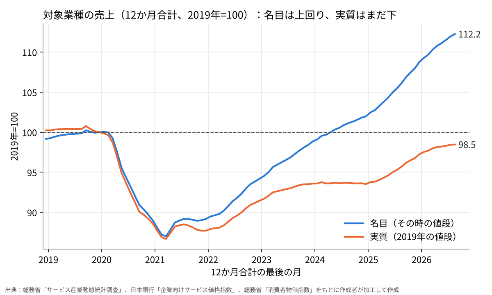
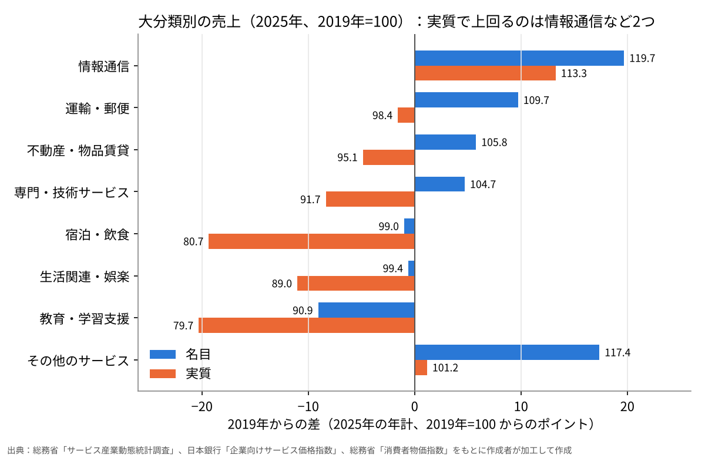
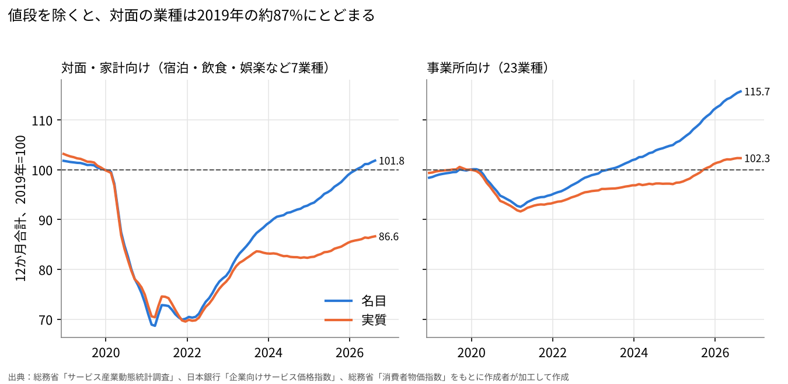
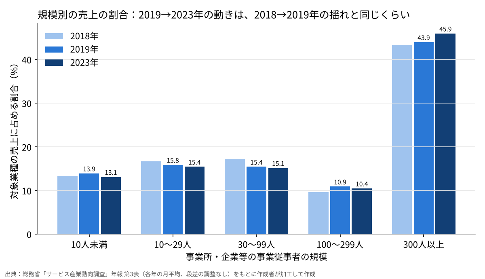

# F357 サービス業の売上は、物価を除いてもコロナ前に戻ったのか？ 名目は2019年の108.8、実質は97.2で、まだ戻っていない

## 結論（先に）

- 対象の31業種（情報通信・運輸・不動産・専門技術・宿泊飲食・生活関連娯楽・教育・その他のサービス）の売上の合計は、2025年の年計で2019年の108.8（名目）でした。値段の上がった分を業種ごとの価格指数で除くと97.2で、2019年を下回っています。差の11.5ポイントは値段の上がりです。ただし、全業種を消費者物価の「持家の帰属家賃を除くサービス」で割ると実質は105.1になり、割る価格の選び方で答えが変わります（頑健性の1b）。対面の7業種が実質で下回ることは、どの割り方でも同じでした。
- 最新の12か月（2025年9月〜2026年8月）でも、名目112.2、実質98.5です。12か月合計の実質は、2021年以降一度も2019年に届いていません。
- 対面で家計向けの7業種（宿泊・飲食店・持ち帰り配達・理美容など・その他の生活関連・娯楽・バスタクシー）は、名目98.9、実質85.3でした。宿泊業は名目124.3ですが、宿泊料が2019年の1.37倍になっていて、実質は90.7です。
- 事業所向けの23業種は、名目112.0、実質101.1です。実質で2019年を上回っているのは、主に情報サービス・インターネット附随・職業紹介派遣などです。
- 問い直しとして事業所・企業の規模別の売上の割合を見ました。30人未満の割合は29.8%→28.5%（2019→2023年）と少し下がりましたが、業種ごとの動きは年ごとの揺れ（2018→2019年）と同じくらいの大きさで、「小さいところほど戻りが遅い」とは言い切れません。

## 問い

総務省の公表では、サービス産業の売上高は前年同月比の増加が長く続いています（2026年8月速報で「58か月連続の増加」）。ただ、売上は名目（その時の値段で測った金額）なので、値上げの分も入っています。

サービス業の企画担当や業界団体、景気を読む人にとっては、「売上が戻った」が仕事の量やお客の数の戻りなのか、値段の上がりなのかで意味が変わります。そこで、業種ごとに近い価格指数で割って実質（2019年の値段で測った売上）にし、2019年と比べました。

既存の記事（158 は名目の戻り、201 は規模と売上の比例）と違い、名目と実質の差と、規模別の割合の変化を問います。

## データ（出典）

- 総務省「サービス産業動態統計調査」時系列 第1表 事業活動の産業（中分類）別売上（収入）金額（月次、2013年1月〜2026年8月、2026年6〜8月は速報）。2024年以前はサービス産業動向調査の値を、2025年1月の母集団・標本の入れ替えによる段差を統計局が調整した値です。消費税込み。
- 日本銀行「企業向けサービス価格指数（2020年基準）」（消費税込みの基本分類指数、類別・大類別）。
- 総務省「消費者物価指数（2025年基準）」長期時系列（中分類・財サービス分類・品目別、全国、月次）。
- 総務省「サービス産業動向調査」年報 第3表 事業従事者規模別売上高（2018・2019・2023年の月平均。この表は2023年が最後）。

対象の31業種の2019年の売上は350.0兆円で、統計表の「サービス産業計」の85.1%です。統計表の範囲とは違うので、「対象業種の合計」と呼びます。ファイルとURLは `data/raw/SOURCES.md` にあります。

## 事前の計画

計画は [PLAN.md](PLAN.md)（2026-11-16 08:45、集計の前に作成）です。業種と価格指数の対応、仮説、頑健性を先に決めました。

| 仮説 | 外れの基準 | 結果 | 判定 |
|---|---|---|---|
| H1 合計は名目で2019年を上回る | 2025/2019 ≦ 100 | 108.75 | 支持 |
| H2 実質の伸びは名目の伸びの半分以下 | 実質の伸び > 名目の伸び×0.5 | 実質 −2.76、名目 +8.75 | 支持 |
| H3 対面・家計向け7業種は実質で2019年を下回る | ≧ 100 | 85.33 | 支持 |
| H4 物価の寄与は対面・家計向けのほうが事業所向けより大きい | 小さければ外れ | 13.59 対 10.89 ポイント | 支持 |

## やったこと

1. 中分類ごとの月の名目売上を、近い価格指数（2019年平均=1）で割って実質にしました（対応は PLAN.md と `src/03_analysis.py` の DEFL）。事業所向けの業種は企業向けサービス価格指数、家計向けの業種は消費者物価指数を使いました。
2. 季節の影響を避けるため、年の合計（1〜12月）と12か月合計で2019年=100 の比を出しました。
3. 物価の寄与 = 名目の比 − 実質の比（ポイント）としました。

## 分かったこと

### 図1 名目は2024年に2019年を超え、実質はまだ下



- 12か月合計で、名目は2024年5月までの12か月で初めて2019年を上回りました。最新は112.2です。
- 実質は2021年3月までの12か月が底（86.7）で、最新は98.5です。2021年以降、100に届いた月はありません。

### 図2 大分類で見ると、実質で上回るのは2つ



- 実質で2019年を上回ったのは、情報通信（113.3）とその他のサービス（101.2）だけでした。
- 宿泊・飲食は名目99.0、実質80.7で、物価の寄与（18.4ポイント）がいちばん大きい大分類です。
- 業種で見ると、情報サービス業は名目138.7・実質126.4、インターネット附随サービス業は147.4・138.6、職業紹介・労働者派遣業は149.4・128.0でした。技術サービス業は名目101.7ですが、価格指数が1.27倍になっていて実質は80.1です。

### 図3 対面の業種は、値段を除くと2019年の約87%



- 対面・家計向けの7業種は、最新の12か月で名目101.8、実質86.6です。名目が2019年を超えたのは2026年3月までの12か月からです。
- 宿泊業は名目124.3、実質90.7でした（宿泊料は2019年の137.0）。飲食店は名目91.8、実質77.3でした（外食の価格は118.8）。
- 事業所向けの23業種は、最新の12か月で名目115.7、実質102.3です。実質が2019年を超えたのは2025年10月までの12か月からです。

## 問い直し（結果を見てから足した）

実質の戻りが業種で大きく違ったので、「小さい事業所・企業ほど戻りが遅いのか」を足しました。サービス産業動向調査の年報 第3表（事業所・企業等の事業従事者規模別の売上）を使いました。この表は年ごとに標本が違い、段差の調整がない値です。実際、対象業種の合計の2023/2019年は、この表では102.6、段差を調整した時系列では98.8で、4ポイントほど違います。そのため水準ではなく、各年の中の割合で比べました。



- 30人未満（10人未満＋10〜29人）の割合は、2018年29.9%、2019年29.8%、2023年28.5%でした。300人以上は43.9%→45.9%（2019→2023年）です。
- 31業種のうち、30人未満の割合が下がったのは20業種、上がったのは11業種でした。変化の中央値は −1.21ポイントです。
- ただし、2018→2019年（コロナの前）の業種ごとの変化も、−10.7〜+6.7ポイントと同じくらい大きく動いています。年ごとの標本の揺れと区別できないので、規模の差ははっきりしないと判断しました。
- 対面・家計向けの7業種では、逆に30人未満の割合が45.4%→46.3%と上がりました。この7業種の名目の2023/2019年は、30人未満で103.9、100人以上で90.5でした（段差の調整なし）。

## 頑健性

| 確かめ | 名目 | 実質 | 物価の寄与 | 対面7業種の実質 | 結論 |
|---|---|---|---|---|---|
| 主（業種ごとの価格、2025年÷2019年） | 108.75 | 97.24 | 11.51 | 85.33 | — |
| 1a 全業種を企業向けサービス価格指数の総平均で割る | 108.75 | 97.07 | 11.69 | 88.27 | 変わらない |
| 1b 全業種を消費者物価の「持家の帰属家賃を除くサービス」で割る | 108.75 | 105.09 | 3.67 | 95.58 | **変わる**（合計は実質で上回る） |
| 2 基準年を2018年にする | 109.68 | 97.02 | 12.65 | 82.73 | 変わらない |
| 3 最新12か月（2025年9月〜2026年8月、うち3か月は速報） | 112.25 | 98.45 | 13.79 | 86.63 | 変わらない |
| 4 その他の生活関連・教育の価格を替える | 108.75 | 97.12 | 11.64 | 84.34 | 変わらない |
| 5 宿泊業を除く | 108.49 | 97.35 | 11.14 | 84.90 | 変わらない |

1b だけ結論が変わります。消費者物価のサービスは2019年から2025年で1.035倍しか上がっていません（家賃や携帯電話の通信料が入っていて、ほとんど上がっていないため）。事業所向けの売上をこれで割るのは合っていないと考えますが、「どの価格で割るか」で答えが変わることは残ります。対面の7業種が実質で2019年を下回ることは、どの割り方でも変わりませんでした。

## 言えないこと

- 価格指数は業種の売上の中身と完全には一致しません。例えば宿泊業の売上には飲食や宴会も入りますが、宿泊料で割っています。
- 実質の伸びは「お客の数」や「仕事の量」の伸びとは限りません。サービスの質や組み合わせが変わった分は区別できません。
- 標本の入れ替えの段差は、統計局が調整した値に頼っています。調整の誤差は分かりません。2026年6〜8月は速報で、改定されることがあります。
- 規模別の表は段差の調整がなく、2024年以降はありません。規模で戻り方が違うかどうかは、このデータでは決められませんでした。
- なぜ戻りが違うのか（訪日客、人手不足、生活の変化など）は、このデータでは分かりません。理由についての話はすべて推測になります。

## 仕事で使うなら

- 「売上が前年より増えた」という数字を見るときに、同じ業種の価格指数を並べて、値段の分と量の分に分けて読むと、読み違えにくくなります。
- 2019年と比べるときは、季節の影響を避けるために年の合計か12か月合計で比べると、季節の影響が入りません。
- 価格指数の選び方で結論が変わることがあるので、複数の割り方を並べておくと、前提がそろいます。

## 計画からの変更

- 計画では「家計向け」と「事業所向け」の分け方を細かく書いていなかったので、H3 の7業種を「対面・家計向け」、教育（補習教育の価格で割る）を別にし、残りの23業種を「事業所向け」としました。
- 図4のタイトルは、2018→2019年の揺れを見たあとで「規模の差ははっきりしない」が伝わる文に変えました。
- PLAN.md の業種の数を「30」と書き誤っていたので、集計のあとに「31」に直しました（対応表の中身は変えていません）。
- それ以外は計画どおりです。

## 再現のしかた

```sh
pip install -r requirements.txt
python3 src/01_fetch.py   # 取得（ネットが必要。data/raw に同梱済みなので通常は不要）
sh src/run_all.sh         # 02 → 03 → 04（オフライン）
```

| ファイル | 中身 |
|---|---|
| src/01_fetch.py | 元データの取得 |
| src/02_build.py | data/sales_monthly.csv・prices_monthly.csv・price_series_names.csv・size_annual.csv を作る |
| src/03_analysis.py | 実質化、比、頑健性、仮説の判定、規模別。results/ に出力 |
| src/04_figures.py | figures/ の4枚 |
| results/main.json | 本文の数字のもと |
| results/*.csv | 業種別・大分類別・12か月合計・年の比・頑健性・規模別の表 |

所要時間は約2.3秒（CPU 1つ）。`results/repro_check.txt`：2026-11-16 再実行、17 ファイル一致。


## レビューで直したこと

| # | 指摘 | 直し方 |
|---|---|---|
| 1 | README が参照する data/raw/SOURCES.md が無かった | 01_fetch.py の取得先と同梱ファイル（8本）から SOURCES.md を書き起こした（URL・中身・sha256） |
| 2 | 結論の1点目が「実質は2019年を下回る」と言い切っていたが、全業種を消費者物価のサービスで割ると実質105.1で上回る（頑健性1b） | 結論1に、割る価格で答えが変わることと、対面7業種はどの割り方でも下回ることを書き添えた |
| 3 | 「仕事で使うなら」が「〜分けて読む。」など言い切りの形だった | です・ます調の読み方の説明に直した |

## 出典

- 総務省「サービス産業動態統計調査」 https://www.stat.go.jp/data/mbss/index.html （統計表 https://www.e-stat.go.jp/stat-search/files?tstat=000001217540 ）
- 総務省「サービス産業動向調査」 https://www.e-stat.go.jp/stat-search/files?toukei=00200544&tstat=000001033747
- 日本銀行「企業向けサービス価格指数」 https://www.stat-search.boj.or.jp/
- 総務省「消費者物価指数」2025年基準 https://www.e-stat.go.jp/stat-search/files?tstat=000001243876

（いずれも 総務省「サービス産業動態統計調査」「サービス産業動向調査」「消費者物価指数」、日本銀行「企業向けサービス価格指数」をもとに作成者が加工して作成）
