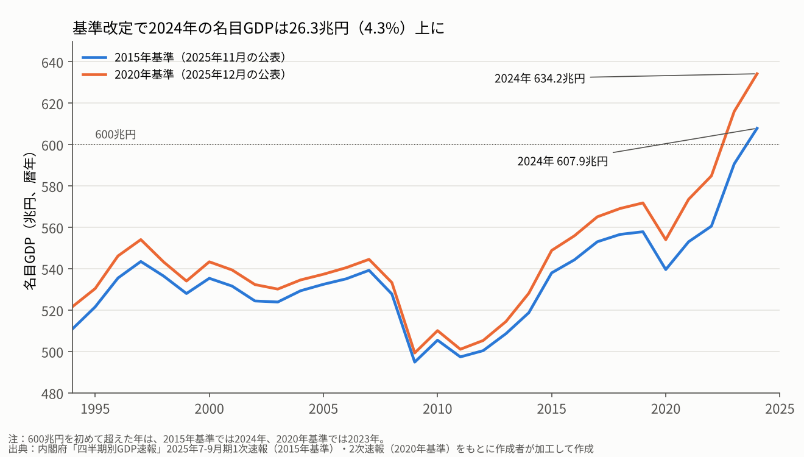
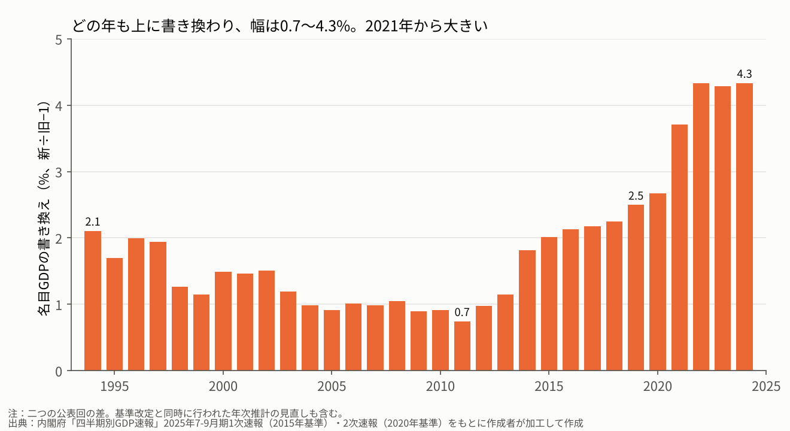
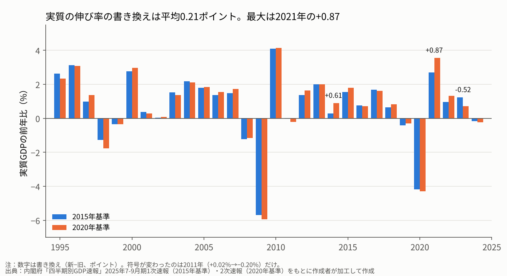
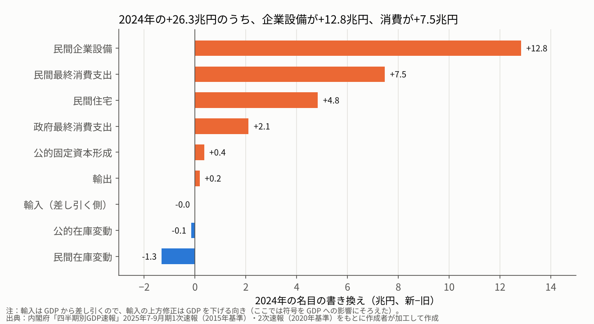

# F358 統計の基準改定で、過去の数字はどれだけ書き換わったのか？ GDPの2020年基準への改定で、名目GDPは1994〜2024年のすべての年で0.7〜4.3%上に。2024年は26.3兆円増え、実質の伸び率の書き換えは平均0.21ポイント

## 結論（先に）
- 内閣府の GDP は、2025年12月の公表から2015年基準が2020年基準に変わりました。その直前（2025年11月）と直後（12月）の公表を比べると、名目GDPは1994〜2024年のすべての年で上に書き換わりました。幅は0.7%（2011年）から4.3%（2022・2024年）です。
- 2024年の名目GDPは607.9兆円から634.2兆円へ、26.3兆円（4.3%）増えました。内訳は民間企業設備 +12.8兆円、民間最終消費支出 +7.5兆円、民間住宅 +4.8兆円、政府最終消費支出 +2.1兆円などです。
- 水準に比べて、実質の伸び率（前年比）の書き換えは小さく、1995〜2024年の平均で0.21ポイント（絶対値）でした。最も大きかったのは2021年の +0.87ポイント（2.70%→3.56%）。前年比の符号が変わったのは2011年（+0.02%→−0.20%）だけ。
- 1994〜2024年の実質の年率は0.73%から0.77%へ、0.04ポイントしか変わらない。
- ただし節目の年は動きます。名目GDPが初めて600兆円を超えた年は、2015年基準では2024年、2020年基準では2023年になりました。

## 問い
GDP は5年ごとに「基準改定」で作り方が見直され、過去の数字も書き換わります。「過去最高」「○年ぶり」といった見出しは、どの基準の数字かで変わることがあります。基準改定でどれだけ数字が動いたのかを、改定の直前と直後の公表を並べて確かめます。GDP を使って計画や比較をする人のための記事です。

## データ（出典）
- 内閣府「四半期別GDP速報」の二つの公表回の暦年の表（1994〜2024年）。
  - 2025年7-9月期1次速報（2025年11月公表、2015年基準）
  - 2025年7-9月期2次速報（2025年12月公表、2020年基準）
  - それぞれ名目暦年、実質暦年（連鎖価格）、暦年デフレーター。
- 二つの回の差を「基準改定による書き換え」とみなしました。同じ時に行われた年次推計の見直しも含みます。
- 実質は基準年が違う（2015年価格と2020年価格）ので、水準でなく伸び率で比べました。

## 事前の計画
[PLAN.md](PLAN.md)（2026-11-16 08:37、集計の前に作成）。名目GDPの2021〜2024年の行は、基準の違いを確かめるために下見で見ていました。

| 仮説 | 外れの基準 | 結果 | 判定 |
|---|---|---|---|
| H1 2024年の名目GDPが3%以上上に書き換わった | 3%未満 | 4.3% | 支持 |
| H2 実質の伸び率の書き換えは平均0.5ポイント以下 | 0.5ポイントより大きい | 0.21ポイント | 支持 |
| H3 名目の書き換えは1990年代より2020年代の方が大きい | 1990年代の方が大きいか同じ | 1994〜99年 1.7%、2020〜24年 3.9% | 支持 |
| H4 31年の実質の年率の変化は0.1ポイント未満 | 0.1ポイント以上 | 0.73%→0.77%（+0.04） | 支持 |

## やったこと
1. 二つの回の名目・実質・デフレーターの暦年の表から、年×項目×基準の表を作った（02_build.py）。
2. 年ごとに名目の水準の書き換え（新÷旧−1）、実質・名目・デフレーターの前年比の差を出しました。名目の書き換えを支出の内訳に分けた（内訳の差の合計は GDP の差と一致）（03_analysis.py）。
3. 結果を見てから、「600兆円を初めて超えた年」などの節目の年が基準で変わるかを見ました（03b_requestion.py）。

## 分かったこと

### 1. 名目の水準はどの年も上に（図1・図2）


書き換えの幅は、1994年 2.1%、2011年 0.7%（最小）、2019年 2.5%、2022・2024年 4.3%（最大）です。2000年代は1%前後だが、2014年から大きくなり、2021年以降は4%前後になりました。

### 2. 実質の伸び率はあまり変わらない（図3）

実質の前年比の書き換えは、1995〜2024年の平均で0.21ポイント（絶対値）でした。大きかった年は2021年（+0.87）、2014年（+0.61）、2023年（−0.52）です。景気の山と谷の形はほとんど変わりません。

### 3. 2024年の書き換えの半分は企業設備（図4）

2024年の +26.3兆円のうち、民間企業設備が +12.8兆円で約半分、民間最終消費支出が +7.5兆円、民間住宅が +4.8兆円です。在庫は −1.3兆円です。

## 問い直し（結果を見てから足した）

### 節目の年は動く
水準が最近ほど大きく上に書き換わったので、見出しになりやすい節目の年を確かめました。
- 名目GDPが初めて600兆円を超えた年：2015年基準では2024年、2020年基準では2023年です。
- 550兆円以上の年：2015年基準では2017年が最初、2020年基準では1997年（554.1兆円）がすでに超えています。
- 1997年の水準を初めて上回った年：どちらの基準でも2016年です。
- 「○兆円を初めて超えた」という節目は基準で1年以上動くことがあるが、「何年ぶりに山を超えた」は今回は動かなかった。

## 頑健性

| 確かめ方 | 実質の前年比の書き換え（平均の絶対値） | 名目の前年比 | デフレーターの前年比 | 実質の最大の書き換え |
|---|---|---|---|---|
| 1995〜2024年（本線） | 0.21 | 0.22 | 0.16 | 0.87（2021年） |
| 1995〜2019年 | 0.18 | 0.19 | 0.13 | 0.61（2014年） |
| 2010〜2024年 | 0.25 | 0.26 | 0.15 | 0.87（2021年） |
| 2021年を除く 1995〜2024年 | 0.19 | — | — | 0.61（2014年） |

どの期間でも、伸び率の書き換えは平均0.2ポイント前後で、名目の水準の書き換え（1〜4%）よりずっと小さいです。

## 言えないこと
- 二つの回の差には、基準改定のほかに、同じ時に行われた年次推計の見直しが入っています。この表だけでは分けられません。
- 書き換えの理由（新しい基礎統計、定義や推計方法の変更など）は、表からは分かりません。内閣府の改定の説明資料で確かめる必要があります。
- 2025年の値は、二つの回で使える四半期の数が違うので比べていません。
- 計画で予定した消費者物価指数の基準改定は扱っていません（下の「計画からの変更」）。

## 仕事で使うなら
- 「過去最高」「初めて○兆円」のような数字を比べるときは、どの基準・どの公表回の数字かをそろえると読み違えにくいです。古い資料の数字と新しい数字を混ぜると、最近の年では4%ほどずれます。
- 年ごとの書き換えは results/gdp_revisions.csv、内訳は results/nominal_revision_by_component.csv にあります。

## 計画からの変更
- 計画では消費者物価指数（2015年基準→2020年基準）も比べる予定だったが、時間の都合で GDP だけにしました。
- 問い直し（節目の年）は結果を見てから足しました。

## 再現のしかた
```
sh src/run_all.sh        # オフライン。所要約3秒
python3 src/01_fetch.py  # 元データを取り直すときだけ（ネットを使う）
```

| ファイル | 中身 |
|---|---|
| src/02_build.py | 6つの CSV（cp932）から data/vintages.csv を作る |
| src/03_analysis.py | 水準と伸び率の書き換え・内訳・仮説・頑健性 → results/main.json・gdp_revisions.csv・nominal_revision_by_component.csv・robustness.csv |
| src/03b_requestion.py | 問い直し → results/requestion.json |
| src/04_figures.py | 図4枚 |

repro_check：/tmp/rep_F358_r1 に写して流し、10ファイル（results 5、figures 4、data の CSV 1）がすべて cmp で一致（results/repro_check.txt）。乱数は使っていない。


## 関連する記事

- F50「GDP の速報は、あとでどれだけ直されるのか？」：1次速報の成長率が2次速報・1年後・最新の値でどれだけ直されたかを、ふだんの改定で測った記事。本記事は、5年ごとの基準改定の直前と直後の公表を比べ、水準と伸び率の書き換えを分けた点が違います。

## レビューで直したこと

| # | 指摘 | 直し方 |
|---|---|---|
| 1 | README が「だ・である」調で、指示書のです・ます調になっていなかった | README の本文をです・ます調に直した（数字は変更なし） |
| 2 | 既存の記事 F50（GDP の速報はあとでどれだけ直されるか）と題材が近いのに、関連の記載がなかった | 「関連する記事」の節を足し、違いを1文で書いた |

## 出典
- 内閣府「四半期別GDP速報」2025年7-9月期1次速報（2015年基準）：https://www.esri.cao.go.jp/jp/sna/data/data_list/sokuhou/files/2025/qe253/tables/gaku-mcy2531.csv ほか
- 同 2025年7-9月期2次速報（2020年基準）：https://www.esri.cao.go.jp/jp/sna/data/data_list/sokuhou/files/2025/qe253_2/tables/gaku-mcy2532.csv ほか（URL は data/raw/SOURCES.md）

（いずれも 内閣府「四半期別GDP速報」をもとに作成者が加工して作成）
