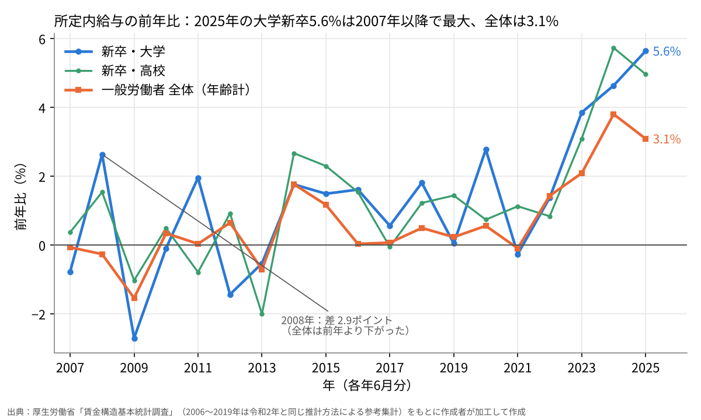
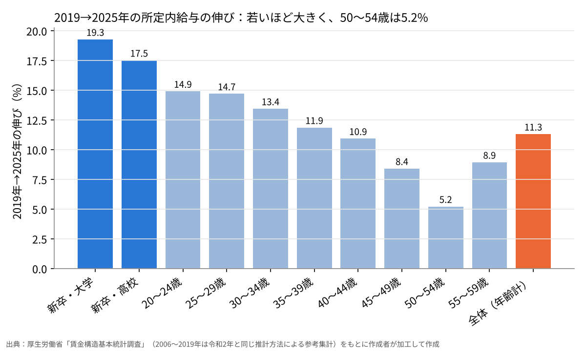
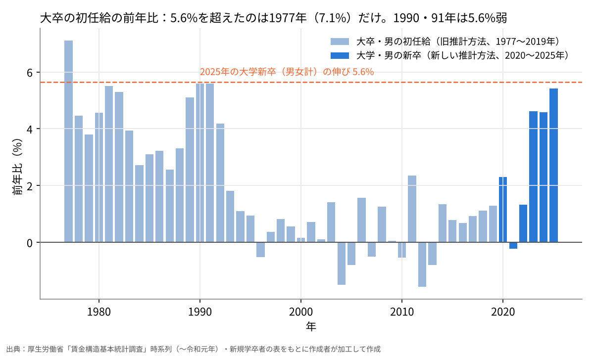
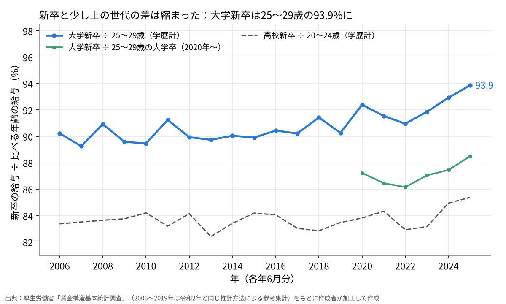

# F359 「初任給が過去最高の伸び」は、賃金全体の伸びと比べてどれだけ特別なのか？ 伸び率は特別、全体との差は2008年に次ぐ2番目

## 結論（先に）

- 2025年の大学新卒の所定内給与（6月分）は262.3千円で、前年比5.64%でした。同じ推計方法でそろえた2007〜2025年の19年の中でいちばん大きい伸びです。一般労働者全体（年齢計）は3.09%でした。
- 新卒の伸びと全体の伸びの差（2.55ポイント）は、19年の中で2番目です。いちばん大きいのは2008年（2.90ポイント）で、このときは全体が前年より下がる中で新卒だけが上がっていました。2025年が特別なのは「差」よりも「全体も一緒に大きく上がっている」ことです。ただし、全体の平均を年齢の構成を2019年に固定して計算し直すと、2025年の差（2.67ポイント）は2008年（2.59ポイント）をわずかに上回り、1番目になります。
- 2019→2025年の伸びは、大学新卒19.3%、高校新卒17.5%に対し、全体11.3%、20〜24歳14.9%、50〜54歳5.2%でした。若い層ほど伸びが大きく、50〜54歳の給与は20〜24歳の1.87倍（2006年）から1.60倍（2025年）に縮まりました。
- 1976年からの古い系列（推計方法が違う）で見ると、大卒・男の初任給の前年比が5.6%を超えたのは1977年（7.1%）だけでした。1981年（5.5%）、1990・1991年（5.59%）は同じくらいの伸びです。「過去最高の伸び」と言えるかは、比べる期間で変わります。
- 問い直しとして、新卒と少し上の世代の差を見ました。大学新卒の給与は25〜29歳（学歴計）の93.9%で、2006年以降でいちばん近くなっています。

## 問い

厚生労働省「令和7年賃金構造基本統計調査の概況」（2026年3月24日公表）では、新規学卒者の賃金（6月分の所定内給与額）が大学で262.3千円、対前年5.6%増でした。報道では「初任給が過去最高」という見出しが続いています。一方、同じ概況で一般労働者全体の賃金は340.6千円、3.1%増です。

採用や人事の担当、就職を控えた学生と家族にとっては、新卒の伸びが「全体の中で特別に大きいのか」「全体の伸びに乗っているだけなのか」で意味が変わります。そこで、推計方法をそろえた2006〜2025年の表で、新卒の伸びを全体・年齢別の伸びと並べました。

既存の看板記事は最低賃金、賃金の分解、名目と実質などを扱っていて、新規学卒者の賃金を全体と比べたものはありません。

## データ（出典）

- 厚生労働省「賃金構造基本統計調査」新規学卒者 第1表（新規学卒者の学歴別所定内給与額、民営事業所、男女別・企業規模別）。2020〜2025年は各年の表、2006〜2019年は【参考掲載】「令和2年調査と同じ推計方法を用いた過去分の集計」です（この参考集計は高校と大学だけ）。
- 同 一般労働者 産業大分類 第1表（産業計、学歴・年齢階級別の所定内給与額と労働者数）。2006〜2019年は同じ参考集計です。
- 同 時系列（〜令和元年まで）第1表 新規学卒者の初任給の推移（1976〜2019年）。旧推計方法で、初任給は「確定した額で、所定内給与額から通勤手当を除いたもの」です。長い期間の比較（H4）だけに使います。
- 単位は千円、6月分、名目です。2020年に調査の推計方法が変わったため、2019年以前は厚労省が新しい方法で集計し直した参考値を使って、2006〜2025年を1本の系列にしました。

ファイルとURLは `data/raw/SOURCES.md` にあります（41ファイル、約23MB）。

## 事前の計画

計画は [PLAN.md](PLAN.md)（2026-11-16 12:45、伸び率を集計する前に作成）です。

| 仮説 | 外れの基準 | 結果 | 判定 |
|---|---|---|---|
| H1 2025年の大学新卒の前年比は2007〜2025年で最大 | ほかの年に2025年以上 | 5.64%（2位は2024年の4.64%） | 支持 |
| H2 2025年の「新卒の伸び − 全体の伸び」は2007〜2025年で最大 | ほかの年のほうが大きい | 2.55ポイント、2008年の2.90ポイントに次ぐ2位 | 外れ |
| H3 2019→2025年の累積の伸びは新卒（大学・高校）が全体と50〜54歳より大きい | 新卒が全体以下 | 大学19.3%・高校17.5%、全体11.3%、50〜54歳5.2% | 支持 |
| H4 旧系列（1976〜2019年）に大卒・男の前年比5.6%以上の年がある | そういう年がない | 1977年の7.1%の1年だけ | 支持 |

## やったこと

1. 各年の表から新卒（高校・大学）と一般労働者（年齢計・年齢階級別）の所定内給与を読み、前年比を計算しました。旧系列は表の前年比と小数第1位で一致することを確かめました。
2. 全体の平均は、高齢の人の割合が増えると動きます。そこで、年齢階級別の給与を2019年の労働者数で重みづけした「年齢構成を固定した平均」も作りました。
3. 2019→2025年の累積の伸びを年齢階級ごとに並べ、50〜54歳 ÷ 20〜24歳の倍率の推移も見ました。

## 分かったこと

### 図1 伸び率は2007年以降で最大。差は2008年のほうが大きい



- 大学新卒の前年比は、2023年3.85%、2024年4.64%、2025年5.64%と3年続けて大きくなりました。高校新卒は2024年が最大（5.73%）で、2025年は4.96%です。
- 2007〜2019年の平均は、大学新卒0.48%、高校新卒0.66%、全体0.17%でした。2021〜2025年の平均は、それぞれ3.05%、3.15%、2.06%です。新卒は以前から全体より少し速く伸びていて、2023年からは全体も含めて伸びが大きくなりました。
- 差（大学新卒 − 全体）が最大だったのは2008年で、全体が −0.27%のときに新卒は +2.63%でした。2025年の差は2.55ポイントで2番目です。

### 図2 2019年からの伸びは若い層ほど大きい



- 2019→2025年で、大学新卒は219.9→262.3千円（+19.3%）、高校新卒は176.4→207.3千円（+17.5%）でした。
- 一般労働者では、20〜24歳14.9%、25〜29歳14.7%、30〜34歳13.4%と若い層ほど大きく、50〜54歳は5.2%でした（55〜59歳8.9%、60〜64歳17.1%）。
- 50〜54歳の給与は20〜24歳の1.87倍（2006年）、1.75倍（2019年）、1.60倍（2025年）です。2012年が最大で、そのあと縮まり続けています。

### 図3 古い系列では、1977年に7.1%の伸びがある



- 旧推計方法の大卒・男の初任給は、1977〜1991年の平均で4.39%、1992〜2019年の平均で0.62%伸びていました。
- 2025年の大学新卒（男女計）の5.64%を超えたのは1977年（7.1%）だけです。1981年5.5%、1990年・1991年5.59%は、ほぼ同じ大きさです。
- 2019年の大卒・男は、旧方法で212.8千円、新しい方法で222.1千円で、水準は直接つながりません。新しい方法の範囲（2006年以降）なら「最大の伸び」と言えますが、1970〜90年代まで含めると「バブルの頃と同じくらい」と言うほうが近いです。

## 問い直し（結果を見てから足した）

結果を見ると、新卒だけでなく20代全体が大きく伸びていました。そこで「新卒と、入社して数年たった人の差は縮まったのか」を足しました。大学新卒の給与を25〜29歳の給与で割りました。



- 大学新卒 ÷ 25〜29歳（学歴計）は、2006年90.2%、2019年90.3%で、2006〜2019年はほぼ横ばいでした。2025年は93.9%で、2006年以降でいちばん近くなりました。
- 25〜29歳の大学卒と比べられるのは2020年以降です（それより前は「大学・大学院卒」でまとめられている）。87.2%（2020年）→86.2%（2022年）→88.5%（2025年）と、2023年から差が縮まっています。
- 高校新卒 ÷ 20〜24歳は、83.4%（2006年）、83.5%（2019年）、85.4%（2025年）でした。

## 頑健性

| 確かめ | 新卒の前年比（2025年） | 比べる相手の前年比 | 差 | 新卒の伸びの順位 | 差の順位 | 結論 |
|---|---|---|---|---|---|---|
| 主：大学・男女計・規模計 vs 全体（年齢計） | 5.64 | 3.09 | 2.55 | 1/19 | 2/19 | — |
| 1a 男 | 5.41 | 2.84 | 2.58 | 1/19 | 2/19 | 変わらない |
| 1b 女 | 6.04 | 3.85 | 2.19 | 1/19 | 3/19 | 変わらない |
| 2a 規模 1,000人以上 | 5.93 | 5.65 | 0.28 | 1/19 | 11/19 | 差は小さい |
| 2b 規模 100〜999人 | 5.09 | 0.96 | 4.13 | 1/19 | 1/19 | 差は最大 |
| 2c 規模 10〜99人 | 2.71 | 2.10 | 0.61 | 2/19 | 9/19 | 伸びも2位 |
| 3a 相手を年齢構成固定の平均に | 5.64 | 2.97 | 2.67 | 1/19 | 1/19 | **変わる**（差も1位） |
| 3b 相手を20〜24歳に | 5.64 | 4.43 | 1.21 | 1/19 | 4/19 | 差は特別でない |
| 4 2021〜2025年だけ | 5.64 | 3.09 | 2.55 | 1/5 | 1/5 | 変わらない |
| 5 高校新卒 | 4.96 | 3.09 | 1.87 | 2/19 | 2/19 | 伸びは2024年が最大 |

大学新卒の伸びが最大であることは、男女別、規模計、比べる相手を替えても同じでした（10〜99人と高校だけ2位）。一方、「全体との差」が最大かどうかは、比べる相手で変わります。年齢構成を固定すると1位、20〜24歳と比べると4位です。企業規模別では、1,000人以上の企業は全体も5.65%伸びていて差は0.28ポイント、100〜999人では全体が0.96%で差が4.13ポイントと、規模で大きく違いました。規模別の全体の伸びは、その年の標本の入れ替わりの影響も受けるので、規模の差の読み方には注意が必要です（推測）。

## 言えないこと

- 6月分の所定内給与で、残業代・賞与は入りません。年収の比較ではありません。
- 2019年以前は、厚労省が新しい推計方法で集計し直した参考値です。旧系列とは水準がつながらず、1970〜90年代との比較は伸び率だけです。
- 標本調査なので、1年の伸びの小さな差（例えば2008年と2025年の差の0.35ポイント）は誤差の範囲かもしれません。標準誤差率は使っていません。
- 新卒の伸びの理由（人手不足、採用の競争、物価、最低賃金）は、このデータでは分かりません。理由についての話はすべて推測になります。
- 名目の値です。物価を除いた実質の伸びは見ていません。
- 新卒の中身（大学の種類、職種）の変化は区別できません。

## 仕事で使うなら

- 「初任給が上がった」という数字は、同じ年の全体の伸びと、20代の伸びを並べて読むと、入口だけの動きか全体の動きかが分かりやすくなります。
- 「過去最高」は、比べる期間（同じ推計方法の2006年以降か、1970年代からか）を添えると、読み違えにくくなります。
- 平均の伸びは年齢の構成でも動くので、年齢構成を固定した平均を並べておくと前提がそろいます。

## 計画からの変更

- H4 の結果を見たあとで、5.6%に近い年（1981年、1990・1991年）を本文と main.json に足しました（判定は変えていません）。
- 図は計画で枚数を決めていなかったので、伸び率・累積の伸び・長い系列・問い直しの4枚にしました。
- それ以外は計画どおりです。

## 再現のしかた

```sh
pip install -r requirements.txt
python3 src/01_fetch.py   # 取得（ネットが必要。data/raw に同梱済みなので通常は不要）
sh src/run_all.sh         # 02 → 03 → 04（オフライン）
```

| ファイル | 中身 |
|---|---|
| src/01_fetch.py | 元データの取得（e-Stat、41ファイル） |
| src/02_build.py | data/newgrad.csv・general.csv・old_ts_starting_pay.csv を作る |
| src/03_analysis.py | 前年比、差、累積、年齢構成の固定、頑健性、問い直し。results/ に出力 |
| src/04_figures.py | figures/ の4枚 |
| results/main.json | 本文の数字のもと |
| results/series_yoy.csv | 年ごとの水準と前年比 |
| results/cum_2019_2025.csv | 2019→2025年の累積の伸び |
| results/robustness.csv | 頑健性の表 |
| results/requestion_newgrad_vs_25_29.csv | 問い直し（新卒 ÷ 25〜29歳） |

所要時間は約5秒（CPU 1つ）。`results/repro_check.txt`：2026-11-16 再実行、14 ファイル一致。

## レビューで直したこと

独立レビューで数字の照合・再実行・図を確かめ、直すところはなかった。

## 出典

- 厚生労働省「賃金構造基本統計調査」 https://www.mhlw.go.jp/toukei/list/chinginkouzou.html （統計表 https://www.e-stat.go.jp/stat-search/files?toukei=00450091 ）
- 厚生労働省「令和7年賃金構造基本統計調査の概況」 https://www.mhlw.go.jp/toukei/itiran/roudou/chingin/kouzou/z2025/dl/14.pdf

（いずれも 厚生労働省「賃金構造基本統計調査」をもとに作成者が加工して作成）
