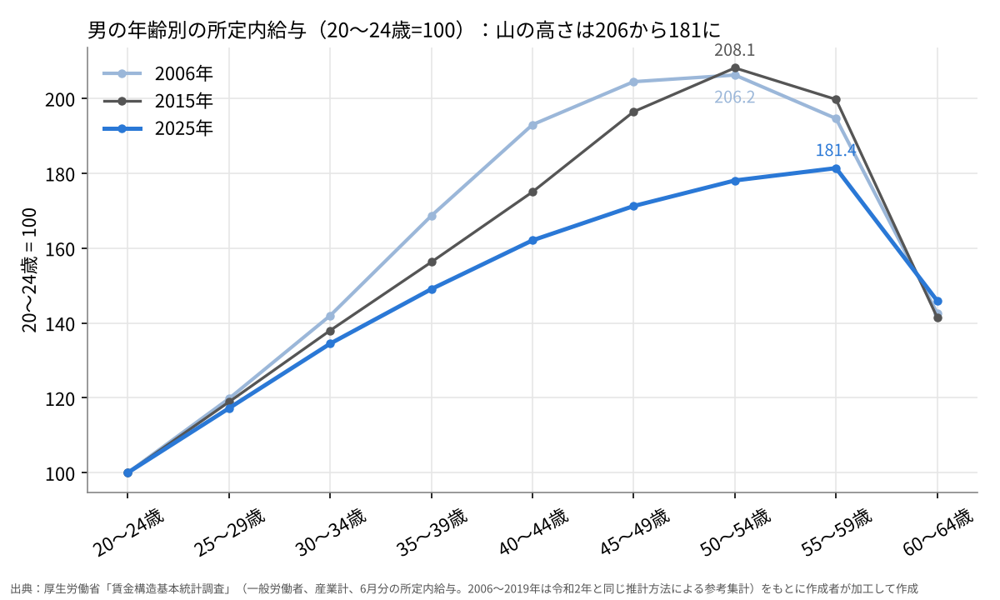
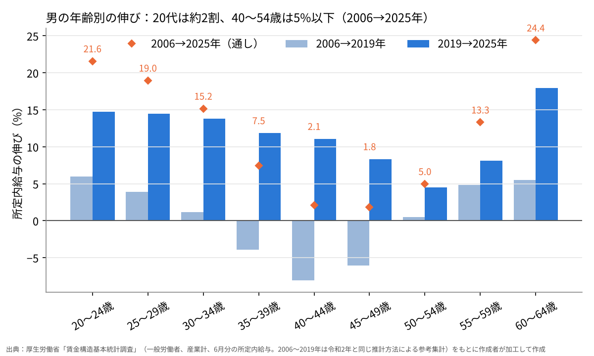
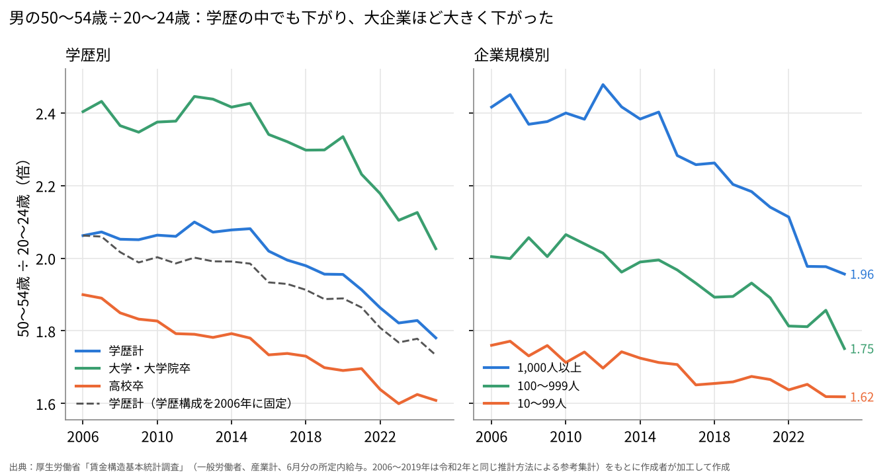
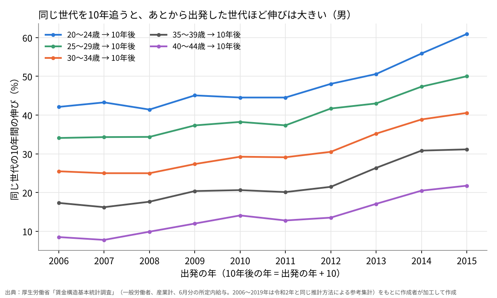

# F360 「年功賃金がゆるやかになった」は、年齢ごとの賃金の曲線の形でどう見えるか？ 男の50〜54歳は20〜24歳の2.06倍から1.78倍に。下がった分は若い側の伸びで説明できる

## 結論（先に）

- 男の所定内給与（6月分）を20〜24歳=100 で見ると、山の高さは2006年206.2（50〜54歳）、2015年208.1（50〜54歳）、2025年181.4（55〜59歳）でした。50〜54歳÷20〜24歳は2.06倍から1.78倍に、13.7%下がりました。下がったのは主に2015年より後です。
- 2006→2025年で、20〜24歳は202.1→245.7千円（+21.6%）、50〜54歳は416.8→437.5千円（+5.0%）でした。50〜54歳も少し伸びているので、倍率の下がりは全部、若い側の伸びで説明できます（分母の寄与133%）。「中高年の賃金が下がった」のではなく「若い人ほど大きく上がった」形です。
- 学歴の中でも同じでした。大学・大学院卒の男は2.40→2.03倍、高校卒の男は1.90→1.61倍です。学歴の構成を2006年に固定しても2.06→1.73倍で、大卒が増えたことはむしろ平らになるのを見えにくくしていました。
- 企業規模別では、1,000人以上が2.42→1.96倍（−19.0%）、100〜999人が2.00→1.75倍（−12.6%）、10〜99人が1.76→1.62倍（−8.1%）で、大企業ほど大きく下がりました。
- 問い直しとして、同じ世代を10年追いました。20〜24歳から10年間の伸びは、2006年に出発した世代で42.1%、2015年に出発した世代で60.9%でした。横断面の曲線は平らになっても、同じ世代の伸びは、あとの世代ほど大きくなっています（全体の賃金が上がった時期を通るため）。

## 問い

労働政策研究・研修機構（JILPT）の「ビジネス・レーバー・トレンド」2026年5月号「年齢階級別にみた賃金」は、賃金構造基本統計調査から、男性の賃金カーブ（20〜24歳を100とした年齢別の賃金）が平らになったと書いています。

人事・賃金制度の担当や労働組合、昇進の見通しを考える会社員にとって、「平らになった」が「若い人が上がった」のか「中高年が上がらなかった」のかで、意味が変わります。また、大卒が増えるなど働く人の構成が変わっただけかもしれません。そこで、推計方法をそろえた2006〜2025年の表で、曲線の形を学歴別・規模別に分けて見ました。

F359（初任給）では男女計の倍率を補足で出しました。この記事は男女別・学歴別・規模別に分け、変化を分母と分子に分けます。

## データ（出典）

- 厚生労働省「賃金構造基本統計調査」一般労働者 産業大分類 第1表（産業計、性・学歴・年齢階級別の所定内給与額と労働者数、企業規模計・1,000人以上・100〜999人・10〜99人）。民営事業所、6月分、名目。
- 2006〜2019年は【参考掲載】「令和2年調査と同じ推計方法を用いた過去分の集計」、2020〜2025年は各年の表です。
- 学歴は、2019年以前の「大学・大学院卒」に合わせて、2020年以降の大学と大学院を労働者数で重みづけしてまとめました。専門学校（2020年から別の区分）は高専・短大と合わせました。

ファイルとURLは `data/raw/SOURCES.md` にあります（20ファイル、約23MB）。

## 事前の計画

計画は [PLAN.md](PLAN.md)（2026-11-16 12:55、指標を集計する前に作成）です。

| 仮説 | 外れの基準 | 結果 | 判定 |
|---|---|---|---|
| H1 男の50〜54歳÷20〜24歳は2006→2025年で1割以上下がる | 下がりが1割未満 | 2.062→1.781（−13.7%） | 支持 |
| H2 下がりの半分以上は20〜24歳の伸び | 分母の寄与 ≦ 0.5 | 1.33（50〜54歳も+5.0%） | 支持 |
| H3 高校卒・大学大学院卒の中でも下がる | どちらかが下がらない | 高校 −15.3%、大学大学院 −15.7% | 支持 |
| H4 1,000人以上のほうが10〜99人より大きく下がる | 小さければ外れ | −19.0% 対 −8.1% | 支持 |

## やったこと

1. 年ごと・性・学歴・規模・年齢階級ごとの所定内給与を読み、20〜24歳=100 の曲線と、50〜54歳÷20〜24歳の倍率を出しました。
2. 倍率の変化（対数）を、50〜54歳の伸びと20〜24歳の伸びに分けました。
3. 各年齢階級の中の学歴の構成（中学・高校・高専短大専門・大学大学院）を2006年に固定し、学歴計の給与を作り直しました。

## 分かったこと

### 図1 男の曲線の山は、2015年から低くなった



- 山の高さ（20〜24歳=100）は、2006年206.2、2010年206.3、2015年208.1、2019年195.6、2025年181.4です。2015年まではほぼ同じで、そのあと下がりました。
- 山の年齢は、2006〜2019年は50〜54歳、2025年は55〜59歳でした。JILPT の記事と同じ結果です。
- 女は山が低く、20〜24歳=100 で127.6〜135.7の間を動いていて、はっきりした傾きはありません（50〜54歳÷20〜24歳は1.25→1.28倍）。

### 図2 若い側が大きく伸び、40〜54歳はほとんど伸びなかった



- 2006→2025年の伸びは、20〜24歳21.6%、25〜29歳19.0%、30〜34歳15.2%に対し、40〜44歳2.1%、45〜49歳1.8%、50〜54歳5.0%でした。
- 2006→2019年には35〜49歳が下がっていました（40〜44歳 −8.1%）。2019→2025年はどの年齢も伸びましたが、20〜24歳14.8%に対し50〜54歳4.5%と、差は続いています。
- 55〜59歳（13.3%）と60〜64歳（24.4%）は伸びています。山の年齢が55〜59歳に移ったのはこのためです。

### 図3 学歴の中でも、どの規模でも下がった



- 大学・大学院卒の男は2.40→2.03倍、高校卒の男は1.90→1.61倍でした。学歴計より大きく下がっています。
- 学歴の構成を2006年に固定すると、2015年にはすでに1.99倍まで下がっていました。学歴計で2006〜2015年に倍率が下がらなかったのは、中高年に大卒が増えたためだと考えています（固定した値との比べから見た推測）。
- 規模別では1,000人以上が2.42→1.96倍で、いちばん大きく下がりました。それでも2025年の倍率は1,000人以上が最も高く、規模による差は縮まりつつ残っています。

## 問い直し（結果を見てから足した）

横断面（同じ年の年齢別）の曲線が平らになったので、「同じ世代を追うと、賃金の上がり方も小さくなったのか」を足しました。年齢階級は5歳きざみなので、ある年に20〜24歳の人が10年後に30〜34歳になる、という形で追いました（同じ人ではなく、同じ生まれの年の集まりの平均です）。



- 20〜24歳から10年間の伸びは、2006年出発の世代で42.1%、2015年出発の世代で60.9%でした。どの出発年齢でも、あとの世代ほど伸びが大きくなっています（1年あとにつき1.5〜1.9ポイント）。
- 40〜44歳から10年間の伸びも、8.5%（2006年出発）から21.8%（2015年出発）になりました。
- 横断面の曲線が平らになっても、同じ世代の伸びが小さくなったわけではありません。2019年以降の全体の賃金の上がりが、どの世代の伸びにも乗っているためです。年齢による上がり（年功）と、時期による上がり（物価や賃上げ）を、このデータだけで分けることはできません。

## 頑健性

| 確かめ | 始め | 終わり | 変化 | 結論 |
|---|---|---|---|---|
| 主：男 50〜54歳÷20〜24歳（2006→2025年） | 2.062 | 1.781 | −13.7% | — |
| 1 男 55〜59歳÷25〜29歳 | 1.625 | 1.547 | −4.8% | 下がるが小さい |
| 2 学歴構成を2006年に固定 | 2.062 | 1.733 | −16.0% | 変わらない（より大きく下がる） |
| 3 女 50〜54歳÷20〜24歳 | 1.245 | 1.275 | +2.4% | **変わる**（女は下がらない） |
| 4a 期間 2006→2019年 | 2.062 | 1.956 | −5.2% | 下がりは小さい |
| 4b 期間 2010→2025年 | 2.063 | 1.781 | −13.7% | 変わらない |
| 5 3年平均（2006〜08年→2023〜25年） | 2.062 | 1.810 | −12.2% | 変わらない |
| 6 男・大学大学院卒・1,000人以上 | 2.735 | 2.225 | −18.6% | 変わらない |

男で倍率が下がることは、どの確かめでも同じでした。ただし、比べる年齢を55〜59歳÷25〜29歳にすると下がりは4.8%と小さくなります。これは、55〜59歳の伸びが大きかったためです。女は曲線がもともと低く、2006→2025年で倍率は少し上がりました。

## 言えないこと

- 横断面の曲線で、一人ひとりの賃金の上がり方ではありません。同じ世代を追った値も、同じ人を追ったものではありません。
- 中高年の転職・出向・役職定年や、正社員でない働き方への移行で、各年齢に残る人の中身が変わります。その影響は分けられません。
- 2019年以前と2020年以降で学歴の区分が変わりました。2019年の男の高校卒は44.6%、2020年の高校は38.1%、専門学校は10.9%、不明は5.1%で、以前の専門学校卒がどの区分に入っていたかは、この表からは確かめられません。高校卒の倍率の変化には、この区分の変更が混ざっている可能性があります（推測）。
- 理由（賃金制度の見直し、人手不足による若手の賃上げ、最低賃金、定年の延長）は、このデータでは分かりません。理由についての話はすべて推測になります。
- 所定内給与だけで、賞与・退職金は入りません。名目の値です。

## 仕事で使うなら

- 賃金カーブの比較は、20〜24歳=100 の倍率と、各年齢の給与の伸びを並べると、「若い側が上がった」のか「中高年が下がった」のかを分けて読めます。
- 学歴の構成が変わると学歴計の曲線も動くので、学歴別か、構成を固定した値を並べると前提がそろいます。
- 横断面の曲線と、同じ世代を追った伸びは別のものなので、どちらの話かを添えると読み違えにくくなります。

## 計画からの変更

- 図を見たあとで、山の高さが2015年までほぼ同じだったので、2015年の値を本文に足しました。
- 学歴の区分の変更の確かめ（2018〜2021年の学歴別の労働者の割合）を、結果を見たあとで main.json に足しました。
- 問い直しは、計画の15年追う形に加え、出発年を10個とれる10年追う形を主にしました（15年は5個しか取れないため）。
- それ以外は計画どおりです。

## 再現のしかた

```sh
pip install -r requirements.txt
python3 src/01_fetch.py   # 取得（ネットが必要。data/raw に同梱済みなので通常は不要）
sh src/run_all.sh         # 02 → 03 → 04（オフライン）
```

| ファイル | 中身 |
|---|---|
| src/01_fetch.py | 元データの取得（e-Stat、20ファイル） |
| src/02_build.py | data/general.csv（性・学歴・年齢・規模別の所定内給与と労働者数）を作る |
| src/03_analysis.py | 曲線、倍率、分解、学歴構成の固定、規模別、頑健性、世代を追った伸び。results/ に出力 |
| src/04_figures.py | figures/ の4枚 |
| results/main.json | 本文の数字のもと |
| results/ratio_timeseries.csv | 倍率の推移（学歴別・規模別） |
| results/growth_by_age.csv | 年齢別の伸び |
| results/cohort_growth_male.csv | 同じ世代を追った伸び |

所要時間は約6秒（CPU 1つ）。`results/repro_check.txt`：2026-11-16 再実行、12 ファイル一致。

## レビューで直したこと

| # | 指摘 | 直し方 |
|---|---|---|
| 1 | 問いの節の読み手に「転職の見通し」とあり、転職活動に触れる書き方だった | 「昇進の見通しを考える会社員」に直した（README） |

直したあとに /tmp で流し直し、results と figures の 11 ファイルが一致することを確かめました（results/repro_check.txt）。

## 出典

- 厚生労働省「賃金構造基本統計調査」 https://www.mhlw.go.jp/toukei/list/chinginkouzou.html （統計表 https://www.e-stat.go.jp/stat-search/files?toukei=00450091 ）
- 労働政策研究・研修機構「年齢階級別にみた賃金」（ビジネス・レーバー・トレンド 2026年5月号） https://www.jil.go.jp/kokunai/blt/backnumber/2026/05/c_01.html

（いずれも 厚生労働省「賃金構造基本統計調査」をもとに作成者が加工して作成）
