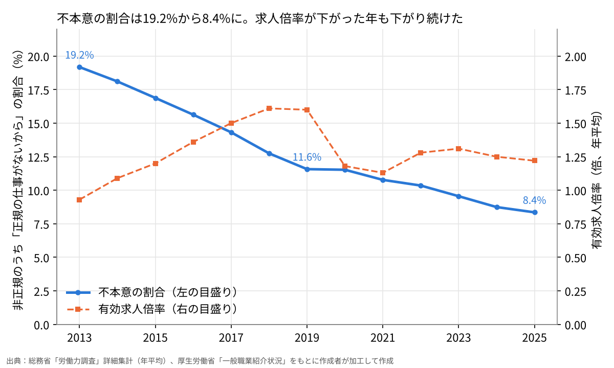
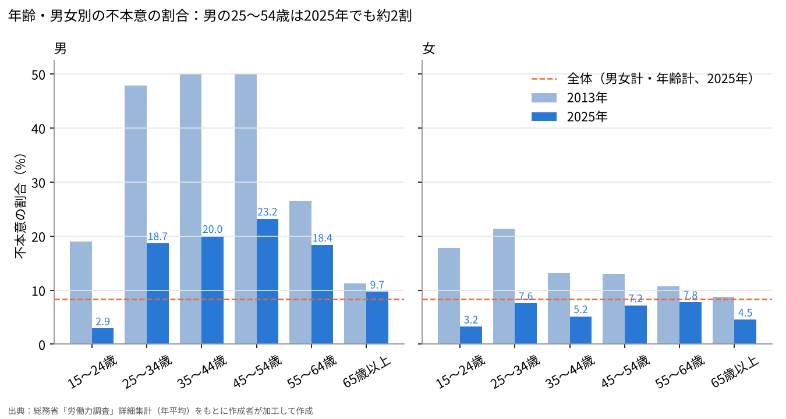
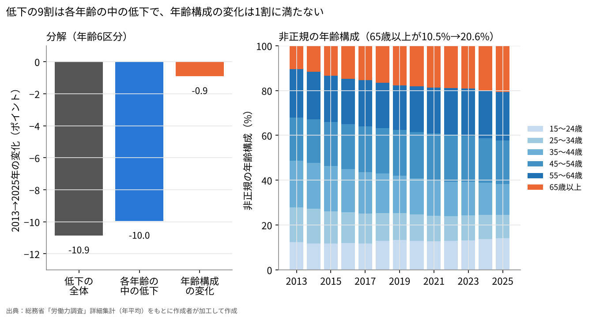
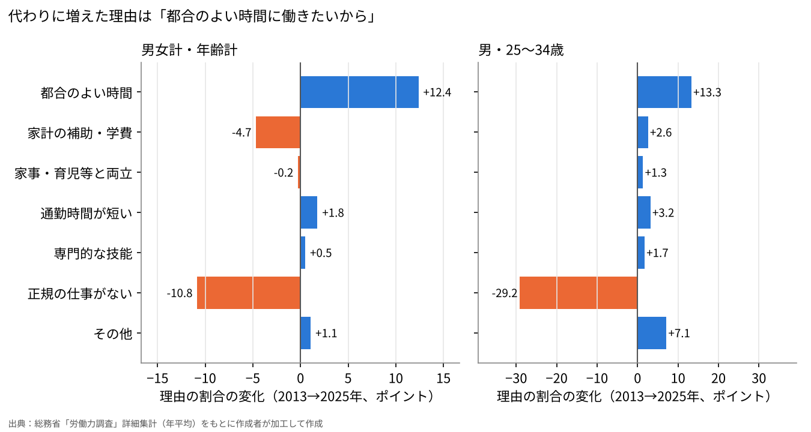

# F361 「非正規で働く人の多くは望んでそうしている」は、年齢別に見ても本当か？ 全体の不本意は8.4%、男の25〜54歳は19〜23%、低下の9割は各年齢の中の低下

## 結論（先に）

- 非正規の職員・従業員のうち、その働き方を選んだ主な理由が「正規の職員・従業員の仕事がないから」の人（不本意非正規）の割合は、2013年19.2%、2025年8.4%でした。全体で見れば、9割以上はほかの理由を挙げています。
- ただし男の25〜34歳は18.7%、35〜44歳は20.0%、45〜54歳は23.2%、55〜64歳は18.4%でした（2025年）。全体の2.2〜2.8倍です。女はどの年齢も8%未満、15〜24歳は男女とも3%前後でした。
- 2013→2025年の低下（−10.9ポイント）のうち、年齢構成の変化（理由の違う65歳以上の非正規が10.5%→20.6%に増えた）による分は −0.9ポイント（約8%）でした。残りの9割は、各年齢の中で不本意の割合が下がったことによります。
- 低下が大きかったのは男の25〜54歳（−27〜−30ポイント）で、25〜34歳の男は47.8%→18.7%でした。代わりに増えた理由は「自分の都合のよい時間に働きたいから」です。
- 有効求人倍率とは、前年からの変化どうしで −0.69 の相関がありました。ただし求人倍率が下がった2020・2021・2024・2025年にも割合は上がっておらず、景気だけでは説明できない下がり方です。

## 問い

厚生労働省の資料（労働政策審議会 雇用環境・均等分科会 第90回、参考資料2-4、2026年3月26日）は、不本意非正規の割合が2025年に8.4%で、12年連続で下がったと書いています。ここから「非正規で働く人の多くは望んでそうしている」と言われることがあります。

人事・採用の担当や、非正規雇用の統計を読む人にとっては、全体の平均だけでなく、どの年齢・男女で不本意が残っているかが大切です。また、高齢の非正規が増えたことで平均が下がっただけかもしれません。そこで、労働力調査の年齢・男女別の表で分けて確かめました。

## データ（出典）

- 総務省「労働力調査」詳細集計（年平均）「年齢階級，現職の雇用形態についた主な理由別非正規の職員・従業員数」（男女別、6つの年齢階級、万人）。年報の時系列表の2017年版（2013〜2017年）、2022年版（2018〜2022年）、2025年版（2021〜2025年）をつなぎました。2021・2022年は2つの版で値がすべて同じでした（差の最大0）。
- 理由は7つです（自分の都合のよい時間に働きたい、家計の補助・学費等、家事・育児等と両立しやすい、通勤時間が短い、専門的な技能等をいかせる、正規の職員・従業員の仕事がない、その他）。この記事では3つ目を短く「家事・育児等と両立」と書きます。
- 厚生労働省「一般職業紹介状況」有効求人倍率（パートを含む、実数の年平均）。

不本意の割合は「正規の仕事がない」÷ 7つの理由の合計です（表の注にある統計局の定義と同じ。2025年の8.35%は厚労省の資料の8.4%と一致）。ファイルとURLは `data/raw/SOURCES.md` にあります。

## 事前の計画

計画は [PLAN.md](PLAN.md)（2026-11-16 12:57、割合を集計する前に作成）です。

| 仮説 | 外れの基準 | 結果 | 判定 |
|---|---|---|---|
| H1 2025年の全体の不本意の割合は10%未満 | 10%以上 | 8.35% | 支持 |
| H2 男の25〜34・35〜44・45〜54歳は全体の2倍以上 | どれかが2倍未満 | 2.23・2.39・2.78倍 | 支持 |
| H3 低下のうち年齢構成の変化による分は3割未満 | 3割以上 | 8.4%（6区分）、11.1%（男女×年齢） | 支持 |
| H4 低下幅は25〜34歳のほうが55〜64歳より大きい | 小さければ外れ | −19.3 対 −5.7 ポイント | 支持 |

## やったこと

1. 性・年齢ごとに、不本意の割合を2013〜2025年について計算しました。
2. 全体の割合の変化を、各年齢の中の割合の変化と、年齢構成（理由を答えた非正規の年齢別の割合）の変化に分けました（シフト・シェア分解）。
3. 有効求人倍率との相関を、水準どうしと、前年からの変化どうしで出しました。

## 分かったこと

### 図1 割合は12年続けて下がった



- 不本意の割合は、19.2%（2013年）、11.6%（2019年）、8.4%（2025年）でした。人数は342万人から173万人になりました（非正規の総数は1,910万人から2,128万人）。
- 求人倍率と水準どうしの相関は −0.32 と弱く、前年からの変化どうしでは −0.69 でした。求人倍率が1上がる年ほど、割合は1.9ポイント多く下がる関係です（12組の変化から）。
- 求人倍率が下がった年（2020・2021・2024・2025年）にも、割合は上がりませんでした。2020年は11.57%→11.53%とほぼ横ばいで、それ以外の年は下がっています。

### 図2 男の25〜64歳は、今も2割前後



- 男の2025年は、25〜34歳18.7%、35〜44歳20.0%、45〜54歳23.2%、55〜64歳18.4%でした。2013年はそれぞれ47.8%、50.0%、50.0%、26.6%で、大きく下がってはいますが、全体（8.4%）の2倍を超えています。
- 女は2025年にどの年齢も8%未満でした（25〜34歳7.6%、55〜64歳7.8%）。15〜24歳は男2.9%、女3.2%です。
- 人数で見ると、2025年の不本意173万人のうち、男の25〜54歳は約37万人（21.5%）でした。人数が多いのは55歳以上と女の45〜64歳で、割合の高さと人数の多さは別の層にあります。

### 図3 低下の9割は各年齢の中の低下



- 非正規の年齢構成では、65歳以上が10.5%（2013年）から20.6%（2025年）に増え、25〜34歳は15.6%から10.5%に減りました。
- 分解すると、−10.9ポイントのうち、各年齢の中の低下が −10.0、年齢構成の変化が −0.9 でした（年齢計の値と年齢別の合計は丸めで少し違うため、分解の全体は −10.87 です）。
- 男女×年齢の12区分で分けても、構成の変化は11.1%でした。「高齢化で平均が下がっただけ」ではありません。

## 問い直し（結果を見てから足した）

不本意の割合が大きく下がったので、「代わりにどの理由が増えたのか」を足しました。



- 男女計・年齢計では、「都合のよい時間に働きたい」が24.2%→36.6%（+12.4ポイント）と増え、「家計の補助・学費」は22.3%→17.7%に減りました。
- 男の25〜34歳では、「正規の仕事がない」が −29.2ポイントで、「都合のよい時間」が +13.3、「その他」が +7.1 でした。
- 女の35〜44歳では、「都合のよい時間」が +9.6、「家事・育児等と両立」が +6.7 で、「家計の補助・学費」が −10.7 でした。
- 「都合のよい時間に働きたい」が本人にとって十分に望んだ働き方かどうかは、この質問からは分かりません。

## 頑健性

| 確かめ | 2013年 | 終わりの年 | 変化（ポイント） | 年齢構成による分の割合 | 結論 |
|---|---|---|---|---|---|
| 主：分母＝理由の合計、男女計・年齢計（2025年） | 19.18 | 8.35 | −10.83 | 0.084 | — |
| 1 分母＝総数（理由を答えなかった人を含む） | 17.91 | 8.13 | −9.78 | — | 変わらない |
| 2 分解を男女×年齢12区分に | 19.18 | 8.35 | −10.83 | 0.111 | 変わらない |
| 3 期間の終わりを2019年に | 19.18 | 11.57 | −7.61 | 0.108 | 変わらない |
| 4 男だけ | 30.69 | 13.04 | −17.65 | — | 変わらない（男は全体より高い） |

どの確かめでも、2025年の割合は10%未満（男だけでは13.0%）、年齢構成の影響は1割前後でした。求人倍率との変化どうしの相関は年齢で違い、15〜24歳 −0.63、25〜34歳 −0.38、35〜44歳 −0.07 でした。

## 言えないこと

- 「主な理由」を1つだけ答える質問です。複数の理由がある人や、「都合のよい時間」「家計の補助」を選んだ人が本当に望んだ働き方なのかは分かりません。
- 年ごとの調査の答えで、同じ人を追っていません。不本意だった人が正規に移ったのか、新しく非正規になった人の理由が違うのかは区別できません。
- 人数は万人単位で丸められていて、男の35〜44歳のように不本意の人数が10万人前後の区分では、割合の1ポイント程度の差は丸めの影響を受けます。
- 求人倍率との相関は因果ではありません。12年続けて下がった理由（景気、制度、働き方の考え方の変化）は、このデータでは分かりません。理由についての話はすべて推測になります。
- 2013年より前は同じ質問の表がありません。

## 仕事で使うなら

- 「不本意非正規は1割未満」という数字は、男女・年齢別に並べると、2割前後が残る層（男の25〜64歳）があることが分かります。
- 全体の割合の変化は、年齢構成の変化と各年齢の中の変化に分けて読むと、平均の動きの中身が分かりやすくなります。
- 人数の多い層と割合の高い層は違うので、両方を並べると前提がそろいます。

## 計画からの変更

- 頑健性4（2021・2022年を古い版にする）は、2つの版の値がすべて同じだったので、表から外して本文に書き、代わりに「男だけ」を足しました。
- 図を見たあとで、不本意の人数の年齢・男女の内訳（2025年）を main.json と本文に足しました。
- 理由の名前の「家事・育児・介護等と両立しやすいから」は、本文と図では「家事・育児等と両立」と短く書きました。
- それ以外は計画どおりです。

## 再現のしかた

```sh
pip install -r requirements.txt
python3 src/01_fetch.py   # 取得（ネットが必要。data/raw に同梱済みなので通常は不要）
sh src/run_all.sh         # 02 → 03 → 04（オフライン）
```

| ファイル | 中身 |
|---|---|
| src/01_fetch.py | 元データの取得（e-Stat、4ファイル） |
| src/02_build.py | data/reason.csv・reason_all_versions.csv・jobs_ratio_annual.csv を作る（見出しの並びを確かめる） |
| src/03_analysis.py | 割合、分解、求人倍率との相関、頑健性、理由の内訳。results/ に出力 |
| src/04_figures.py | figures/ の4枚 |
| results/main.json | 本文の数字のもと |
| results/share_by_sex_age.csv | 性・年齢別の不本意の割合 |
| results/robustness.csv | 頑健性の表 |
| results/requestion_reason_mix.csv | 理由の内訳の変化 |

所要時間は約3秒（CPU 1つ）。`results/repro_check.txt`：2026-11-16 再実行、13 ファイル一致。

## レビューで直したこと

独立レビューで数字の照合・再実行・図を確かめ、直すところはなかった。

## 出典

- 総務省「労働力調査」 https://www.stat.go.jp/data/roudou/index.html （年報 https://www.e-stat.go.jp/stat-search/files?toukei=00200531 ）
- 厚生労働省「一般職業紹介状況」 https://www.mhlw.go.jp/toukei/list/114-1.html
- 厚生労働省「短時間・有期雇用労働者対策基本方針（案）データ集」（労働政策審議会 雇用環境・均等分科会 第90回 参考資料2-4） https://www.mhlw.go.jp/content/11901000/001680279.pdf

（いずれも 総務省「労働力調査」、厚生労働省「一般職業紹介状況」をもとに作成者が加工して作成）
