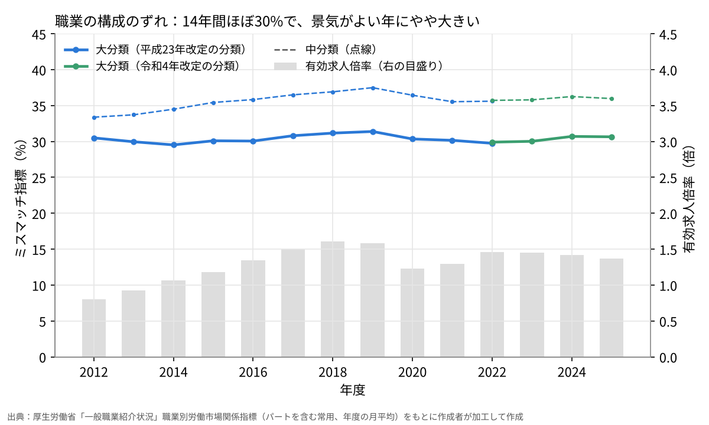
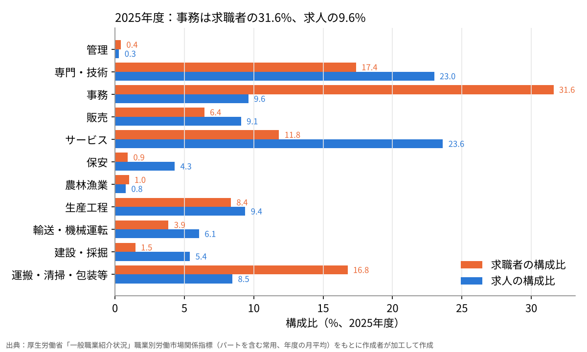
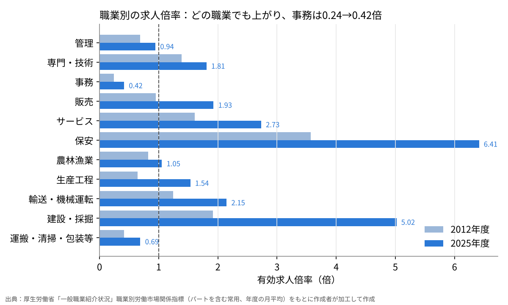
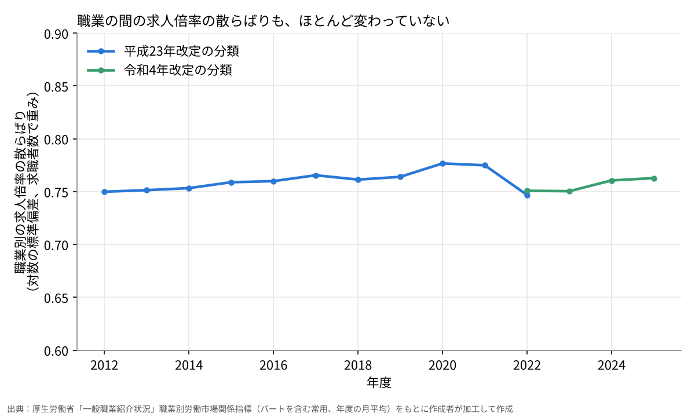

# F362 職業ごとの「人が足りない」と「仕事が見つからない」のずれは、広がったのか？ 構成のずれは14年間ほぼ30%、事務は求職の31.6%・求人の9.6%

## 結論（先に）

- ハローワークの有効求人と有効求職の職業（大分類）の構成のずれ（ミスマッチ指標）は、2012年度30.5%、2019年度31.4%、2025年度30.7%でした。2012〜2014年度の平均30.2%に対し、2023〜2025年度の平均は30.5%で、ほぼ変わっていません。
- ずれのいちばん大きな要因は、一貫して事務です。2025年度は求職者の31.6%が事務を希望しているのに、求人に占める事務は9.6%でした（2012年度は29.8%と9.0%）。
- ずれは景気と一緒に少し動き、求人倍率が高い年度ほどやや大きくなりました（相関0.47）。2019年度が最大でした。
- 事務を除いて計算すると、ずれは21.0%（2012年度）から17.9%（2025年度）に小さくなりました（H4 は外れ）。事務以外の職業どうしでは、ずれはむしろ縮んでいます。
- 職業別の求人倍率は、事務も含めてどの職業でも上がりました（事務0.24→0.42倍、建設・採掘1.92→5.02倍）。構成のずれは変わらず、全体の人手の足りなさが強まった形です。問い直しとして見た職業の間の求人倍率の散らばりも、ほとんど変わっていませんでした。

## 問い

求人倍率が1倍を超えていても、仕事を探す人が多い職業と、求人が多い職業がずれていると、「人が足りない」と「仕事が見つからない」が同時に起きます。職業のミスマッチが広がっているという話は、白書や報道でよく出ます。

ハローワークや自治体の就労支援、職業訓練を企画する人、人事・採用の担当にとっては、ずれが「広がっている」のか「同じ形で続いている」のかで、打つ手の考え方が変わります。そこで、厚生労働省の職業別の求人・求職の表から、構成のずれを1つの数字にして、2012〜2025年度の推移を見ました。

## データ（出典）

- 厚生労働省「一般職業紹介状況」長期時系列表 21 職業別労働市場関係指標（実数）。有効求人数・有効求職者数（パートを含む常用、年度の月平均）。
- 職業分類が2022年4月に変わったため、2012〜2022年度は平成23年改定の分類、2022〜2025年度は令和4年改定の分類の表を使いました。2022年度は両方にあり、大分類のずれの差は0.16ポイントでした。
- 大分類は11区分（分類不能を除く）、中分類は中分類のない大分類を含めて約58区分です。

ファイルとURLは `data/raw/SOURCES.md` にあります。

## 事前の計画

計画は [PLAN.md](PLAN.md)（2026-11-16 13:05、指標を集計する前に作成）です。

| 仮説 | 外れの基準 | 結果 | 判定 |
|---|---|---|---|
| H1 大分類のずれは2023〜25年度平均のほうが2012〜14年度平均より大きい | 小さいか同じ | 30.46% 対 30.15%（+0.3ポイント） | 支持（ごくわずか） |
| H2 2025年度に構成比の差がいちばん大きいのは事務 | ほかの職業 | 事務 +22.0ポイント（求職のほうが多い） | 支持 |
| H3 ずれと求人倍率は正の相関 | 0以下 | 0.47（変化どうし0.39） | 支持 |
| H4 事務を除いても広がった | 小さければ外れ | 20.0% → 18.0%（−2.0ポイント） | 外れ |

H1 は基準の上では支持ですが、+0.3ポイントは年度ごとの動き（29.5〜31.4%）より小さく、「広がった」と言えるほどではありません。

## やったこと

1. 年度ごと・職業ごとに、求職者の構成比と求人の構成比を出しました。
2. ミスマッチ指標 = 1/2 × Σ|求職の構成比 − 求人の構成比| を計算しました。「求職者の何%が職業を移れば、求職と求人の構成がそろうか」を表します。
3. 分類の変わり目は、2022年度の2つの値の差（段差）を古い分類の値に足してつなぎました。

## 分かったこと

### 図1 ずれは14年間ほぼ30%



- 大分類のずれは、29.5%（2014年度）から31.4%（2019年度）の間を動きました。
- 求人倍率が上がった2014〜2019年度にずれも少し大きくなり、2020年度に下がりました。
- 中分類で計算すると、33.4%（2012年度）、37.5%（2019年度）、36.0%（2025年度）でした。細かい職業で見ると、ずれは少し広がっています（2012〜14年度平均34.0% → 2023〜25年度平均36.0%）。

### 図2 事務は求職の3割、求人の1割



- 2025年度、事務は求職者の31.6%、求人の9.6%でした。運搬・清掃・包装等も求職16.8%に対し求人8.5%で、求職のほうが多い職業です。
- 求人のほうが多いのは、サービス（求人23.6%、求職11.8%）、専門・技術（23.0%、17.4%）、建設・採掘（5.4%、1.5%）、保安（4.3%、0.9%）などです。
- 大分類のずれ30.7%のうち、事務の分が11.0ポイント、サービスが5.9ポイント、運搬・清掃・包装等が4.2ポイントでした。

### 図3 求人倍率はどの職業でも上がった



- 2012→2025年度で、事務の求人倍率は0.24→0.42倍、運搬・清掃・包装等は0.42→0.69倍でした。1倍を下回る職業は残っています。
- 建設・採掘は1.92→5.02倍、保安は3.57→6.41倍、サービスは1.61→2.73倍になりました。
- 構成のずれ（どの職業に人が偏っているか）は変わらず、どの職業でも求人の数が求職より速く増えた、という変化でした。

## 問い直し（結果を見てから足した）

構成のずれが変わらなかったので、「職業の間の求人倍率の差（散らばり）は広がったのか」を足しました。職業別の求人倍率の対数の標準偏差（求職者数で重み）を計算しました。



- 散らばりは0.750（2012年度）、0.764（2019年度）、0.777（2020年度）、0.763（2025年度）で、ほとんど変わっていません。
- 求人倍率の高い職業と低い職業の差は、倍率の比で見ると同じくらいのまま、全体が上がっています。

## 頑健性

| 確かめ | 2012〜14年度 | 2023〜25年度 | 変化（ポイント） | 結論 |
|---|---|---|---|---|
| 主：大分類・有効・パート含む | 30.15 | 30.46 | +0.30 | — |
| 1 中分類 | 33.98 | 36.01 | +2.03 | 少し広がった |
| 2 パートを除く常用 | 30.94 | 29.89 | −1.05 | **変わる**（少し縮んだ） |
| 3 新規（フロー） | 25.76 | 25.63 | −0.13 | 変わらない |
| 4 令和4年改定の分類だけ（2022→2025年度） | 29.90 | 30.65 | +0.74 | 変わらない |
| 5 平成23年改定の分類だけ（2012→2021年度） | 30.50 | 30.16 | −0.34 | 変わらない |
| H4 事務を除く | 20.01 | 18.04 | −1.97 | 縮んだ |

どの確かめでも、大分類での変化は ±1ポイント程度でした。中分類だけ +2ポイントで、細かい職業の中でのずれは少し広がっています。「ずれが大きく広がった」と言える結果はありませんでした。

## 言えないこと

- ハローワークを通した求人・求職だけです。民間の職業紹介や求人サイト、縁故の採用は入りません。
- 求職者が希望する職業で、実際に就ける職業とは違います。構成のずれは「人が足りない量」そのものではありません。
- 2022年4月の分類の改定で、職業のくくりが変わりました。段差は2022年度の差で補正しましたが、職業の中身の違いは残ります。
- ずれの理由（賃金、資格、勤務地、働き方）は、このデータでは分かりません。理由についての話はすべて推測になります。
- 年度の月平均で、季節による動きは見ていません。

## 仕事で使うなら

- 「職業のミスマッチ」を話すときは、構成のずれ（指標）と、職業別の求人倍率の両方を並べると、「偏りが変わった」のか「全体が足りなくなった」のかを分けて読めます。
- 大分類と中分類で結果が少し違うので、どちらの粒度の話かを添えると前提がそろいます。
- 事務の求職の多さは14年間ずっと最大の要因なので、時点をそろえて比べると読み違えにくくなります。

## 計画からの変更

- H1 の判定は基準どおり「支持」としましたが、変化が年度ごとの動きより小さいことを判定の表の下に書き足しました。
- 寄与の分解は、分類をまたがないよう、2012→2021年度（旧分類）と2022→2025年度（新分類）に分けて results/contribution_by_major.csv に出しました。
- 問い直しは計画の候補どおり、職業別の求人倍率の散らばりにしました。
- それ以外は計画どおりです。

## 再現のしかた

```sh
pip install -r requirements.txt
python3 src/01_fetch.py   # 取得（ネットが必要。data/raw に同梱済みなので通常は不要）
sh src/run_all.sh         # 02 → 03 → 04（オフライン）
```

| ファイル | 中身 |
|---|---|
| src/01_fetch.py | 元データの取得（e-Stat、2ファイル） |
| src/02_build.py | data/occupation_fy.csv（分類・系列・年度・職業ごとの値）を作る。中分類の合計が大分類と合うか確かめる |
| src/03_analysis.py | ミスマッチ指標、段差、相関、寄与、頑健性、散らばり。results/ に出力 |
| src/04_figures.py | figures/ の4枚 |
| results/main.json | 本文の数字のもと |
| results/mismatch_timeseries.csv・mismatch_linked.csv | 指標の推移（分類ごと・つないだもの） |
| results/major_shares_h23.csv・major_shares_r4.csv | 大分類の構成比と求人倍率 |

所要時間は約3秒（CPU 1つ）。`results/repro_check.txt`：2026-11-16 再実行、13 ファイル一致。

## レビューで直したこと

独立レビューで数字の照合・再実行・図を確かめ、直すところはなかった。

## 出典

- 厚生労働省「一般職業紹介状況（職業安定業務統計）」 https://www.mhlw.go.jp/toukei/list/114-1.html （統計表 https://www.e-stat.go.jp/stat-search/files?toukei=00450222 ）

（いずれも 厚生労働省「一般職業紹介状況」をもとに作成者が加工して作成）
