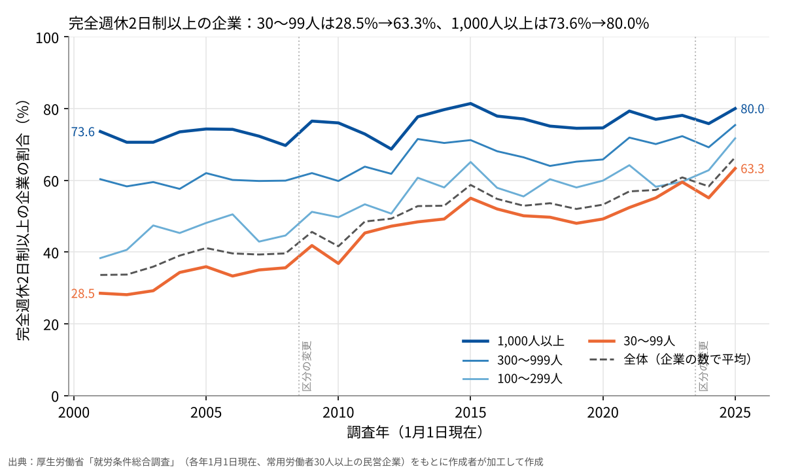
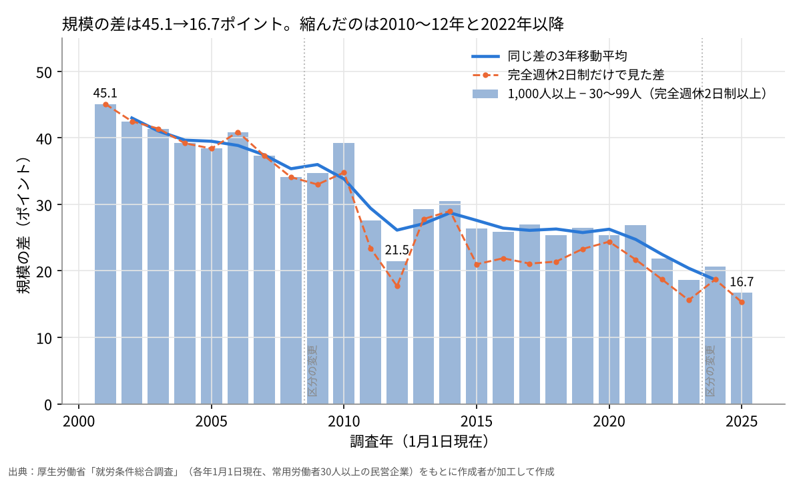
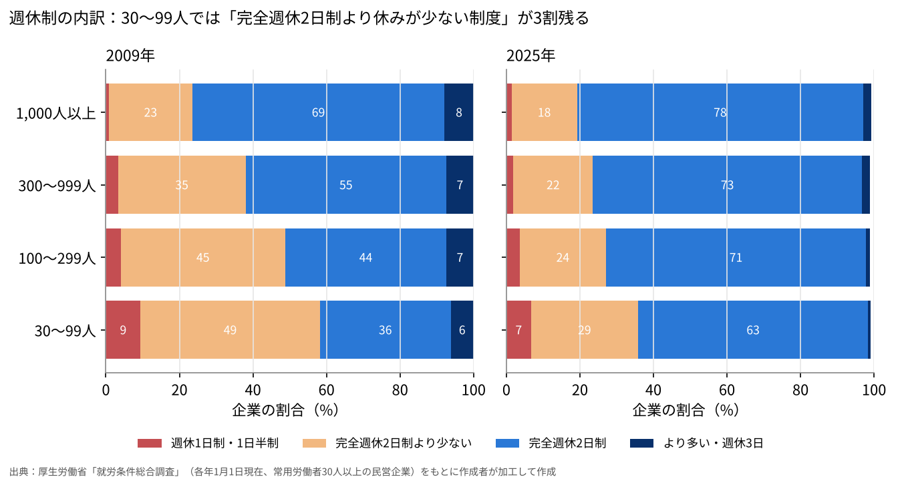
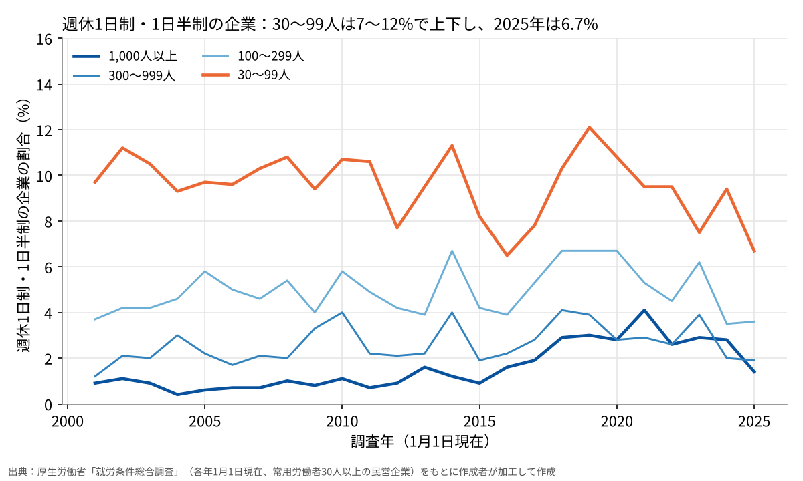

# F363 「週休2日が当たり前」は、企業の規模でどれだけ違うのか？ 完全週休2日制以上は1,000人以上で80.0%、30〜99人で63.3%。差は45.1→16.7ポイントに

## 結論（先に）

- 毎週2日以上休める「完全週休2日制以上」の企業の割合（2025年1月）は、1,000人以上80.0%、300〜999人75.4%、100〜299人71.7%、30〜99人63.3%でした。「何らかの週休2日制」なら9割を超えますが、毎週2日となると規模で差があります。
- 1,000人以上と30〜99人の差は、2001年の45.1ポイントから2025年の16.7ポイントへ縮みました（3年移動平均でも43.0→18.7）。縮んだのは主に、小さい企業の割合が上がったためです（30〜99人は28.5%→63.3%、1,000人以上は73.6%→80.0%）。
- 差が大きく縮んだ時期は2回ありました。2010〜2012年と、2022年以降です。5年間の縮みが最も大きかったのは2007→2012年（−15.8ポイント）で、2015年以降の5年はそれより小さく（最大−8.7ポイント）、「最近になって急に縮んだ」という仮説（H3）は外れました。
- 30〜99人の企業では、2025年も「完全週休2日制より休日が実質的に少ない制度」（隔週休みなど）が29.1%、週休1日制・1日半制が6.7%残っています。
- 区分の変更（2009年、2024年）と、2025年の1年で全体が8.1ポイント上がったことには注意が必要です（調査の作り方の変化の影響かどうかは確かめられませんでした）。

## 問い

「週休2日が当たり前」と言われます。厚生労働省「就労条件総合調査」でも、何らかの週休2日制がある企業は9割前後です。ただ、「何らかの週休2日制」には、月に1〜3回だけ週休2日になる制度なども入ります。

中小企業の経営者や人事担当、就職先を比べる学生と家族にとっては、毎週2日休める「完全週休2日制」が、規模によってどれだけ違うのかが知りたいところです。そこで、2001〜2025年の調査の表を毎年つないで、規模の差の推移と、縮んだ時期を確かめました。

既存の記事（jodn 438 の年間労働時間、366 の祝日と連休）は、企業の週休制を規模別に見ていません。

## データ（出典）

- 厚生労働省「就労条件総合調査」各年の「企業規模、産業、主な週休制の形態別企業（数）割合」。調査年は2001〜2025年（各年1月1日現在）。常用労働者30人以上の民営企業。産業計の行を使いました。
- 表の形は年によって違います（1枚に規模別の塊、規模ごとの別シート、規模が行など）。列は見出しの文字で判定し、毎年、規模の行がそろっていることを確かめました（`src/02_build.py`）。
- 「完全週休2日制以上」は、2001〜2008年は完全週休2日制、2009〜2023年は完全週休2日制 ＋「完全週休2日制より休日日数が実質的に多い制度」、2024年以降は完全週休2日制 ＋「何らかの週休3日制」です。区分の変わる年に段差がありえます（全体で2008年39.6%→2009年45.6%、2023年60.8%→2024年58.3%）。

ファイルとURLは `data/raw/SOURCES.md` にあります（25ファイル、約3MB）。

## 事前の計画

計画は [PLAN.md](PLAN.md)（2026-11-16 13:15、規模別の推移を集計する前に作成）です。

| 仮説 | 外れの基準 | 結果 | 判定 |
|---|---|---|---|
| H1 2025年も1,000人以上と30〜99人の差は10ポイント以上 | 10ポイント未満 | 16.7ポイント | 支持 |
| H2 差は2001→2025年で半分以下に縮んだ | 半分を超えて残る | 45.1→16.7（0.37倍） | 支持 |
| H3 差の5年間の縮みが最も大きいのは2015年以降 | 2014年以前のほうが大きい | 2007→2012年の −15.8 が最大（2015年以降は最大 −8.7） | 外れ |
| H4 30〜99人の割合は20ポイント以上上がった | 20ポイント未満 | 28.5%→63.3%（+34.8） | 支持 |

## やったこと

1. 25年分の表から、規模別（計・1,000人以上・300〜999人・100〜299人・30〜99人）の週休制の割合を取り出しました。
2. 「完全週休2日制以上」の割合と、1,000人以上 − 30〜99人の差を年ごとに出しました。
3. 差の5年ごとの変化を出し、縮んだ時期を探しました。

## 分かったこと

### 図1 小さい企業の割合が大きく上がった



- 30〜99人は28.5%（2001年）、41.8%（2009年）、55.0%（2015年）、63.3%（2025年）でした。
- 1,000人以上は73.6%（2001年）から80.0%（2025年）で、2015年の81.4%が最も高い年でした。
- 全体（企業の数での平均）は33.6%から66.4%です。30〜99人の企業の数が多いので、全体は30〜99人に近い動きをします。

### 図2 差は2回の時期に大きく縮んだ



- 差は2001年45.1ポイントから2008年34.1ポイントへ少しずつ縮み、2010年39.2→2012年21.5ポイントと大きく縮みました。その後2013〜2021年は25〜30ポイントで横ばいでした。
- 2022年以降に再び縮み、2025年は16.7ポイントで、25年間で最も小さくなりました。
- 2012年は1,000人以上の割合が68.7%と前後の年より低く、1年だけの揺れ（標本の揺れ）が入っている可能性があります。3年移動平均では26.1ポイント（2012年）です。

### 図3 30〜99人では「完全週休2日制より休みが少ない制度」が3割残る



- 2009年の30〜99人は、完全週休2日制より休みが少ない制度が48.8%、完全週休2日制が35.6%でした。2025年はそれぞれ29.1%、62.6%です。
- 1,000人以上でも、完全週休2日制より休みが少ない制度は17.8%（2025年）あります。
- 何らかの週休3日制は、2025年に1,000人以上で2.1%、30〜99人で0.7%でした。

## 問い直し（結果を見てから足した）

差が縮んだあとも、小さい企業に「週休2日でない」制度がどれだけ残っているのかを足しました。週休1日制・1日半制の企業の割合を規模別に並べました。



- 30〜99人は9.7%（2001年）、12.1%（2019年）、6.7%（2025年）と、7〜12%の間を上下していて、はっきり減り続けてはいません。
- 1,000人以上は0.9%（2001年）、3.0%（2019年）、1.4%（2025年）でした。
- 完全週休2日制以上の差は縮みましたが、週休1日制の残り方は規模で違うままです。

## 頑健性

| 確かめ | 始めの年 | 始めの差 | 終わりの年 | 終わりの差 | 比 | 結論 |
|---|---|---|---|---|---|---|
| 主：完全週休2日制以上、1,000人以上 − 30〜99人 | 2001 | 45.1 | 2025 | 16.7 | 0.37 | — |
| 1 完全週休2日制だけ | 2001 | 45.1 | 2025 | 15.3 | 0.34 | 変わらない |
| 2 300〜999人 − 100〜299人 | 2001 | 22.0 | 2025 | 3.7 | 0.17 | 変わらない（中くらいの規模どうしの差はほぼなくなった） |
| 3 区分の変わらない期間（2009→2023年） | 2009 | 34.7 | 2023 | 18.6 | 0.54 | 少し弱まる（半分をわずかに上回る） |
| 4 3年移動平均（2002→2024年） | 2002 | 43.0 | 2024 | 18.7 | 0.43 | 変わらない |

差が大きく縮んだことは、どの確かめでも同じでした。区分の変わらない2009〜2023年だけでは、差は0.54倍で、「半分以下」の基準はわずかに満たしません。

## 言えないこと

- 企業の数の割合で、そこで働く人の割合ではありません。大きい企業ほど働く人が多いので、働く人で数えると割合は高くなると考えられます（推測）。
- 「主な週休制」（最も多くの労働者に当てはまる制度）で、同じ企業の中で制度が違う人は分かりません。
- 制度があることと、実際に休めていること（休日の出勤）は別です。
- 区分の変更（2009年、2024年）や、2025年の1年で全体が8.1ポイント上がったことには、調査の作り方（母集団の更新など）の影響が入っているかもしれません。年ごとの小さな動きは標本の揺れかもしれません。
- 差が縮まった理由（法律、人手不足、採用の競争など）は、このデータでは分かりません。理由についての話はすべて推測になります。

## 仕事で使うなら

- 「週休2日」は「何らかの週休2日制」と「完全週休2日制」で数字が大きく違うので、どちらの定義かを添えると読み違えにくくなります。
- 規模で比べるときは、同じ年の中の差で見ると、区分の変更の影響を受けにくくなります。
- 1年だけの大きな動き（2012年、2025年など）は、3年移動平均と並べると揺れかどうかを見分けやすくなります。

## 計画からの変更

- 図を見たあとで、2012年の1,000人以上の値が前後の年より低いことを本文に書き足しました。
- 図3（2009年と2025年の内訳）は、計画に書いていなかった図です。差が縮んだ中身を見るために足しました。
- それ以外は計画どおりです。

## 再現のしかた

```sh
pip install -r requirements.txt
python3 src/01_fetch.py   # 取得（ネットが必要。data/raw に同梱済みなので通常は不要）
sh src/run_all.sh         # 02 → 03 → 04（オフライン）
```

| ファイル | 中身 |
|---|---|
| src/01_fetch.py | 元データの取得（e-Stat、25ファイル） |
| src/02_build.py | 年ごとに形の違う表から data/weekly_holiday_by_size.csv を作る |
| src/03_analysis.py | 完全週休2日制以上の割合、規模の差、5年ごとの変化、頑健性、週休1日制。results/ に出力 |
| src/04_figures.py | figures/ の4枚 |
| results/main.json | 本文の数字のもと |
| results/shares_by_size_year.csv | 年・規模ごとの週休制の内訳 |
| results/gap_timeseries.csv | 規模の差の推移 |

所要時間は約3秒（CPU 1つ）。`results/repro_check.txt`：2026-11-16 再実行、11 ファイル一致。

## レビューで直したこと

独立レビューで数字の照合・再実行・図を確かめ、直すところはなかった。

## 出典

- 厚生労働省「就労条件総合調査」 https://www.mhlw.go.jp/toukei/list/11-23.html （統計表 https://www.e-stat.go.jp/stat-search/files?toukei=00450099 ）

（いずれも 厚生労働省「就労条件総合調査」をもとに作成者が加工して作成）
