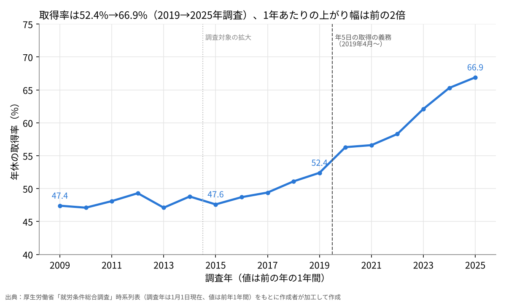
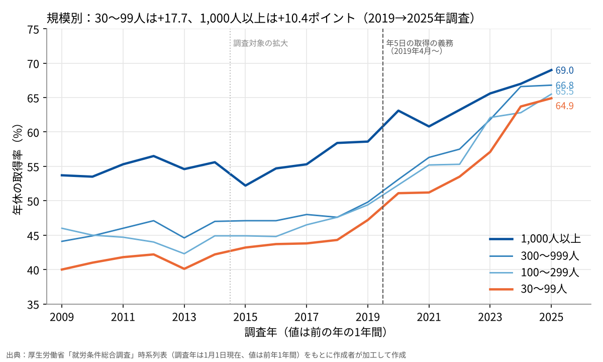
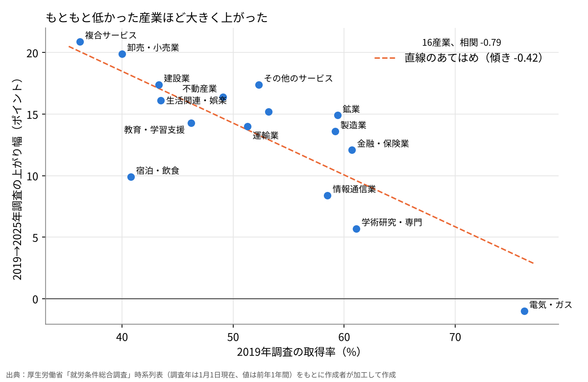
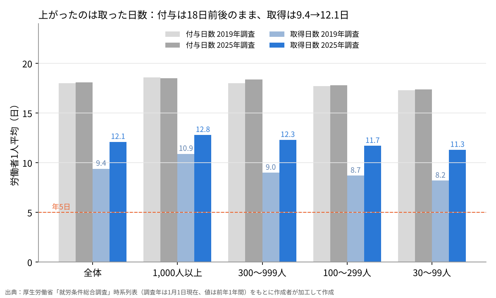

# F364 「有給休暇の取得率が過去最高」は、どの規模・産業で上がったのか？ 取得率は52.4%→66.9%、30〜99人は+17.7ポイント、規模の差は11.4→4.1に

## 結論（先に）

- 年次有給休暇の取得率（労働者1人平均）は、2019年調査52.4%から2025年調査66.9%へ上がりました（調査は1月1日現在、値は前の年の1年間）。1年あたりの上がり幅は、2015→2019年調査の1.20ポイントに対し、2019→2025年調査は2.42ポイントで、ちょうど2倍でした。
- 規模別では、30〜99人が47.2%→64.9%（+17.7ポイント）、1,000人以上が58.6%→69.0%（+10.4ポイント）でした。1,000人以上と30〜99人の差は11.4ポイントから4.1ポイントに縮みました。
- 産業別でも、2019年調査で取得率が低かった産業ほど大きく上がりました（16産業で相関 −0.79）。卸売・小売業は40.0%→59.9%、建設業は43.3%→60.7%です。産業の間の散らばり（標準偏差）は10.0から6.7ポイントになりました。
- 上がったのは取った日数で、付与された日数はほぼ同じでした（全体で取得9.4→12.1日、付与18.0→18.1日）。取得率の上がりは、すべて取得日数の増加で説明できます。
- 問い直しとして取得日数を産業別に見ると、2019年調査で8日未満だった産業は5つありましたが、2025年調査では0になりました。最も少ないのは宿泊・飲食の8.0日です。

## 問い

厚生労働省「就労条件総合調査」では、年休の取得率が上がり続け、2025年調査で66.9%と「過去最高」と報じられました。2019年4月から、年10日以上の年休がある人に年5日を取らせることが会社の義務になっています。

人事・労務の担当や中小企業の経営者にとっては、どの規模・産業で上がったのか、もともと低かったところが追いついたのか、が知りたいところです。そこで、同じ調査の時系列表で、規模・産業別の取得率と日数を、2019年の前と後に分けて比べました。

既存の記事（jodn F265）は、政策の目標（取得率70%）に届くペースを全体の値で見たものです。この記事は、規模・産業別の上がり方と、日数への分け方を問います。

## データ（出典）

- 厚生労働省「就労条件総合調査」時系列表 11（労働者1人平均の付与日数）・12（取得日数）・13（取得率）、企業規模・産業別。
- 産業の分類が同じ2009〜2025年調査を使いました。調査の対象が2015年調査から広がった（会社組織以外の法人と複合サービス事業を含めた）ので、「前」の比較は主に2015年調査からにしました。
- 取得率 =（取得日数計 ÷ 付与日数計）×100 です（表の注）。本文の取得率は表の値、日数の分解には日数の表の値を使いました。

ファイルとURLは `data/raw/SOURCES.md` にあります。

## 事前の計画

計画は [PLAN.md](PLAN.md)（2026-11-16 13:15、規模・産業別の変化を集計する前に作成）です。

| 仮説 | 外れの基準 | 結果 | 判定 |
|---|---|---|---|
| H1 後（2019→2025年調査）の1年あたりの上がり幅は、前（2015→2019年調査）の2倍以上 | 2倍未満 | 2.42 対 1.20（2.01倍） | 支持（ぎりぎり） |
| H2 30〜99人のほうが1,000人以上より大きく上がった | 小さい | +17.7 対 +10.4 | 支持 |
| H3 2019年調査で低い産業ほど上がり幅が大きい（相関 < −0.3） | −0.3 以上 | −0.79（順位の相関 −0.71） | 支持 |
| H4 上がりの8割以上は取得日数の増加による | 0.8未満 | 1.02（付与日数はわずかに増えた） | 支持 |

H1 は基準をわずかに超えただけで、「後」の起点を2020年調査にすると1.77倍になり、2倍を下回ります（頑健性2）。

## やったこと

1. 時系列表から、2009〜2025年調査の規模別（4区分）・産業別（16産業）の付与日数・取得日数・取得率を取り出しました。
2. 前後の期間の1年あたりの上がり幅を比べました。
3. 2019→2025年調査の取得率の変化を、取得日数の変化と付与日数の変化に分けました（対数）。

## 分かったこと

### 図1 2019年調査のあと、上がり方が速くなった



- 取得率は47.4%（2009年調査）、47.6%（2015年調査）、52.4%（2019年調査）、56.3%（2020年調査）、66.9%（2025年調査）でした。
- 2009〜2015年調査はほぼ横ばいで、2016年調査から上がり始め、2020年調査以降に速くなりました。
- 義務が始まった時期と上がり方の変化は重なりますが、同じ時期には人手不足や働き方の変化もあり、このデータで原因を分けることはできません。

### 図2 小さい企業ほど大きく上がった



- 2019→2025年調査で、300〜999人は49.8%→66.8%（+17.0）、100〜299人は49.4%→65.5%（+16.1）でした。
- 1,000人以上と30〜99人の差は、2009〜2020年調査は9.0〜14.5ポイントでしたが、2024年調査3.3、2025年調査4.1ポイントに縮みました。
- 30〜99人の取得日数は8.2日から11.3日になりました。

### 図3 低かった産業ほど大きく上がった



- 2019年調査の取得率と2019→2025年調査の上がり幅の相関は −0.79、あてはめた直線の傾きは −0.42 でした（2019年調査で10ポイント低い産業は、4.2ポイント多く上がった関係）。
- 卸売・小売業は40.0%→59.9%（+19.9）、建設業は43.3%→60.7%（+17.4）と大きく上がりました。電気・ガスは76.2%→75.2%で、もともと高い産業はほとんど動いていません。
- 例外は宿泊・飲食で、40.8%→50.7%（+9.9）と、低い産業の中では上がり幅が小さく、2025年調査でも最も低い産業です。

### 図4 上がったのは取った日数



- 全体で、付与日数は18.0日→18.1日、取得日数は9.4日→12.1日でした。取得率の対数の変化（0.244）は、取得日数の変化（0.253）とほぼ同じで、付与日数はわずかに増えています。
- どの規模でも同じで、付与日数は17〜19日の間でほとんど動かず、取得日数が3日前後増えました（1,000人以上は+1.9日）。

## 問い直し（結果を見てから足した）

年5日の義務は「日数」の決まりなので、取得率ではなく取得日数で、少ない産業がどれだけ残っているかを足しました。

- 取得日数が8日未満の産業は、2019年調査で5つ、2025年調査で0でした。
- 2025年調査で最も少ないのは宿泊・飲食の8.0日（2019年調査6.2日）、最も多いのは電気・ガスの14.7日でした。
- 産業の平均はどこも5日を大きく上回っていますが、これは平均で、5日未満の人がどれだけいるかは分かりません。

## 頑健性

| 確かめ | 前の1年あたり | 後の1年あたり | 比・相関 | 結論 |
|---|---|---|---|---|
| 主：H1 前2015→2019・後2019→2025年調査 | 1.20 | 2.42 | 2.01倍 | — |
| 1 前を2009→2019年調査に | 0.50 | 2.42 | 4.83倍 | 変わらない（より大きな差） |
| 2 後の起点を2020年調査に（2020→2025年調査） | 1.20 | 2.12 | 1.77倍 | **変わる**（2倍を下回る） |
| 3 H3 を順位の相関で | — | — | −0.71 | 変わらない |
| 4 H3 を小さな2産業（鉱業・複合サービス）を除いて | — | — | −0.79 | 変わらない |
| 5 H3 の起点を2020年調査に | — | — | −0.75 | 変わらない |

「後のほうが速い」ことはどの確かめでも同じですが、「2倍以上」かどうかは起点の年で変わります。「低い産業ほど上がった」は、どの確かめでも同じでした。

## 言えないこと

- 労働者1人平均の値で、一人ひとりの取得日数の分布（5日未満の人の割合など）は分かりません。
- 上がりが義務化によるものかどうかは、このデータでは決められません。同じ時期に、人手不足、感染症の流行、働き方の変化があります。
- 産業別の値は標本の小さい産業で揺れが大きく（例：複合サービス事業は2019年調査36.2%、2020年調査72.7%、2025年調査57.1%）、1年の値で読むと誤ることがあります。
- 調査の対象の範囲が2008年調査・2015年調査で変わっています。
- 「低い産業ほど上がった」には、上限（100%）に近いほど上がりにくいことや、平均への回帰（たまたま低かった年の次は上がりやすい）も入りえます（推測）。

## 仕事で使うなら

- 取得率だけでなく、付与日数と取得日数を並べると、上がったのが「取った日数」なのか「付与が減った」のかを分けて読めます。
- 規模・産業で比べるときは、起点の年を2つ（2019年調査・2020年調査など）並べると、義務の始まった年の扱いによる違いが分かります。
- 産業の1年の値は揺れるので、複数年の動きで見ると読み違えにくくなります。

## 計画からの変更

- H1 が基準をわずかに超えただけだったので、判定の表の下に頑健性2の結果を書き足しました。
- 産業の図では、名前を付けない点が1つあります（値は results/industry_change.csv にあります）。
- それ以外は計画どおりです。

## 再現のしかた

```sh
pip install -r requirements.txt
python3 src/01_fetch.py   # 取得（ネットが必要。data/raw に同梱済みなので通常は不要）
sh src/run_all.sh         # 02 → 03 → 04（オフライン）
```

| ファイル | 中身 |
|---|---|
| src/01_fetch.py | 元データの取得（e-Stat、3ファイル） |
| src/02_build.py | data/paid_leave.csv（規模・産業・年ごとの付与日数・取得日数・取得率）を作る。見出しと行の名前を確かめる |
| src/03_analysis.py | 前後の上がり幅、規模・産業別の変化、相関、日数の分解、頑健性。results/ に出力 |
| src/04_figures.py | figures/ の4枚 |
| results/main.json | 本文の数字のもと |
| results/rate_by_group_year.csv | 規模・産業・年ごとの取得率 |
| results/industry_change.csv | 産業別の変化 |
| results/decomposition_2019_2025.csv | 日数の分解 |

所要時間は約3秒（CPU 1つ）。`results/repro_check.txt`：2026-11-16 再実行、11 ファイル一致。

## レビューで直したこと

独立レビューで数字の照合・再実行・図を確かめ、直すところはなかった。

## 出典

- 厚生労働省「就労条件総合調査」 https://www.mhlw.go.jp/toukei/list/11-23.html （時系列表 https://www.e-stat.go.jp/stat-search/files?toukei=00450099 ）

（いずれも 厚生労働省「就労条件総合調査」をもとに作成者が加工して作成）
