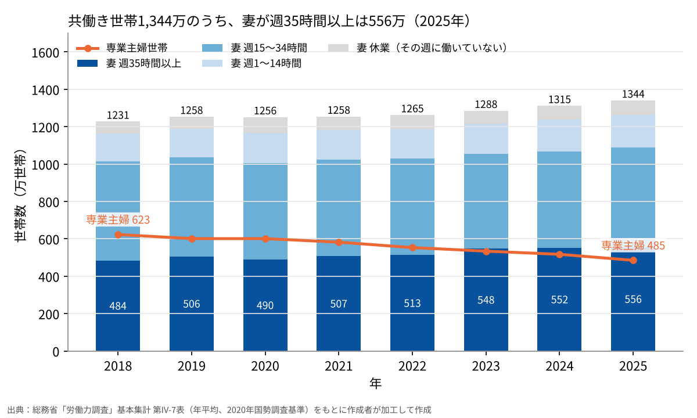
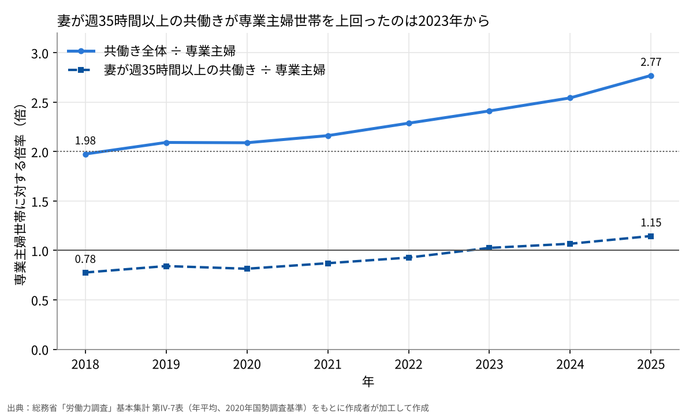
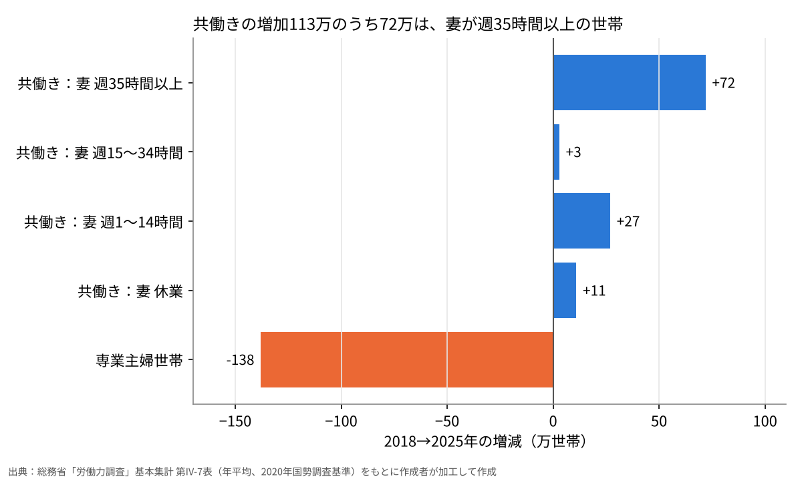
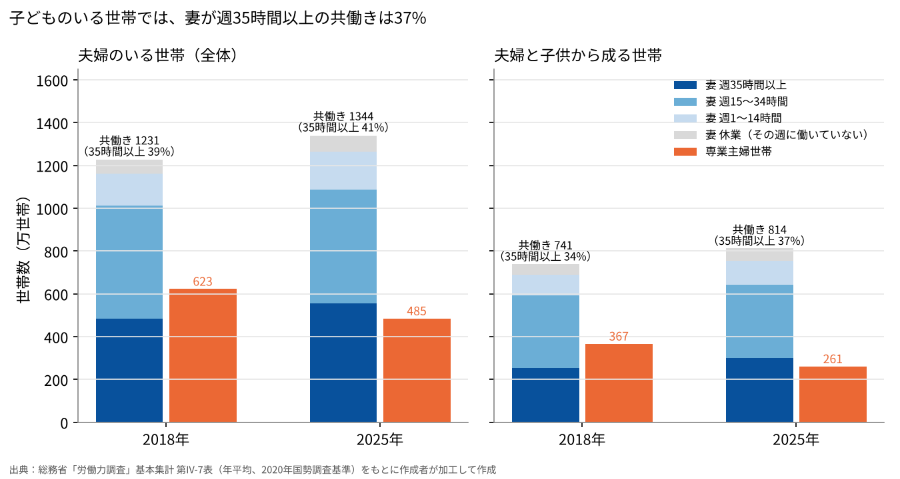

# F365 「共働き世帯は専業主婦世帯の2倍以上」は、妻の働き方（フルタイムかパートか）で分けるとどう見えるか？ 共働き1,344万のうち妻が週35時間以上は41.4%、専業主婦世帯の1.15倍

## 結論（先に）

- 2025年の共働き世帯（夫婦ともに非農林業の雇用者）は1,344万世帯で、専業主婦世帯（夫が非農林業の雇用者で、妻が働いていない）485万世帯の2.77倍でした。「2倍以上」は2019年から当てはまります（2018年は1.98倍）。
- 共働き世帯を妻の月末1週間の就業時間で分けると、週35時間以上は556万世帯（41.4%）、週15〜34時間は532万、週1〜14時間は176万、その週に休んでいた人が76万でした。半分以上は、妻が週35時間未満の共働きです。
- 妻が週35時間以上の共働きだけを数えると、専業主婦世帯の1.15倍です。専業主婦世帯を上回ったのは2023年からで、2018年は0.78倍でした。
- 2018→2025年の増減は、共働き +113万、専業主婦 −138万でした。共働きの増加のうち72万（64%）は妻が週35時間以上の世帯ですが、共働きに占める割合は39.3%→41.4%と、少ししか上がっていません。
- 問い直しとして子どものいる世帯（夫婦と子供から成る世帯）に絞ると、妻が週35時間以上の共働きは37.0%で、全体より少し低くなりました。それでも2025年は専業主婦世帯（261万）の1.15倍です。

## 問い

労働政策研究・研修機構（JILPT）の「早わかり グラフでみる長期労働統計」図12などで、共働き世帯は専業主婦世帯の2倍以上と紹介されています。ただ、共働きの中には、妻が週35時間以上働く世帯も、短い時間で働く世帯も入ります。

家計・保育・住宅などの需要を考える企業や自治体にとっては、「共働き」の中身（妻の働く時間）で、必要なものが変わります。そこで、労働力調査の夫婦の就業状態の表で、共働き世帯を妻の週の就業時間で分けました。

既存の記事で「共働き」に触れるのは保育所と出生率の分析（jodn F16・F100・F118）で、世帯の数の内訳は扱っていません。

## データ（出典）

- 総務省「労働力調査」基本集計 第IV-7表「妻及び夫の就業状態・農林業・非農林業・従業上の地位・月末1週間の就業時間・月間就業時間，世帯の家族類型別夫婦のいる世帯数」（年平均、万世帯）。
- 主の分析は2018〜2025年（2020年国勢調査基準。2018〜2021年は時系列接続用の値）。2016・2017年は旧基準の値で、比べるときだけ使いました。
- 定義は JILPT の図に合わせました。共働き世帯＝夫・妻ともに非農林業の雇用者。専業主婦世帯＝夫が非農林業の雇用者で、妻が非労働力人口または完全失業者。「フルタイム」は雇用形態ではなく、月末1週間の就業時間が週35時間以上としました。
- JILPT の図は「詳細集計」の値で、この記事は「基本集計」の値なので、数万世帯の違いがあります（例：2024年の共働きはこの記事で1,315万）。

ファイルとURLは `data/raw/SOURCES.md` にあります。

## 事前の計画

計画は [PLAN.md](PLAN.md)（2026-11-16 13:35、内訳や比を集計する前に作成）です。

| 仮説 | 外れの基準 | 結果 | 判定 |
|---|---|---|---|
| H1 2025年の共働きは専業主婦の2倍以上 | 2倍未満 | 2.77倍 | 支持 |
| H2 共働きのうち妻が週35時間以上は半分未満 | 半分以上 | 41.4% | 支持 |
| H3 妻が週35時間以上の共働きだけでも専業主婦より多い | 少ない | 1.15倍（2023年から上回る） | 支持 |
| H4 2018→2025年の共働きの増加の半分以上は妻が週35時間以上の世帯 | 半分未満 | 64% | 支持 |

## やったこと

1. 各年の表から、夫が非農林業の雇用者の列を取り出し、妻の就業状態・就業時間の行と組み合わせました（列は見出しの文字で確かめました）。
2. 共働き世帯を、妻の週の就業時間（週35時間以上、週15〜34時間、週1〜14時間、休業）に分けました。
3. 専業主婦世帯に対する倍率を、共働き全体と、妻が週35時間以上の共働きで出しました。

## 分かったこと

### 図1 共働きの半分以上は、妻が週35時間未満



- 2025年の共働き1,344万世帯の内訳は、妻が週35時間以上556万、週15〜34時間532万、週1〜14時間176万、休業76万でした。
- 週15〜34時間の中では、週15〜29時間がおよそ7割です。
- 2018年は共働き1,231万世帯のうち、週35時間以上が484万（39.3%）でした。

### 図2 妻が週35時間以上の共働きが専業主婦を上回ったのは2023年



- 共働き全体 ÷ 専業主婦は、1.98倍（2018年）から2.77倍（2025年）になりました。
- 妻が週35時間以上の共働き ÷ 専業主婦は、0.78倍（2018年）、1.03倍（2023年）、1.15倍（2025年）でした。
- 倍率が上がった大きな理由は、専業主婦世帯が623万から485万に減ったことです。

### 図3 増えたのは主に「妻が週35時間以上」、減ったのは専業主婦



- 2018→2025年で、共働きは +113万（妻が週35時間以上 +72万、週15〜34時間 +3万、週1〜14時間 +27万、休業 +11万）、専業主婦は −138万でした。
- 増えた分の64%は妻が週35時間以上の世帯ですが、もともと共働きの6割近くが週35時間未満なので、割合は2ポイントしか上がっていません。

## 問い直し（結果を見てから足した）

保育や子育ての需要を考えるときは、子どものいる世帯の内訳が知りたくなるので、「夫婦と子供から成る世帯」に絞りました（この区分には、子どもの年齢の制限はありません）。



- 2025年の共働きは814万世帯で、妻が週35時間以上は301万（37.0%）でした。2018年は741万世帯のうち253万（34.1%）です。
- 専業主婦世帯は367万（2018年）から261万（2025年）に減りました。共働き ÷ 専業主婦は2.02倍から3.12倍、妻が週35時間以上の共働き ÷ 専業主婦は0.69倍から1.15倍です。
- 子どものいる世帯では、全体より妻が週35時間以上の割合が4ポイントほど低くなっています。

## 頑健性

| 確かめ | 共働きのうちの割合 | 専業主婦に対する倍率 | 結論 |
|---|---|---|---|
| 主：妻が週35時間以上（2025年） | 41.4% | 1.15 | — |
| 1 線を週30時間以上に | 53.1% | 1.47 | H2 は**変わる**（半分を超える） |
| 2 休業者を時間の分かる人の割合で振り分け | 43.9% | 1.22 | 変わらない |
| 3 旧基準（2015年基準）2021年 | 40.3% | 0.87 | 新基準の2021年（40.3%、0.87）と同じ |
| 4 月間の就業時間 月121時間以上 | 51.0% | 1.41 | H2 は**変わる**（半分を超える） |

「妻がフルタイムの共働きは半分に満たない」は、線を週35時間に置いたときの話で、週30時間以上や月121時間以上で数えると半分を超えます。どの数え方でも、妻が長い時間働く共働きは専業主婦世帯より多くなっています（2025年）。基準の違い（旧基準と新基準）による差は、2021年の比べでほとんどありませんでした。

## 言えないこと

- 時間は月末1週間の実際の就業時間で、正社員かパートかという契約の違いとは一致しません。
- 夫が自営業や農林業の世帯、夫が働いていない世帯は、共働きにも専業主婦にも入りません（JILPT の定義に合わせたため）。
- 世帯の数で、収入、家事・育児の分担、働く時間の希望は分かりません。
- 2017年以前と2018年以降は人口の基準が違い、2016・2017年の値はつないでいません。
- 共働きが増えた理由（人手不足、家計、制度）は、このデータでは分かりません。理由についての話はすべて推測になります。

## 仕事で使うなら

- 「共働きは専業主婦の2倍以上」という数字は、妻の就業時間の内訳を添えると、フルタイム同士の世帯がどれだけかを読み違えにくくなります。
- 「フルタイム」の線（週35時間・週30時間・月121時間）で割合が大きく変わるので、どの線かを明記すると前提がそろいます。
- 倍率の上がりは、共働きの増加と専業主婦の減少の両方で起きているので、分けて見ると中身が分かります。

## 計画からの変更

- 頑健性4（月間の就業時間）は、月121時間以上の3区分の合計としました。
- 図1の専業主婦の数の注記の置き方を、見やすいように直しました。
- それ以外は計画どおりです。

## 再現のしかた

```sh
pip install -r requirements.txt
python3 src/01_fetch.py   # 取得（ネットが必要。data/raw に同梱済みなので通常は不要）
sh src/run_all.sh         # 02 → 03 → 04（オフライン）
```

| ファイル | 中身 |
|---|---|
| src/01_fetch.py | 元データの取得（e-Stat、14ファイル） |
| src/02_build.py | 年により形の違う表から data/couples.csv を作る（夫が非農林業雇用者の列を見出しで確かめる） |
| src/03_analysis.py | 共働きの内訳、専業主婦に対する倍率、増減、頑健性、子どものいる世帯。results/ に出力 |
| src/04_figures.py | figures/ の4枚 |
| results/main.json | 本文の数字のもと |
| results/dual_vs_housewife_2018_2025.csv | 年ごとの世帯数と倍率 |
| results/dual_vs_housewife_couple_with_children.csv | 夫婦と子供から成る世帯 |

所要時間は約3秒（CPU 1つ）。`results/repro_check.txt`：2026-11-16 再実行、10 ファイル一致。

## レビューで直したこと

独立レビューで数字の照合・再実行・図を確かめ、直すところはなかった。

## 出典

- 総務省「労働力調査」 https://www.stat.go.jp/data/roudou/index.html （統計表 https://www.e-stat.go.jp/stat-search/files?toukei=00200531 ）
- 労働政策研究・研修機構「早わかり グラフでみる長期労働統計」図12 専業主婦世帯と共働き世帯 https://www.jil.go.jp/kokunai/statistics/timeseries/html/g0212.html

（いずれも 総務省「労働力調査」をもとに作成者が加工して作成）
