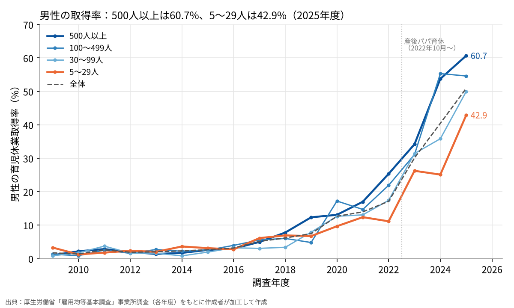
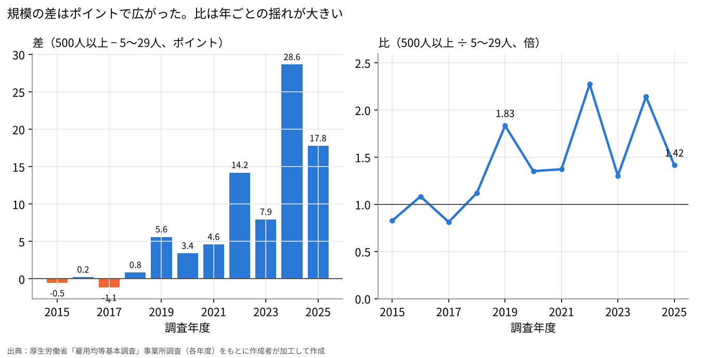
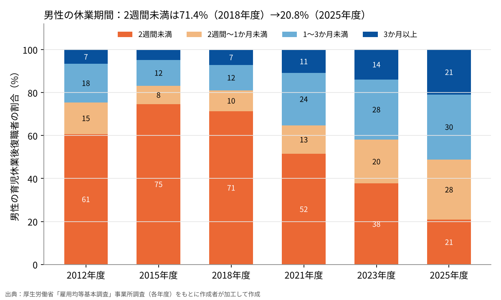
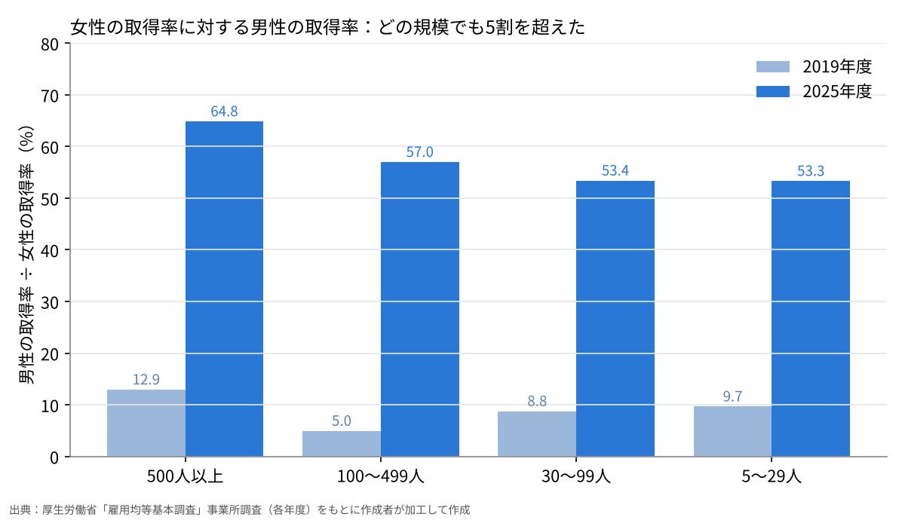

# F366 「男性の育児休業の取得率が急上昇」は、事業所の規模でどれだけ違うのか？ 500人以上は60.7%、5〜29人は42.9%。差は広がり、短い休業は大きく減った

## 結論（先に）

- 男性の育児休業取得率は、2019年度調査7.48%から2025年度調査50.91%へ上がりました。事業所の規模別では、500人以上12.3%→60.7%、100〜499人4.8%→54.6%、30〜99人7.9%→50.0%、5〜29人6.7%→42.9%で、どの規模でも36ポイント以上上がっています。
- 500人以上と5〜29人の差は、2019年度5.6ポイント、2025年度17.8ポイントで、ポイントでは広がりました。3年平均（2018〜20年度→2023〜25年度）で見ても3.3→18.1ポイントです。比で見ると年ごとの揺れが大きく、2019年度を起点にすると縮み（1.83→1.42倍）、3年平均では広がりました（1.42→1.58倍）。
- 2015年度ごろまでは、規模による差はほとんどありませんでした。差がはっきりしたのは2019年度以降です。
- 男性の育児休業後に復職した人のうち、休業が2週間未満の人は、2018年度71.4%から2025年度20.8%に減り、1か月以上が18.9%から51.1%に増えました。5〜29人でも2週間未満は94.2%から26.1%に減っています。
- 問い直しとして女性の取得率と比べると、男性の取得率は女性の57.6%（2025年度、2019年度は9.0%）で、どの規模でも5割を超えました。

## 問い

厚生労働省「雇用均等基本調査」では、男性の育児休業取得率（配偶者が出産した男性のうち、育児休業を始めた人の割合）が、2019年度の7.48%から大きく上がり、2025年度調査では50.91%と公表されました。2022年度には「産後パパ育休」が始まり、大企業には取得率の公表の義務もできています。

中小企業の経営者や人事担当、自治体にとっては、上がり方が事業所の規模でどれだけ違い、休業の期間がどう変わったのかが知りたいところです。そこで、2009〜2025年度の調査の表を規模別につなぎ、取得期間の分布もあわせて見ました。

既存の記事（jodn F265）は、政策目標に届くペースを全体の値で見たものです。この記事は、規模の差と取得期間を問います。

## データ（出典）

- 厚生労働省「雇用均等基本調査」事業所調査の「育児休業者割合」（産業・事業所規模別、男性・女性）、2009〜2025年度調査。事業所規模は500人以上、100〜499人、30〜99人、5〜29人。調査年度の前年10月からの1年間に配偶者が出産した男性のうち、調査時点までに育児休業を始めた人の割合です。
- 同「取得期間別育児休業後復職者割合」（男性、事業所規模別）、2012・2015・2018・2021・2023・2025年度調査。前の年度に育児休業を終えて復職した人の、休業期間の分布です。
- 2013年度は同じ名前の表が2つ載っていて、後に載った表を使いました（男性の値は2つで同じ）。

ファイルとURLは `data/raw/SOURCES.md` にあります。

## 事前の計画

計画は [PLAN.md](PLAN.md)（2026-11-16 13:40、規模別の推移や取得期間を集計する前に作成）です。

| 仮説 | 外れの基準 | 結果 | 判定 |
|---|---|---|---|
| H1 2019→2025年度で4つの規模すべてが20ポイント以上上がった | どれかが20ポイント未満 | +36.2〜+49.8 | 支持 |
| H2 2025年度も500人以上と5〜29人の差は10ポイント以上 | 10ポイント未満 | 17.8ポイント | 支持 |
| H3 差は2019年度より2025年度のほうが大きい | 小さい | 5.6 → 17.8 ポイント | 支持（ポイントで。比では起点しだい） |
| H4 2週間未満の割合は2018年度より2025年度のほうが小さい | 大きい | 71.4% → 20.8% | 支持 |

## やったこと

1. 各年度の表から、規模別の男性・女性の取得率を取り出しました。
2. 500人以上と5〜29人の差（ポイント）と比を、年度ごとに出しました。
3. 取得期間の分布を、2週間未満、2週間〜1か月未満、1〜3か月未満、3か月以上にまとめました。

## 分かったこと

### 図1 どの規模も大きく上がり、5〜29人が遅れている



- 2009〜2016年度は、どの規模も1〜4%で、規模による差はほとんどありませんでした。
- 2019→2025年度の上がり幅は、500人以上 +48.3、100〜499人 +49.8、30〜99人 +42.1、5〜29人 +36.2ポイントでした。
- 5〜29人は2024年度25.1%から2025年度42.9%と、最後の1年で大きく上がりました。

### 図2 差はポイントで広がった。比は年ごとの揺れが大きい



- 差（500人以上 − 5〜29人）は、2019年度5.6、2022年度14.2、2023年度7.9、2024年度28.6、2025年度17.8ポイントでした。年ごとの揺れが大きく、標本の揺れが入っていると考えられます（推測）。
- 比は、1.83倍（2019年度）、2.28倍（2022年度）、1.30倍（2023年度）、1.42倍（2025年度）と上下しています。

### 図3 短い休業が減り、1か月以上が半分に



- 男性の育児休業後復職者のうち、5日未満は2015年度56.9%、2018年度36.3%、2025年度6.8%でした。
- 2週間未満は71.4%（2018年度）から20.8%（2025年度）、1か月以上は18.9%から51.1%になりました。
- 規模別でも同じで、2週間未満は500人以上で65.0%→19.7%、5〜29人で94.2%→26.1%でした。2025年度の1か月以上は、500人以上54.1%、5〜29人47.2%で、規模の差は取得率ほど大きくありません。

## 問い直し（結果を見てから足した）

男性の取得率が上がった中で、女性との差はどれだけ縮んだのかを足しました。男性の取得率を女性の取得率で割りました。



- 全体では、男性の取得率は女性の9.0%（2019年度）から57.6%（2025年度）になりました。
- 2025年度は、500人以上64.8%、100〜499人57.0%、30〜99人53.4%、5〜29人53.3%でした。
- 5〜29人では女性の取得率も80.4%と他の規模（93〜96%）より低く、比で見ると規模の差は小さくなります。

## 頑健性

| 確かめ | 始め | 終わり | 差・比は広がったか | 結論 |
|---|---|---|---|---|
| 主：差（500人以上 − 5〜29人）2019→2025年度 | 5.61 | 17.78 | 広がった | — |
| 1 比（500人以上 ÷ 5〜29人）2019→2025年度 | 1.83 | 1.42 | 縮んだ | **変わる** |
| 2 差（30人以上 − 5〜29人） | 1.19 | 12.27 | 広がった | 変わらない |
| 3 起点を2020年度に（差） | 3.41 | 17.78 | 広がった | 変わらない |
| 3' 3年平均の差（2018〜20→2023〜25年度） | 3.29 | 18.12 | 広がった | 変わらない |
| 3'' 3年平均の比 | 1.42 | 1.58 | 広がった | 変わらない（比でも広がる） |
| 4a H4 500人以上（2週間未満の割合） | 65.0 | 19.7 | — | 変わらない |
| 4b H4 5〜29人（2週間未満の割合） | 94.2 | 26.1 | — | 変わらない |

ポイントの差はどの確かめでも広がりました。比は、2019年度（比が高かった年）を起点にしたときだけ縮み、3年平均では広がりました。

## 言えないこと

- 取得率は「休業を始めた人」の割合で、取得期間は「休業を終えて復職した人」の分布です。対象の人と期間がずれるので、同じ人の取得と期間を結びつけることはできません。
- 事業所の規模で、企業の規模ではありません。大企業の小さな支店は小さな事業所に入ります。
- 標本調査で、規模・年度の細かい区分では値が大きく揺れます（例：差は2023年度7.9、2024年度28.6ポイント）。
- 上がった理由（法改正、取得率の公表の義務、意識の変化、人手の余裕）は、このデータでは分けられません。理由についての話はすべて推測になります。

## 仕事で使うなら

- 規模の差は、ポイントの差と比の両方を並べると、「上がり方の大きさ」と「割合としての差」を分けて読めます。
- 1年だけの値は揺れるので、3年平均と並べると読み違えにくくなります。
- 取得率と取得期間は別の表なので、両方を並べると「取った人が増えた」と「長く取るようになった」を分けて見られます。

## 計画からの変更

- 比の結論が起点の年で変わったので、3年平均の比（頑健性3''）を結果を見たあとで足しました。
- 図2の題は、結果を見て「比は年ごとの揺れが大きい」に直しました。
- それ以外は計画どおりです。

## 再現のしかた

```sh
pip install -r requirements.txt
python3 src/01_fetch.py   # 取得（ネットが必要。data/raw に同梱済みなので通常は不要）
sh src/run_all.sh         # 02 → 03 → 04（オフライン）
```

| ファイル | 中身 |
|---|---|
| src/01_fetch.py | 元データの取得（e-Stat、23ファイル） |
| src/02_build.py | data/leave_rate.csv・leave_period_male.csv を作る（見出しで列を確かめる） |
| src/03_analysis.py | 規模別の取得率、差と比、取得期間、頑健性、女性との比。results/ に出力 |
| src/04_figures.py | figures/ の4枚 |
| results/main.json | 本文の数字のもと |
| results/male_rate_by_size.csv | 規模別の男性の取得率と差・比 |
| results/male_period_grouped.csv | 男性の取得期間の分布 |

所要時間は約3秒（CPU 1つ）。`results/repro_check.txt`：2026-11-16 再実行、11 ファイル一致。

## レビューで直したこと

| # | 指摘 | 直し方 |
|---|---|---|
| 1 | 図1の「産後パパ育休（2022年10月〜）」の線が2021年度調査と2022年度調査の間にあり、制度が最初に入りうる調査（2023年度調査）とずれていた | 線と注記を2022年度調査と2023年度調査の間（2022.5）に移した（src/04_figures.py、図1を作り直し） |

直したあとに /tmp で流し直し、results と figures の 9 ファイルが一致することを確かめました（results/repro_check.txt）。

## 出典

- 厚生労働省「雇用均等基本調査」（統計表 https://www.e-stat.go.jp/stat-search/files?toukei=00450281 ）

（いずれも 厚生労働省「雇用均等基本調査」をもとに作成者が加工して作成）
