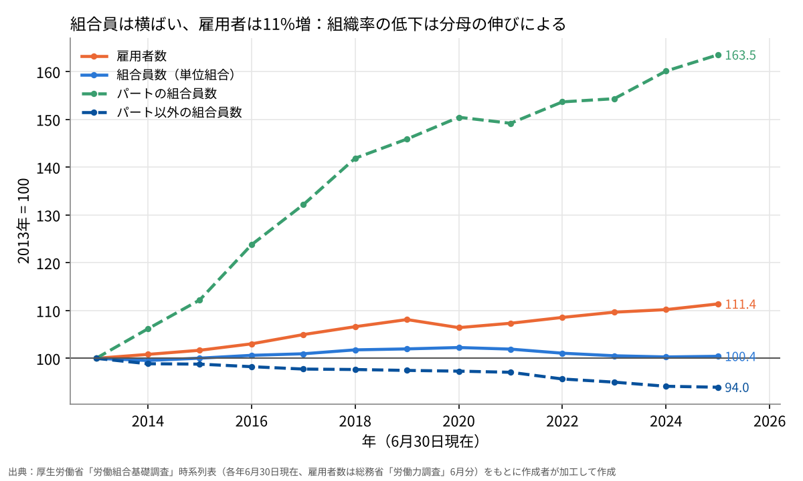
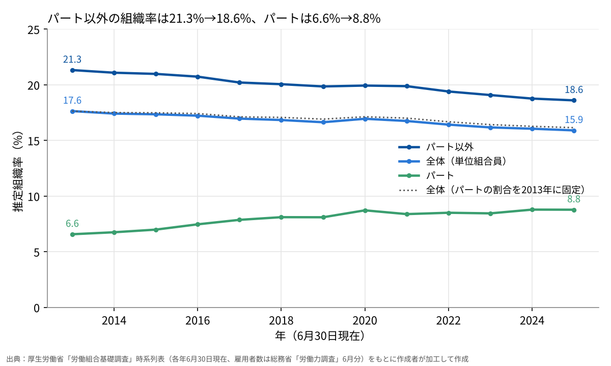
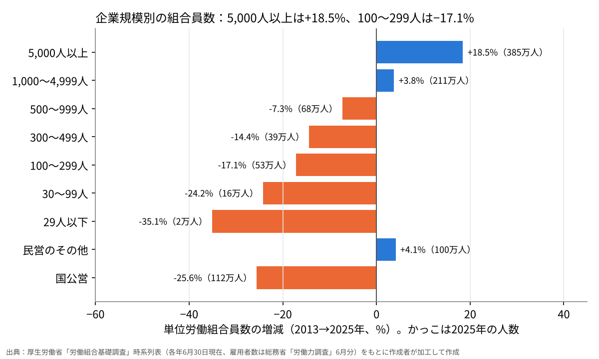

# F367 「労働組合の組織率は過去最低」は、パートの組合員が増えても下がり続けているのか？ 組合員は横ばい、雇用者が11%増えて16.0%に

## 結論（先に）

- 推定組織率（公表値）は2013年17.7%から2025年16.0%へ下がり、2025年が過去最低でした。この間、パートタイム労働者の組合員は91.4万人から149.4万人（1.63倍）に増えています。
- 組合員数（単位組合）は982万人から986万人で、ほとんど変わっていません（+0.4%）。雇用者数は5,571万人から6,205万人（+11.4%）に増えました。組織率の低下は、ほぼすべて雇用者（分母）が増えたことで説明できます（分母の寄与104%）。
- パート以外の組合員は891万人から837万人（−6.0%）に減り、パート以外の雇用者は7.7%増えました。パート以外の組織率は21.3%→18.6%（−2.7ポイント）で、全体（−1.7ポイント）より大きく下がりました。パートの組織率は6.6%→8.8%に上がっています。
- 企業規模別では、5,000人以上の企業の組合員は+18.5%、1,000〜4,999人は+3.8%でしたが、1,000人未満はどの規模も減りました（100〜299人 −17.1%、30〜99人 −24.2%）。国公営は−25.6%でした。民営企業の組合員のうち1,000人以上の企業の割合は63.6%→68.3%になりました。
- 問い直しとして、雇用者に占めるパートの割合を2013年（25.0%）のままにして計算し直すと、2025年の全体の組織率は16.1%で、実際（15.9%）とほとんど変わりません。パートが増えたこと自体の影響は小さく、パート以外の組織率の低下が主です。

## 問い

厚生労働省「労働組合基礎調査」では、推定組織率（労働組合員数 ÷ 雇用者数）が毎年のように「過去最低」と報じられます。一方で、パートタイム労働者の組合員は増え続けています。

労働組合の役員や人事・労務の担当にとっては、組織率が下がったのが「組合員が減ったから」なのか「働く人が増えたから」なのか、パートとそれ以外でどう違うのかで、意味が変わります。そこで、同じ調査の時系列表で、組織率の変化を組合員数と雇用者数、パートとパート以外に分けました。

既存の記事（jodn 210）はストライキの件数を扱い、組織率には触れただけです。

## データ（出典）

- 厚生労働省「労働組合基礎調査」時系列表 第1表（単位・単一労働組合の組合員数、雇用者数、推定組織率）、第3表（企業規模別の単位労働組合員数）、第8表（パートタイム労働者の組合員数、雇用者数、推定組織率）。各年6月30日現在。雇用者数は総務省「労働力調査」の6月分です。
- パートの雇用者数は、2013年からある「新定義」（週35時間未満の正規以外の雇用者 ＋ 週35時間以上で「パート」と呼ばれる雇用者）を使いました。
- 公表の推定組織率は「単一労働組合」の組合員数で計算されています。パートの組合員数は「単位労働組合」の数なので、パートとパート以外に分けるときは、全体も単位組合員数で計算し直しました（2025年は公表値16.0%、単位組合員ベース15.9%）。

ファイルとURLは `data/raw/SOURCES.md` にあります。

## 事前の計画

計画は [PLAN.md](PLAN.md)（2026-11-16 13:45、分解を集計する前に作成）です。

| 仮説 | 外れの基準 | 結果 | 判定 |
|---|---|---|---|
| H1 パートの組合員は1.5倍以上に増え、全体の組織率は下がった | どちらかが当てはまらない | 1.63倍、17.7%→16.0% | 支持 |
| H2 パート以外の組織率は全体より大きく下がった | 小さい | −2.72 対 −1.73 ポイント | 支持 |
| H3 全体の低下の半分以上は雇用者（分母）の増加による | 半分未満 | 104% | 支持 |
| H4 民営企業の組合員は1,000人未満の企業で大きく減った | 1,000人未満のほうが減り方が小さい | 1,000人以上 +12.8%、1,000人未満 −14.0% | 支持 |

## やったこと

1. 組織率の対数の変化を、組合員数の対数の変化と雇用者数の対数の変化に分けました。
2. パート以外の組合員数（単位組合員数 − パートの組合員数）とパート以外の雇用者数（雇用者数 − パートの雇用者数）から、パート以外の組織率を出しました。
3. 企業規模別の組合員数の増減を、2013年と2025年で比べました。

## 分かったこと

### 図1 組合員は横ばい、雇用者は11%増



- 2013年を100とすると、2025年は雇用者数111.4、組合員数100.4、パートの組合員数163.5、パート以外の組合員数94.0でした。
- 組織率の対数の変化 −0.104 は、組合員数 +0.004 と雇用者数 +0.108 に分かれます。組合員は減っておらず、働く人が増えた分だけ割合が下がった形です。
- 組合員数は2020年（1,004万人）が最も多く、そのあと少し減っています。

### 図2 パート以外の組織率が下がり、パートは上がった



- パート以外の組織率は、21.3%（2013年）、19.8%（2019年）、18.6%（2025年）でした。
- パートの組織率は、6.6%、8.1%、8.8%と上がりました。組合員に占めるパートの割合は9.3%から15.1%になりました。
- 雇用者に占めるパートの割合は25.0%から27.5%で、組合員に占めるパートの割合ほどは変わっていません。

### 図3 大企業で増え、中小企業と国公営で減った



- 2013→2025年の組合員数の増減は、5,000人以上 +18.5%（385万人）、1,000〜4,999人 +3.8%、500〜999人 −7.3%、300〜499人 −14.4%、100〜299人 −17.1%、30〜99人 −24.2%、29人以下 −35.1%でした。
- 国公営は151万人から112万人（−25.6%）に減りました。
- この表には規模別の雇用者数がないので、規模別の組織率は出せません。大企業の組合員の増加にパートがどれだけ入っているかも、この表では分かりません。

## 問い直し（結果を見てから足した）

パートの割合が増えたこと（組織率の低いパートが増えたこと）が全体の組織率を下げたのかを確かめるため、雇用者に占めるパートの割合を2013年（25.0%）に固定して、全体の組織率を計算し直しました（図2の点線）。

- 2025年の全体の組織率は、実際15.9%に対し、パートの割合を固定すると16.1%でした。差は0.2ポイントです。
- 2013→2025年の低下（−1.7ポイント）の大部分は、パートの割合の変化ではなく、パート以外の組織率の低下によるものです。

## 頑健性

| 確かめ | 全体の変化（ポイント） | パート以外の変化（ポイント） | 分母の寄与 | 結論 |
|---|---|---|---|---|
| 主：2013→2025年、単位組合員、パート新定義 | −1.73 | −2.72 | 1.04 | — |
| 1 期間を2013→2019年に | −1.00 | −1.47 | 1.34 | 変わらない |
| 2 公表の組織率（単一組合員）で分解 | −1.73 | — | 1.05 | 変わらない |
| 3 パートの雇用者を旧定義（週35時間未満）に | −1.73 | −2.22 | — | 変わらない |
| 3' 旧定義で2010→2025年 | −2.44 | −3.10 | 0.91 | 変わらない |

どの確かめでも、全体の低下の大半は雇用者の増加によるもので、パート以外の組織率は全体より大きく下がりました。なお、雇用者数は2022年に労働力調査の基準人口が切り替わっていますが、この表は切り替えの補正をしていません（2021年5,980万人→2022年6,048万人）。

## 言えないこと

- 組合員数は労働組合が答えた数、雇用者数は労働力調査の推計で、違う調査の数の比です。
- 規模別の雇用者数がないので、規模別の組織率は出せません。
- パートは組合が「パート」と答えた人で、労働力調査の定義と完全には合いません。
- 組織率が下がった理由（産業の構成、働き方、組合の活動）は、このデータでは分かりません。理由についての話はすべて推測になります。

## 仕事で使うなら

- 組織率の動きは、組合員数と雇用者数を並べると、「組合員が減った」のか「働く人が増えた」のかを分けて読めます。
- パートとパート以外に分けると、全体の数字では見えない動き（パート以外の低下、パートの上昇）が分かります。
- 公表の組織率（単一組合）とパートの組織率（単位組合）は組合員の数え方が違うので、並べるときは数え方をそろえると前提がそろいます。

## 計画からの変更

- 図は3枚にし、問い直しの「パートの割合を固定した組織率」は図2に点線で重ねました。
- それ以外は計画どおりです。

## 再現のしかた

```sh
pip install -r requirements.txt
python3 src/01_fetch.py   # 取得（ネットが必要。data/raw に同梱済みなので通常は不要）
sh src/run_all.sh         # 02 → 03 → 04（オフライン）
```

| ファイル | 中身 |
|---|---|
| src/01_fetch.py | 元データの取得（e-Stat、3ファイル） |
| src/02_build.py | data/union_total_part.csv・union_members_by_firm_size.csv を作る（見出しと合計を確かめる） |
| src/03_analysis.py | 組織率の分解、パートとパート以外、規模別、頑健性、パートの割合の固定。results/ に出力 |
| src/04_figures.py | figures/ の3枚 |
| results/main.json | 本文の数字のもと |
| results/density_decomposition_series.csv | 年ごとの組合員数・雇用者数・組織率 |
| results/members_by_firm_size_2013_2025.csv | 企業規模別の組合員数 |

所要時間は約2秒（CPU 1つ）。`results/repro_check.txt`：2026-11-16 再実行、11 ファイル一致。

## レビューで直したこと

独立レビューで数字の照合・再実行・図を確かめ、直すところはなかった。

## 出典

- 厚生労働省「労働組合基礎調査」（統計表 https://www.e-stat.go.jp/stat-search/files?toukei=00450101 ）

（いずれも 厚生労働省「労働組合基礎調査」をもとに作成者が加工して作成）
