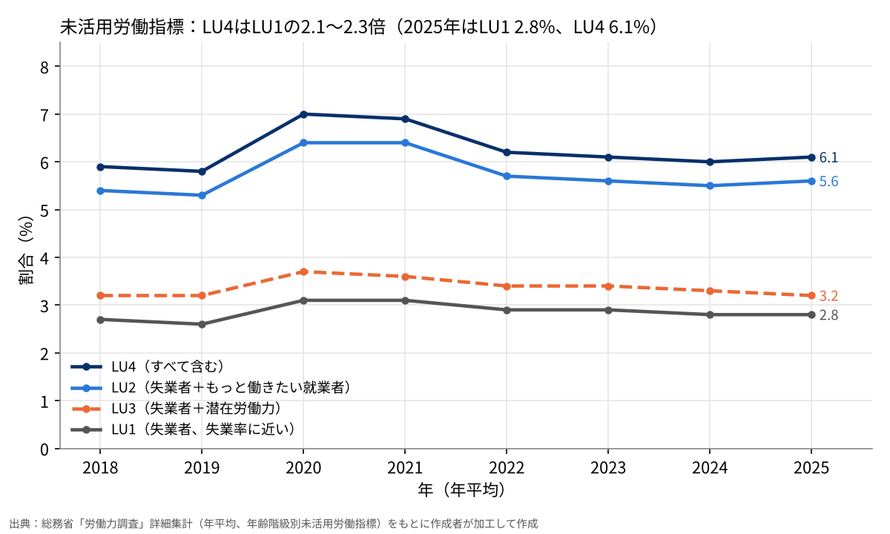
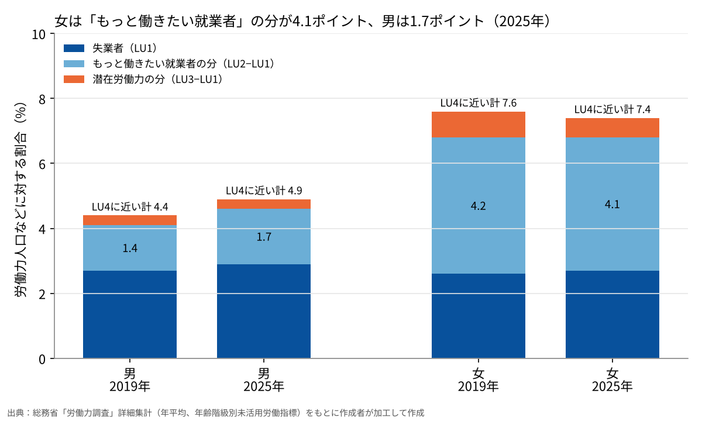
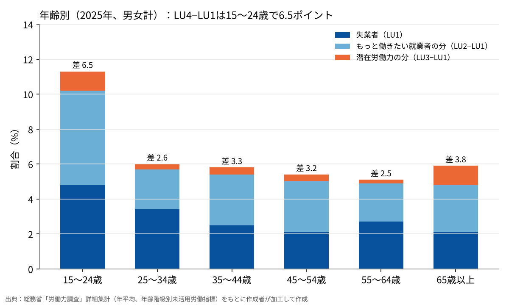
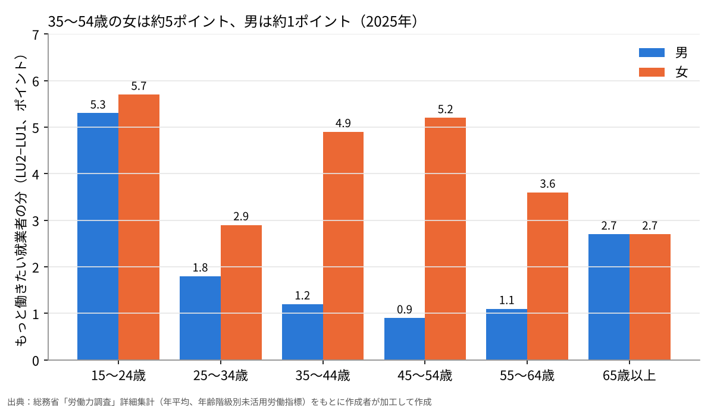

# F368 失業率は低いが、「もっと働きたい人」を含めるとどう見えるか？ 2025年は失業者だけなら2.8%、含めると6.1%。女の35〜54歳は8%台

## 結論（先に）

- 総務省「労働力調査」の未活用労働指標で、失業者だけの割合（LU1、失業率に近い）は2025年に2.8%でした。もっと働きたい就業者と、働きたいが仕事を探していない人（潜在労働力）を含めた LU4 は6.1%で、LU1 の2.18倍です。2018〜2025年のどの年も2.1〜2.3倍でした。
- LU4 と LU1 の差（3.3ポイント、2025年）のほとんどは「もっと働きたい就業者」（追加就労希望就業者）の分（LU2 − LU1 = 2.8ポイント）で、潜在労働力の分（LU3 − LU1）は0.4ポイントでした。
- 女は差が大きく、2025年の LU4 は女7.4%、男5.0%、差（LU4 − LU1）は女4.7、男2.1ポイントでした。女の35〜44歳・45〜54歳は LU1 が2%台なのに LU4 は8%台で、もっと働きたい就業者の分が約5ポイントあります（男の同じ年齢は約1ポイント）。
- 2020年（景気の落ち込み）には、LU1 が +0.5ポイント、もっと働きたい就業者の分が +0.6ポイント上がり、LU4 は5.8%→7.0%になりました。失業者が増えただけでなく、働く時間が減った人が増えた形です。ただし、0.1ポイント刻みの値で、差はわずかです。
- 年齢別では15〜24歳の差が最も大きく（6.5ポイント、LU4 11.3%）、次が65歳以上（3.8ポイント）です。この2つの年齢は潜在労働力の分が1.1ポイントと、他の年齢（0.2〜0.4）より大きくなっています。

## 問い

日本の失業率は2%台と低い水準です。ただ、働いていても「もっと長く働きたい」人や、働きたいが今は仕事を探していない人は、失業率には入りません。総務省「労働力調査」は2018年から、これらを含めた「未活用労働指標」（LU1〜LU4）を公表しています。

- LU1 ＝ 失業者 ÷ 労働力人口
- LU2 ＝（失業者 ＋ 追加就労希望就業者）÷ 労働力人口
- LU3 ＝（失業者 ＋ 潜在労働力人口）÷（労働力人口 ＋ 潜在労働力人口）
- LU4 ＝（失業者 ＋ 追加就労希望就業者 ＋ 潜在労働力人口）÷（労働力人口 ＋ 潜在労働力人口）

労働市場の統計を読む人や、人手不足の対策を考える企業・自治体にとっては、「働きたいのに十分に働けていない人」がどこにどれだけいるかが知りたいところです。そこで、LU1〜LU4 を男女・年齢・年で比べ、差の中身を分けました。

既存の記事（F354 失業率と求人倍率）は失業率だけを扱っていて、未活用労働指標は使っていません。

## データ（出典）

- 総務省「労働力調査」年報 詳細集計 全国・時系列表「年齢階級別未活用労働指標」（LU1〜LU4、補助指標、男女別）。2019〜2025年版をつなぎ、同じ年が2つの版にあるときは新しい版の値を使いました（2つの版で値の違いはありませんでした）。2018〜2025年の年平均で、年齢階級別の値もあります。
- 同 長期時系列表 1-e-3「未活用労働指標１」（月次、季節調整値、2002年1月〜2026年9月）。LU1 の長い動きと、年報の値との照合に使いました。
- 値は0.1ポイント刻みで公表されているので、差の計算も0.1ポイントの精度です。

ファイルとURLは `data/raw/SOURCES.md` にあります。

## 事前の計画

計画は [PLAN.md](PLAN.md)（2026-11-16 13:50、比べや分解を集計する前に作成）です。

| 仮説 | 外れの基準 | 結果 | 判定 |
|---|---|---|---|
| H1 2018〜2025年のどの年も LU4 は LU1 の2倍以上 | 2倍未満の年がある | 最小2.10倍（2023年） | 支持 |
| H2 女の LU4 − LU1 はどの年も男より大きい | 男以上の年がある | 女のほうが2.6〜3.4ポイント大きい | 支持 |
| H3 2019→2020年の上がり幅は LU1 より「もっと働きたい就業者の分」のほうが大きい | 小さい | +0.6 対 +0.5 ポイント | 支持（差はわずか） |
| H4 2025年の LU4 − LU1 が最も大きいのは15〜24歳か65歳以上 | 35〜54歳のどれかが最大 | 15〜24歳（6.5ポイント） | 支持 |

## やったこと

1. 年・男女・年齢ごとに LU1〜LU4 を並べ、LU4 ÷ LU1 と LU4 − LU1 を出しました。
2. 差を、もっと働きたい就業者の分（LU2 − LU1）と潜在労働力の分（LU3 − LU1）に分けました。LU3・LU4 は分母に潜在労働力を足すので、この分け方は近似です（2つの分の和と LU4 − LU1 の差は最大0.2ポイント）。

## 分かったこと

### 図1 LU4 は LU1 の2倍あまり



- 男女計の LU1 は2.6〜3.1%、LU4 は5.8〜7.0%の間を動きました。LU4 ÷ LU1 は2.10倍（2023年）〜2.26倍（2020年）です。
- LU2（失業者＋もっと働きたい就業者）は2025年に5.6%で、LU4 との差は小さく、LU3（失業者＋潜在労働力）は3.2%で LU1 に近い値です。
- LU1 の月次（季節調整値）は、2002年6月の6.0%が最も高く、2026年9月は2.6%でした。

### 図2 女は「もっと働きたい就業者」の分が大きい



- 2025年のもっと働きたい就業者の分は、女4.1ポイント、男1.7ポイントでした（2019年は女4.2、男1.4）。
- LU1 は男女でほとんど同じ（女2.7%、男2.9%）ですが、LU4 は女7.4%、男5.0%です。
- 男は2019→2025年に差（LU4 − LU1）が1.7から2.1ポイントへ少し広がりました。

### 図3 年齢別では15〜24歳と65歳以上の差が大きい



- 2025年の LU4 − LU1 は、15〜24歳6.5、25〜34歳2.6、35〜44歳3.3、45〜54歳3.2、55〜64歳2.5、65歳以上3.8ポイントでした。
- 15〜24歳は LU1 も4.8%と高く、LU4 は11.3%です。2018年も LU4 は10.3%で、若い層の未活用が大きいことは変わっていません。
- 65歳以上と15〜24歳は潜在労働力の分が1.1ポイントで、他の年齢（0.2〜0.4）より大きくなっています。

## 問い直し（結果を見てから足した）

女の差が大きかったので、「もっと働きたい就業者の分」を年齢・男女別に並べました（2025年）。



- 女は35〜44歳4.9、45〜54歳5.2ポイント、男は同じ年齢で1.2、0.9ポイントでした。
- 女の35〜44歳・45〜54歳の LU1 は2.6%・2.2%ですが、LU4 は8.1%・8.0%です。失業率だけでは見えない「もっと働きたい」が、この年齢の女に多くあります。
- 15〜24歳と65歳以上は、男女でほとんど差がありません（15〜24歳 男5.3・女5.7、65歳以上 男女とも2.7）。

## 頑健性

| 確かめ | 値 | 補足 | 結論 |
|---|---|---|---|
| 主：LU4 ÷ LU1 の最小（2018〜2025年、男女計） | 2.10倍 | 2023年 | — |
| 1 差（LU4 − LU1）の最小 | 3.2ポイント | 2018・2019年 | 変わらない |
| 2 年齢別で差が最大の年齢（2019年） | 5.7ポイント | 15〜24歳 | 変わらない |
| 2 年齢別で差が最大の年齢（2022年） | 5.7ポイント | 15〜24歳 | 変わらない |
| 3 版の違いによる LU4 の差の最大 | 0.0ポイント | 同じ年・男女で比べた | 変わらない |
| 4 月次の年平均と年報の LU1 の差の最大 | 0.06ポイント | 2018〜2025年 | 変わらない |

どの確かめでも結論は同じでした。H3（2020年の上がり方）は差が0.1ポイントしかなく、値の丸めで入れ替わりうるので、強くは言えません。

## 言えないこと

- 追加就労希望は「もっと働きたい」と本人が答えたもので、すぐに働ける時間や、働きたい賃金の条件は分かりません。
- 潜在労働力には「仕事があればすぐ働ける人」と「探しているがすぐには働けない人」が入り、どれだけが実際に働くかは分かりません。
- 内訳は指標の差からの近似で、値は0.1ポイント刻みです。
- 2018年より前は LU2〜LU4 がなく、景気の長い波の中での位置は分かりません。
- なぜ女の35〜54歳でもっと働きたい人が多いのか（働き方の制度、家庭の事情、仕事の条件）は、このデータでは分かりません。理由についての話はすべて推測になります。

## 仕事で使うなら

- 失業率と並べて LU2・LU4 を見ると、「働いているが十分ではない人」を含めた余力の大きさが分かります。
- 男女・年齢で LU1 と LU4 の差が大きく違うので、どの層の話かを添えると読み違えにくくなります。
- 指標は0.1ポイント刻みなので、小さな差を比べるときは丸めの影響に気をつけると前提がそろいます。

## 計画からの変更

- 2018年版の表は形が違う（構成する人数の表）ため取得から外し、2018年の値は2019年版から取りました。
- それ以外は計画どおりです。

## 再現のしかた

```sh
pip install -r requirements.txt
python3 src/01_fetch.py   # 取得（ネットが必要。data/raw に同梱済みなので通常は不要）
sh src/run_all.sh         # 02 → 03 → 04（オフライン）
```

| ファイル | 中身 |
|---|---|
| src/01_fetch.py | 元データの取得（e-Stat、8ファイル） |
| src/02_build.py | data/lu_annual.csv・lu_annual_all_versions.csv・lu1_monthly.csv を作る |
| src/03_analysis.py | 倍率・差・内訳、男女・年齢別、頑健性。results/ に出力 |
| src/04_figures.py | figures/ の4枚 |
| results/main.json | 本文の数字のもと |
| results/lu_with_parts.csv | 年・男女・年齢ごとの LU1〜LU4 と内訳 |

所要時間は約3秒（CPU 1つ）。`results/repro_check.txt`：2026-11-16 再実行、12 ファイル一致。

## レビューで直したこと

独立レビューで数字の照合・再実行・図を確かめ、直すところはなかった。

## 出典

- 総務省「労働力調査」 https://www.stat.go.jp/data/roudou/index.html （統計表 https://www.e-stat.go.jp/stat-search/files?toukei=00200531 ）

（いずれも 総務省「労働力調査」をもとに作成者が加工して作成）
