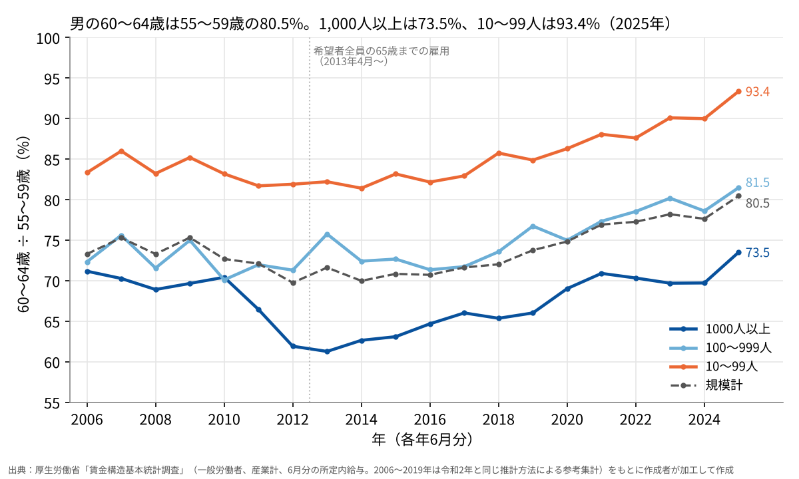
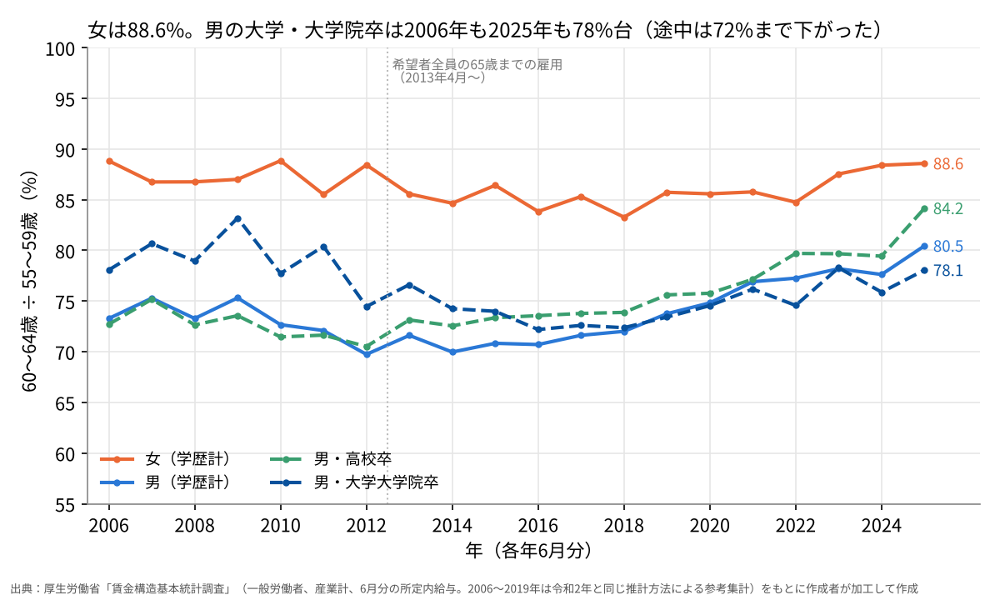
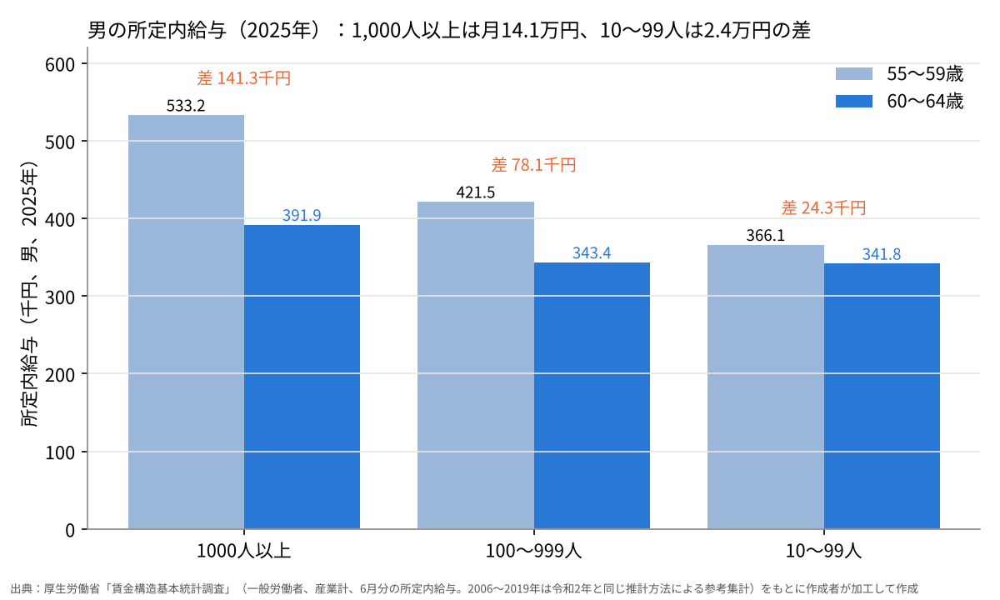
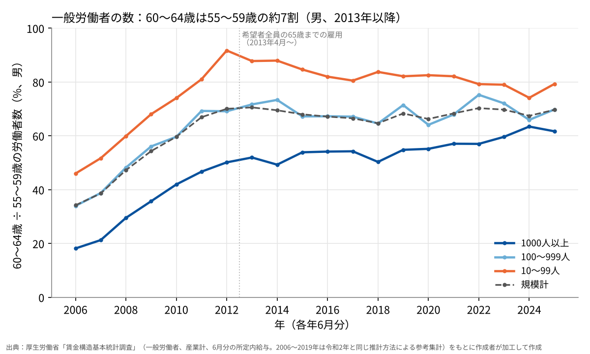

# F369 「60歳で賃金が大きく下がる」は、企業の規模や男女でどれだけ違うのか？ 男の60〜64歳は55〜59歳の80.5%、1,000人以上は73.5%、10〜99人は93.4%、女は88.6%

## 結論（先に）

- 一般労働者の男の所定内給与（6月分）は、2025年に60〜64歳が55〜59歳の80.5%でした（445.6千円 → 358.5千円）。2006年は73.3%で、下がり幅は小さくなっています。
- 規模で大きく違い、2025年は1,000人以上73.5%（533.2千円 → 391.9千円、差14.1万円）、100〜999人81.5%、10〜99人93.4%（差2.4万円）でした。どの年も、1,000人以上は10〜99人より大きく下がっています（100〜999人と1,000人以上の順は、2010年だけ入れ替わりました）。
- 1,000人以上は2006年71.2%から2013年61.3%へいったん下がり、そのあと2025年73.5%まで戻りました。規模計の男の比は、2006→2013年は1年あたり −0.24ポイント、2013→2025年は +0.74ポイントで、2013年より後に縮み方が速くなりました。
- 女は88.6%（2025年）で、男より下がり方が小さくなっています。男の大学・大学院卒は2006年も2025年も78%台で、間の2016年に72.2%まで下がっていました。規模計の改善の多くは高校卒（72.7%→84.2%）によるものです。
- 問い直しとして労働者数を見ると、男の60〜64歳の一般労働者は55〜59歳の34.2%（2006年）から70.5%（2013年）に増え、その後は7割前後です。働き続ける人が増えた時期に比はいったん下がり、そのあと上がりました。

## 問い

60歳の定年のあと、再雇用などで賃金が大きく下がるとよく言われます。2013年4月からは希望する人を65歳まで雇うことが会社の義務になり（経過措置は2025年3月まで）、2021年4月からは70歳までの就業機会の確保が努力義務になりました。

人事・賃金制度の担当や、60歳前後の会社員とその家族にとっては、下がり方が企業の規模や男女でどれだけ違い、小さくなってきたのかが知りたいところです。そこで、推計方法をそろえた2006〜2025年の表で、60〜64歳 ÷ 55〜59歳の所定内給与を比べました。

F360（年功賃金の曲線）は20〜24歳を基準にした曲線の形を見たもので、60歳での下がり方は扱っていません。

## データ（出典）

- 厚生労働省「賃金構造基本統計調査」一般労働者 産業大分類 第1表（産業計、性・学歴・年齢階級別の所定内給与額と労働者数、企業規模計・1,000人以上・100〜999人・10〜99人）。民営事業所、6月分、名目。2006〜2019年は【参考掲載】「令和2年調査と同じ推計方法を用いた過去分の集計」、2020〜2025年は各年の表です（F360 と同じファイル）。
- 一般労働者（短時間労働者を除く）で、正社員かどうかは分けていません。
- 学歴は2019年以前の「大学・大学院卒」に合わせ、2020年以降の大学と大学院を労働者数で合わせました。

ファイルとURLは `data/raw/SOURCES.md` にあります（20ファイル、約23MB）。

## 事前の計画

計画は [PLAN.md](PLAN.md)（2026-11-16 13:55、下がり幅を集計する前に作成）です。

| 仮説 | 外れの基準 | 結果 | 判定 |
|---|---|---|---|
| H1 男・規模計の比は2006→2025年に5ポイント以上上がった | 5ポイント未満 | 73.3% → 80.5%（+7.2） | 支持 |
| H2 男の比はどの年も1,000人以上のほうが10〜99人より低い | 1,000人以上が10〜99人以上の年がある | 差は12.2〜20.9ポイント（最大は2013年）で、どの年も低い | 支持 |
| H3 2025年の比は男のほうが女より低い | 男が女以上 | 80.5% 対 88.6% | 支持 |
| H4 男・規模計の1年あたりの上がりは2013→2025年のほうが大きい | 小さい | −0.24 対 +0.74 ポイント | 支持 |

## やったこと

1. 年・性・規模・学歴ごとに、60〜64歳と55〜59歳の所定内給与の比を出しました（同じ年の年齢別の平均どうしの比）。
2. 2013年の前と後で、1年あたりの変化を比べました。
3. 60〜64歳と55〜59歳の一般労働者の数の比も出しました（問い直し）。

## 分かったこと

### 図1 大きい企業ほど大きく下がる



- 男の比は、規模計で73.3%（2006年）、71.6%（2013年）、80.5%（2025年）でした。
- 1,000人以上は71.2%（2006年）から61.3%（2013年）へ下がり、2025年は73.5%でした。10〜99人は83.3%から93.4%です。
- 10〜99人と1,000人以上の差は、12.2ポイント（2006年）から19.9ポイント（2025年）に広がりました。

### 図2 女と、男の学歴別



- 女の比は83〜89%の間で、2025年は88.6%でした。女は55〜59歳の給与がもともと男より低く、60歳での下がり方も小さくなっています。
- 男の高校卒は72.7%（2006年）から84.2%（2025年）に上がりました。男の大学・大学院卒は78.1%（2006年）、72.2%（2016年）、78.1%（2025年）でした。

### 図3 金額で見ると、大企業では月14万円の差



- 2025年の男の所定内給与は、1,000人以上で55〜59歳533.2千円、60〜64歳391.9千円、10〜99人で366.1千円、341.8千円でした。
- 60〜64歳の給与は、1,000人以上と10〜99人で5万円ほどしか違いません。大企業ほど55〜59歳の給与が高く、そこからの下がり方が大きい形です。

## 問い直し（結果を見てから足した）

比が2013年ごろにいったん下がったので、「60歳を過ぎても一般労働者として働く人の数」がどう変わったかを足しました。60〜64歳 ÷ 55〜59歳の労働者数の比を出しました。



- 男の規模計は34.2%（2006年）、70.5%（2013年）、69.7%（2025年）でした。1,000人以上は18.1%から61.7%に増えています。
- 2006〜2013年に、60歳を過ぎても一般労働者として働く人が大きく増えた時期に、給与の比は下がりました。そのあとは人数の比がほぼ横ばいの中で、給与の比が上がっています。
- この人数の比には、生まれた年ごとの人数の違い（例えば人数の多い世代が60歳を越えた時期）も入るので、働き続ける人の割合そのものではありません。

## 頑健性

| 確かめ | 2006年 | 2025年 | 変化（ポイント） | 結論 |
|---|---|---|---|---|
| 主：男・学歴計・規模計 | 73.28 | 80.45 | +7.18 | — |
| 1a 男・高校卒 | 72.71 | 84.16 | +11.44 | 変わらない |
| 1b 男・大学大学院卒 | 78.07 | 78.06 | −0.01 | **変わる**（2006年と同じ） |
| 2 3年平均（2006〜08→2023〜25年） | 73.95 | 78.75 | +4.81 | 少し弱まる（5ポイント未満） |
| 3 60〜64歳 ÷ 50〜54歳（男） | 69.15 | 81.94 | +12.80 | 変わらない |
| 4 65〜69歳 ÷ 60〜64歳（男） | 86.75 | 84.88 | −1.86 | 65歳でも下がり、縮んでいない |
| 5a 1,000人以上（男） | 71.16 | 73.50 | +2.34 | 小さい |
| 5b 100〜999人（男） | 72.32 | 81.47 | +9.15 | 変わらない |
| 5c 10〜99人（男） | 83.32 | 93.36 | +10.04 | 変わらない |

下がり幅が小さくなったことは多くの確かめで同じですが、男の大学・大学院卒と1,000人以上ではほとんど変わっていません。3年平均では +4.8ポイントで、H1 の「5ポイント以上」をわずかに下回ります。

## 言えないこと

- 同じ人の60歳前後の賃金の変化ではなく、同じ年の年齢別の平均どうしの比です。
- 正社員か、再雇用の嘱託などかは分けていません。職務や働く時間の変化も分かりません。
- 所定内給与だけで、賞与、年金、高年齢雇用継続給付などは入りません。
- 一般労働者だけで、短時間で働く人は入りません。60歳を過ぎて短時間の働き方に移った人は、この比には入りません。
- 下がり方が小さくなった理由（制度の改正、人手不足、賃金制度の見直し）は、このデータでは分かりません。理由についての話はすべて推測になります。

## 仕事で使うなら

- 60歳での下がり方は、規模で大きく違うので、規模を分けて比べると読み違えにくくなります。
- 比が上がったのが「60歳以上の給与が上がった」のか「55〜59歳が上がらなかった」のかは、金額を並べると分かります。
- 学歴の構成で平均が動くので、学歴別も並べると前提がそろいます。

## 計画からの変更

- 図2の題は、男の大学・大学院卒が途中で下がっていたことを見たあとで直しました。
- 図3（金額）は計画に書いていなかった図です。比だけでは大きさが分かりにくいので足しました。
- それ以外は計画どおりです。

## 再現のしかた

```sh
pip install -r requirements.txt
python3 src/01_fetch.py   # 取得（ネットが必要。data/raw に同梱済みなので通常は不要）
sh src/run_all.sh         # 02 → 03 → 04（オフライン）
```

| ファイル | 中身 |
|---|---|
| src/01_fetch.py | 元データの取得（e-Stat、20ファイル。F360 と同じ） |
| src/02_build.py | data/general.csv（性・学歴・年齢・規模別の所定内給与と労働者数）を作る |
| src/03_analysis.py | 60〜64歳 ÷ 55〜59歳の比、頑健性、労働者数の比。results/ に出力 |
| src/04_figures.py | figures/ の4枚 |
| results/main.json | 本文の数字のもと |
| results/ratio_60_64_to_55_59.csv | 年・性・規模・学歴ごとの比 |
| results/requestion_worker_ratio.csv | 労働者数の比 |

所要時間は約5秒（CPU 1つ）。`results/repro_check.txt`：2026-11-16 再実行、9 ファイル一致。

## レビューで直したこと

| # | 指摘 | 直し方 |
|---|---|---|
| 1 | 結論の「どの年も、大きい企業ほど大きく下がっています」は、2010年に100〜999人（70.1%）が1,000人以上（70.4%）を下回っていて正しくなかった | 「どの年も、1,000人以上は10〜99人より大きく下がっています（100〜999人と1,000人以上の順は2010年だけ入れ替わり）」に直した |
| 2 | H2 の結果「差は12.2〜19.9ポイント」は、最大が2013年の20.9ポイントで範囲が違っていた（note は「12〜20ポイント」） | 03_analysis.py で main.json の H2 に最大値（max_gap 20.94、2013年）を出すようにし、README を「12.2〜20.9ポイント（最大は2013年）」、note を「12〜21ポイント」に直した |

直したあとに /tmp で流し直し、results と figures の 8 ファイルが一致することを確かめました（results/repro_check.txt）。

## 出典

- 厚生労働省「賃金構造基本統計調査」 https://www.mhlw.go.jp/toukei/list/chinginkouzou.html （統計表 https://www.e-stat.go.jp/stat-search/files?toukei=00450091 ）

（いずれも 厚生労働省「賃金構造基本統計調査」をもとに作成者が加工して作成）
