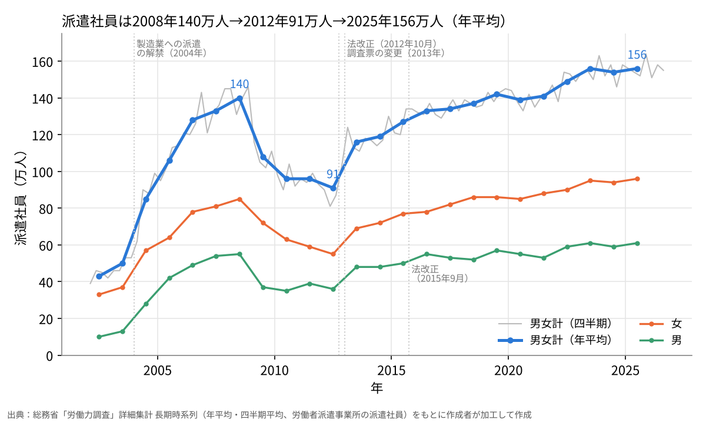
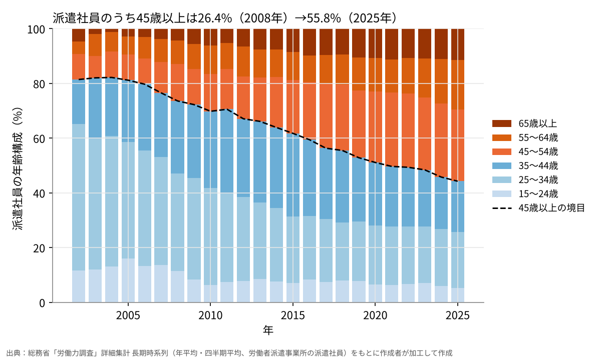
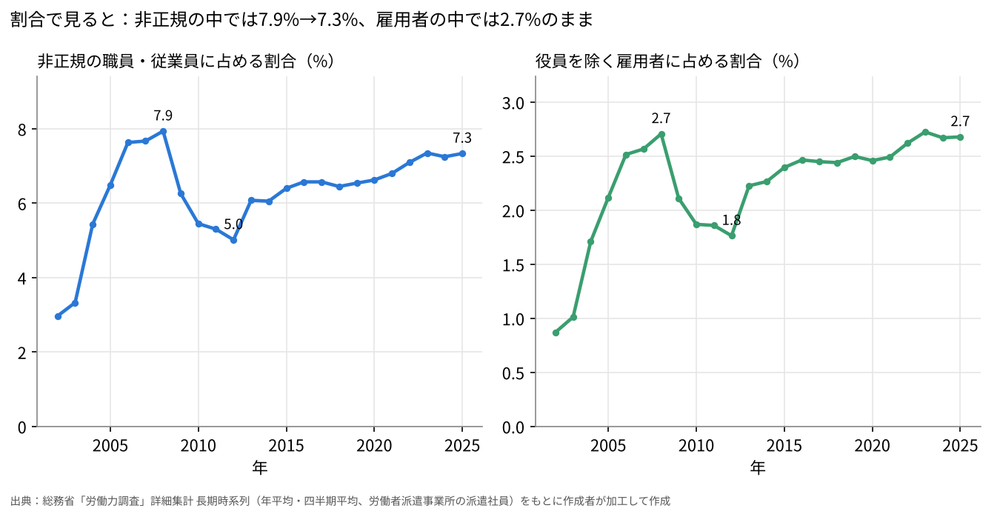

# F370 派遣で働く人は、2008年のピークからどこまで減ったのか？ 2012年に91万人まで減り、2025年は156万人と数の上では2008年（140万人）を上回った（2013年に調査の段差あり）

## 結論（先に）

- 労働力調査の「労働者派遣事業所の派遣社員」は、2008年の年平均140万人から2012年の91万人へ35%減りました（四半期では2008年10〜12月期146万人 → 2012年4〜6月期81万人）。
- その後は増え、2019年（142万人）に2008年を上回り、2025年は156万人でした。ただし2012年→2013年の増加（91万人→116万人）は、調査票の変更と同じ年で、同じ年に契約社員・その他が減っているので、区分の変わった分が入っていると考えられます（推測）。この段差（+25万人）は2008年と2025年の差（+16万人）より大きいので、段差の大きさによっては「2008年を上回った」とは言えません。
- 2008→2012年の減り方は男 −34.5%、女 −35.3%で、ほぼ同じでした（男のほうが大きく減ったという仮説は外れ）。
- 派遣社員の年齢は大きく上がり、45歳以上の割合は26.4%（2008年）から55.8%（2025年）になりました。25〜34歳は50万人から32万人に減り、45〜54歳は19万人から41万人、55〜64歳は12万人から28万人に増えています。
- 割合で見ると、非正規の職員・従業員に占める派遣社員は7.9%（2008年）→5.0%（2012年）→7.3%（2025年）、役員を除く雇用者に占める割合は2.7%で、2008年と同じ水準です。

## 問い

労働者派遣は、2004年に製造業への派遣が解禁されて大きく増え、2008年の景気の落ち込みで「派遣切り」が話題になりました。2012年・2015年には派遣の法律が改正されています。

人材派遣や人事の担当、働き方を考える人にとっては、派遣で働く人がその後どうなったか（減ったままか、戻ったか、誰が派遣で働いているか）が知りたいところです。そこで、労働力調査の雇用形態別の長期時系列で、派遣社員の数を男女・年齢で並べました。

既存の記事（jodn 370）は雇用者の割合（従業上の地位）を扱い、雇用形態の内訳は扱っていません。

## データ（出典）

- 総務省「労働力調査」長期時系列データ（詳細集計）年平均 10-1「年齢階級（10歳階級）別就業者数及び年齢階級（10歳階級）、雇用形態別雇用者数」（2002〜2025年、男女別、万人）。2005〜2021年は人口の基準の切り替えに合わせた時系列接続用の値です。
- 同 四半期平均 9-1（2002年1〜3月期〜2026年7〜9月期、男女計）。
- 「労働者派遣事業所の派遣社員」は、勤め先での呼び方による本人の答えです。
- 注によれば、2013年に調査票が変わり、「契約社員・嘱託」が「契約社員」と「嘱託」に分かれました。

ファイルとURLは `data/raw/SOURCES.md` にあります。

## 事前の計画

計画は [PLAN.md](PLAN.md)（2026-11-16 14:00、男女・年齢別の推移を集計する前に作成）です。

| 仮説 | 外れの基準 | 結果 | 判定 |
|---|---|---|---|
| H1 2025年の派遣社員は2008年を上回る | 下回る | 156万人 対 140万人 | 支持 |
| H2 2008→2012年の減り方は男のほうが大きい | 小さい | 男 −34.5%、女 −35.3% | 外れ |
| H3 45歳以上の割合は2008→2025年に15ポイント以上上がった | 15ポイント未満 | 26.4% → 55.8%（+29.4） | 支持 |
| H4 非正規に占める派遣の割合は2025年のほうが2008年より低い | 高いか同じ | 7.9% → 7.3% | 支持 |

## やったこと

1. 年平均の派遣社員の数を、男女・年齢（10歳階級）ごとに並べました。
2. 非正規の職員・従業員、役員を除く雇用者に占める割合を出しました。
3. 2012年と2013年の間の段差を、ほかの雇用形態の動きと並べて確かめました。

## 分かったこと

### 図1 2012年まで減り、そのあと増えた



- 年平均は、2002年43万人、2004年85万人、2008年140万人、2012年91万人、2019年142万人、2025年156万人でした。
- 四半期では、2008年10〜12月期の146万人がピークで、2012年4〜6月期の81万人が底でした。2026年7〜9月期は155万人です。
- 2012→2013年に派遣社員は91万人から116万人に増えましたが、同じ年に契約社員（355万人→274万人、嘱託を分けたため）や「その他」（128万人→82万人）が減っています。調査票の変更で答え方が変わった分が入っていると考えられます（推測）。

### 図2 派遣で働く人の年齢が上がった



- 2008年の派遣社員は、25〜34歳50万人、35〜44歳37万人が中心でした。2025年は45〜54歳41万人が最も多く、55〜64歳28万人、65歳以上18万人です。
- 15〜24歳は16万人（2008年）から8万人（2025年）に減りました。
- 45歳以上の割合は26.4%（2008年）、33.9%（2013年）、55.8%（2025年）でした。

### 図3 割合で見ると、2008年の水準に戻った程度



- 非正規に占める派遣社員の割合は、7.9%（2008年）、5.0%（2012年）、7.3%（2025年）でした。
- 役員を除く雇用者に占める割合は、2.7%（2008年）、1.8%（2012年）、2.7%（2025年）です。数は2008年を上回りましたが、雇用者全体も増えたので、割合は同じくらいです。

## 問い直し（結果を見てから足した）

年齢が上がったので、「同じ世代の人が、10年後も派遣で働いているのか」を足しました。10歳階級を10年ずらして、同じ生まれの年の集まりの派遣社員の数を比べました（同じ人を追ったものではありません）。

- 2008年に25〜34歳だった世代は50万人、10年後（2018年、35〜44歳）は36万人（0.72倍）でした。
- 2013年に35〜44歳だった世代は35万人、10年後（45〜54歳）は41万人（1.17倍）、2015年に35〜44歳だった世代も39万人から41万人（1.05倍）でした。
- 2013年以降に35歳を過ぎた世代では、40代・50代になっても派遣で働く人が減らず、むしろ増えています。派遣で働く人の年齢が上がったのは、若い人が減ったことと、同じ世代が派遣で働き続けたり、あとから派遣で働き始めたりしたことの両方によると考えられます（推測）。

結果は `results/requestion_cohort.csv` にあります。

## 頑健性

| 確かめ | 始め | 終わり | 結論 |
|---|---|---|---|
| 主：年平均、2008年→2025年（万人） | 140 | 156 | — |
| 1 四半期のピーク→最新（万人） | 146 | 155 | 変わらない（上回る） |
| 2 H3 を2013→2025年に（45歳以上の割合、%） | 33.9 | 55.8 | 変わらない |
| 2 H4 を2013→2025年に（非正規に占める割合、%） | 6.07 | 7.33 | **変わる**（2013年からは上がった） |
| 3 役員を除く雇用者に占める割合（2008→2025年、%） | 2.71 | 2.68 | ほぼ同じ |
| 4 既公表値（2008年→2021年、万人） | 140 | 140 | 2021年は同じ（時系列接続をしていない値） |

数が2008年を上回ったことと、年齢が上がったことは、どの確かめでも同じでした。非正規に占める割合は、2008年と比べれば下がりましたが、2013年と比べれば上がっていて、起点で結論が変わります。

## 言えないこと

- 本人の答える「勤め先での呼び方」による区分で、派遣元に雇われている人の数と完全には一致しません。
- 2013年の調査票の変更の影響の大きさは、この表だけでは決められません。
- 派遣で働く理由や、正社員への転換は分かりません。
- 産業・職業の内訳はこの表にありません。
- 法改正の影響は、景気の動きと同じ時期に重なっていて、分けられません。理由についての話はすべて推測になります。

## 仕事で使うなら

- 派遣社員の数は、雇用者全体や非正規に占める割合と並べると、増減が全体の動きによるものかどうかを分けて読めます。
- 2013年をまたぐ比べには、調査票の変更による段差がありうることを添えると、読み違えにくくなります。
- 年齢の構成が大きく変わっているので、年齢別に並べると前提がそろいます。

## 計画からの変更

- 図は3枚にし、問い直し（世代を追った数）は表と本文で示しました。
- 図2の年齢構成には、数字の代わりに45歳以上の境目の線を入れました。
- それ以外は計画どおりです。

## 再現のしかた

```sh
pip install -r requirements.txt
python3 src/01_fetch.py   # 取得（ネットが必要。data/raw に同梱済みなので通常は不要）
sh src/run_all.sh         # 02 → 03 → 04（オフライン）
```

| ファイル | 中身 |
|---|---|
| src/01_fetch.py | 元データの取得（e-Stat、2ファイル） |
| src/02_build.py | data/employment_type_annual.csv・published_annual.csv・dispatched_quarterly.csv を作る（見出しを確かめる） |
| src/03_analysis.py | 推移、男女・年齢、割合、段差、頑健性、世代を追った数。results/ に出力 |
| src/04_figures.py | figures/ の3枚 |
| results/main.json | 本文の数字のもと |
| results/dispatched_annual.csv | 年ごとの派遣社員と割合 |
| results/dispatched_by_age.csv・dispatched_age_share.csv | 年齢別 |
| results/requestion_cohort.csv | 世代を追った数 |

所要時間は約3秒（CPU 1つ）。`results/repro_check.txt`：2026-11-16 再実行、13 ファイル一致。

## レビューで直したこと

| # | 指摘 | 直し方 |
|---|---|---|
| 1 | 2012→2013年の調査票の変更による段差（+25万人）が、2008年と2025年の差（+16万人）より大きいのに、題名で「2008年を上回った」と言い切っていた | 題名を「数の上では2008年の140万人を上回った（2013年に調査の段差あり）」に直し（status・note・README）、結論と note の要点に段差と差の大きさの比べを1文足した |

直したあとに /tmp で流し直し、results と figures の 10 ファイルが一致することを確かめました（results/repro_check.txt）。

## 出典

- 総務省「労働力調査」 https://www.stat.go.jp/data/roudou/index.html （統計表 https://www.e-stat.go.jp/stat-search/files?toukei=00200531 ）

（いずれも 総務省「労働力調査」をもとに作成者が加工して作成）
