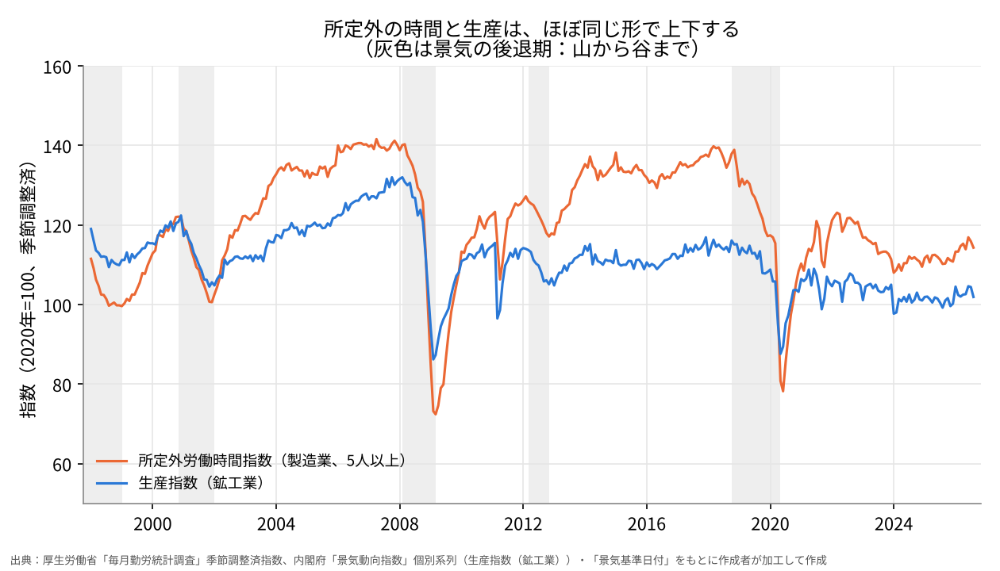
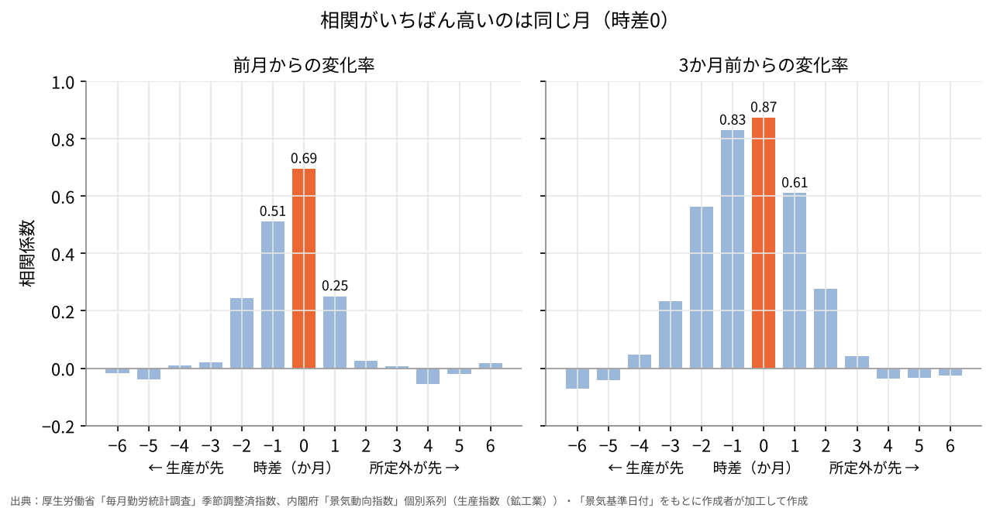
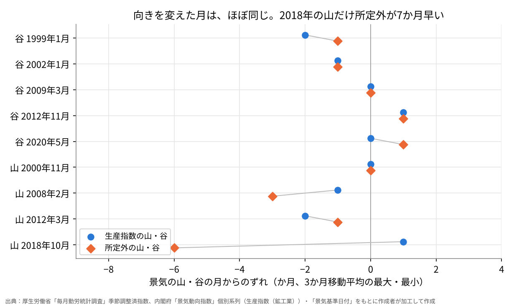
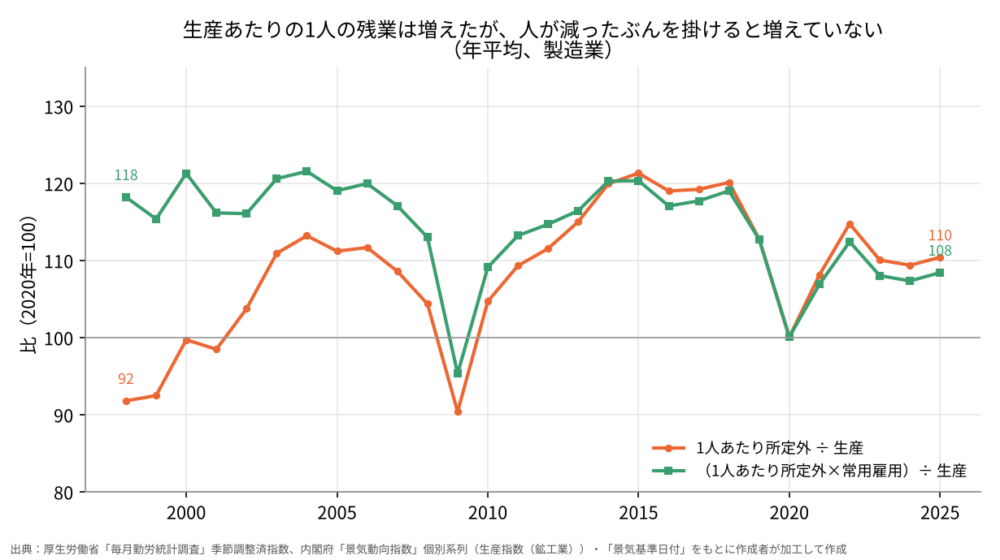

# F371 所定外の労働時間は、生産の動きより先に動くのか？ 前月比の相関は同じ月が0.69で最大。先には動かず、2019年以降は結びつきが弱まった

## 結論（先に）
- 製造業の所定外労働時間指数（季節調整済、事業所規模5人以上）と鉱工業の生産指数を1998年1月〜2026年8月の344か月で比べると、前月からの変化率どうしの相関がいちばん高いのは**同じ月（時差0）で0.69**でした。所定外が1か月先の相関は0.25で、生産が1か月先（所定外が1か月遅れ）の0.51より低くなりました。月の動きで見る限り、所定外は生産より**先に動くとは言えず、同時か、少し遅れ**ます。
- 景気の山（4回）の前後で3か月移動平均の最大の月を比べると、所定外は生産より平均2.0か月早く向きを変えました。ただし、これは2018年10月の山で7か月早かった1回に大きく引っ張られた値で、ほかの3回は0か月・2か月早い・1か月遅いでした。移動平均をかけない値では平均0.75か月で、景気の谷（5回）では平均0.4か月遅れでした。
- 3か月前からの変化率で見ると、生産が1%動くと所定外は1.37%動きます（予想の1.5%より小さい）。2019年4月以降（時間外労働の上限規制のあと）は、相関が0.77から0.61に、傾きが1.00から0.72に下がりました（2020年3〜12月を除く）。
- 生産あたりの1人の所定外は1998年の92から2025年の110（2020年=100）に増えましたが、製造業の常用雇用が減っているので、人数を掛けた総量の目安で見ると118から108へ、むしろ少し減っています。

## 問い
工場では、注文が増えるとまず残業で対応し、人を増やすのは後になると言われます。逆に注文が減ると、まず残業が減ります。そうなら、製造業の所定外労働時間は生産と同じか、少し先に動くはずです。この記事では、毎月勤労統計の所定外労働時間指数（製造業）が、鉱工業の生産指数より先に動くのか、同時か、後なのかを、月ごとの変化率の時差の相関と、景気の山・谷の前後の向きの変わり方で確かめました。あわせて、生産が1%動いたときの所定外の動きの大きさと、2019年以降の変化も見ました。

## データ（出典）
- 厚生労働省「毎月勤労統計調査」全国調査 長期時系列表「季節調整済指数」（1998年1月〜2026年8月、2020年=100）。製造業・事業所規模5人以上・就業形態計の所定外労働時間指数を主に使い、30人以上の所定外、5人以上の総実労働時間・常用雇用指数、調査産業計の所定外も使いました。
- 内閣府「景気動向指数」一致系列の個別系列のうち C1 生産指数（鉱工業、2020年=100、季節調整済）。
- 内閣府経済社会総合研究所「景気基準日付」（1998年以降の山は2000年11月・2008年2月・2012年3月・2018年10月、谷は1999年1月・2002年1月・2009年3月・2012年11月・2020年5月）。
- 元データは data/raw に同梱しています（合計約0.2MB、取得の記録は data/raw/SOURCES.md）。

## 事前の計画
計画は [PLAN.md](PLAN.md)（2026-11-16 14:10、時差の相関や景気の山・谷の前後の動きを計算する前に作成）です。

| 仮説 | 外れの基準 | 結果 | 判定 |
|---|---|---|---|
| H1：前月比どうしの相関は時差0でいちばん高い | ほかの時差で最大なら外れ | 時差0で0.695（−1か月0.511、+1か月0.251） | 支持 |
| H2：景気の山で、所定外の山は生産の山より平均1か月以上早い | 平均1か月未満なら外れ | 平均2.0か月（0、2、−1、7） | 支持（ただし1回に依存。頑健性で崩れる） |
| H3：3か月変化率で生産1%に所定外は1.5%より多く動く | 傾き1.5以下なら外れ | 傾き1.37 | 外れ |
| H4：2019年4月以降は相関が0.1以上低い | 低下0.1未満なら外れ | 0.772→0.607（−0.165） | 支持 |

## やったこと
1. 両系列を対数にして、前月比（%）と3か月前比（%）を作りました。
2. 所定外の変化率と、k か月あとの生産の変化率の相関を k=−6〜+6 で計算しました（k>0 なら所定外が先）。
3. 景気の山・谷の前後12か月で、3か月中心移動平均の最大（山）・最小（谷）の月を両系列で探し、月の差を比べました。
4. 3か月前比の所定外を、同じ期間の生産に回帰した傾きを、全期間と4つの期間で計算しました。
5. 問い直しとして、生産あたりの所定外を年平均で計算しました。

## 分かったこと
### 図1：所定外の時間と生産は、ほぼ同じ形で上下する

- 2008〜2009年の落ち込みでは、生産指数は2008年2月から2009年2月に34.7%下がり、所定外は2009年3月までに48.3%下がりました。2020年は生産が19.5%、所定外が33.4%下がりました。総実労働時間は11.0%・10.1%の低下で、落ち込みは所定外に集まっています。
- 2003年ごろから所定外の水準は生産より上にあり、2014〜2018年は差が広がりました。

### 図2：相関がいちばん高いのは同じ月（時差0）

- 前月比では時差0が0.69、所定外が1か月遅れが0.51、所定外が1か月先が0.25でした。3か月前比でも時差0の0.87が最大で、所定外が遅れる側（0.83）のほうが先の側（0.61）より高くなりました。
- 月の動きで見る限り、所定外を生産の「先行指標」として読むのは難しく、同時の答え合わせに近い動きです。

### 図3：向きを変えた月は、ほぼ同じ。2018年の山だけ所定外が7か月早い

- 谷では、所定外と生産の向きが変わった月の差は−1〜0か月で、平均すると所定外が0.4か月遅れでした。
- 山では、2000年は同じ月、2008年は所定外が2か月早く、2012年は1か月遅く、2018年は所定外が2018年4月、生産が2018年11月で7か月早くなりました。2018年は所定外が春に最大になったあと、生産が高い水準を保つ中で先に下がり始めています。

### 図4：生産あたりの1人の残業は増えたが、人が減ったぶんを掛けると増えていない

- 「所定外の指数÷生産指数」は1998年の92から2014〜2018年の120前後に上がり、2025年は110でした。
- 同じ期間に製造業の常用雇用指数は129から98に下がりました。1人あたりの所定外に常用雇用を掛けた「総量の目安」を生産で割ると、1998年118、2007年117、2019年113、2025年108でした。

## 問い直し（結果を見てから足した）
図1で所定外の水準が生産より上に離れていくのが目に入ったので、「同じ生産でも残業が増えたのか」を足しました（図4）。1人あたりで見ると増えましたが、働く人の数を掛けると、総量の目安は少し減っていました。1人あたりの残業が増えたように見えるのは、人が減ったぶんを1人ひとりの時間で埋めた形とも読めます（推測）。

## 頑健性
| 確かめたこと | 結果 |
|---|---|
| 事業所規模30人以上の所定外 | 前月比の相関は時差0で最大（0.695）、傾き1.43、山で平均1.75か月早い、谷で0.2か月遅い |
| 2008年10月〜2009年6月と2020年3〜12月を除く | 時差0で最大（0.53、−1か月0.31、+1か月0.02）、傾き0.97 |
| 移動平均をかけない値で山・谷 | 山で平均0.75か月早い（H2 は外れになる）、谷で平均1.2か月遅い。2018年の山は所定外が3か月遅い |
| 総実労働時間（製造業）に替える | 時差0で最大（0.46）、傾き0.27 |
| 調査産業計の所定外に替える | 時差0で最大（0.54） |

H1（同時）はどの確かめでも同じでした。H2（山で先）は、移動平均のかけ方を変えるだけで外れになり、弱い結果です。

## 言えないこと
- 所定外は1人あたりの時間の指数で、製造業全体の残業の総量ではありません。図4の「総量の目安」も、常用雇用指数を掛けた近似です。
- 鉱工業の生産指数には鉱業が入り、毎勤の製造業とは範囲が少し違います。
- 毎勤は調査の対象の入れ替えや集計の見直しで段差のある月があり、季節調整のかけ方も2つの統計で違います。
- 所定外が1か月遅れる側の相関が高いのは、毎勤が月末でなく給与の締切日で区切る会社を含むため、前の月の残業が一部入ることが関係しているかもしれません（推測）。
- 先に動くかどうかは相関で見たもので、所定外が生産を動かす（または逆）という因果は言えません。
- 2019年以降の関係の変化は、上限規制のほか、物の動きの変化や2020年の落ち込みのあとの回復の仕方とも重なっていて、分けられません。2020年5月より後の景気の山・谷はまだ決まっていません。

## 仕事で使うなら
- 毎勤の所定外は、生産の数か月先を読む材料としては弱く、同じ月の生産の動きの確かめや、落ち込みの深さを見る材料として向いています。大きな落ち込みのときの下げ幅は、生産の1.4〜1.7倍でした（2008〜2009年、2020年）。
- 1人あたりの残業の水準を年をまたいで比べるときは、人数の変化を合わせて見ると読み違いが減ります。

## 計画からの変更
- 問い直しで、常用雇用指数（製造業5人以上）を追加で読みました（PLAN の候補を、人数を掛ける形に広げました）。
- 頑健性に、調査産業計の所定外を1つ足しました。

## 再現のしかた
```sh
pip install -r requirements.txt
python3 src/01_fetch.py   # 取得（ネットが必要。data/raw に同梱済みなので通常は不要）
sh src/run_all.sh         # 02 → 03 → 04（オフライン）
```

| ファイル | 中身 |
|---|---|
| src/01_fetch.py | 元データの取得（e-Stat 2ファイル、内閣府の景気基準日付のページ） |
| src/02_build.py | data/monthly.csv・cycle_dates.csv を作る（列は見出しの文字で探す） |
| src/03_analysis.py | 時差の相関、山・谷の比較、弾力性、期間別、生産あたりの所定外。results/ に出力 |
| src/04_figures.py | figures/ の4枚 |
| results/main.json | 本文の数字のもと |
| results/xcorr.csv | 時差の相関（系列別） |
| results/turning_points*.csv | 景気の山・谷の前後の向きの変わり目 |
| results/period_corr.csv・annual_ratio.csv | 期間別の相関・傾き、年平均の比 |

所要時間は数秒です。/tmp に写して流し直し、results と figures と data の CSV の 13 ファイルがバイト単位で一致することを確かめました（results/repro_check.txt）。

## レビューで直したこと

独立レビューで数字の照合・再実行・図を確かめ、直すところはなかった。

## 出典
- 厚生労働省「毎月勤労統計調査」全国調査 長期時系列表 季節調整済指数（e-Stat）
- 内閣府「景気動向指数」個別系列（生産指数（鉱工業））（e-Stat）
- 内閣府経済社会総合研究所「景気基準日付」

（いずれも 厚生労働省「毎月勤労統計調査」、内閣府「景気動向指数」「景気基準日付」 をもとに作成者が加工して作成）
