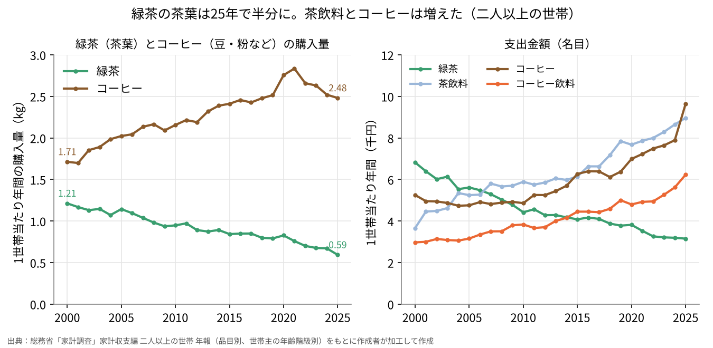
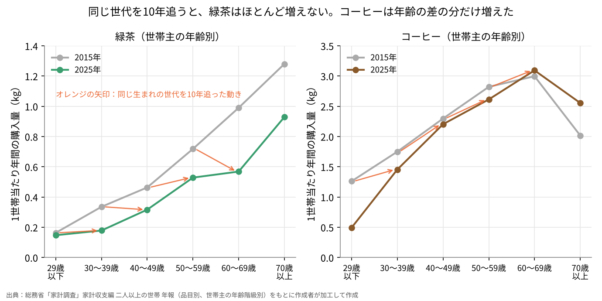
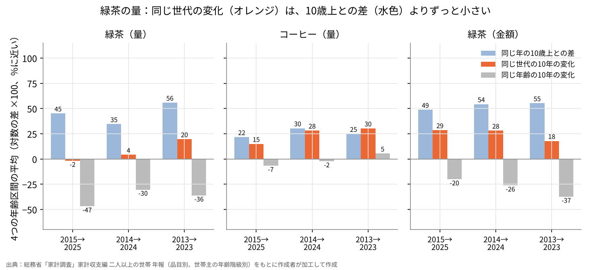
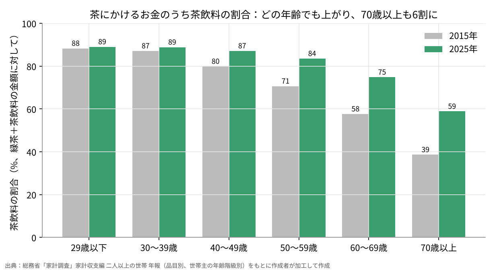

# F372 「緑茶からコーヒーへ」は、年齢の違いと世代の違いのどちらで説明できるか？ 同じ世代を10年追うと緑茶はほぼ増えず（対数差−2）、年齢の違いだけでは説明できない

## 結論（先に）
- 二人以上の世帯が1年に買う緑茶（茶葉）は、2000年の1.21kgから2025年の0.59kgへ51%減りました。コーヒー（豆・粉・インスタント）は1.71kgから2.48kgへ45%増え、茶飲料の支出は3,662円から8,962円（名目）になりました。
- 年齢の高い世帯ほど緑茶を多く買います（2015年は10歳上の年齢階級ほど、対数の差×100で平均45、約1.6倍多い）。ところが、同じ生まれの世代を10年追うと、2015→2025年の緑茶の購入量の変化は平均で対数の差×100が−2で、ほとんど増えていませんでした。2014→2024年は+4、2013→2023年は+20で、いずれも10歳上との差（35〜56）の半分に届きません（以下、断りのない「対数の差」はすべて×100の値です）。
- 「年を取ると緑茶を買うようになる（年齢の違い）」だけでは、この10年の動きは説明できません。同じ年齢の世帯の購入量が、どの組でも10年で対数の差−30〜−47（およそ3〜4割）減ったためです。これが「若い世代ほど緑茶を飲まない（世代の違い）」によるのか、「どの世代でも同じように減った（時代の動き）」によるのかは、このデータだけでは決められません。
- コーヒーは逆で、同じ世代を追った増え方（対数の差15〜30）が10歳上との差（22〜30）とほぼ同じでした。70歳以上の世帯のコーヒーの購入量は、2015→2025年に27%増えています。

## 問い
家庭で買う緑茶は減り、コーヒーは広く飲まれるようになりました。年齢の高い世帯ほど緑茶を多く買うので、「年を取ると緑茶を飲むようになる」のか、「緑茶を多く飲む世代が上にいるだけで、若い世代は年を取っても緑茶を飲まない」のかで、これからの見通しが変わります。この記事では、総務省「家計調査」の世帯主の年齢階級別の購入量を10年の間隔で並べ、同じ生まれの世代を追って、緑茶とコーヒーの購入量がどう変わったかを確かめました。茶葉から茶飲料（ペットボトルなど）への置き換わりが年齢でどう違うかも見ました。

## データ（出典）
- 総務省「家計調査」家計収支編 二人以上の世帯 年報の品目別表（食料「調理食品」～「飲料」）2013・2014・2015・2023・2024年。各年の世帯主の年齢階級別（29歳以下、30〜39歳、…、70歳以上）の1世帯当たり年間の支出金額と購入数量、2000〜2024年の時系列。
- 同 2025年 第4-6表「世帯主の年齢階級別１世帯当たり支出金額，購入数量及び平均価格」。
- 品目：緑茶（茶葉）、コーヒー（豆・粉・インスタント）は金額と数量（g）、茶飲料・コーヒー飲料は金額のみ。
- 元データは data/raw に同梱しています（約1.0MB、取得の記録は data/raw/SOURCES.md）。年報どうしで重なる年の全国の値は一致しました（data/overlap_check.csv）。

## 事前の計画
計画は [PLAN.md](PLAN.md)（2026-11-16 14:20、同じ世代を追う計算や時系列の集計をする前に作成）です。

| 仮説 | 外れの基準 | 結果 | 判定 |
|---|---|---|---|
| H1：緑茶（量）で、同じ世代の10年の変化は、10歳上との差の半分に満たない | 半分以上なら外れ | 平均−1.8 対 45.1（比 −0.04） | 支持 |
| H2：コーヒー（量）の同じ年齢の2015→2025年の変化は、60〜69歳と70歳以上でプラス | どちらかがマイナスなら外れ | +3.2%、+26.7% | 支持 |
| H3：2025年の茶飲料の割合は29歳以下で80%以上、70歳以上で50%未満 | どちらかを満たさなければ外れ | 89.0%、58.9% | 外れ（70歳以上も5割を超えた） |
| H4：全国で緑茶の量は2000→2025年に30%以上減り、コーヒーの量の変化は±15%以内 | どちらかを満たさなければ外れ | −51.1%、+44.8% | 外れ（コーヒーは大きく増えた） |

## やったこと
1. 年報の飲料の表から、年齢階級別と全国平均の緑茶・コーヒー・茶飲料・コーヒー飲料の金額と数量を取り出しました。表の列は見出しの品目番号（380 緑茶、382 コーヒー、38X 茶飲料、384 コーヒー飲料）で探しています。
2. 10年の間隔の組（2015→2025、2014→2024、2013→2023）で、年齢階級を10歳ずらして同じ生まれの世代を追いました（29歳以下→30〜39歳 から 50〜59歳→60〜69歳 までの4区間。上が開いた70歳以上への区間は参考）。
3. 3つの差を対数で計算しました：(A) 同じ世代の10年の変化、(B) はじめの年の10歳上との差、(C) 10歳上の年齢の10年の変化。A＝B＋C がなりたちます。
4. 茶飲料の割合（緑茶＋茶飲料の金額に対して）を年齢別に比べました。

## 分かったこと
### 図1：緑茶の茶葉は25年で半分に。茶飲料とコーヒーは増えた

- 緑茶の購入量は2000年1.21kg、2015年0.84kg、2025年0.59kg。コーヒーは1.71kg、2.41kg、2.48kgで、2021年の2.84kgが最大でした。
- 金額（名目）では、茶飲料が2007年に緑茶を上回り、2025年は緑茶3,153円、茶飲料8,962円、コーヒー9,635円、コーヒー飲料6,229円でした。

### 図2：同じ世代を10年追うと、緑茶はほとんど増えない

- 緑茶：2015年に40〜49歳だった世代は463g、10年後（50〜59歳）は528g。2015年の50〜59歳（718g）には届きません。2015年に50〜59歳だった世代は718gから568gに減りました。
- コーヒー：2015年に30〜39歳だった世代は1,749gから2,203gに増え、2015年の40〜49歳（2,297g）に近づきました。

### 図3：緑茶の量では、同じ世代の変化は10歳上との差よりずっと小さい

- 緑茶（量）：同じ世代の変化は−2、+4、+20、10歳上との差は45、35、56、同じ年齢の変化は−47、−30、−36（3つの組、対数の差×100）。
- コーヒー（量）：同じ世代の変化15、28、30は、10歳上との差22、30、25とほぼ同じで、同じ年齢の変化は−7〜+5と小さい。
- 緑茶を金額で見ると、同じ世代の変化は29、28、18で、量より大きくなります。値段が上がったぶんが入るためです。

### 図4：茶飲料の割合は、どの年齢でも上がった

- 緑茶＋茶飲料の金額のうち茶飲料は、全国平均で2015年60.1%、2025年74.0%。70歳以上は38.6%から58.9%になりました。
- 29歳以下は88.3%から89.0%で、若い世帯はもともと9割近くが茶飲料です。

## 問い直し（結果を見てから足した）
緑茶の茶葉は同じ世代でも増えないと分かったので、「茶にかけるお金」そのものが減っているのかを足しました。緑茶＋茶飲料の金額（名目）で同じ世代を10年追うと、2015→2025年は対数の差で平均+39（10歳上との差は+17）、同じ年齢の10年の変化は+22でした。茶葉の量は減っても、茶にかけるお金は茶飲料に移って増えています。茶とコーヒーを合わせた金額も、同じ世代で+44（対数の差）でした。値段の上がり分を除いた量の比較はできないので、「飲む量」が増えたかは分かりません。

## 頑健性
| 確かめたこと | 結果 |
|---|---|
| 10年の組を 2014→2024 に替える | 緑茶（量）の比 0.12（H1 支持）。コーヒーの同じ年齢の変化 60〜69歳 +10.3%、70歳以上 +21.0%（H2 支持） |
| 10年の組を 2013→2023 に替える | 緑茶（量）の比 0.35（支持）。コーヒー +20.2%、+33.8%（支持） |
| 量の代わりに金額で H1 | 比 0.59、0.52、0.32。3組のうち2組で半分を超え、H1 は外れになる |
| H4 の起点を2002年・2005年に替える | 緑茶 −47.6%・−48.2%、コーヒー +33.9%・+22.6%。コーヒーはどの起点でも±15%を超えた |
| 年齢の傾き（70歳以上÷30〜39歳、緑茶の量） | 2013年3.6、2015年3.8、2024年3.6、2025年5.2。年齢による差は10年たっても小さくなっていない |

H1 は量では3組とも同じでしたが、金額では崩れます。値段の動きを除いた「量」で見るのが、この問いには合っていると考えます。

## 言えないこと
- 世帯主の年齢で分けた世帯の購入で、1人ひとりの飲む量ではありません。世帯の人数や、同居する若い人の好みも入ります。
- 同じ生まれの世代を追うといっても、同じ世帯を追ったものではありません。
- 年齢・時代・世代は、1つを決めると残りが決まるため、仮定なしには分けられません。この記事の結論も「年齢の違いだけでは説明できない」までで、世代か時代かは決めていません。
- 外で飲む分（喫茶代、自動販売機、職場）は入っていないか、入り方が品目で違います。
- 2018年1月の家計簿の改正をまたぐ比較で、品目によっては段差があり得ます。2002年から食料の数量の調べ方が変わり、2000年は農林漁家世帯を含む値を使いました。
- 2025年は緑茶の金額がほぼ同じで量が前年より12%減っていて、値段の上がりが影響していると考えられます（推測）。2015→2025年の組の値はこの影響を受けます。

## 仕事で使うなら
- 「年を取れば茶葉を買うようになる」という前提で、高齢化から茶葉の需要を見積もると、この10年の動きとは合いません。年齢別の購入量は、同じ世代を追った動きと並べて見ると読み違いが減ります。
- 茶にかけるお金は、年齢の高い世帯でも茶飲料に移っています。茶葉と茶飲料は分けずに「茶」として見ると、別の姿になります。

## 計画からの変更
- PLAN.md では数量の単位を「100g」と書きましたが、表の数量は g でした（100g は平均価格の単位）。分析は g で行いました。
- 問い直しで、緑茶＋茶飲料、茶とコーヒーの合計の金額を追加しました（PLAN の候補を、茶の合計にも広げました）。
- 頑健性4は、年齢の傾き（70歳以上÷30〜39歳）の比較として行いました。

## 再現のしかた
```sh
pip install -r requirements.txt
python3 src/01_fetch.py   # 取得（ネットが必要。data/raw に同梱済みなので通常は不要）
sh src/run_all.sh         # 02 → 03 → 04（オフライン）
```

| ファイル | 中身 |
|---|---|
| src/01_fetch.py | 元データの取得（e-Stat 6ファイル） |
| src/02_build.py | data/by_age.csv・national.csv・overlap_check.csv を作る（列は品目番号で探す） |
| src/03_analysis.py | 同じ世代の追跡、同じ年齢の変化、茶飲料の割合、全国の変化。results/ に出力 |
| src/04_figures.py | figures/ の4枚 |
| results/main.json | 本文の数字のもと |
| results/cohort_steps.csv・cohort_summary.csv | 同じ世代を追った差（区間別・平均） |
| results/same_age_change.csv・shares_by_age.csv・age_profile_rel30s.csv | 同じ年齢の変化、割合、年齢の傾き |

所要時間は数秒です。/tmp に写して流し直し、results と figures と data の CSV の 13 ファイルがバイト単位で一致することを確かめました（results/repro_check.txt）。

## レビューで直したこと

| # | 指摘 | 直し方 |
|---|---|---|
| 1 | 「1世帯支持年間」は誤字（表の名前は「1世帯当たり支出金額…」） | 「1世帯当たり」に直した |
| 2 | 対数の差×100の値（−2、45、35〜56 など）を「%」と書いていた（45は実際には約1.6倍で、57%にあたる）。「10年で3〜5割減った」も対数の差−30〜−47で、実際はおよそ3〜4割 | 題名・README・note で「対数差」「対数の差×100」と書き直し、「およそ3〜4割」に直した（題名：「ほぼ増えず（対数差−2）、10歳上との差（同45）に届かない」） |

直したあとに /tmp で流し直し、results と figures の 10 ファイルが一致することを確かめました（results/repro_check.txt）。

## 出典
- 総務省「家計調査」家計収支編 二人以上の世帯 年報（2013・2014・2015・2023・2024・2025年）品目別支出金額，購入数量及び平均価格（e-Stat）

（いずれも 総務省「家計調査」 をもとに作成者が加工して作成）
