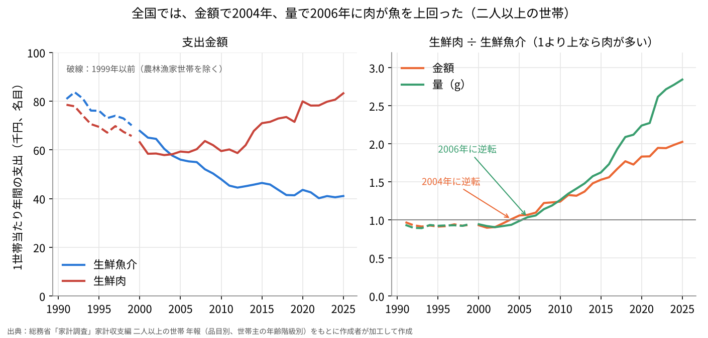
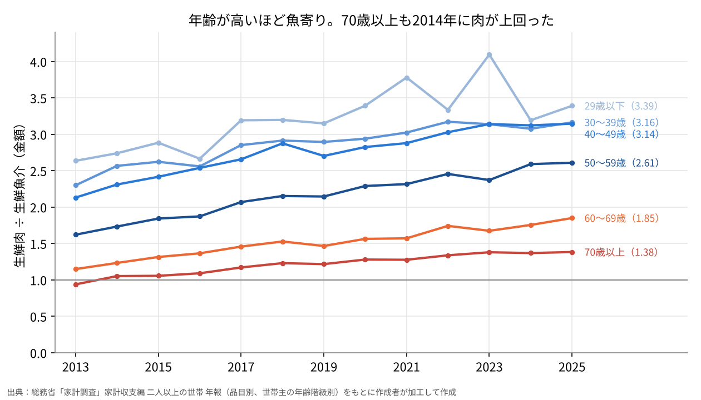
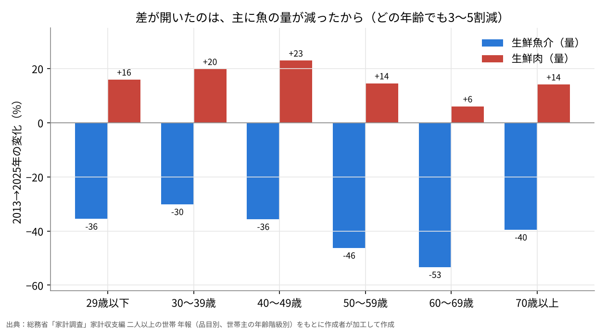
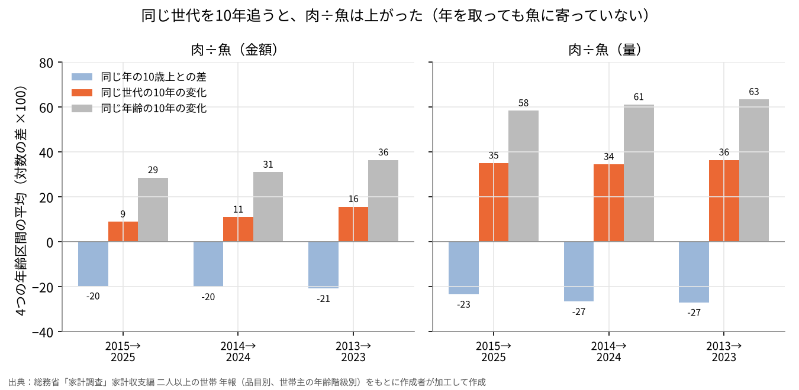

# F373 「魚より肉」は、いつ逆転し、世帯主の年齢でどう違うのか？ 家計の支出では2004年、量では2006年に肉が上回った。70歳以上も2014年に逆転し、2025年は全体で肉が魚の2.03倍

## 結論（先に）
- 二人以上の世帯の家計で、生鮮肉への支出が生鮮魚介を上回ったのは**2004年**（金額）、量（g）では**2006年**でした。1991年は魚8.1万円・肉7.9万円でしたが、2025年は魚4.1万円・肉8.3万円で、金額で2.03倍、量で2.84倍（魚17.8kg、肉50.6kg）になりました。
- 世帯主の年齢が高いほど魚寄りです。2013年の「肉÷魚」（金額）は29歳以下2.63、50〜59歳1.62、60〜69歳1.15、70歳以上0.94で、70歳以上だけがまだ魚が上でした。70歳以上も**2014年**に金額で、2016年に量で肉が上回りました。
- 2013→2025年に、魚の量はどの年齢でも30〜53%減り、肉の量は6〜23%増えました。差が開いたのは主に魚が減ったためです。
- 同じ生まれの世代を10年追うと、「肉÷魚」は金額で平均+9〜+16（対数の差×100）上がりました。年を取るにつれて魚に寄る動きは、この10年では見えませんでした。

## 問い
家庭の食卓で「魚より肉」が進んだと言われます。総務省「家計調査」で、生鮮魚介と生鮮肉への支出がいつ逆転したのか、量で見るとどうか、世帯主の年齢によって逆転の時期がどう違うのかを確かめました。金額には値段の動きが入るので、購入した量（g）でも同じことを見ています。

## データ（出典）
- 総務省「家計調査」家計収支編 二人以上の世帯 年報の品目別表 2013〜2024年の各年（食料「魚介類」、食料「肉類～乳卵類」）。各年の世帯主の年齢階級別（29歳以下〜70歳以上の6つ）の生鮮魚介・鮮魚・生鮮肉の支出金額と購入数量（g）、時系列（1991〜2024年。1999年以前は農林漁家世帯を除く値、2000年は除く値と含む値の両方）。
- 同 2025年 第4-6表 世帯主の年齢階級別１世帯当たり支出金額，購入数量及び平均価格。
- 元データ25ファイルを data/raw に同梱しています（約2.7MB、取得の記録は data/raw/SOURCES.md）。年報どうしで重なる年の全国の値はすべて一致しました（data/overlap_check.csv）。
- 一部の年の .xls ファイルは、数値の表示形式の記録に読めない文字が入っていて、読み込みのライブラリ（xlrd）が止まります。02_build.py では表示形式の記録だけを読み飛ばしています（値には関係しません）。

## 事前の計画
計画は [PLAN.md](PLAN.md)（2026-11-16 14:50、逆転の年や年齢別の比を計算する前に作成）です。

| 仮説 | 外れの基準 | 結果 | 判定 |
|---|---|---|---|
| H1：金額の逆転は2008〜2013年 | その外なら外れ | 2004年 | 外れ（思ったより早い） |
| H2：量の逆転は金額より5年以上早い | 5年未満の差、または遅ければ外れ | 量は2006年で、金額より2年遅い | 外れ |
| H3：2013年の70歳以上はまだ魚が上で、2014〜2025年に逆転 | すでに肉が上、またはまだ魚が上なら外れ | 2013年0.94、2014年に逆転 | 支持 |
| H4：2013→2025年の「肉÷魚」（金額）の上がり幅は、70歳以上のほうが29歳以下より大きい | 小さければ外れ | 70歳以上 +0.45、29歳以下 +0.76 | 外れ |

## やったこと
1. 各年の年報の表から、生鮮魚介・鮮魚・生鮮肉の列を見出しの品目名で探し、年齢別と全国の金額・量を取り出しました。
2. 「肉÷魚」の比が1を超え、その後に1以下に戻らない最初の年を「逆転の年」としました。
3. 年齢別の比を2013〜2025年で並べ、2013→2025年の魚・肉それぞれの量の変化を計算しました。
4. 問い直しとして、同じ世代を10年追った比の変化を計算しました（F372 と同じ方法）。

## 分かったこと
### 図1：全国では、金額で2004年、量で2006年に肉が魚を上回った

- 「肉÷魚」（金額）は1991〜2003年は0.90〜0.97で、2004年に1.01、2010年1.24、2025年2.03になりました。量は2006年に1.04で、2025年は2.84です。
- 金額が量より先に逆転したのは、2004年に100gあたりの値段が魚140円・肉151円で、肉のほうが高かったためです。2025年は魚231円・肉164円で、今度は魚のほうが高く、量の比（2.84）が金額の比（2.03）を上回っています。
- 金額では、魚が1991年の8.1万円から2025年の4.1万円へ半分に減り、肉は2003年の5.8万円を底に8.3万円まで増えました。

### 図2：年齢が高いほど魚寄り。70歳以上も2014年に肉が上回った

- 2025年の「肉÷魚」（金額）は、29歳以下3.39、30〜39歳3.16、40〜49歳3.14、50〜59歳2.61、60〜69歳1.85、70歳以上1.38でした。
- 2013年に1を下回っていたのは70歳以上（0.94）だけで、2014年に1.05になってから戻っていません。量（g）では70歳以上は2013年0.88、2016年に1.02で逆転しました。60歳代以下は2013年の時点で、金額でも量でもすでに肉が上でした。

### 図3：差が開いたのは、主に魚の量が減ったから

- 2013→2025年の生鮮魚介の量は、29歳以下−36%、30〜39歳−30%、40〜49歳−36%、50〜59歳−46%、60〜69歳−53%、70歳以上−40%でした。
- 生鮮肉の量は+6〜+23%で、魚の減り方のほうがずっと大きくなっています。全国平均では魚30.6kg→17.8kg、肉45.3kg→50.6kgでした。

## 問い直し（結果を見てから足した）
### 図4：同じ世代を10年追うと、肉÷魚は上がった

年齢が高いほど魚寄りなので、「年を取ると魚に寄るのか」を足しました。同じ生まれの世代を10年追うと、「肉÷魚」（金額）は2015→2025年で平均+9、2014→2024年で+11、2013→2023年で+16上がりました（対数の差×100）。同じ年の10歳上との差は−20前後で、もし年を取ると魚に寄るのなら比は下がるはずですが、そうなっていません。同じ年齢の10年の変化（+29〜+36）が年齢の差を上回っています。量で見ても同じ向きでした。ただし、年齢・時代・世代は仮定なしには分けられないので、「年を取っても魚に寄らない」のか「年を取ると魚に寄るが、それ以上に全体が肉に動いた」のかは決められません。

## 頑健性
| 確かめたこと | 結果 |
|---|---|
| 生鮮魚介の代わりに鮮魚（貝類・塩干などを除く） | 金額の逆転は2002年。量では1991年の時点ですでに肉が上（1.05）。70歳以上は2013年の時点で金額でも肉が上 |
| 年齢別の比を3年移動平均にする | 70歳以上の逆転は2014年以前（移動平均の最初の年）で、2014年という結論と合う |
| 1999年以前（農林漁家を除く）と2000年以降（含む）の段差 | 2000年の比は除く0.934・含む0.931（金額）、0.948・0.944（量）で、つないでも逆転の年は変わらない |
| H4 を量で見る | 上がり幅は29歳以下+2.53、70歳以上+0.78で、H4 は量でも外れ |
| H4 を比の伸び率（対数の差）で見る | 29歳以下+25、70歳以上+39、50〜69歳+48。伸び率で見れば年齢の高い世帯のほうが大きく、差の幅とは逆の結論になる |

H4 は「差の幅」で見るか「伸び率」で見るかで結論が変わります。計画どおり差の幅で判定し、伸び率の結果も並べました。

## 言えないこと
- 家で調理するために買った分で、外食や弁当・総菜の中の魚・肉は入っていません。食べる量の逆転とは一致しません。
- 世帯主の年齢で分けた世帯の購入で、1人ひとりの食べる量ではありません。世帯の人数の違いも入ります。
- 2002年から食料の数量の調べ方が変わり、2018年に家計簿が改正されています。前後の比較には段差があり得ます。
- 年齢別の表は2013年からしか集めていないので、60歳代以下の逆転の年は分かりません。
- 年齢・時代・世代は仮定なしには分けられません。図4の読み方は2つあり得ます。
- 魚が減った理由（値段、調理の手間、取れる量など）は、このデータからは分かりません。

## 仕事で使うなら
- 「年齢の高い世帯は魚を買う」という見方は、2013年までは金額でも当てはまりましたが、70歳以上でも2014年から肉のほうが多くなっています。年齢で売り場を考えるときは、最新の年の比を見るほうが安全です。
- 金額と量で逆転の年が2年ずれるように、値段の動きで見え方が変わります。比べるときは両方を並べると読み違いが減ります。

## 計画からの変更
- 一部の .xls が読めなかったため、02_build.py に表示形式の記録を読み飛ばす処理を足しました。
- 問い直しの候補だった「同じ世代を追う」を、そのまま行いました。
- 頑健性に、H4 を伸び率で見る確かめを足しました。

## 再現のしかた
```sh
pip install -r requirements.txt
python3 src/01_fetch.py   # 取得（ネットが必要。data/raw に同梱済みなので通常は不要）
sh src/run_all.sh         # 02 → 03 → 04（オフライン）
```

| ファイル | 中身 |
|---|---|
| src/01_fetch.py | 元データの取得（e-Stat 25ファイル） |
| src/02_build.py | data/by_age.csv・national.csv・overlap_check.csv を作る（列は品目名で探す） |
| src/03_analysis.py | 肉÷魚の比、逆転の年、年齢別の変化、同じ世代の追跡、100gあたりの値段。results/ に出力 |
| src/04_figures.py | figures/ の4枚 |
| results/main.json | 本文の数字のもと |
| results/national_ratio.csv・ratio_by_age.csv・crossing_by_age.csv | 全国と年齢別の比、逆転の年 |
| results/change_2013_2025.csv・cohort_ratio*.csv | 2013→2025年の変化、同じ世代の追跡 |

所要時間は数秒です。/tmp に写して流し直し、results と figures と data の CSV の 14 ファイルがバイト単位で一致することを確かめました（results/repro_check.txt）。

## レビューで直したこと

| # | 指摘 | 直し方 |
|---|---|---|
| 1 | 「1世帯支持年間」は誤字 | 「1世帯当たり支出金額，購入数量及び平均価格」に直した |

直したあとに /tmp で流し直し、results と figures の 11 ファイルが一致することを確かめました（results/repro_check.txt）。

## 出典
- 総務省「家計調査」家計収支編 二人以上の世帯 年報（2013〜2025年）品目別支出金額，購入数量及び平均価格（e-Stat）

（いずれも 総務省「家計調査」 をもとに作成者が加工して作成）
