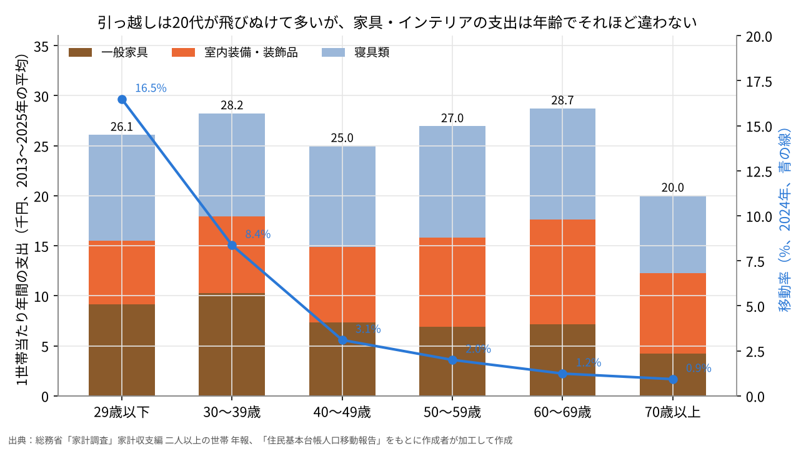
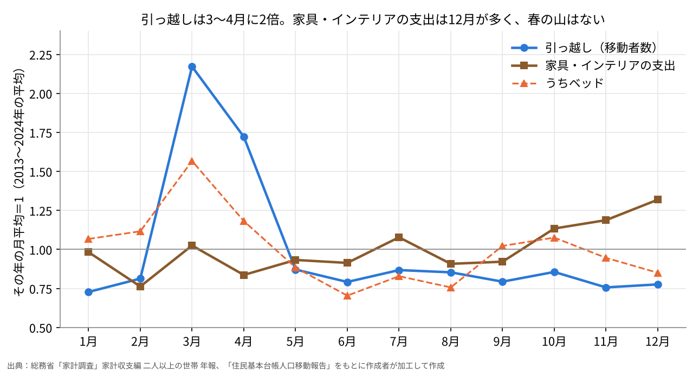
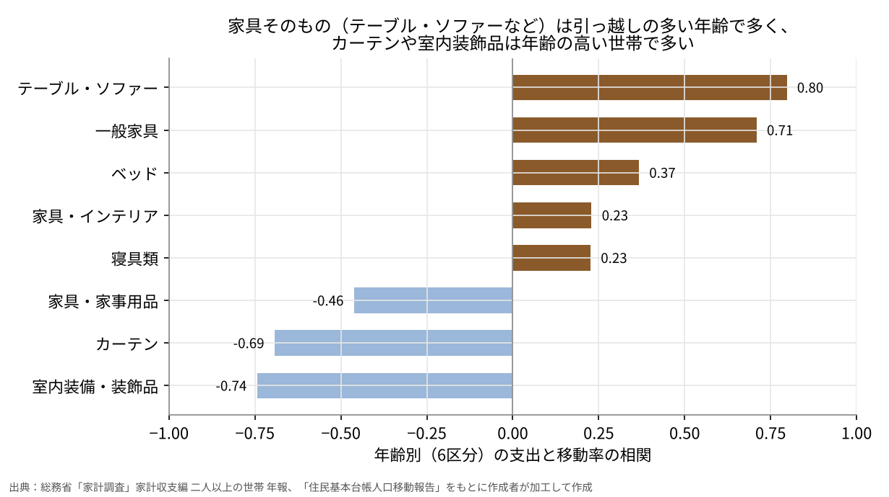
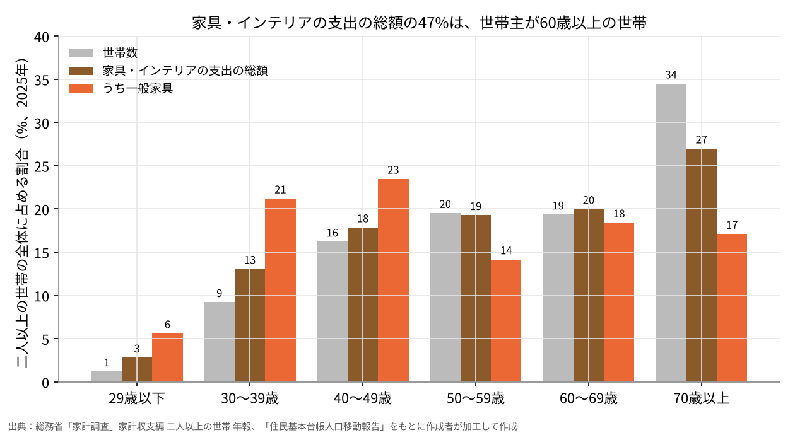

# F374 家具やインテリアへの支出は、引っ越しの多い年齢で多いのか？ 年齢別の支出と移動率の相関は0.23。家具そのものは若い世帯、カーテンは60歳代で多く、3〜4月の支出は月平均の0.93倍

## 結論（先に）
- 引っ越しの多さ（都道府県内の移動率＋他県への転出率、2024年）は、20歳代16.5%、30歳代8.4%、60歳代1.2%で、若い年齢に大きく偏っています。
- 二人以上の世帯の「家具・インテリア」（一般家具＋室内装備・装飾品＋寝具類）への支出は、2013〜2025年の平均で1世帯当たり年2.0万〜2.9万円で、いちばん多いのは世帯主60〜69歳（28,736円）、次が30〜39歳（28,244円）でした。年齢別の支出と移動率の相関は0.23で、引っ越しの多い年齢ほど多いとは言えません。
- 品目で分かれます。テーブル・ソファー（相関0.80）や一般家具（0.71）は引っ越しの多い若い世帯で多く、カーテン（−0.69）や室内装備・装飾品（−0.74）は年齢の高い世帯で多くなっています。
- 月別では、引っ越しは3〜4月に月平均の1.95倍になりますが、家具・インテリアの支出は3〜4月が0.93倍で、12月（1.32倍）がいちばん多い月でした。春に山があるのはベッド（1.37倍）だけです。
- 世帯数を掛けた支出の総額では、家具・インテリアの47%が世帯主60歳以上の世帯の分です（2025年）。

## 問い
引っ越しをすると、家具やカーテン、照明、寝具をそろえることが多いはずです。そうなら、家具・インテリアへの支出は、引っ越しの多い年齢の世帯で多く、引っ越しの多い3〜4月に増えるはずです。家具やインテリアを売る側にとって、「誰が」「いつ」買うのかは品ぞろえや売り場づくりの前提になります。この記事では、総務省「家計調査」の世帯主の年齢別・月別の支出を、住民基本台帳の年齢別の移動率・月別の移動者数と並べて確かめました。

## データ（出典）
- 総務省「家計調査」家計収支編 二人以上の世帯 年報（家具・家事用品）2013〜2024年の各年：世帯主の年齢階級別（29歳以下〜70歳以上）と月別の1世帯当たり支出金額。2025年は第4-6表（年齢別、5歳ずらしの再掲の区分、世帯数分布）。
- 「家具・インテリア」＝一般家具（たんす、テーブル・ソファー、食器戸棚など）＋室内装備・装飾品（照明器具、室内装飾品、敷物、カーテンなど）＋寝具類（ベッド、布団など）。
- 総務省「住民基本台帳人口移動報告」2024年の年齢（5歳階級）別の都道府県内移動率・他都道府県への転出者の移動率、長期時系列表の月別移動者数（日本人、都道府県内＋都道府県間）。
- 元データ17ファイルを data/raw に同梱しています（約1.9MB、取得の記録は data/raw/SOURCES.md）。

## 事前の計画
計画は [PLAN.md](PLAN.md)（2026-11-16 15:20、年齢別・月別の集計や移動率との比較をする前に作成）です。この記事は予備 R17 から作りました（元の問いは既存の F352 と重なるため。REPLACED.md に記録）。

| 仮説 | 外れの基準 | 結果 | 判定 |
|---|---|---|---|
| H1：家具・インテリアの支出は29歳以下と30〜39歳が上位2つ | そうでなければ外れ | 1位60〜69歳、2位30〜39歳、29歳以下は4位 | 外れ |
| H2：年齢別の支出と移動率の相関は0.8以上 | 0.8未満なら外れ | 0.23 | 外れ |
| H3：3〜4月の支出は月平均の1.2倍以上 | 1.2未満なら外れ | 0.93倍 | 外れ |
| H4：月別の支出と移動者数の形の相関は0.5以上 | 0.5未満なら外れ | −0.17 | 外れ |

## やったこと
1. 家計調査の各年の表から、品目番号（480〜489 一般家具、491〜499 室内装備・装飾品、500〜509 寝具類など）の列を探し、年齢別・月別の金額を取り出しました。
2. 年齢別は2013〜2025年の名目の値を平均しました。移動率は5歳階級を10歳にまとめ（29歳以下は20〜29歳、70歳以上は70歳以上の4区分の平均）、都道府県内と他県への転出を足しました。
3. 月別は各年の月の値をその年の月平均で割り、2013〜2024年で平均しました。移動者数も同じです。
4. 2025年の世帯数分布を掛けて、年齢別の支出の総額の割合を計算しました。

## 分かったこと
### 図1：引っ越しは20代が飛びぬけて多いが、家具・インテリアの支出は年齢でそれほど違わない

- 家具・インテリアは、29歳以下26,090円、30〜39歳28,244円、40〜49歳24,975円、50〜59歳26,951円、60〜69歳28,736円、70歳以上20,011円でした（2013〜2025年の平均）。
- 一般家具だけなら30〜39歳10,255円、29歳以下9,137円が上位で、70歳以上は4,212円です。室内装備・装飾品は60〜69歳が10,463円でいちばん多くなっています。

### 図2：引っ越しは3〜4月に2倍。家具・インテリアの支出に春の山はない

- 移動者数は3月が月平均の2.17倍、4月が1.72倍です。家具・インテリアの支出は3月1.03倍、4月0.84倍で、10〜12月（1.13〜1.32倍）のほうが多くなっています。
- 年ごとの3〜4月の比は0.66（2020年）〜1.17（2014年）で、春に月平均を上回った年は12年のうち3年でした。
- ベッドだけは3月1.57倍で、月の形と移動者数の相関も0.79でした。

### 図3：家具そのものは引っ越しの多い年齢で多く、カーテン・室内装飾品は年齢の高い世帯で多い

- 年齢別の支出と移動率の相関は、テーブル・ソファー0.80、一般家具0.71、ベッド0.37に対し、カーテン−0.69、室内装備・装飾品−0.74でした。
- 合計の「家具・インテリア」では、向きの違う品目が打ち消し合って0.23になります。

## 問い直し（結果を見てから足した）
### 図4：支出の総額の47%は、世帯主60歳以上の世帯

1世帯当たりでは年齢の差が小さいので、「世帯数を掛けた総額では、どの年齢の分が大きいのか」を足しました（2025年）。世帯主60歳以上の世帯は二人以上の世帯の53.9%で、家具・インテリアの支出の総額の47.0%を占めます。世帯主39歳以下は世帯の10.4%、総額の15.9%です。一般家具だけでは、39歳以下が26.8%、60歳以上が35.5%でした。二人以上の世帯の中では、家具・インテリアを買うお金の半分近くは年齢の高い世帯から出ていることになります。

## 頑健性
| 確かめたこと | 結果 |
|---|---|
| 一般家具だけにする | 上位は30〜39歳と29歳以下（H1 は支持になる）。年齢別の相関0.71（H2 は外れのまま）、3〜4月は1.00倍、月の相関0.07 |
| 2025年の5歳ずらしの区分（25〜34歳など5区分）で H2 | 相関0.97。区分のしかた（65歳以上をまとめる）と1年だけの値で大きく変わり、結論は安定しない |
| 2020〜2021年を除く | 3〜4月は0.96倍、月の相関−0.10で、結論は同じ |
| 移動率を都道府県内だけ・他県への転出だけにする | 相関0.25・0.21で、結論は同じ |
| カーテン・テーブル・ソファーの月別 | 3〜4月はカーテン1.02倍、テーブル・ソファー0.87倍。春の山はベッドだけ |

H2 は、5歳ずらしの区分では0.97と高くなりました。2025年の再掲の区分は65歳以上を1つにまとめていて、支出の少ない70歳代以上と移動率の低い年齢が重なるためと考えられます（推測）。10歳区分の13年平均の結果を本体としました。

## 言えないこと
- 二人以上の世帯だけで、引っ越しの多い若い単身の世帯は入っていません。単身の世帯を含めると、若い年齢の支出の割合は大きくなるはずです（推測）。
- 世帯主の年齢と、引っ越した人の年齢は同じではありません。住民基本台帳の移動は市区町村をまたぐもので、同じ市区町村の中の引っ越しは入っていません。
- 家計調査は引っ越したかどうかを聞いていないので、引っ越した世帯だけの支出は分かりません。
- 家計調査の月別の値は標本が少なく、品目によって振れが大きいです。12月の山の理由（年末の買い替え、寝具の季節など）は、このデータでは確かめていません。
- 名目の金額で、物価の動きは除いていません。

## 仕事で使うなら
- 二人以上の世帯について、「家具は引っ越しの多い若い世帯が買う」は、テーブル・ソファーなど家具そのものには当てはまりますが、カーテンや室内装飾品、合計には当てはまりません。品目ごとに年齢の形を分けて見ると読み違いが減ります。
- 家計の支出で見る限り、3〜4月の山はベッドなど一部の品目に限られます。

## 計画からの変更
- 02_build.py に、一部の年の .xls の表示形式の記録を読み飛ばす処理を足しました（値には関係しません）。
- 頑健性に、カーテン・テーブル・ソファーの月別を足しました。

## 再現のしかた
```sh
pip install -r requirements.txt
python3 src/01_fetch.py   # 取得（ネットが必要。data/raw に同梱済みなので通常は不要）
sh src/run_all.sh         # 02 → 03 → 04（オフライン）
```

| ファイル | 中身 |
|---|---|
| src/01_fetch.py | 元データの取得（e-Stat 17ファイル） |
| src/02_build.py | data/fies_age.csv・fies_month.csv・fies_2025_age5.csv・move_rate_age.csv・moves_month.csv を作る |
| src/03_analysis.py | 年齢別の平均と移動率の相関、月別の形、総額の割合、頑健性。results/ に出力 |
| src/04_figures.py | figures/ の4枚 |
| results/main.json | 本文の数字のもと |
| results/age_profile_mean_2013_2025.csv・move_rate_10y.csv | 年齢別の支出と移動率 |
| results/season_*.csv・march_april_by_year.csv | 月別の形、年ごとの3〜4月 |
| results/share_2025.csv | 世帯数を掛けた総額の割合 |

所要時間は数秒です。/tmp に写して流し直し、results と figures と data の CSV の 18 ファイルがバイト単位で一致することを確かめました（results/repro_check.txt）。

## レビューで直したこと

独立レビューで数字の照合・再実行・図を確かめ、直すところはなかった。

## 出典
- 総務省「家計調査」家計収支編 二人以上の世帯 年報（2013〜2025年）品目別支出金額（e-Stat）
- 総務省「住民基本台帳人口移動報告」長期時系列表 第1表、2024年 年齢（5歳階級）別移動率（e-Stat）

（いずれも 総務省「家計調査」「住民基本台帳人口移動報告」 をもとに作成者が加工して作成）
