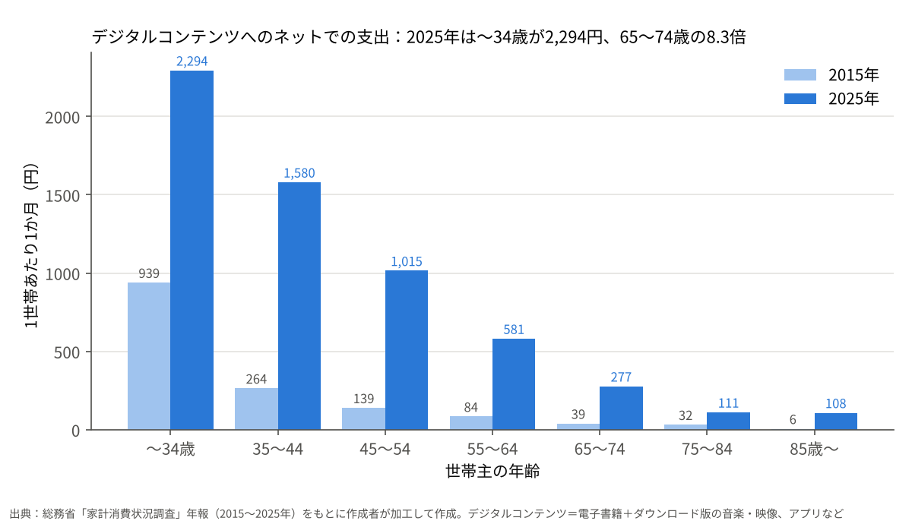
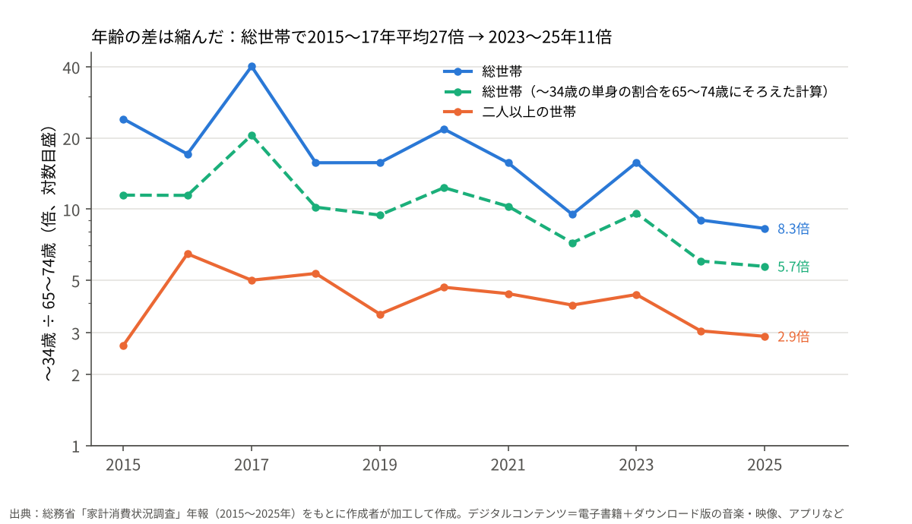
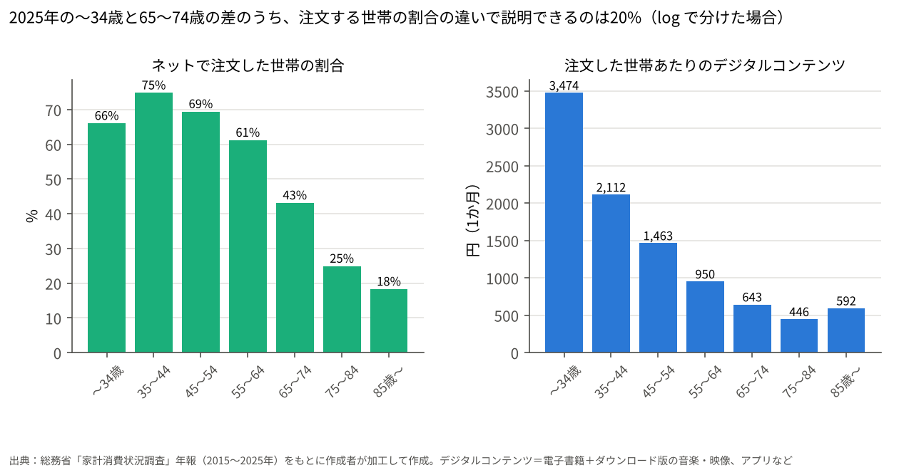
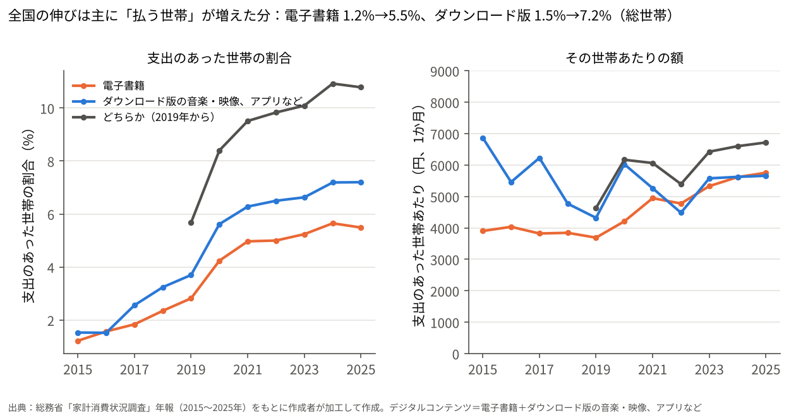

# F375 動画・音楽などデジタルコンテンツへの支出は、年齢でどれだけ違うのか？ 2025年は〜34歳の世帯が65〜74歳の8.3倍。2015〜17年平均の27倍から縮み、差の8割は買う世帯の使う額の違い

## 結論（先に）
- 電子書籍とダウンロード版の音楽・映像・アプリ（以下「デジタルコンテンツ」）にネットで払った額は、2025年に1世帯あたり1か月724円でした。世帯主が〜34歳の世帯は2,294円、65〜74歳は277円で、8.3倍の差があります（総世帯）。
- 差は縮んでいます。〜34歳 ÷ 65〜74歳 は、2015〜2017年の平均27.1倍から、2023〜2025年は11.0倍になりました。この10年で、〜34歳は2.4倍、65〜74歳は7.1倍に増えています。
- 2025年の差のうち、「ネットで注文する世帯の割合」の違い（66.0% と 43.1%）で説明できるのは20%でした。残りの80%は、注文した世帯あたりの額の違い（3,474円 と 643円）です。
- 全国の伸びは、主に「払う世帯」が増えた分でした。どちらかに支出のあった世帯は、2019年の5.7%から2025年の10.8%に増え、伸び（log）の63%を占めます。
- ただし、二人以上の世帯だけで比べると2025年の差は2.9倍です。問い直しで、〜34歳の世帯の多くがひとり暮らしであることが、総世帯の差の約2割を説明すると分かりました。

## 問い
電子書籍や、ダウンロード版の音楽・映像・アプリへの支出は、世帯主の年齢でどれだけ違うのか。その差は、この10年で縮まったのか。差は「ネットで買う世帯の割合」の違いから来るのか、「買う世帯が使う額」の違いから来るのか。

知りたい人は、電子書籍・配信・アプリの事業者のマーケティング担当や、「高齢の世帯もデジタルに移っている」という話を数字で確かめたい人です。

## データ（出典）
| データ | 期間 | 出典 |
|---|---|---|
| 家計消費状況調査 年報 第1-2表：世帯主の年齢階級別 インターネットを利用した1世帯当たり1か月間の支出（総世帯・二人以上の世帯・単身世帯） | 2015〜2025年 | 総務省統計局、e-Stat |
| 同 第4-2表：世帯主の年齢階級別 インターネットを利用した購入状況（頑健性に使用） | 2015〜2025年 | 同上 |
| 同 第6-1表・第6-2表：全国の支出世帯あたりの額と、支出世帯の割合 | 2015〜2025年 | 同上 |

44ファイル（計4.6MB）を data/raw に同梱しています。statInfId と取得日は data/raw/SOURCES.md にあります。2014年以前は品目の区分が違う（電子書籍の区分がない）ため使っていません。用語の解説では、「ダウンロード版の音楽・映像、アプリなど」はダウンロードした音楽・映像、ソフト・アプリ（レンタルを含む）です。

## 事前の計画
集計の前に [PLAN.md](PLAN.md) を書きました（2026-11-18）。前の担当がこの番号を取っていましたが、フォルダは空で、引き継げるものはありませんでした。前の担当が数字を見たかは分かりません。私は表を探すときに、第4-2表の「平均」（ネットで注文した世帯の割合と支出総額）を2015・2020・2025年分見ました。また PLAN を書いた後、表の形を確かめるときに年齢別のネット支出総額の行が画面に出ました。デジタルコンテンツの金額は、計画の後に集計しました。

| 仮説 | 外れの基準 | 結果 | 判定 |
|---|---|---|---|
| H1：2025年、〜34歳は65〜74歳の3倍以上 | 3倍未満 | 8.3倍（二人以上の世帯では2.9倍） | 支持（総世帯） |
| H2：差は縮んだ（2023〜25年の平均 < 2015〜17年の平均） | 縮んでいない | 27.1倍 → 11.0倍 | 支持 |
| H3：差（log）のうち、注文する世帯の割合で説明できるのは半分未満 | 半分以上 | 20%（第4-2表の割合では28%） | 支持 |
| H4：全国の伸び（log）の半分以上は、支出のあった世帯の割合の伸び | 半分未満 | 2019→2025年で63%（電子書籍 2015→2025年 79%、ダウンロード版 114%） | 支持 |

## やったこと
1. 44ファイルから表を作り（02）、D = 電子書籍 + ダウンロード版の年齢の差の推移を出した（03）。
2. D = 注文した世帯の割合 r × 注文した世帯あたりの額 d とし、年齢の差を log で分けた。全国は D = 支出のあった世帯の割合 s × その世帯あたりの額 m に分けた。
3. 頑健性を9通り確かめ、結果を見てから単身世帯の影響を足した（03b）。図は4枚（04）。

## 分かったこと

### 図1：〜34歳が2,294円、65〜74歳は277円


2025年のデジタルコンテンツは、〜34歳 2,294円、35〜44歳 1,580円、45〜54歳 1,015円、55〜64歳 581円、65〜74歳 277円、75〜84歳 111円、85歳〜 108円でした（1世帯あたり1か月）。年齢が上がるほど少なくなります。内訳は、〜34歳が電子書籍 994円・ダウンロード版 1,300円、65〜74歳が127円・150円です。2015年からの伸びは、全体で4.6倍、〜34歳で2.4倍、45〜54歳で7.3倍、65〜74歳で7.1倍でした。

ネットで買うコンテンツ（デジタル＋パッケージのソフト＋紙の本）のうちデジタルの割合は、全体で23.8%から49.2%に、65〜74歳でも15.1%から34.8%に上がりました。

### 図2：年齢の差は、27倍から11倍に縮んだ


〜34歳 ÷ 65〜74歳 は年ごとのぶれが大きいものの（2017年は40.2倍）、傾向としては1年あたり約10%ずつ縮んでいます（log の傾き −0.107）。二人以上の世帯だけで比べると、差はもともと小さく、4.7倍（2015〜17年）から3.4倍（2023〜25年）でした。

### 図3：差の8割は「注文した世帯あたりの額」


2025年にネットで注文した世帯の割合は、〜34歳 66.0%、65〜74歳 43.1%で、1.5倍の違いです。注文した世帯あたりのデジタルコンテンツは3,474円と643円で、5.4倍の違いです。8.3倍の差を log で分けると、割合の違いが20%、額の違いが80%でした。「ネットで買わないから少ない」というより、「ネットで買う世帯でも、コンテンツに使う額が小さい」ことが差の中心です。

### 図4：全国の伸びは、払う世帯が増えた分


1か月に電子書籍の支出があった世帯は、2015年の1.2%から2025年の5.5%に、ダウンロード版は1.5%から7.2%に増えました。支出のあった世帯あたりの額は、電子書籍が3,901円から5,754円、ダウンロード版は6,867円から5,658円です。どちらかの支出があった世帯（2019年から集計）は5.7%から10.8%に増え、その世帯あたりの額は4,634円から6,717円でした。2020年に割合が大きく上がりました（外出の自粛の時期と重なる）。

## 問い直し（結果を見てから足した）
二人以上の世帯で差が2.9倍まで小さくなったので、「〜34歳の世帯が多く使うのは、ひとり暮らしが多いからか」を確かめました。総世帯を単身世帯と二人以上の世帯の混ざりとみて、単身の割合を世帯人員から求めました（世帯人員 = 単身の割合×1 + 残り×二人以上の世帯の人員）。この割合で単身と二人以上の額を混ぜると、総世帯の額との違いは1%以内でした。

- 2025年の単身の割合は、〜34歳 84.0%、65〜74歳 35.6%（推計）。
- 〜34歳の単身世帯は2,536円、二人以上の世帯は1,007円です。
- 〜34歳の単身の割合が65〜74歳と同じ35.6%だったとすると、〜34歳は1,551円、差は5.7倍になります（実際は8.3倍）。世帯の形の違いが差（log）の18%を説明します。65〜74歳の単身の額は、単身世帯の表に60歳以上の区分しかないため、その値で代えています（推測を含む）。
- この計算でも、差は2015〜17年の14.5倍から2023〜25年の7.1倍に縮んでいて、「縮んだ」という結論は変わりません。

## 頑健性
| 確かめ | 2025年の比 | 2015〜17年平均 | 2023〜25年平均 | 割合で説明できる分 | 結論は変わったか |
|---|---|---|---|---|---|
| 基本（総世帯、10歳階級） | 8.3倍 | 27.1倍 | 11.0倍 | 20% | ― |
| 二人以上の世帯 | 2.9倍 | 4.7倍 | 3.4倍 | 35% | H1 は外れ（3倍未満）。縮んだのは同じ |
| 世帯人員1人あたり | 11.9倍 | 34.1倍 | 15.4倍 | ― | 変わらない |
| 3年平均の額で比べる | 10.3倍 | 27.4倍 | 11.6倍 | ― | 変わらない |
| 2020・2021年を除いた傾向 | ― | ― | ― | ― | 傾き −0.108（全年 −0.107）。変わらない |
| 5歳階級：〜34歳 ÷ 70〜74歳 | 11.3倍 | 38.9倍 | 14.9倍 | ― | 変わらない |
| 〜34歳 ÷ 全体の平均 | 3.2倍 | 5.4倍 | 3.3倍 | ― | 変わらない |
| 注文の割合を第4-2表の値にする | 8.3倍 | 27.1倍 | 11.0倍 | 28% | 変わらない |
| 電子書籍だけ／ダウンロード版だけ | 7.8倍／8.7倍 | 15.0倍／37.6倍 | 9.3倍／12.4倍 | ― | どちらも縮んだ |

## 言えないこと
- 世帯主の年齢で分けた世帯の平均です。個人の年齢ではありません。65〜74歳の世帯の支出には、同居する若い家族の分も入ります。
- アプリストアやキャリア決済の支払いを「ネットを利用した支出」として記入したかは、記入する人の判断による部分があります。定額の動画・音楽の配信サービスがどの品目に入っているかは、用語の解説からは分かりません。
- 2015〜2017年の65〜74歳の額は数十円と小さく、比は年ごとに大きくぶれます。
- 年齢の違いと、生まれた年（世代）の違いは、11年分では分けられません。
- 単身の割合は世帯人員からの推計で、65〜74歳の単身の額は60歳以上の値で代えています。

## 仕事で使うなら
- 年齢の差は「ネットで買わない」よりも「買う世帯の額が小さい」ことが中心、という見方の材料になります。
- 総世帯と二人以上の世帯で差の大きさが3倍近く違うので、年齢で比べるときは、世帯の形をそろえた数字も並べると読み違いが減ります。

## 計画からの変更
- 注文した世帯の割合 r：第1-2表の参考の行「注文をした世帯（1万分比）」は、割合ではなく年齢の間の分布だったため、「支出総額 ÷ 注文をした世帯当たりの支出総額」で求めました（同じ表の中で D = r × d が成り立つ）。第4-2表の割合は頑健性に回しました。
- H4 の「合わせた額」は、支出のあった世帯の割合の「計」の行が2019年からしかないため、2019→2025年で判定しました。2015→2025年は品目別に出しています。
- 頑健性の「2020・2021年を除く」は、比べる期間の平均の外にあるため、比の傾向（回帰）で除く形にしました。電子書籍だけ・ダウンロード版だけ・第4-2表の割合を足しました。

## 再現のしかた
```
pip install -r requirements.txt
sh src/run_all.sh        # オフライン。01_fetch.py は呼ばない
```
| ファイル | 役割 |
|---|---|
| src/01_fetch.py | e-Stat から44ファイルを取る（ネットが必要。run_all.sh からは呼ばない） |
| data/raw/・SOURCES.md | 元データ（同梱、4.6MB）と取得元 |
| src/02_build.py | → data/age_items.csv・data/national_items.csv |
| src/03_analysis.py | → results/main.json・age_year_table.csv・age_gap_decomposition.csv・national_payers.csv・robustness.csv |
| src/03b_requestion.py | 問い直し → results/requestion.json・single_mix.csv |
| src/04_figures.py | → figures/fig1〜fig4 |

所要時間は約6秒（CPU 1つ）。results/repro_check.txt：2026-11-18 に /tmp に写して流し直し、13ファイル（results 7・figures 4・data の中間 CSV 2）がバイト単位で一致しました。

## レビューで直したこと
| # | 指摘 | 直し方 |
|---|---|---|
| 1 | 題名の「10年前の27倍」は、2015年単年の比（24.1倍）ではなく2015〜17年平均（27.1倍）の値だった | 題名を「2015〜17年平均の27倍から縮み」に直し、status・note の1行目もそろえた |
| 2 | README の見出しと status・note の題名で「買う世帯の使う額」のかぎかっこの有無が違った | 見出しを status の題名にそろえた |

独立レビューで数字の照合・再実行（/tmp で13ファイル一致）・図4枚を確かめました。

## 出典
- 総務省統計局「家計消費状況調査」年報（e-Stat）：https://www.e-stat.go.jp/stat-search/files?toukei=00200565&tstat=000000660001
- 同 用語の解説（2025年）：https://www.stat.go.jp/data/joukyou/2025ar/gaiyou/pdf/25yougo.pdf

（いずれも総務省「家計消費状況調査」をもとに作成者が加工して作成）
