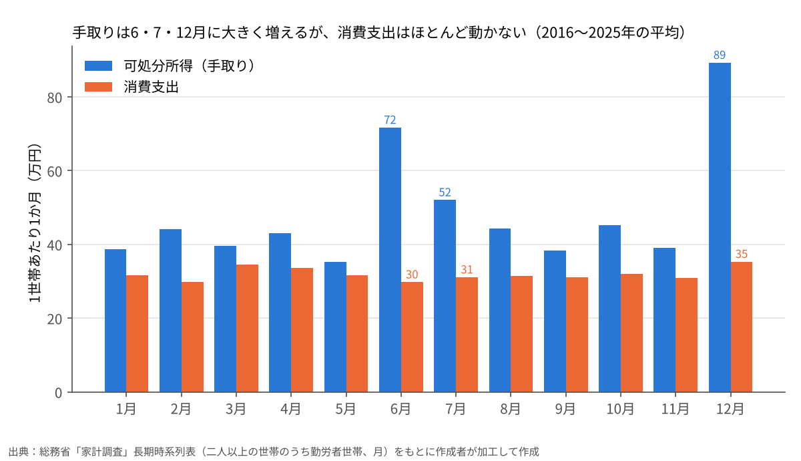
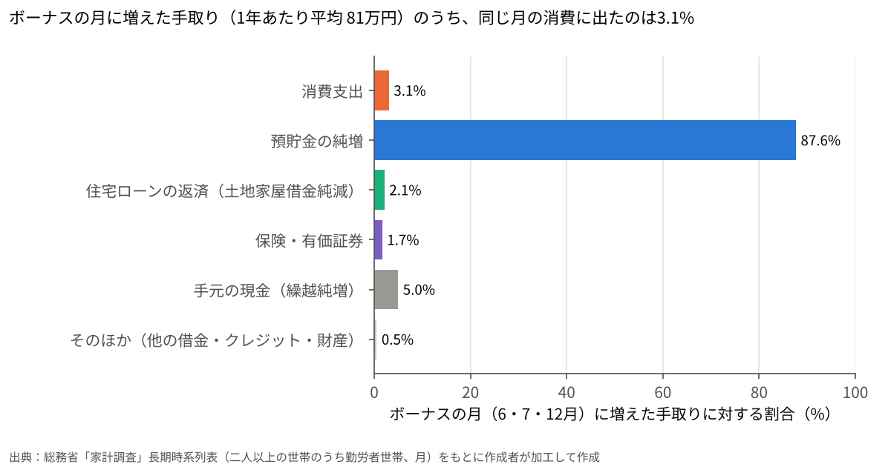
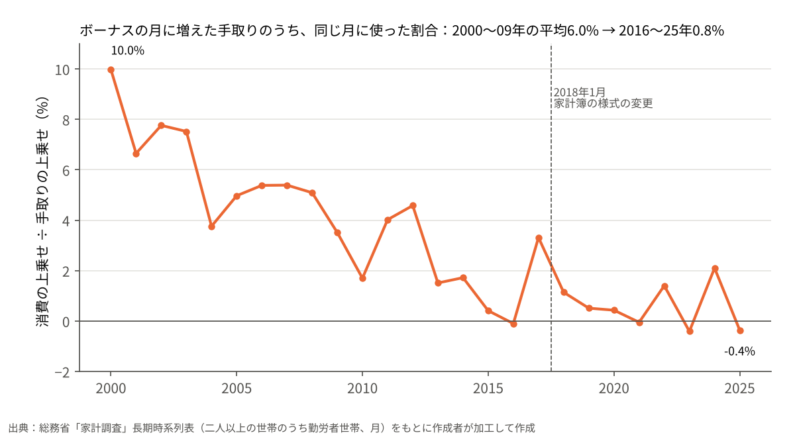
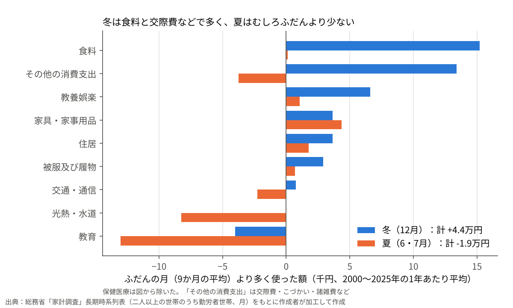

# F376 ボーナスの月に、勤労者世帯はどれだけ使い、どれだけ残すのか？ 増えた手取り81万円のうち同じ月に使ったのは3.1%、87.6%は預貯金に。使う割合は2000年代の6.0%から0.8%に

## 結論（先に）
- 勤労者世帯（二人以上の世帯のうち勤労者世帯）では、ボーナスの月（6・7・12月）に手取り（可処分所得）が、ふだんの月より1年あたり平均81万円多くなります（2000〜2025年の平均）。
- そのうち、同じ月の消費支出の増加に出たのは3.1%（1年あたり約2.5万円）でした。87.6%は預貯金の純増（預け入れから引き出しを引いた額）に、2.1%が住宅ローンの返済の上乗せに回っています。
- 消費の増え方は夏と冬で逆でした。冬（12月）は食料・交際費などで +4.4万円、夏（6・7月）はふだんの月より −1.9万円です。ボーナスの上乗せが大きい年ほど消費の上乗せも大きい、というはっきりした関係は見えません（夏冬を合わせた傾き −1.7%、95%区間 −9.8〜+6.4%。冬だけでは +3.1%）。ただし年の傾向を入れた回帰では +8.3% と出し方で幅があり、高く見ても1割程度です。冬の上乗せの多くは、年末の季節の分と見る方が合います。
- 同じ月に使う割合は、2000〜2009年の平均6.0%から、2016〜2025年は0.8%に下がりました。
- 問い直し：2000年代は、ボーナス以外の月に預貯金を取り崩す月が1年に4.8か月ありましたが、2016〜2025年は0.6か月です。ボーナスを「ふだんの月の穴埋め」に回す形は、記録の上では見えにくくなっています。

## 問い
夏と冬のボーナスの月には、勤労者世帯の収入が大きく増えます。その増えた分のうち、どれだけをその月に使い、どれだけを貯金や住宅ローンの返済に回しているのでしょうか。使うなら何に使うのか。その割合は26年で変わったのか。

知りたい人は、ボーナスの時期の売り上げを見込む小売・旅行の担当や、家計の貯蓄の動きを読むアナリストです。民間のアンケート（ロイヤリティ マーケティング、2025年6月）では、夏のボーナスの使い道の1位は12年続けて「貯金・預金」でした。これは「使うつもり」の調査なので、家計調査の記入（実際のお金の出入り）で確かめました。

## データ（出典）
| データ | 期間 | 出典 |
|---|---|---|
| 家計調査 長期時系列表 表2 用途分類（二人以上の世帯のうち勤労者世帯、1世帯あたり1か月） | 2000年1月〜2026年9月（分析は2000〜2025年） | 総務省統計局「家計調査（家計収支編）」e-Stat statInfId 000040270658 |

使った項目は、実収入、世帯主の臨時収入・賞与、税・社会保険料、可処分所得（手取り）、消費支出（10大費目と主な中分類）、黒字とその内訳（預貯金純増・住宅ローンの返済＝土地家屋借金純減・繰越純増など）です。可処分所得 = 消費支出 + 黒字 と、黒字 = 内訳の合計が丸めの範囲で成り立つことを確かめました。

## 事前の計画
集計の前に [PLAN.md](PLAN.md) を書きました（2026-11-18）。前の担当が取得（01_fetch.py と元データ）まで作って止まっていた番号を引き継ぎました。前の担当が数字を見たかは分かりません。私は表の形を確かめるときに2000年1月の列の値を目にしましたが、ボーナスの月の値は計画の後に集計しました。

定義：ボーナスの月の「上乗せ」は、6・7・12月の値から、その年のほかの9か月の平均を引いて足したもの（1年あたり）です。「見かけの使う割合」A は、消費支出の上乗せ ÷ 手取りの上乗せ（2000〜2025年の合計どうし）。「限界的に使う割合」b は、年ごとの消費の上乗せを手取りの上乗せに回帰した傾きです。

| 仮説 | 外れの基準 | 結果 | 判定 |
|---|---|---|---|
| H1：A は50%未満 | A ≥ 50% | A = 3.1% | 支持 |
| H2：b は A より10ポイント以上小さい（季節の分が A を大きく見せている） | b ≥ A − 10ポイント | b = −1.7%（95%区間 −9.8〜+6.4%）。A がもともと小さく、差は4.7ポイント | 外れ |
| H3：黒字の上乗せの最大の行き先は預貯金で半分以上、かつ住宅ローンの返済が手取りの上乗せの10%以上 | どちらかを満たさない | 預貯金は黒字の上乗せの90.4%。住宅ローンの返済は2.1% | 外れ（後半） |
| H4：A_y は下がった（2016〜2025年の平均が2000〜2009年より5ポイント以上低い） | 下がり幅が5ポイント未満 | 6.0% → 0.8%（−5.2ポイント） | 支持 |

## やったこと
1. xlsx から項目×年月の表を作り（02）、年ごとの上乗せを項目ごとに計算した（03）。
2. A・b・黒字の内訳・夏と冬の費目を集計し、頑健性を確かめた。
3. 結果を見てから、ボーナス以外の月の預貯金の取り崩しを見た（03b）。図は4枚（04）。

## 分かったこと

### 図1：手取りは6・7・12月に跳ねるが、消費支出はほとんど動かない


2016〜2025年の平均で、手取りは6月72万円、7月52万円、12月89万円です（ほかの月は35〜45万円）。消費支出は6月30万円、7月31万円、12月35万円で、ほかの月（30〜35万円）とほぼ同じです。月ごとのばらつき（変動係数）は、手取りが31.8%、消費支出が5.2%でした。

### 図2：増えた手取りの87.6%は預貯金の純増に


ボーナスの月の上乗せ（1年あたり平均）は、実収入が96.3万円、うち世帯主の臨時収入・賞与が78.6万円、税・社会保険料が15.3万円で、手取りの上乗せは80.9万円でした。行き先は、預貯金の純増 87.6%、手元の現金（繰越純増）5.0%、消費支出 3.1%、住宅ローンの返済（土地家屋借金純減）2.1%、保険・有価証券 1.7%、そのほか 0.5% です。住宅ローンのボーナス払いは、ローンのない世帯も含めた平均なので小さく出ます（推測）。

### 図3：同じ月に使う割合は、2000年の10.0%から2025年は −0.4% に


年ごとの A_y は、2000年の10.0%から下がり続け、2016年以降はほぼ0のまわりにあります（2000〜2009年の平均6.0%、2016〜2025年の平均0.8%）。この間、手取りの上乗せは2000年の93.1万円、2025年の99.9万円と、大きくは変わっていません。下がったのは、ボーナスの月の消費の上乗せ（2000年9.3万円 → 2025年 −0.4万円）の方です。2018年1月に家計簿の様式が変わっていて、その前後で比べるときは注意が要ります（下の頑健性で2018年以降だけでも計算した）。

### 図4：冬は食料と交際費などで多く、夏はふだんの月より少ない


冬（12月）の消費の上乗せは +4.4万円で、食料 +1.5万円（34.7%）、その他の消費支出 +1.3万円（30.5%）、教養娯楽 +0.7万円（15.0%）の順でした。中分類では、交際費 +7,490円、こづかい +5,895円、交際費のうち食料 +4,589円、教養娯楽用品 +3,778円、外食 +2,456円です。夏（6・7月）は −1.9万円で、教育 −1.3万円（授業料は4月などに多い）、光熱・水道 −0.8万円が下げています。夏に多いのは家庭用耐久財 +2,958円（エアコンなどと推測）、こづかい +4,248円、パック旅行費 +2,327円でした。どちらも季節の買い物の形に見えます。

## 問い直し（結果を見てから足した）
「ボーナスの月に預貯金に積んだ分は、ほかの月に取り崩して使っているのではないか」を確かめました。年ごとに、ボーナス以外の9か月の預貯金純増を足しました（results/deposit_drawdown_by_year.csv）。

- 2000〜2009年：ボーナスの月の預貯金純増は1年あたり62.1万円、ほかの月は合計 −4.0万円。預貯金が減った月は1年に平均4.8か月ありました。
- 2016〜2025年：ボーナスの月は103.6万円、ほかの月も合計 +58.7万円。減った月は1年に平均0.6か月です。

2000年代は「ボーナスで積み、ほかの月に少し取り崩す」形でしたが、最近はほかの月も積み増しています（2016〜2025年のボーナス以外の月の黒字は1年あたり81.0万円）。ただし、キャッシュレスの支払いが増えると引き落としの記入のされ方も変わるので、月ごとの形は記入の方法の影響も受けます（推測）。

## 頑健性
| 確かめ | A（見かけの使う割合） | b（傾き） | 結論は変わったか |
|---|---|---|---|
| 基本（9か月の平均を基準、2000〜2025年） | 3.1% | −1.7%（標準誤差 4.1） | ― |
| 基準を近い月にする（夏は4・5・8・9月、冬は10・11月） | 3.6% | −2.8% | 変わらない |
| 分母を実収入にする | 2.6% | −5.2% | 変わらない |
| 2020・2021年を除く | 3.4% | +1.1% | 変わらない |
| 2018年以降だけ（8年） | 0.6% | +3.4% | 変わらない |
| 2000〜2017年だけ（18年） | 4.5% | +29.1% | b は大きい（傾向の重なり。下の行） |
| 夏（6・7月）だけ | −5.2% | −3.7% | 夏はふだんより少ない |
| 冬（12月）だけ | 9.8% | +3.1% | 冬でも1割未満 |
| 傾き：前年との差どうしの回帰 | ― | +9.0%（標準誤差 4.6） | 高くても1割程度 |
| 傾き：年の直線の傾向を入れた回帰 | ― | +8.3%（標準誤差 2.0） | 同上 |
| 傾き：Theil-Sen | ― | −1.3% | 変わらない |
| 年ごとの比 A_y の中央値 | 2.7% | ― | 変わらない |

「同じ月に使うのは手取りの上乗せの1割未満」という結論は、どの確かめでも変わりませんでした。限界的な割合 b は、出し方で −5%〜+9% と幅があり（2000〜2017年だけは+29%）、ゼロと区別できない出し方が多いです。参考（計画外）：2026年の夏（6・7月、基準は1〜5・8・9月）は −11.3% でした。

## 言えないこと
- 家計調査は世帯の平均です。ボーナスのない世帯も平均に入っているので、「ボーナスをもらった人が何割使うか」ではありません。
- 翌月以降に使う分（ボーナスで貯めて秋に旅行する、など）は、この定義では「残した」に入ります。問い直しで見たように、最近はほかの月も預貯金が増えていて、取り崩しは見えにくいだけかもしれません。
- 預貯金純増は口座の出入りの差で、何のために貯めたのかは分かりません。カードの支払いや口座振替の記入のされ方の変化も含みます。
- 冬の上乗せが「ボーナスがあるから」か「年末だから」かは、26年分の年の比較ではきれいには分けられません。
- 2018年1月の家計簿の様式の変更の前後の比較には注意が要ります。

## 仕事で使うなら
- ボーナスの時期の売り上げの見込みでは、勤労者世帯の平均で見ると、12月の消費の上乗せは年末の季節の分とほぼ同じ大きさで、ボーナスの額の大小にはあまり連動していない、という目安になります。

## 計画からの変更
- 傾き b の出し方に「年の直線の傾向を入れた回帰」を足しました（2000〜2017年だけの b が大きく出たため）。
- 参考として2026年の夏を計算しました（計画外。年の途中のため基準の月が違う）。
- 図4では保健医療を図から除きました（表 results/items_excess.csv には残しています）。

## 再現のしかた
```
pip install -r requirements.txt
sh src/run_all.sh        # オフライン。01_fetch.py は呼ばない
```
| ファイル | 役割 |
|---|---|
| src/01_fetch.py | e-Stat から元データを取る（ネットが必要。run_all.sh からは呼ばない） |
| data/raw/kakei_longterm_workers_monthly.xlsx・SOURCES.md | 元データ（同梱、2.0MB）と取得元 |
| src/02_build.py | xlsx → data/monthly_long.csv・data/items.csv |
| src/common.py | 行の対応、上乗せと回帰の計算 |
| src/03_analysis.py | results/main.json・excess_by_year.csv・items_excess.csv・robustness.csv |
| src/03b_requestion.py | 問い直し：results/requestion.json・monthly_profile.csv・deposit_drawdown_by_year.csv |
| src/04_figures.py | figures/fig1〜fig4 |

所要時間は約5秒（CPU 1つ）。results/repro_check.txt：2026-11-18 に /tmp に写して流し直し、13ファイル（results 7・figures 4・data の中間 CSV 2）がバイト単位で一致しました。

## レビューで直したこと
| # | 指摘 | 直し方 |
|---|---|---|
| 1 | 結論（先に）の「冬の分も…（傾き −0.02）」は、夏冬を合わせた傾き（−1.7%）を冬の傾きのように書いていた（冬だけの傾きは +3.1%）。また、年の傾向を入れた回帰では +8.3%（標準誤差2.0）と正に出ていて、「増えるわけではない」は言い過ぎだった | 結論の文を、合わせた傾きと冬だけの傾き・区間を分けて書き、出し方で −5〜+9% の幅があり高く見ても1割程度、に弱めた。note の同じ箇所も「関係はほぼありません」→「はっきりした関係は見えません」に直し、傾向を入れた回帰の値を足した |
| 2 | README の見出しが status・note の題名と違っていた | 見出しを status の題名にそろえた |

独立レビューで数字の照合・再実行（/tmp で13ファイル一致）・図4枚を確かめました。保健医療の費目は本文では扱っておらず、図4の注と計画からの変更で「図から除いた」と書いているだけです。

## 出典
- 総務省統計局「家計調査（家計収支編）」長期時系列表 表2：https://www.e-stat.go.jp/stat-search/file-download?statInfId=000040270658&fileKind=4
- 株式会社ロイヤリティ マーケティング「夏のボーナスの使い道」調査（2025年6月26日）：https://www.loyalty.co.jp/wp/wp-content/uploads/2025/06/250626.pdf

（いずれも総務省「家計調査」をもとに作成者が加工して作成）
