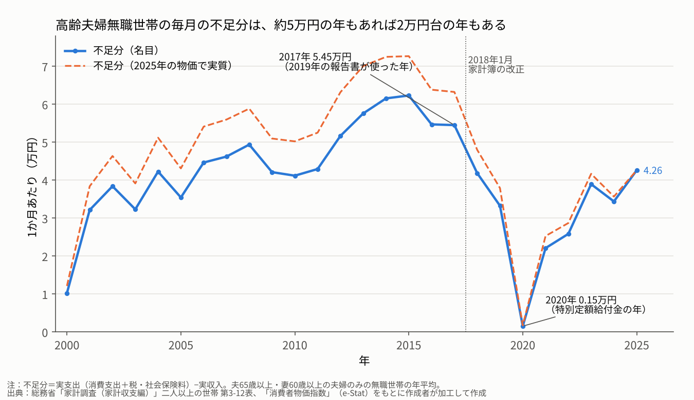
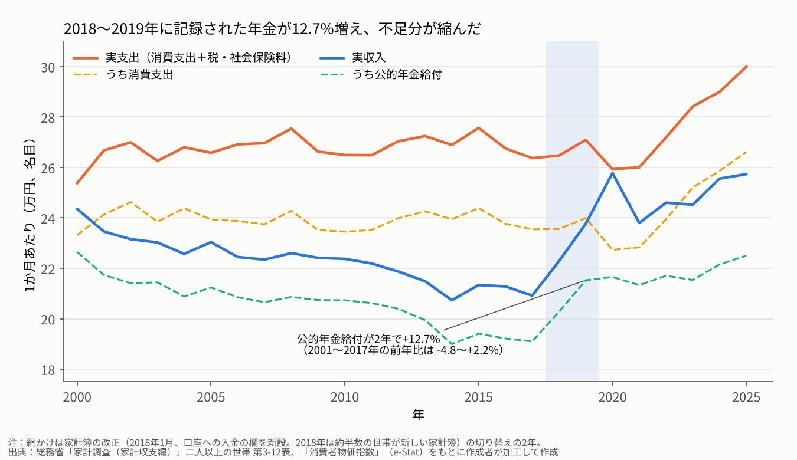
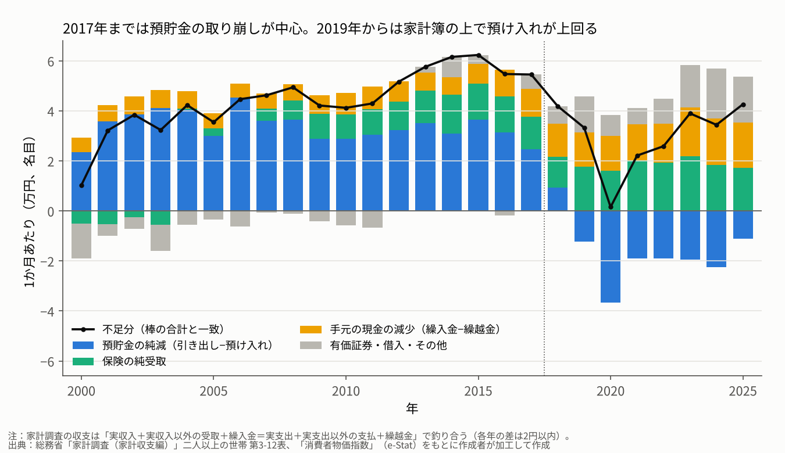
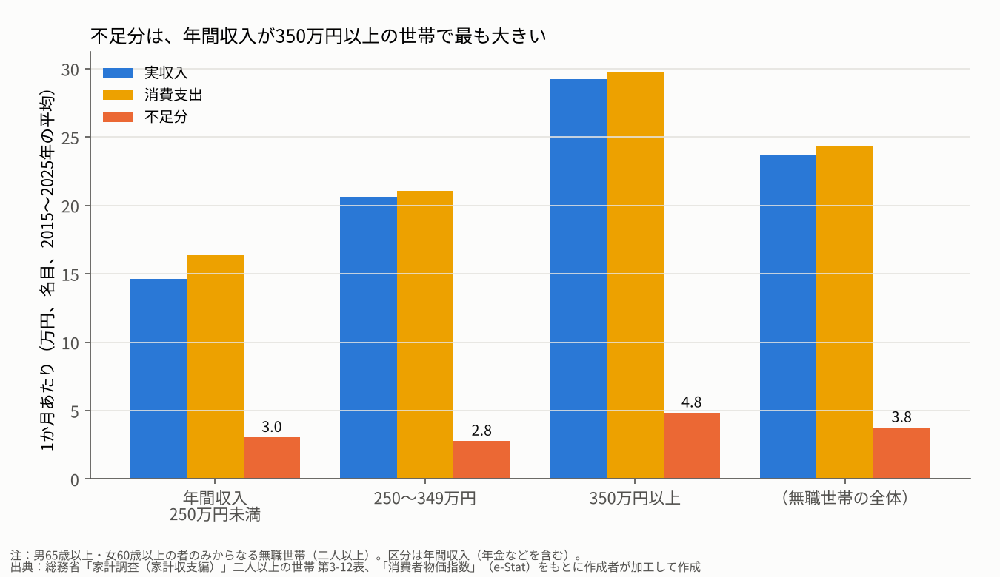

# F377 「高齢夫婦の毎月の赤字は約5万円」は今も同じか？ 2017年は5.5万円、2021〜25年の平均は3.3万円。ただし2018年の家計簿の改正をはさみ、記録された年金が2年で12.7%増えた

精選モード。計画（[PLAN.md](PLAN.md)）は集計の前に書きました（データの取得までは前の担当。PLAN.md の冒頭に開示）。資産運用・年金制度・貯蓄のしかたの助言はせず、数字の見方の説明にとどめます。

## 結論（先に）

1. **2019年の報告書の「毎月約5万円の赤字」は、家計調査の2017年の値そのものでした。** 高齢夫婦無職世帯（夫65歳以上・妻60歳以上の夫婦のみの無職世帯）の2017年は、実収入 209,198円、実支出 263,718円で、不足分は 54,520円です。
2. **不足分は年で大きく動きます。** 5万円を超えたのは2012〜2017年の6年だけです。最大は2015年の62,326円、最小は2020年の1,541円、2021〜2025年の平均は 32,788円でした。
3. **ただし2018年をまたぐ比較は同じ物差しではありません。** 2018年1月の家計簿の改正（口座への入金の欄の新設）の前後で、記録された公的年金給付が2年で +12.7%（+24,269円）増えました。2001〜2017年の前年比は −4.8〜+2.2% です。2018年からの不足分の縮みの多くは、この段差で説明できる大きさです（問い直し）。
4. **「貯蓄で埋める」は、2017年までは家計簿でも見えます。** 2000〜2014年は不足分の 81.7% が預貯金の純減でした。2019年からは預け入れが引き出しを上回り、読みにくくなりました。
5. **平均の不足分は、収入の低い世帯ほど大きいわけではありません。** 2015〜2025年の平均で、年間収入350万円以上の区分は 48,412円、250万円未満は 30,337円でした。

## 問い

2019年6月、金融審議会 市場ワーキング・グループの報告書が、高齢夫婦無職世帯の平均で毎月の赤字が約5万円、20年で約1,300万円、30年で約2,000万円の取り崩しになると試算しました。「老後2000万円」として広く知られた数字です。

元になった家計調査の数字を26年分並べ、2017年の値は他の年でも同じか、変化は収入と支出のどちらから来たか、「貯蓄で埋める」は家計簿でどう見えるか、平均の中身はどうかを確かめます。家計の統計を読む人、記事やセミナーでこの数字に触れる人に向けた、数字の見方の確認です。

## データ（出典）

- 総務省「家計調査（家計収支編）」二人以上の世帯 詳細結果表 第3-12表（高齢者のいる世帯）世帯主の就業状態別 1世帯当たり1か月間の収入と支出、2000〜2025年の年平均（26ファイル、e-Stat）
  - 主な列：夫65歳以上・妻60歳以上の夫婦一組の世帯（無職世帯）。集計世帯数は年に 838〜1,558世帯
  - 確かめの列：65歳以上の夫婦一組の無職世帯、男65歳以上・女60歳以上の者のみからなる無職世帯とその年間収入の3区分
- 総務省「消費者物価指数」2025年基準 全国 中分類（月）：持家の帰属家賃を除く総合の年平均で、2025年の円に直した
- 取得元の URL と取得日は [data/raw/SOURCES.md](data/raw/SOURCES.md)

言葉：不足分（赤字）＝実支出（消費支出＋税・社会保険料）− 実収入。収支は「実収入＋実収入以外の受取＋繰入金＝実支出＋実支出以外の支払＋繰越金」で釣り合うので、不足分は預貯金・保険・現金などの動きに分けられます。26年×7列で、この式のずれは2円以内でした（`data/identity_check.csv`）。

## 事前の計画

[PLAN.md](PLAN.md) に、問い・仮説・外れの基準・頑健性を、集計の前に書きました。判定は次のとおりです。

| 仮説 | 外れの基準 | 結果 | 判定 |
|---|---|---|---|
| H1 2021〜25年平均は2017年より1万円以上小さい | 差が1万円未満 | 21,732円小さい | 支持（段差を戻す試算では逆） |
| H2 実質の変化は、実収入の減少の寄与が消費支出の寄与より大きい | 消費支出の方が大きい | 実収入 +13,948円、消費支出 −22,858円 | 外れ |
| H3 2015〜25年は不足分の7割以上が預貯金の純減 | 7割未満 | −9.3% | 外れ |
| H4 350万円以上の区分の不足分は250万円未満以上 | 250万円未満の方が大きい | 48,412円 対 30,337円 | 支持 |

## やったこと

26年分の表を行の名前と列の番号で読み取り（`src/kakei.py`）、不足分の推移（名目・実質）、2000〜04年→2021〜25年の変化の寄与の分け方（足し算で厳密に分かれる）、収支の恒等式による埋め方の内訳、年間収入の区分の比較を出しました。結果を見てから、2018年の家計簿の改正の段差を調べました。

## 分かったこと

### 不足分は年で動き、5万円台は2012〜2017年だけ



- 2000年 10,251円、2005年 35,455円、2010年 41,192円、2015年 62,326円、2017年 54,520円、2020年 1,541円、2025年 42,622円です。
- 26年の平均は 40,016円、中央値は 41,999円。前年からの動きの大きさの中央値は 6,822円で、標本の揺れも入ります。
- 2020年は特別収入（給付金など）が 18,843円あり（2019年は 5,738円）、これを除いた不足分は 20,384円でした。

### 収入と支出：2018〜2019年に記録された年金が段差のように増えた



- 公的年金給付は 2000年 226,460円から 2017年 191,019円まで少しずつ減り、2018年 +6.1%、2019年 +6.2% と大きく増えました。同じ2年の消費支出は +1.9% です。
- 実質で 2000〜04年平均→2021〜25年平均の不足分は 37,455円 → 34,799円（−2,656円）。寄与は消費支出の減少 −22,858円、税・社会保険料の増加 +6,255円、実収入の減少 +13,948円（うち公的年金給付 +25,624円、勤め先・事業収入 −7,847円）で、H2 は外れました。

### 埋め方：2017年までは預貯金の取り崩しが中心



- 2000〜2014年の合計では、不足分の 81.7% が預貯金の純減でした。
- 2019年からは預け入れが引き出しを上回り（2015〜2025年の合計で −9.3%）、「手元の現金の減少」と「その他」が大きくなりました。
- 手元の現金の減少（繰入金 − 繰越金）は毎年プラスで、2023年からは約1.8〜2.0万円です。理由はこの表からは分かりません。

### 平均の中身：収入の高い区分ほど不足分が大きい



- 男65歳以上・女60歳以上の者のみの無職世帯（2015〜2025年平均）で、年間収入250万円未満は実収入 146,066円・不足分 30,337円、250〜349万円は 206,405円・27,705円、350万円以上は 292,227円・48,412円。収入の高い区分は消費支出も大きく（297,311円）、26年中23年で250万円未満より不足分が大きい値でした。

### 参考：報告書と同じ掛け算を年ごとにすると

- 不足分×12か月×30年は、2017年の値で 1,963万円（20年で 1,308万円）。各年の値では 55万円（2020年）〜2,244万円（2015年）、2025年は 1,534万円です。どの年の平均を使うかで結果が変わることの説明で、必要な額の見積もりではありません。

## 問い直し（結果を見てから足した）

**2018年の家計簿の改正の前後で、記録された年金と預貯金に段差はあるか？** 2018〜2019年の年金と預け入れの伸びが、それまでと違って見えたので足しました。

- 統計局によると、2018年1月の改正で口座への入金の欄が新設され、影響は収入でより大きく出たと推察されています（2018年は約半数の世帯が新しい家計簿）。
- 公的年金給付は2017→2019年に +12.7%（+24,269円）。2001〜2017年の前年比は −4.8〜+2.2%（中央値 −0.95%）です。65歳以上の夫婦一組の無職世帯でも +13.4% でした。
- 預け入れも2017→2019年に +16.9%（それまでの前年比の最大は +1.8%）。口座に入った年金が収入と預け入れの両方に書かれるようになった、と考えると形が合います（推測）。
- 試算：年金の伸びのうち、それまでの中央値の伸び（2年分）を超える部分（14.9%）を段差とみなして2019年以降の年金を割り引くと、2021〜2025年の平均の不足分は 61,084円です（記録どおりでは 32,788円）。H1 は逆になります。
- どちらの物差しが実態に近いかは決められません。言えるのは、**2017年以前と2019年以降を並べて「縮んだ」と読むのは危ういこと**です。2017年までの不足分が年金の記入漏れで大きく出ていた可能性もあります（推測）。

## 頑健性

| 条件 | H1：2017年 − 最近の平均 | H2：実収入 / 消費支出の寄与（実質） | H3：預貯金の純減 |
|---|---|---|---|
| 基本 | +21,732円 支持 | +13,948 / −22,858 外れ | −9.3% 外れ |
| R1 65歳以上の夫婦一組の無職世帯 | +21,080円 支持 | +20,908 / −18,626 支持 | −14.0% 外れ |
| R2 名目（実収入は増えた） | +21,732円 支持 | −15,300 / +8,301 外れ | −9.3% 外れ |
| R3 2020〜21年を除く | +19,061円 支持 | +15,495 / −21,591 外れ | +4.5% 外れ |
| R4 特別収入を除く | +18,731円 支持 | +14,934 / −22,858 外れ | ― |
| R5a 期間 2005〜09→2021〜25 | ― | +6,620 / −22,158 外れ | ― |
| R5b 期間 2000〜04→2023〜25 | +15,860円 支持 | +18,406 / −21,065 外れ | ― |
| R6 段差を戻す試算（問い直し） | −6,564円 外れ | ― | ― |

H1 は家計簿の段差の扱いで判定が変わります。H2 は定義で判定が変わる（R1）ので、収入と消費の寄与はほぼ同じ大きさと読むのが安全です。H3 はどの条件でも外れです。

## 言えないこと

- 家計調査の平均は「平均的な世帯」ではありません。世帯ごとの差は大きく、平均の不足分を個々の世帯に当てはめられません。
- 2018年の段差のうち、記入のしかたの変化と実際の変化は分けられません。試算は一つの仮定にもとづきます。
- 家計調査は貯蓄の残高を見ていません。不足分が何年続くか、資産がいくら要るかは扱いません。
- 世帯主の平均年齢の上昇（72.8歳→76.9歳）など、世帯の中身の変化の効果は分けていません。
- 年金制度・資産運用・貯蓄のしかたの良し悪しは扱いません。

## 仕事で使うなら

- 家計調査の1年の平均を引用するときは、前後の年の幅も一緒に示す。
- 2018年をまたいで収入や預貯金を比べるときは、家計簿の改正の段差を注記し、総務省の変動調整値の説明も参照する。

## 計画からの変更

- 問い直しとして、2018年の家計簿の改正の段差（03b_requestion.py）と、それを戻す試算（頑健性の R6）を足しました。
- H2 の判定に「実収入が減った向き」であることも条件として加えました（計画の文言「実収入の減少の寄与」に合わせるため。名目では実収入が増えていた）。

## 再現のしかた

```
sh src/run_all.sh
```

オフラインで 02 → 03 → 03b → 04 を流します（元データは `data/raw/` に同梱）。CPU 1つで約7秒です。

| ファイル | 中身 |
|---|---|
| src/01_fetch.py | 元データの取得（ネットが必要。run_all からは呼ばない） |
| src/kakei.py | 表を読む共通の関数 |
| src/02_build.py | data/kakei_elderly_long.csv・cpi_annual.csv・identity_check.csv |
| src/03_analysis.py | 推移・分け方・埋め方・収入区分・頑健性（results/main.json ほか） |
| src/03b_requestion.py | 問い直し（results/requestion.json） |
| src/04_figures.py | 図4枚 |

再実行の確かめ（[results/repro_check.txt](results/repro_check.txt)）：/tmp に写して流し直し、17ファイル（results 10・figures 4・data 3）がバイト単位で一致、所要7秒。

## レビューで直したこと

| # | 指摘 | 直し方 |
|---|---|---|
| 1 | 題名と note の要約が「家計簿の改正で、記録される年金が増えた」と、改正が原因だと言い切る形だった（本文では、記入の変化と実際の変化は分けられないとしている） | 題名を「改正をはさみ、記録された年金が2年で12.7%増えた」に、note の太字の段落も同じ趣旨に弱めた。status・note の1行目・README の見出しをそろえた |

数字の照合・再実行（/tmp で17ファイル一致）・図4枚は独立レビューで確かめ、ほかに直すところはなかった。

## 出典

- 総務省統計局「家計調査（家計収支編）」二人以上の世帯 詳細結果表 第3-12表（2000〜2025年）：https://www.e-stat.go.jp/stat-search/files?toukei=00200561 （各ファイルの URL は data/raw/SOURCES.md）
- 総務省統計局「消費者物価指数」2025年基準：https://www.e-stat.go.jp/stat-search/files?toukei=00200573
- 金融審議会 市場ワーキング・グループ報告書「高齢社会における資産形成・管理」（2019年6月3日）：https://www.fsa.go.jp/singi/singi_kinyu/tosin/20190603/01.pdf
- 総務省統計局「統計Today」家計簿の改正について：https://www.stat.go.jp/info/today/140.html
- 総務省統計局「家計調査 変動調整値について」：https://www.stat.go.jp/data/kakei/longtime/pdf/hendo2019.pdf

（いずれも 総務省「家計調査」「消費者物価指数」をもとに作成者が加工して作成）
