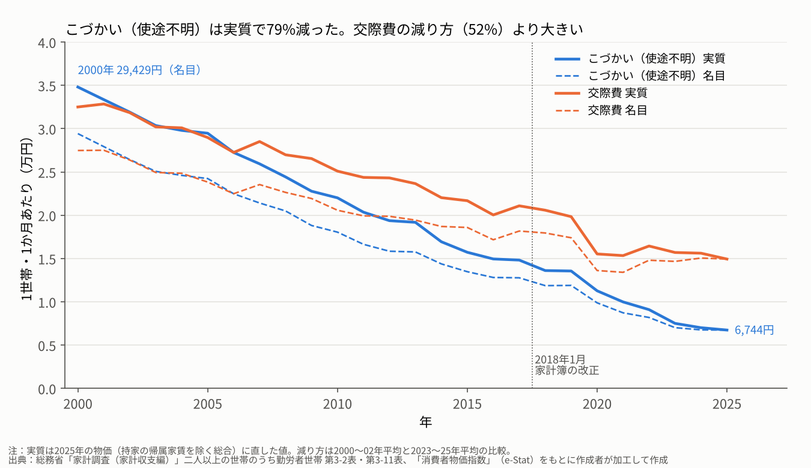
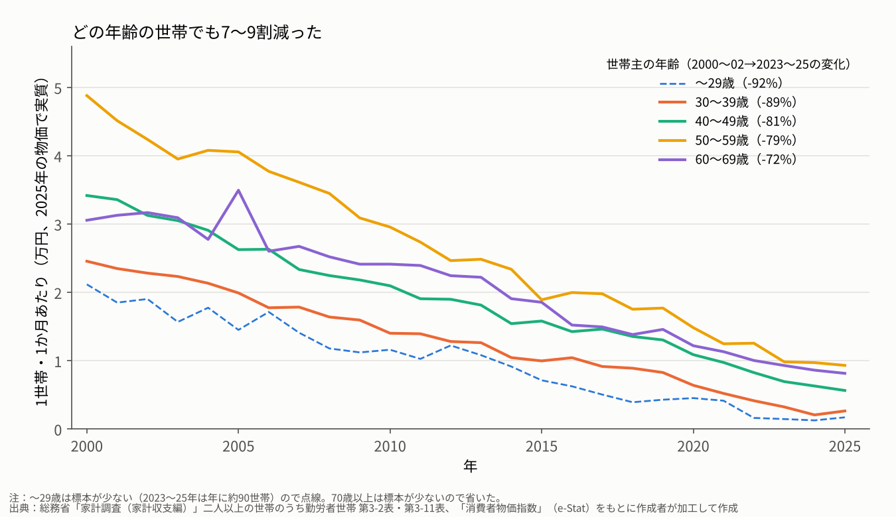
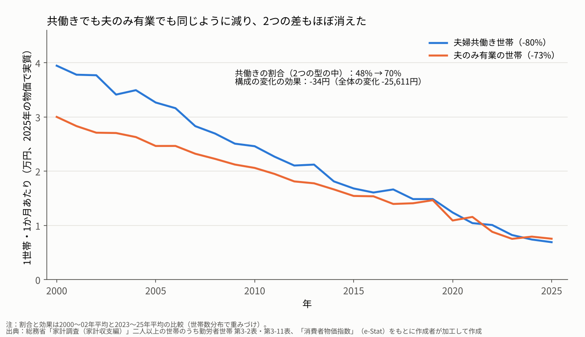
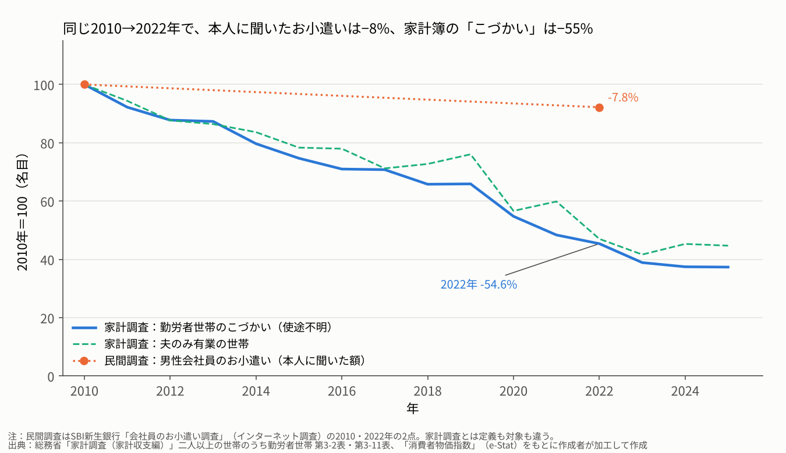

# F378 勤労者世帯の「こづかい」は、どこまで減ったのか？ 2000年の月29,429円から2025年は6,744円。物価を引くと79%減で、本人に聞いた民間調査のお小遣いとは減り方がまるで違う

精選モード。計画（[PLAN.md](PLAN.md)）は集計の前に書きました（データの取得までは前の担当。PLAN.md の冒頭に開示）。

## 結論（先に）

1. **家計調査の「こづかい（使途不明）」は、勤労者世帯で4分の1以下になりました。** 1世帯・1か月あたり、2000年 29,429円、2010年 18,052円、2025年 6,744円です。物価を引いた実質で、2000〜02年平均から2023〜25年平均までに 78.7% 減りました。
2. **交際費の減り方（52.4%）より大きく、消費支出に占める割合は 8.6% から 1.9% になりました。** 実質の消費支出の減少（−60,421円）のうち、43.5% がこづかいの減少（−26,270円）でした。
3. **どの年齢の世帯でも7〜9割減りました。** 世帯主が30〜39歳で −88.7%、50〜59歳で −78.8%、60〜69歳で −72.1% です。年齢の構成の変化の効果は小さく（+681円）、減少はほぼすべて年齢階級の中の減少でした。共働き（−80.4%）と夫のみ有業（−73.0%）も同じ形です。
4. **問い直し：本人に聞いた民間調査のお小遣いとは、減り方がまるで違います。** 同じ2010→2022年（名目）で、民間調査の男性会社員のお小遣いは −7.8%、家計調査の勤労者世帯のこづかいは −54.6% でした。家計調査の「こづかい」は、使い道が家計簿に書かれなかった現金の額で、本人が使えるお金の額ではありません。

## 問い

「会社員のお小遣いは減り続けている」という話は、民間の調査でよく語られます。SBI新生銀行（旧 新生銀行）の調査では、男性会社員のお小遣いは1990年の77,725円が最高で、2010年代からは3万円台後半〜4万円前後です。

総務省の家計調査にも「こづかい（使途不明）」という項目があります。世帯の家計簿で、家族に渡されて使い道が書かれなかった現金です。この記事では、勤労者世帯のこの項目が2000〜2025年にどこまで減ったのかを、物価・年齢・共働きかどうかで分けて確かめます。家計の統計を読む人や、家族向けの商品・外食・趣味のサービスを扱う人が、公的な統計の数字をどう読むかを知るための記事です。お小遣いをいくらにすべきかは扱いません。

## データ（出典）

- 総務省「家計調査（家計収支編）」二人以上の世帯のうち勤労者世帯、2000〜2025年の年平均（e-Stat）
  - 第3-2表 世帯主の年齢階級別：平均と10歳きざみ（〜29歳、30〜39歳、40〜49歳、50〜59歳、60〜69歳）。確かめに、二人以上の世帯（全体）の平均も使用
  - 第3-11表 妻の就業状態・世帯類型別：夫婦共働き世帯、夫のみ有業の世帯
  - 集計世帯数は勤労者世帯の平均で年に 3,802〜4,693世帯
- 総務省「消費者物価指数」2025年基準 全国 中分類（月）：持家の帰属家賃を除く総合の年平均で、2025年の円に直した
- 照合用（手入力）：SBI新生銀行の公表資料から、男性会社員のお小遣いの3点（1990・2010・2022年）
- 取得元の URL と取得日は [data/raw/SOURCES.md](data/raw/SOURCES.md)

## 事前の計画

[PLAN.md](PLAN.md) に、問い・仮説・外れの基準・頑健性を、集計の前に書きました。判定は次のとおりです。

| 仮説 | 外れの基準 | 結果 | 判定 |
|---|---|---|---|
| H1 実質で30%以上減った | 30%未満 | 33,361円 → 7,091円（−78.7%） | 支持 |
| H2 こづかいの減り方は交際費より大きい | 交際費の方が大きく減った | −78.7% 対 −52.4% | 支持 |
| H3 5つの年齢階級のすべてで20%以上減った | どれか1つでも20%未満 | −72.1%〜−92.4% | 支持 |
| H4 年齢の構成を固定しても減少の8割以上が残る | 8割未満 | 102.6% | 支持 |

仮説はすべて支持されました。ただし、基準の30%・20%は、結果から見ると控えめでした。

## やったこと

26年分の表を行の名前と列の見出しで読み取り（`src/kakei.py`）、こづかいと交際費を名目・実質・割合で並べ、2000〜02年平均と2023〜25年平均を比べました。年齢・共働きかどうか別にも同じことをし、構成の変化の効果を分けました（シフト・シェア分解：平均の変化を「階級の中の変化」と「構成の変化」に分ける方法）。結果を見てから、民間調査との比較などを足しました。

## 分かったこと

### こづかいは実質で79%減り、交際費より大きく減った



- こづかい（名目）は 2000年 29,429円 → 2005年 24,242円 → 2010年 18,052円 → 2015年 13,483円 → 2020年 9,887円 → 2025年 6,744円です。26年で最も多いのは2000年、最も少ないのは2025年で、前の年より増えたのは25回のうち2019年の1回だけでした。
- 交際費（名目）は 2000年 27,482円 → 2025年 14,944円です。実質では −52.4% でした。
- 消費支出に占めるこづかいの割合は 2000年 8.6% → 2025年 1.9%、可処分所得に占める割合は 6.2% → 1.3% です。
- 2018年1月の家計簿の改正の年（2017→2018年）の実質の前年比は −8.5% で、ほかの年の平均（−6.5%、標準偏差 5.0）から外れていません。改正の段差は見えませんでした。

### どの年齢でも7〜9割減った



- 2000〜02年平均 → 2023〜25年平均（実質）：〜29歳 19,583円 → 1,491円（−92.4%）、30〜39歳 23,635円 → 2,661円（−88.7%）、40〜49歳 33,020円 → 6,306円（−80.9%）、50〜59歳 45,455円 → 9,635円（−78.8%）、60〜69歳 31,185円 → 8,700円（−72.1%）。
- 若い世帯ほど減り方が大きい形です（〜29歳は2023〜25年の標本が年に約90世帯）。
- 勤労者世帯の世帯主の平均年齢は 46.2歳 → 51.0歳に上がり、60〜69歳の世帯の割合（5つの階級の中）は 10.7% → 19.8% になりました。こづかいの多い年齢の割合が増えたので、構成の変化はむしろ平均を +681円押し上げる向きでした。平均の減少（−26,420円）は、ほぼすべて階級の中の減少（−27,101円）です。

### 共働きでも夫のみ有業でも同じように減った



- 夫婦共働き世帯は 38,335円 → 7,525円（−80.4%）、夫のみ有業の世帯は 28,495円 → 7,681円（−73.0%）です（実質）。2000年ごろは共働きの方が1万円ほど多かった差が、ほぼなくなりました。
- 2つの型の中で共働きの割合は 48% → 70% に増えましたが、構成の変化の効果は −34円でした。

## 問い直し（結果を見てから足した）

**家計調査のこづかいの減り方は、本人に聞いた民間調査のお小遣いと比べてどうか？ こづかいの減少は、消費支出の減少のどれだけにあたるか？** 結果を見て、減り方が予想よりはるかに大きかったので足しました。



- 同じ2010→2022年（名目）で、SBI新生銀行の調査の男性会社員のお小遣いは 41,910円 → 38,642円（−7.8%）でした。家計調査の勤労者世帯のこづかいは 18,052円 → 8,195円（−54.6%）、夫のみ有業の世帯でも 16,910円 → 7,953円（−53.0%）です。
- 民間調査は本人が答えた「使えるお金」、家計調査は家計簿で「使い道が書かれなかった現金」です。家族が使ったお金でも、品目が書かれれば品目の支出に入ります。
- キャッシュレス払いが広がり、家族の支出も明細から品目ごとに家計簿に書かれやすくなったことが、こづかいの減少の一部を説明する可能性があります（推測。このデータではキャッシュレスの効果を分けられません）。
- 勤労者世帯の実質の消費支出は、2000〜02年平均 401,958円 → 2023〜25年平均 341,537円（−15.0%）でした。この減少の 43.5% がこづかいの減少です。こづかいを除いた消費支出は −9.3%、こづかいと交際費を除くと −5.1% でした。
- 「家計の消費が減った」の一部は、使い道の分からない現金の減少でできています。

## 頑健性

| 条件 | こづかいの変化 | 交際費の変化 | H1 | H2 |
|---|---|---|---|---|
| 基本（勤労者世帯・実質・2000〜02→2023〜25） | −78.7% | −52.4% | 支持 | 支持 |
| R1 名目 | −75.5% | −45.1% | 支持 | 支持 |
| R2 消費支出に占める割合の変化率 | −75.0% | −44.0% | 支持 | 支持 |
| R3a 1人あたり（実質） | −76.8% | ― | 支持 | ― |
| R3b 有業人員1人あたり（実質） | −80.3% | ― | 支持 | ― |
| R4a 期間 2005〜07→2023〜25 | −74.3% | −45.4% | 支持 | 支持 |
| R4b 期間 2015〜17→2023〜25 | −53.3% | −26.3% | 支持 | 支持 |
| R5 家計簿の改正をまたがない 2000〜02→2015〜17 | −54.5% | −35.4% | 支持 | 支持 |
| R6 対数の直線の傾き×25年（2020〜21年を除く。年率 −6.27%） | −80.2% | −54.4% | 支持 | 支持 |
| R7 二人以上の世帯（全体） | −75.0% | −50.2% | 支持 | 支持 |

どの条件でも結論は変わりません。2015〜17年からの最近8年だけでも半分以上減っています（R4b）。

## 言えないこと

- 家計調査の「こづかい」は、世帯の家計簿で使い道が分からない現金です。本人が自由に使えるお金の額ではなく、民間調査の「お小遣い」と同じ物差しで比べることはできません。
- こづかいの減少のうち、使い方の変化（使い道が家計簿に書かれるようになった）と、本当に渡す額が減ったことを分けられません。キャッシュレスの効果も推測です。
- 個人ごとの額や、家族の中で誰がいくら受け取ったかは分かりません。
- 〜29歳と60〜69歳は標本が少なめで、年ごとの値の揺れが大きい階級です。
- お小遣いの額や家計の配分の良し悪しは扱いません。

## 仕事で使うなら

- 家計調査の「こづかい」を、会社員のお小遣いの統計として引用しない。民間調査の数字と並べるときは、定義の違い（使い道の書かれない現金 か、本人に聞いた額 か）を必ず添える。
- 消費支出の長い期間の減少を読むときは、こづかい（使途不明）の減少がどれだけを占めるかを分けて見る。

## 計画からの変更

- 問い直しとして、民間調査との比較と、消費支出の減少に占める割合を足しました（`src/03b_requestion.py`）。民間調査の数字は公表資料から手で写した3点（`data/raw/sbi_okozukai_male_employee.csv`）で、2010年の値は2022年の公表資料のグラフの数字です。
- 計画の頑健性「2020〜21年を除く」は、比べる期間（3年平均）に2020〜21年が入らないため、対数の直線の傾きを2020〜21年を除いて求める形にしました（R6）。

## 再現のしかた

```
sh src/run_all.sh
```

オフラインで 02 → 03 → 03b → 04 を流します（元データは `data/raw/` に同梱）。CPU 1つで約15秒です。

| ファイル | 中身 |
|---|---|
| src/01_fetch.py | 元データの取得（ネットが必要。run_all からは呼ばない） |
| src/kakei.py | 表を読む共通の関数 |
| src/02_build.py | data/kakei_pocket_long.csv・cpi_annual.csv |
| src/03_analysis.py | 推移・年齢・共働き・分解・頑健性（results/main.json ほか） |
| src/03b_requestion.py | 問い直し（results/requestion.json） |
| src/04_figures.py | 図4枚 |

再実行の確かめ（[results/repro_check.txt](results/repro_check.txt)）：/tmp に写して流し直し、13ファイル（results 7・figures 4・data 2）がバイト単位で一致、所要14秒。

## レビューで直したこと

独立レビューで数字の照合（民間調査の3点を公表資料と照合したものを含む）・再実行・図を確かめ、直すところはなかった。

## 出典

- 総務省統計局「家計調査（家計収支編）」二人以上の世帯 詳細結果表 第3-2表・第3-11表（2000〜2025年）：https://www.e-stat.go.jp/stat-search/files?toukei=00200561 （各ファイルの URL は data/raw/SOURCES.md）
- 総務省統計局「消費者物価指数」2025年基準：https://www.e-stat.go.jp/stat-search/files?toukei=00200573
- SBI新生銀行「2022年 会社員のお小遣い調査」（2022年6月27日）：https://corp.sbishinseibank.co.jp/ja/news/news/news20220627103048/main/0/link/220627_OkozukaiSurvey_j.pdf
- 新生銀行「サラリーマンのお小遣い調査 30年白書」（2012年9月24日）：https://corp.sbishinseibank.co.jp/ja/news-archive/news-archive1/news20120924103093/main/0/link/120924okozukai_hakusho_j.pdf

（いずれも 総務省「家計調査」「消費者物価指数」をもとに作成者が加工して作成。民間調査の数字は照合のために引用）
