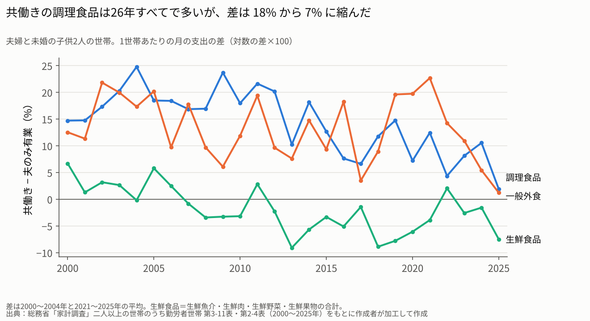
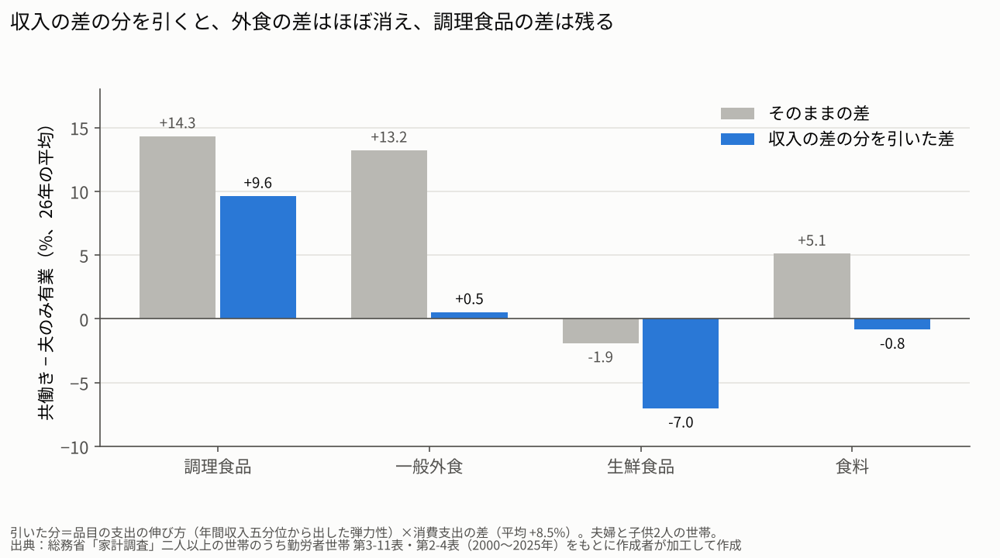
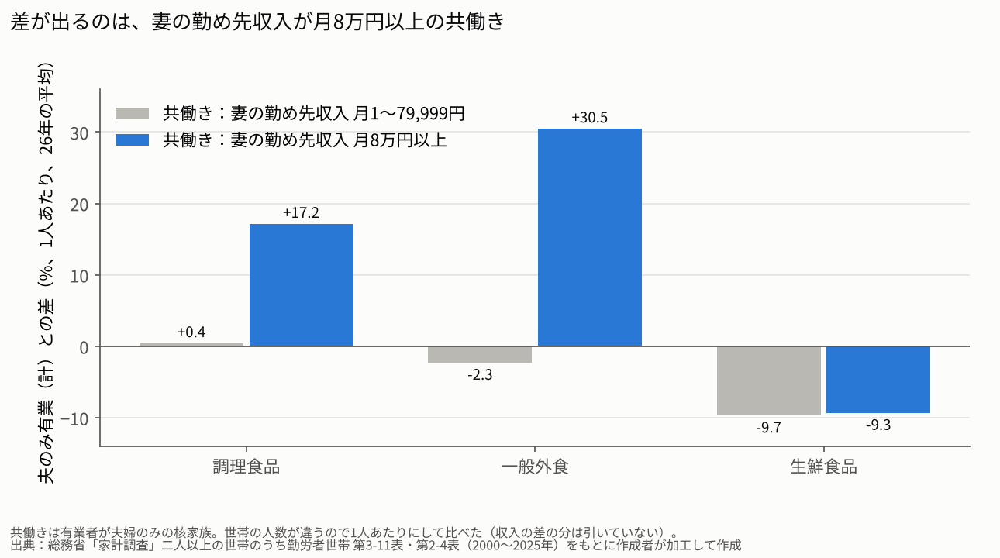
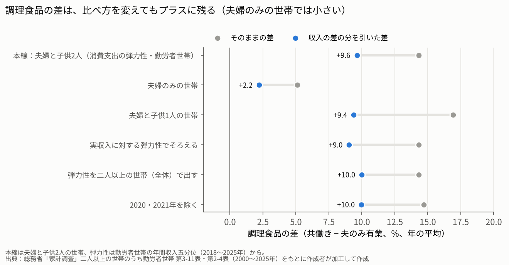

# F379 共働きの世帯は、食事に「時間よりお金」を使っているのか？ 調理食品は26年すべてで多く平均+14%、収入の差を引いても+10%残る。外食の差は収入でほぼ説明でき、調理食品の差は18%から7%に縮んだ

## 結論（先に）

- 夫婦と子供2人の勤労者世帯で比べると、共働きの世帯は夫のみ有業の世帯より、調理食品（総菜・弁当など）に平均 +14.3%（対数の差）多く払っていました。2000〜2025年の26年すべてでプラスです。
- 一般外食も +13.2% 多く、26年すべてでプラスでした。ただし、共働きの方が消費支出が平均 +8.5% 多いことの分（収入の差の分）を引くと、外食の差は +0.5% とほぼ消えます。調理食品は +9.6% 残りました。
- 生鮮食品（生鮮の魚介・肉・野菜・果物）は、そのままでは −1.9% とほぼ同じでした（マイナスは26年中18年）。収入の差の分を引くと −7.0% です。
- 調理食品の差は小さくなっています。2000〜2004年の平均 +18% から、2021〜2025年は +7% になりました（10年あたり −5.6ポイント）。
- 結果を見てから足した問い直しでは、差が出るのは妻の勤め先収入が月8万円以上の共働きで、8万円未満の共働きでは、1人あたりの調理食品は夫のみ有業の世帯とほぼ同じ（+0.4%）でした。

## 問い

「共働きが増えて、総菜や弁当などの中食が伸びた」という説明をよく見かけます。統計局は、調理食品への支出が平成の30年で1.7倍になったと紹介しています（統計トピックス No.119）。ただし、そのうちどれだけが働き方の違いと結びつくのかは示されていません。

この記事は、食品スーパー・総菜・外食などで、客の世帯の働き方と買い方の関係を読む人に向けたものです。同じ家族の形で、共働きと夫のみ有業の世帯の食料の支出を比べ、差がどれくらいで、そのうち収入の差で説明できる分はどれくらいかを確かめます。共働きの世帯は収入が多いので、外食や総菜に多く払うのは「時間がないから」なのか「お金があるから」なのかを分けたい、という問いです。

## データ（出典）

- 総務省「家計調査」二人以上の世帯のうち勤労者世帯 第3-11表（妻の就業状態、世帯類型別）年平均、2000〜2025年（26年）。
  - 本線：夫婦と未婚の子供2人の世帯。「夫婦共働き（有業者は夫婦のみ、核家族）」と「夫のみ有業」を比べます。集計世帯数は年の平均でそれぞれ約502世帯と約470世帯です。夫のみ有業は年々減り、2025年は211世帯でした。
  - ほかに、夫婦のみの世帯、夫婦と子供1人の世帯、妻の勤め先収入で分けた共働きの区分を使いました。
- 総務省「家計調査」第2-4表 年間収入五分位階級別（勤労者世帯・全国、二人以上の世帯・全国）2018〜2025年：収入の差の分を引くための「支出の伸び方」を出すのに使いました。
- 元データは `data/raw/` に同梱しています（34ファイル、約16MB。取得元は `data/raw/SOURCES.md`）。

## 事前の計画

計画は [PLAN.md](PLAN.md)（2026-11-17 22:30 作成、集計の前）。前の担当はデータの取得までで止まっていて、計画や結果のファイルはありませんでした。計画は引き継いだ担当が書きました。ただし、表の形を確かめる下見のときに、2025年の「共働き（計）」と「夫のみ有業（計）」の外食・調理食品などの数字を1年分見ています（PLAN.md の「取得前に見たもの」に書きました）。本線の「夫婦と子供2人」どうしの比べ、年ごとの差、収入をそろえた差は、計画の後に初めて見ました。

| 仮説 | 外れの基準 | 結果 | 判定 |
|---|---|---|---|
| H1 調理食品と一般外食は共働きの方が多い | 平均の差が +5% 未満、またはプラスの年が20年未満 | 調理食品 +14.3%（26年）、一般外食 +13.2%（26年） | 支持 |
| H2 生鮮食品は共働きの方が少ない | 平均の差が −3% より大きい、またはマイナスの年が20年未満 | −1.9%（マイナスは18年） | 外れ |
| H3 収入の差の分を引いても調理食品の差は残る | +3% 未満 | +9.6% | 支持 |
| H4 調理食品の差は縮んだ | 傾きが正で区間が0をまたがない（またげば判定できず） | 10年あたり −5.6（95%区間 −8.0〜−3.2） | 支持 |

## やったこと

1. 品目ごと・年ごとに、共働きと夫のみ有業の1世帯あたりの月の支出の対数の差 ×100 を出しました（以下「差」、%）。26年の平均と、プラス（マイナス）の年の数を数えました。
2. 収入の差の分を引きました。第2-4表の年間収入の5つの階級で、各品目の支出が消費支出に対してどれだけ伸びるか（弾力性）を年ごとに出し、2018〜2025年で平均しました。調理食品は 0.55、一般外食は 1.50、生鮮食品は 0.60 です。「品目の差 − 弾力性 × 消費支出の差」を、収入の差の分を引いた差とします。
3. 差を年に回帰して傾きを出しました（Newey-West の標準誤差、ラグ2）。
4. 家族の形・収入のそろえ方・期間を変えて確かめました（`src/03_analysis.py`）。乱数は使っていません。

## 分かったこと

### 図1：共働きの調理食品は26年すべてで多いが、差は縮んだ



- 調理食品の差は 2000〜2004年の平均 +18% から、2021〜2025年の平均 +7% に小さくなりました。2025年は +1.9% です。金額では、2000年は共働き 9,777円・夫のみ有業 8,440円、2025年は 13,521円と 13,268円でした。
- 夫のみ有業の世帯の調理食品が伸びて、共働きに近づいた形です。
- 生鮮食品の差は、2000年代前半はプラスの年もあり、2008年ごろからはマイナスの年が多くなりました。

### 図2：収入の差の分を引くと、外食の差はほぼ消え、調理食品の差は残る



- 共働きの世帯は、消費支出が平均 +8.5%、実収入が +15.2% 多い世帯です。
- 外食は収入が多い世帯ほど大きく伸びる品目（弾力性 1.50）なので、消費支出の差だけで +12.7% ほどの差が見込まれます。実際の差 +13.2% は、ほぼそれで説明できました（残りは +0.5%）。
- 調理食品は収入に対してあまり伸びない品目（0.55）です。収入の差で見込まれるのは +4.7% ほどで、+9.6% が残りました。
- 生鮮食品は、収入の差からはプラスが見込まれるのに、実際はほぼ同じでした。差し引くと −7.0% です。
- 食料全体は +5.1% で、差し引くと −0.8% でした。食費の総額は収入に見合った程度で、違うのは中身の配分です。

### 図3：差が出るのは、妻の勤め先収入が月8万円以上の共働き（問い直し）



- 詳しくは下の「問い直し」に書きました。

### 図4：調理食品の差は、比べ方を変えてもプラスに残る



- 収入の差の分を引いた調理食品の差は、6通りの比べ方で +2.2〜+10.0% でした。夫婦のみの世帯（子供がいない）では +2.2% と小さくなります。

## 問い直し（結果を見てから足した）

**妻の勤め先収入が多い共働きほど、調理食品の差は大きいか？** 計画の候補から選びました。第3-11表には、有業者が夫婦のみの核家族の共働きを、妻の勤め先収入で「月1〜79,999円」と「月8万円以上」に分けた区分があります。家族の形がそろった区分はないので、夫のみ有業（計）と1人あたりの支出で比べました（`results/requestion_wife_income.csv`）。

| 区分 | 調理食品 | 一般外食 | 生鮮食品 | 1人あたり消費支出の差 |
|---|---|---|---|---|
| 妻の勤め先収入 月1〜79,999円 | +0.4% | −2.3% | −9.7% | +0.4% |
| 妻の勤め先収入 月8万円以上 | +17.2% | +30.5% | −9.3% | +15.8% |

- 妻の勤め先収入が月8万円未満の共働きでは、調理食品・外食とも、夫のみ有業の世帯とほとんど違いませんでした。
- 月8万円以上の共働きでは、調理食品が +17.2% です。収入の差の分を引いても +8.4% 残ります（外食は +6.8%）。
- 生鮮食品は、どちらの区分でも1人あたり −9〜−10% でした。1人あたりにすると子供の多い世帯の分が小さく出るなど、家族の形の違いがまざっています（推測）。
- 調理食品の内訳では、主食的調理食品（弁当・おにぎりなど）が +12.9%、他の調理食品（総菜など）が +15.3% で、どちらもプラスでした（本線の比べ）。

## 頑健性

| 確かめ | 調理食品 | 同・収入の差を引く | 一般外食 | 同・収入の差を引く | 生鮮食品 | 結論は変わったか |
|---|---|---|---|---|---|---|
| 本線：夫婦と子供2人 | +14.3 | +9.6 | +13.2 | +0.5 | −1.9 | — |
| 夫婦のみの世帯 | +5.1 | +2.2 | +29.2 | +21.4 | −23.6 | H3 は外れになる（+3%未満）。外食の差は残る |
| 夫婦と子供1人の世帯 | +16.9 | +9.4 | +18.6 | −1.8 | −1.1 | 変わらない |
| 実収入に対する弾力性でそろえる | +14.3 | +9.0 | +13.2 | −1.2 | −1.9 | 変わらない |
| 弾力性を二人以上の世帯（全体）で出す | +14.3 | +10.0 | +13.2 | −3.3 | −1.9 | 変わらない |
| 2020・2021年を除く | +14.7 | +10.0 | +12.5 | −0.2 | −1.6 | 変わらない |
| 生鮮食品に牛乳・卵を足す | — | — | — | — | −1.9 | 変わらない |

単位はすべて %（26年の平均）。子供のいない夫婦のみの世帯では、共働きの差は調理食品より外食・生鮮食品にはっきり出ます。共働きの夫婦のみの世帯は家で食べる回数そのものが少ない、という見方もできますが、データでは確かめていません（推測）。

## 言えないこと

- 世帯の平均どうしの比べで、同じ世帯の働き方が変わったときの変化ではありません。「共働きになると調理食品が増える」という因果は言えません。
- 世帯主の年齢（共働きの方が平均1.7歳上）、子供の年齢、住む地域は2つの区分でそろえていません。
- 収入の差の分の引き方は、年間収入の違う世帯どうしの比べから出した弾力性に頼っています。収入の高い階級ほど世帯の人数が多い、という違いもまざります。
- 金額の差で、買った量や、料理にかけた時間は分かりません。「時間よりお金」は支出の形から見える範囲の話です。
- 夫のみ有業の夫婦と子供2人の世帯は、2025年には211世帯まで減り、近年の年ごとの差は振れが大きくなっています。

## 仕事で使うなら

- 共働きの世帯の外食が多いことは、収入の多さでほぼ説明がつく、という手がかりになります。調理食品は、収入の差を引いても差が残る品目です。
- 世帯の型どうしの比べを読むときは、家族の形をそろえ、収入の差の分を分けて見ると、差の意味が変わることがあります。

## 計画からの変更

- 2000〜2017年の第2-4表（世帯主の定期収入階級別で中身が違う）と消費者物価指数は使わないので、data/raw から外しました。
- 頑健性の「生鮮食品に牛乳・卵を足す」は、平均の差（−1.9%）だけを表に載せました。
- 問い直しは候補から「妻の勤め先収入」を選び、調理食品の内訳（もう1つの候補）も短く載せました。

## 再現のしかた

```sh
pip install -r requirements.txt
sh src/run_all.sh        # オフラインで 02 → 03 → 04。所要は約7秒
python3 src/01_fetch.py  # 元データを取り直すとき（ネットが必要。run_all.sh からは呼ばない）
```

| ファイル | 中身 |
|---|---|
| `src/01_fetch.py` | e-Stat から元データを取る |
| `src/02_build.py` | data/raw から `data/type_items.csv`（世帯の区分 × 年 × 品目）と `data/quintile_items.csv`（五分位）を作る |
| `src/03_analysis.py` | 差・弾力性・仮説の判定・頑健性・問い直し。`results/main.json` と CSV を書く |
| `src/04_figures.py` | 図4枚（`figures/`） |
| `results/main.json` | 本文の数字はすべてここから |

再実行の確かめ（2026-11-17）：/tmp に写し、02 以降が作るファイルを消してから流して、11 ファイル（results の CSV・JSON 5、図 4、data の CSV 2）がすべて `cmp` でバイト単位に一致しました。所要は7秒です（`results/repro_check.txt`）。

## レビューで直したこと

独立レビューで数字の照合・再実行・図を確かめ、直すところはなかった。

## 出典

- 総務省統計局「家計調査（家計収支編）」二人以上の世帯 第3-11表・第2-4表（e-Stat）：https://www.e-stat.go.jp/stat-search/files?toukei=00200561
- 総務省統計局「統計トピックス No.119 統計が語る平成のあゆみ」：https://www.stat.go.jp/data/topics/topi1194.html

（いずれも総務省「家計調査」をもとに作成者が加工して作成）
