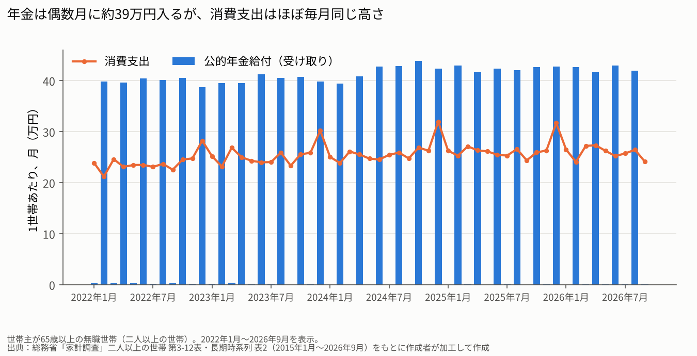
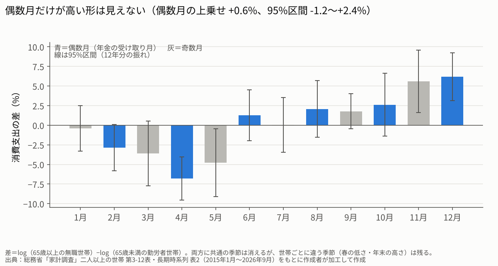
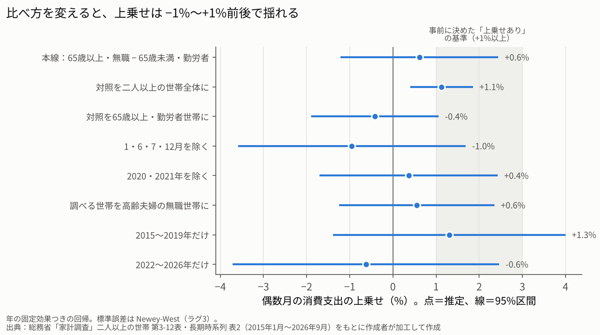
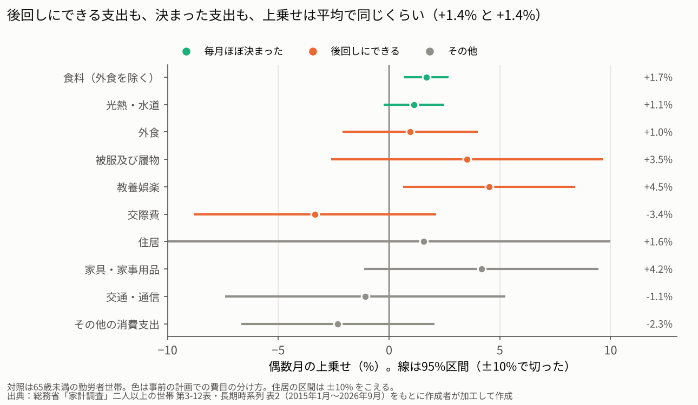

# F380 年金が支給される偶数月に、高齢世帯の消費は増えるのか？ 年金は偶数月に約39万円入るが、消費の上乗せは+0.6%（95%区間 −1.2〜+2.4%）で、増えた年金の0.4%ほど

## 結論（先に）

- 世帯主が65歳以上の無職世帯（以下「年金の世帯」）では、公的年金給付の99%（年ごとの最小でも98.7%）が偶数月に記録されています。偶数月の平均は約39.1万円、奇数月は約0.3万円です。
- 一方、消費支出を65歳未満の勤労者世帯と比べると、偶数月の上乗せは +0.6%（95%区間 −1.2〜+2.4%）でした。事前に決めた基準（+1%以上で、区間が0をまたがない）に届かず、「偶数月に消費が増える」は支持されませんでした。
- 上乗せを円に直すと1か月あたり約1,500円で、偶数月に増える年金（約38.8万円）の0.4%ほどです。
- 比べる相手や期間を変えると、上乗せは −1.0%〜+1.3% の間で動きます。二人以上の世帯全体と比べたときだけ +1.1%（区間 +0.4〜+1.9%）と0をまたぎませんでした。
- 偶数月には「預貯金（預け入れ）」が年金とほぼ同じ額だけ増え、消費は毎月ほぼ同じ高さで続きます。

## 問い

公的年金は、原則として偶数月の15日に、前の月までの2か月分がまとめて支払われます（日本年金機構のよくある質問による）。そのため「年金の出る月は財布のひもがゆるむ」「支給月は店が混む」とよく言われます。

高齢の客が多い商売の月ごとの売上や、家計の月次の統計を読む人に向けて、月の単位の家計の支出で偶数月の増え方がどれくらいの大きさで見えるのかを確かめます。年金の制度の良し悪しや、受け取り方への助言は扱いません。数字の見方の説明にとどめます。

## データ（出典）

- 総務省「家計調査（家計収支編）」二人以上の世帯 詳細結果表 第3-12表（高齢者のいる世帯）世帯主の就業状態別、月別、2015年1月〜2026年9月（141か月）。e-Stat から月ごとの Excel を取りました。
  - 調べる世帯：世帯主が65歳以上の無職世帯。集計世帯数は月に平均約2,414世帯、世帯主の平均年齢は75.8歳です。実収入のうち公的年金給付が81%を占めます。
  - 比べる世帯（対照）：世帯主が65歳未満の勤労者世帯（65歳以上の人がいる世帯のうち）。給料は毎月入ります。集計世帯数は月に平均約326世帯、世帯主の平均年齢は53.0歳です。
  - ほか：世帯主が65歳以上の勤労者世帯、高齢夫婦の無職世帯、高齢者のみの無職世帯の年間収入の3区分。
- 総務省「家計調査」長期時系列 表2 用途分類（二人以上の世帯、月）：対照を二人以上の世帯全体に替える確かめに使いました。
- 元データは `data/raw/` に同梱しています（142ファイル、約19MB。取得元は `data/raw/SOURCES.md`）。

## 事前の計画

計画は [PLAN.md](PLAN.md)（2026-11-17 14:41 作成、集計の前）。前の担当が計画とデータ取得まで済ませて止まっていたものを引き継ぎました。引き継いだ時点で結果のファイルはなく、時刻から計画は結果より前と判断しましたが、前の担当が別の場所で数字を見ていなかったかまでは確かめられません（PLAN.md の最後に追記）。

| 仮説 | 外れの基準 | 結果 | 判定 |
|---|---|---|---|
| H1 年金は偶数月に集中している | 偶数月の割合が年の合計の90%未満 | 年ごとの最小 98.7%、平均 99.3% | 支持 |
| H2 偶数月に消費が対照より高い | +1%未満、または95%区間が0をまたぐ | +0.6%（−1.2〜+2.4%） | 外れ |
| H3 上乗せは後回しにできる支出で大きい | 後回しにできる支出の上乗せが、決まった支出以下 | 単純な平均で +1.41% と +1.40%（差 0.002ポイント）。金額の重みでは +1.07% と +1.54% で逆 | 判定できず（基準の上では支持だが、差がほぼない） |
| H4 増える消費は増える年金の1割未満 | 1割以上 | 0.4%（約1,500円 ÷ 約38.8万円） | 支持 |

## やったこと

1. 偶数月かどうかは月の名前で決まるので、1つの世帯の中だけで比べると、12月の支出増や2月の日数の少なさといった季節の動きと区別できません。そこで、月ごとに「年金の世帯の消費支出の対数 − 対照の対数」（以下「差」）を作り、両方に共通する季節の動きを消しました。
2. 差を「偶数月なら1」の変数と年の固定効果（年ごとの水準の違い）に回帰しました。標準誤差は Newey-West（前後の月の相関を考える方法、ラグ3）です。係数 ×100 を「偶数月の上乗せ（%）」と呼びます。
3. 別の比べ方として、偶数月の差と、すぐ前後の奇数月の差の平均との違いを、70の偶数月で平均しました（「前後の月との比べ」）。
4. 費目ごとに同じことをし、頑健性の確かめを8通り行いました（`src/03_analysis.py`）。乱数は使っていません。

## 分かったこと

### 図1：年金は偶数月に入るが、消費支出はほぼ毎月同じ高さ



- 年金の世帯の公的年金給付は、偶数月の平均が約39.1万円、奇数月が約0.3万円です（2015〜2025年）。
- 消費支出は月に平均約24.4万円で、年末の12月に高くなる以外は、偶数月と奇数月で目に見える上下はありません。

### 図2：対照との差を月ごとに見ても、偶数月だけが高い形は見えない



- 差を年の平均からのずれにして暦の月ごとに並べると、春（4〜5月）に低く、年末（11〜12月）に高い形が見えます。偶数月と奇数月が交互に上下する形ではありません。
- 春の低さ・年末の高さは、2つの世帯で季節の動き方が違うために残ったものと考えられます（推測）。この形は年の固定効果では消えず、偶数月の係数の区間を広げています。
- 年の固定効果つきの回帰で、偶数月の上乗せは +0.6%（95%区間 −1.2〜+2.4%）です。前後の月との比べでは +0.5%（−1.1〜+2.0%）でした。

### 図3：比べ方を変えると、上乗せは −1%〜+1%前後で揺れる



- 8通りの比べ方のうち、95%区間が0をまたがなかったのは、対照を二人以上の世帯全体にしたとき（+1.1%、+0.4〜+1.9%）だけでした。
- 年金も受け取る65歳以上の勤労者世帯と比べると −0.4% です。賞与で支出が動く月（1・6・7・12月）を除くと −1.0% になります。

### 図4：費目で分けても、後回しにできる支出だけが増えるわけではない



- 区間が0をまたがなかったのは、食料（外食を除く）+1.7% と教養娯楽 +4.5% でした。
- 計画で「後回しにできる」とした4費目（外食・被服及び履物・教養娯楽・交際費）の上乗せの平均は +1.41%、「毎月ほぼ決まった」2費目（食料（外食を除く）・光熱・水道）は +1.40% で、ほぼ同じでした。交際費は −3.4% でした。

## 問い直し（結果を見てから足した）

計画に書いた候補2つを、結果を見てから両方とも足しました。

**問い直し1：偶数月に入った年金は、家計簿の上でどこに行くのか？** 年金の世帯の中で、偶数月と奇数月の差（円、年の固定効果つき）を見ました（`results/requestion_deposits.csv`）。

| 項目 | 偶数月 − 奇数月（円） | 95%区間 |
|---|---|---|
| 公的年金給付 | +390,469 | +382,068〜+398,870 |
| 預貯金（預け入れ） | +390,413 | +381,042〜+399,783 |
| 預貯金引出 | +23,036 | +17,261〜+28,811 |
| 消費支出 | +5,407 | +724〜+10,090 |

- 偶数月の預け入れの増え方は、年金の増え方とほぼ同じ額です。口座に振り込まれた年金が、そのまま「預け入れ」として記録されているためと考えられます（推測。家計調査の記入のきまりの文書では確かめきれていません）。
- 預け入れから引き出しを引いた差は、偶数月に増えた年金の94%にあたります。
- 消費支出の +5,407円は対照と比べていないので、12月の増加などの季節がまざった値です。

**問い直し2：年間収入の低い世帯ほど、偶数月の上乗せは大きいか？** 高齢者のみの無職世帯を年間収入で3つに分けると、上乗せは 250万円未満で +1.8%（−0.7〜+4.3%）、250〜349万円で +1.0%（−1.0〜+3.0%）、350万円以上で +0.05%（−2.0〜+2.1%）でした。収入の低い区分ほど大きい並びですが、どの区間も0をまたぎ、区分どうしの区間も重なっています。250万円未満の区分は集計世帯数が月に約242世帯と少なく、振れが大きいことに注意が必要です。

## 頑健性

| 確かめ | 上乗せ（%） | 95%区間 | 前後の月との比べ（%） | 結論は変わったか |
|---|---|---|---|---|
| 本線：65歳以上・無職 − 65歳未満・勤労者 | +0.61 | −1.22〜+2.44 | +0.46 | — |
| 対照を二人以上の世帯全体に | +1.13 | +0.40〜+1.86 | +1.12 | 変わった（この比べ方だけ基準を満たす） |
| 対照を65歳以上・勤労者世帯に | −0.42 | −1.89〜+1.06 | −0.38 | 変わらない |
| 1・6・7・12月を除く | −0.95 | −3.59〜+1.69 | −1.88 | 変わらない |
| 2020・2021年を除く | +0.36 | −1.70〜+2.43 | +0.17 | 変わらない |
| 調べる世帯を高齢夫婦の無職世帯に | +0.55 | −1.25〜+2.35 | +0.39 | 変わらない |
| 2015〜2019年だけ（後から足した） | +1.30 | −1.39〜+4.00 | +1.09 | 変わらない |
| 2022〜2026年だけ（後から足した） | −0.63 | −3.71〜+2.46 | −0.78 | 変わらない |

二人以上の世帯全体は集計世帯数が多く振れが小さいため、区間が狭くなったと考えられます（推測）。8通りのうち1通りだけなので、H2 は「外れ」のままにしました。

## 言えないこと

- 月の単位の統計なので、支給日（15日）の前後の数日の動きは見えません。月の中で支出の時期がずれていても、月の合計が同じなら見えません。
- 年6回の偶数月払いの前後をまたぐデータはなく、支払いの回数が違ったときと比べることはできません。
- 対照の世帯とは年齢・人数・暮らし方が違い、差のすべてを年金の入り方で説明することはできません。春と年末の形のように、世帯ごとに違う季節の動きが残っています。
- 標本調査で、対照の集計世帯数は月に約326と少なく、月ごとの振れが大きいです。「上乗せがない」ことを示したのではなく、「あっても数%以内で、この統計では見分けられない」ということです。
- 買った日と記録の月がずれる支出があり、店の売上の動きとそのまま同じではありません。
- 単身の高齢世帯は入っていません（二人以上の世帯だけ）。

## 仕事で使うなら

- 高齢の客の多い商売の月次の数字に偶数月の上下が見えたとき、家計の月の支出の統計からは「年金の月だから」と説明できる大きさは見えにくい、という手がかりになります。
- 偶数月かどうかは月の名前で決まるので、1つの系列の中だけで比べると季節の動きとまざります。比べる相手の系列との差で見ると、見分けやすくなります。

## 計画からの変更

- 費目のうち1つ（このシリーズで扱わない分野にかかる費目）を外しました。H3 で比べる費目には入っていなかったので、判定には関わりません。
- 使わなかった元データ（長期時系列の勤労者世帯の表）を data/raw から外しました。
- 頑健性に「2015〜2019年だけ」「2022〜2026年だけ」を後から足しました（表に明記）。
- H3 は基準の上では「支持」ですが、差が0.002ポイントしかなく、金額の重みでは逆になるため「判定できず」としました。`results/main.json` には基準どおりの判定（verdict_rule）も残しています。
- 問い直しは候補から1つ選ぶ予定でしたが、2つとも行いました。

## 再現のしかた

```sh
pip install -r requirements.txt
sh src/run_all.sh        # オフラインで 02 → 03 → 04。所要は約11秒
python3 src/01_fetch.py  # 元データを取り直すとき（ネットが必要。run_all.sh からは呼ばない）
```

| ファイル | 中身 |
|---|---|
| `src/01_fetch.py` | e-Stat から元データを取る（月別の表のファイル番号は `src/ids_3_12.json`） |
| `src/02_build.py` | data/raw から `data/monthly_groups.csv`（世帯の区分 × 月 × 項目）を作る |
| `src/03_analysis.py` | 仮説の判定・費目・頑健性・問い直し。`results/main.json` と CSV を書く |
| `src/04_figures.py` | 図4枚（`figures/`） |
| `results/main.json` | 本文の数字はすべてここから |

再実行の確かめ（2026-11-17）：/tmp に写し、02 以降が作るファイルを消してから流して、13 ファイル（results の CSV・JSON 8、図 4、data/monthly_groups.csv）がすべて `cmp` でバイト単位に一致しました。所要は11秒です（`results/repro_check.txt`）。

## レビューで直したこと

独立レビューで数字の照合・再実行・図を確かめ、直すところはなかった。

## 出典

- 総務省統計局「家計調査（家計収支編）」二人以上の世帯 詳細結果表 第3-12表、長期時系列 表2（e-Stat）：https://www.e-stat.go.jp/stat-search/files?toukei=00200561
- 日本年金機構「年金はいつ支払われますか。」：https://www.nenkin.go.jp/section/faq/jukyu/uketori/uketori/shiharaiduki/20140421-01.html

（いずれも総務省「家計調査」をもとに作成者が加工して作成）
