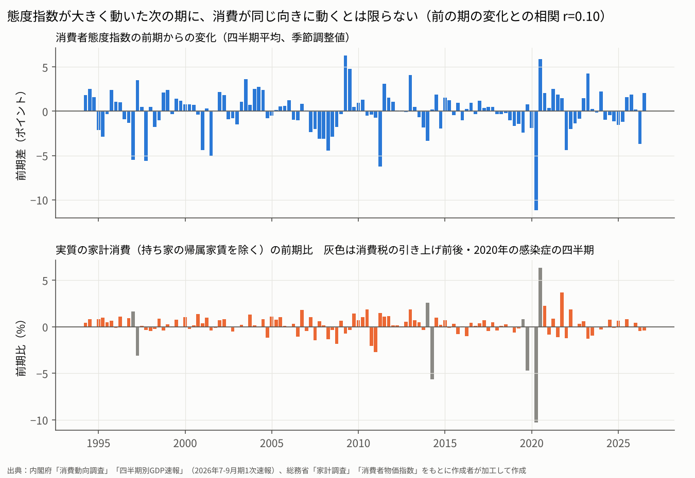
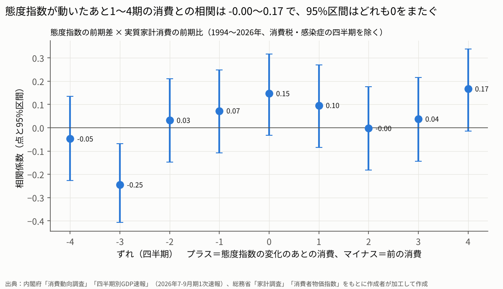
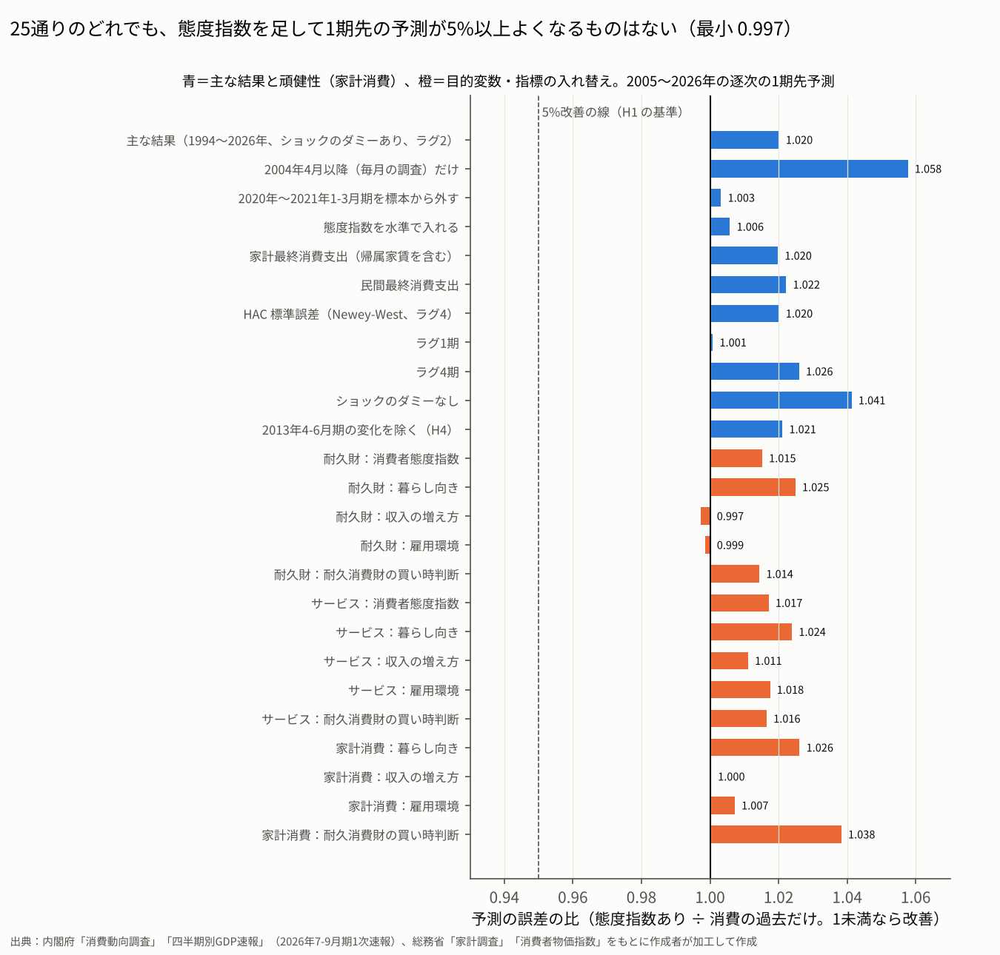
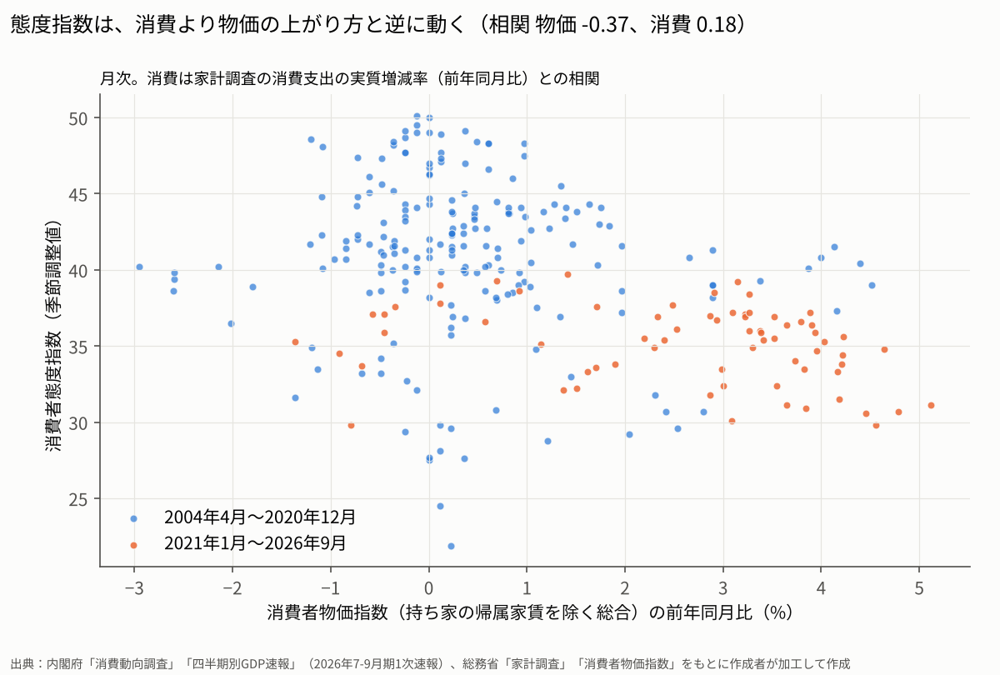

# F381 消費者の「暮らし向き」の見通しは、実際の消費を先取りするのか？ 先取りは見えない。次の期の消費との相関は0.10で、予測の誤差はかえって2.0%増えた

## 結論（先に）

- 内閣府の消費者態度指数（季節調整値）の前期からの変化と、GDP 速報の実質の家計消費（持ち家の帰属家賃を除く）の前期比を、1994〜2026年の四半期で比べました。態度指数が動いた次の期の消費との相関は 0.10（95%区間 −0.08〜0.27）で、同じ期でも 0.15（−0.03〜0.32）でした
- 消費自身の過去の値に、態度指数の過去の変化を足しても、説明はほとんど増えません（グレンジャー因果の検定 p=0.998）。2005年以降の逐次の1期先予測では、誤差（RMSE）が 2.0% 増えました
- 調査の期間・消費の定義・ラグの数・指標（暮らし向き・収入・雇用・耐久消費財の買い時）・目的変数（耐久財・サービス）を変えた25通りのどれでも、予測の誤差が5%以上小さくなるものはありませんでした（比の最小 0.997）
- 問い直し：態度指数は、消費よりも物価の上がり方と逆向きに動いていました。2004年4月〜2026年9月の月次で、物価の前年同月比との相関は −0.37、家計調査の実質消費の前年同月比との相関は 0.18 です
- 「先取りが見えない」ことを示すもので、家計の気持ちを測る統計としての意味を否定するものではありません

## 問い

消費者態度指数は、二人以上の世帯に「暮らし向き」「収入の増え方」「雇用環境」「耐久消費財の買い時」の今後半年の見通しを聞いて、0〜100 の指数にしたものです。調査月の翌月の初めに公表され、GDP 速報（四半期の終わりの約1か月半後）や家計調査（翌々月の初め）より早く出ます。内閣府の景気動向指数では「先行系列」の1つに入っていて（[景気動向指数](https://www.esri.cao.go.jp/jp/stat/di/di.html)）、報道でも「消費者マインドの改善（悪化）」が消費の先行きの手がかりのように書かれます。

需要の見通しを作る人や経済の記事を読む人にとって、「この指数が動いたら、あとで消費が動くのか」は確かめておきたい点です。投資・政策・価格についての助言はしません。

企業の見方（日銀短観）と GDP を比べた既存の F345 とは別に、家計の見方と家計の消費に絞ります。

## データ（出典）

| データ | 中身 | 期間 |
|---|---|---|
| 内閣府「消費動向調査」長期時系列表 2表 | 消費者態度指数と4つの意識指標（二人以上の世帯、季節調整値） | 1982年6月〜2026年10月（2004年3月までは四半期ごと） |
| 内閣府「四半期別GDP速報」2026年7-9月期1次速報 | 実質季節調整系列：家計最終消費支出（持ち家の帰属家賃を除く・含む）、民間最終消費支出、形態別（耐久財・サービスなど） | 1994年1-3月期〜2026年7-9月期 |
| 総務省「家計調査」長期時系列 表2 | 二人以上の世帯の消費支出の実質増減率（前年同月比） | 2001年1月〜2026年9月 |
| 総務省「消費者物価指数」2025年基準 中分類 | 持ち家の帰属家賃を除く総合（問い直しで使用） | 1970年1月〜2026年9月 |

四半期の態度指数は、2004年4月以降は3か月の平均、それより前は調査月の値です。2013年4月に調査方法が郵送に変わり、断層があります。

## 事前の計画

計画は [PLAN.md](PLAN.md)（2026-11-18 04:08、集計の前に作成）。仮説ごとの判定は次のとおりです。

| 仮説 | 基準 | 結果 | 判定 |
|---|---|---|---|
| H1 前の期の態度指数の変化は、消費の前期比を消費の過去を超えて説明する | F 検定 p<0.05 かつ予測の誤差が5%以上小さい | p=0.998、誤差の比 1.020 | 外れ |
| H2 相関は同じ期がいちばん強く、1期先はその半分以下 | 同じ期の相関が1期先の2倍以上 | 同じ期 0.15 ＞ 1期先 0.10 だが2倍に届かず、どちらも95%区間が0をまたぐ | 判定できず |
| H3 耐久財の1期先は「買い時判断」が4指標で最もよく説明する | 買い時判断の t 値が最大かつ |t|≥2 | 最大は雇用環境（t=1.53）、買い時判断は t=1.11 | 外れ |
| H4 2013年の断層を除いても H1 の結論は変わらない | p と予測の判定が同じ | p=0.998、誤差の比 1.021 | 支持 |

## やったこと

1. 態度指数の前期差と、実質の家計消費の前期比（対数差×100）を四半期で並べた
2. 時差の相関：ずれ −4〜+4 四半期。消費税の引き上げ前後（1997・2014・2019年）と2020年の感染症の四半期は、消費の側を除いた
3. グレンジャー因果：消費の前期比を、消費自身のラグ2期と態度指数の変化のラグ2期、ショックの四半期のダミーに回帰し、態度指数の係数がすべて0かを F 検定
4. 逐次の予測：2005年1-3月期から、その時点までのデータで推定して1期先を当て、「消費の過去だけ」のモデルと誤差を比べた（Clark-West 検定も）。ショックの四半期は推定にも評価にも使わない
5. 4つの意識指標、耐久財・サービスへの入れ替え
6. 月次：家計調査の実質増減率と態度指数の前年同月差の時差相関（2005年4月〜2026年9月、消費税・感染症の月を除く）

## 分かったこと

### 図1 態度指数が大きく動いても、次の期の消費はついてこない



- 態度指数が4ポイント以上動いた四半期は13あります。たとえば2009年4-6月期は +6.3 でしたが、次の期の消費は −0.37% でした
- 13の四半期のうち、次の期の消費が態度指数と同じ向きに動いたのは7で、ほぼ半々でした（results/big_moves.csv）

### 図2 どのずれでも相関は弱い



- 態度指数が動いたあと1〜4期の消費との相関は −0.00〜0.17 で、95%区間はどれも0をまたぎます
- 同じ期の相関は 0.15（95%区間 −0.03〜0.32）です。3期前の消費との相関だけが −0.25（−0.41〜−0.07）と0をまたぎませんが、9つのずれを見た中の1つで、偶然でも出うる大きさです（推測）
- 月次でも、家計調査の実質消費との相関は同じ月で 0.10、6か月先で最大の 0.17 でした（前年比どうしなので検定はしていません）

### 図3 25通りのどれでも、予測は5%以上よくならない



- 主な結果では、1期先予測の誤差は消費の過去だけのモデルの 1.020 倍でした（Clark-West 検定の片側 p=0.63）
- 係数で見ると、態度指数が1ポイント上がったときの次の期の消費は +0.004% で、ほぼ0です
- 耐久財でも、4指標のどれもラグの係数の |t| は2未満でした

## 問い直し（結果を見てから足した）

**問い：態度指数が消費を先取りしないなら、何と一緒に動いているのか？**

物価の上がり方（消費者物価指数 持ち家の帰属家賃を除く総合の前年同月比）と、家計調査の実質消費の前年同月比を、態度指数の水準と並べました（[src/03b_requestion.py](src/03b_requestion.py)）。



- 2004年4月〜2026年9月の月次で、態度指数と物価の上がり方の相関は −0.37、実質消費との相関は 0.18 でした。両方を入れた回帰（HAC 標準誤差）では、物価の係数は −1.14（t=−2.40）、消費は 0.21（t=0.89）です
- 2021年以降は物価の上がり方の平均が 2.57%（2005〜2019年は 0.41%）で、態度指数の平均は 35.1（同 41.3）でした。4つの指標のうち、下がり方が大きいのは「耐久消費財の買い時判断」（41.9 → 29.6）と「暮らし向き」（40.1 → 33.5）です
- ただし、2005〜2019年だけ、2021年以降だけで見ると、物価の係数の |t| は2未満でした。物価と気持ちの関係は「期間をまたいだ水準の違い」が大きく効いていて、月々の動きで強く結びついているとまでは言えません

## 頑健性

| 確かめ | F 検定の p | 予測の誤差の比 |
|---|---|---|
| 主な結果（1994〜2026年、ダミーあり、ラグ2） | 0.998 | 1.020 |
| 2004年4月以降（毎月の調査）だけ | 0.889 | 1.058 |
| 2020年〜2021年1-3月期を標本から外す | 0.137 | 1.003 |
| 態度指数を水準で入れる | 0.998 | 1.006 |
| 家計最終消費支出（帰属家賃を含む） | 0.996 | 1.020 |
| 民間最終消費支出 | 0.996 | 1.022 |
| HAC 標準誤差（Newey-West、ラグ4） | 0.998 | 1.020 |
| ラグ1期 | 0.887 | 1.001 |
| ラグ4期 | 0.058 | 1.026 |
| ショックのダミーなし | 0.306 | 1.041 |
| 2013年4-6月期の変化を除く | 0.998 | 1.021 |

11通りすべてで p≥0.05、誤差の比は 1.001〜1.058 で、結論は変わりませんでした。ラグ4期だけ p=0.058 と 0.05 に近いものの、予測は悪化しました。

## 言えないこと

- 態度指数と消費の間に因果があるか、ないかは言えません。この記事は「過去の動きから先を当てられるか」だけを見ています
- GDP の家計消費は後から改定されます。ここで使ったのは2026年7-9月期1次速報の時点の値で、それぞれの時点の速報値で当てられたかは見ていません
- 単身世帯・地域・年齢による違いは見ていません（調査には単身世帯や総世帯の表もあります）
- 2013年・2018年の調査方法の変更による断層は、完全には取り除けません
- 問い直しの物価との関係は相関で、物価が気持ちを下げたと言い切ることはできません。賃金や株価など、ほかの要因は入れていません
- 消費税・感染症の四半期は除いたかダミーで扱ったため、その時期に態度指数が役立ったかは結論の外です

## 仕事で使うなら

- 「消費者マインドが改善したので、消費は次の期に伸びる」という読み方は、過去30年の四半期のデータでは裏付けが見えません
- 態度指数は、物価の上がり方への家計の受け止めを早く知る数字として読むほうが、データとは合っています（推測を含みます）

## 計画からの変更

- 問い直し（物価との関係）は結果を見てから足しました。PLAN にはありません
- 逐次の予測で、推定に使う四半期が24未満の時点は予測しないことにしました（2004年4月以降だけの確かめで、最初の数期は推定ができないため）。主な結果には影響しません

## 再現のしかた

```sh
pip install -r requirements.txt
sh src/run_all.sh      # オフライン。02 → 03 → 03b → 04
python3 src/01_fetch.py  # 元データを取り直すときだけ（ネットが必要）
```

| ファイル | 中身 |
|---|---|
| src/01_fetch.py | 元データの取得（run_all.sh からは呼ばない） |
| src/02_build.py | data/cci_monthly.csv・qe_quarterly.csv・kakei_monthly.csv を作る |
| src/03_analysis.py | 時差の相関・グレンジャー因果・逐次の予測・構成指標・頑健性 → results/main.json ほか |
| src/03b_requestion.py | 問い直し（物価との関係） → results/requestion.json |
| src/04_figures.py | 図4枚 |
| data/raw/ | 元データ6ファイル（約1.7MB）と SOURCES.md |

所要時間は CPU 1つで約18秒。/tmp に写して生成物を消してから流し直し、results・figures・data の CSV・JSON・PNG 18ファイル（results 9・figures 4・data の中間 CSV 5）がバイト単位で一致しました（results/repro_check.txt）。

## レビューで直したこと
| # | 指摘 | 直し方 |
|---|---|---|
| 1 | README の見出し（「翌期の消費との相関は0.10、」）が status・note の題名（「次の期の消費との相関は0.10で、」）と違っていた | 見出しを status の題名にそろえた |
| 2 | 再現のしかたの一致ファイル数が「17ファイル」で、status と repro_check（18ファイル）と合っていなかった | 18ファイル（results 9・figures 4・data 5）に直した |

独立レビューで数字の照合（「25通り」は頑健性11通り＋指標・目的変数の入れ替え15通りから重なる1通りを除いた数、比の最小 0.997 は耐久財×収入の増え方）・再実行（/tmp で18ファイル一致）・図4枚を確かめました。

## 出典

- 内閣府「消費動向調査」（e-Stat）：https://www.e-stat.go.jp/stat-search/files?toukei=00100405&tstat=000001014549
- 内閣府経済社会総合研究所「四半期別GDP速報」2026年7-9月期1次速報：https://www.esri.cao.go.jp/jp/sna/data/data_list/sokuhou/files/2026/qe263/gdemenuja.html
- 総務省統計局「家計調査（家計収支編）」（e-Stat）：https://www.e-stat.go.jp/stat-search/files?toukei=00200561
- 総務省統計局「消費者物価指数」（e-Stat）：https://www.e-stat.go.jp/stat-search/files?tstat=000001243876
- 内閣府「景気動向指数」：https://www.esri.cao.go.jp/jp/stat/di/di.html

（いずれも 内閣府「消費動向調査」「四半期別GDP速報」、総務省「家計調査」「消費者物価指数」をもとに作成者が加工して作成）
