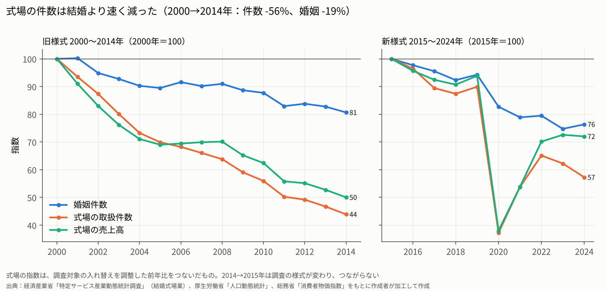
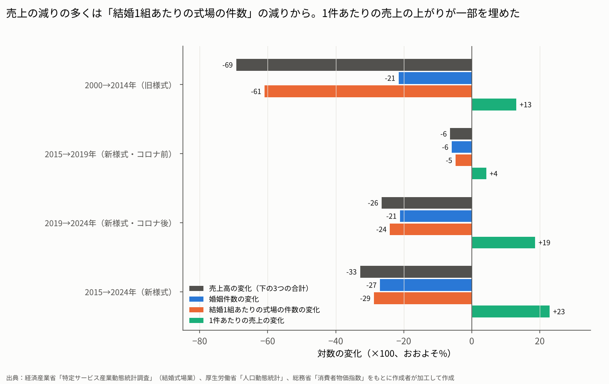
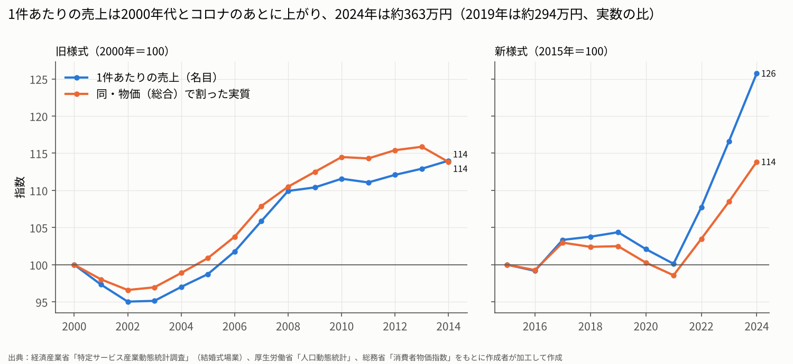
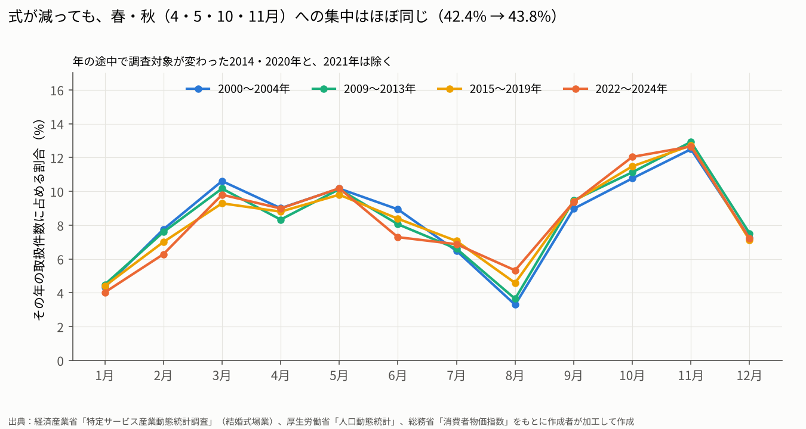

# F382 結婚式場の売上は、結婚の件数より速く減ったのか？ 2000→2014年に婚姻は19%減、式場の売上は50%減、件数は56%減。2024年の件数は2019年の64%で、婚姻の81%に届かない

## 結論（先に）

- 経済産業省「特定サービス産業動態統計調査」の結婚式場業を、調査対象の入れ替えを調整した前年比でつなぎました。2000→2014年に、式場の取扱件数は56%、売上高は50%減りました。同じ期間の婚姻件数の減りは19%です
- 減り方の差は年あたり 4.3ポイントで、「結婚1組あたりの式場の件数」は14年で46%減りました。2015→2019年（新しい様式）も差は年あたり 1.2ポイントで、同じ向きでした
- 1件あたりの売上は上がり、売上の減りの一部を埋めました。2000→2014年に +14%（物価を除いても +14%）、2015→2024年に +26%（物価を除いて +14%）。実数の比で、2024年は1件あたり約363万円です
- 感染症のあと、2024年の式場の件数は2019年の64%、婚姻件数は81%で、差は17ポイントでした。売上は1件あたりの上がりで77%まで戻っています
- 問い直し：式が減っても、春・秋（4・5・10・11月）への集中はほぼ変わっていません（2000〜2004年 42.4% → 2022〜2024年 43.8%）

## 問い

婚姻件数は2000年の約80万組から、2024年は約49万組に減りました。一方で「式を挙げない夫婦が増えた」「少人数の式が増えた」とも言われます。式場・衣装・写真・飲食など婚礼に関わる仕事をする人や、結婚の統計を読む人にとって、式場の売上の減りを「結婚の数の減り」「式場で挙げる割合の減り」「1件あたりの売上」に分けて見ることには意味があります。価格や経営についての助言はしません。

## データ（出典）

| データ | 中身 | 期間 |
|---|---|---|
| 経済産業省「特定サービス産業動態統計調査」長期データ 結婚式場業 | 売上高・取扱件数・従業者数の実数と前年比（年・月） | 旧様式 2000〜2014年、新様式（企業調査）2015〜2024年 |
| 厚生労働省「人口動態統計」上巻 第9.5表 | 婚姻件数（総数・夫妻とも初婚） | 1952〜2025年 |
| 総務省「消費者物価指数」2025年基準 | 総合・生鮮食品を除く総合（年平均） | 1970〜2025年 |

この調査は2024年12月分が最後です。調査対象は何度か入れ替わっていて、実数には断層があります。表の前年比は「断層を調整したもの」と注にあるため、主な結果はこの前年比をつないだ指数で出しました。2014→2015年は様式が変わって前年比がないため、2つの期間はつないでいません。

## 事前の計画

計画は [PLAN.md](PLAN.md)（2026-11-18 04:17、比較・分解の集計の前に作成）。下見で年の実数と前年比の表は見ています（PLAN に記載）。

| 仮説 | 基準 | 結果 | 判定 |
|---|---|---|---|
| H1 式場の件数は結婚より速く減った | 年あたりの差が −1ポイント以下、旧・新の両方 | 旧 −4.35、新（2015→2019年）−1.19 | 支持 |
| H2 1件あたりの売上は物価より上がった | 実質で +5% 以上、旧・新の両方 | 旧 +13.8%、新（2015→2019年）+2.5% | 判定できず |
| H3 コロナのあと、式場は結婚ほど戻っていない | 2024年の2019年比の差が −10ポイント以下 | 件数 63.7%、婚姻 81.0%（差 −17.3） | 支持 |
| H4 「夫妻とも初婚」と比べても H1 は同じ | H1 の判定が変わらない | 旧 −3.85、新 −1.21 | 支持 |

H2 は、新様式の期間を2024年まで延ばすと実質 +13.9% になりますが、計画で決めた期間（コロナ前）では基準に届きませんでした。

## やったこと

1. 前年比をつないで、旧様式は2000年＝100、新様式は2015年＝100 の指数（売上・件数・従業者）を作った
2. 婚姻件数も同じ年を100にして並べた
3. 売上の対数の変化を「婚姻件数の変化」「結婚1組あたりの式場の件数の変化」「1件あたりの売上の変化」の和に分けた
4. 1件あたりの売上を消費者物価（総合）で割って実質にした
5. 月の前年比から作った年の値と、年の前年比が合うかを確かめた（23年で差は最大 0.24ポイント）

## 分かったこと

### 図1 式場の件数は結婚より速く減った



- 2000→2014年：婚姻 −19.3%、式場の件数 −56.1%、売上 −50.0%
- 2015→2019年：婚姻 −5.7%、式場の件数 −10.1%、売上 −6.1%
- 2022→2024年は婚姻が −3.9% だったのに対し、件数は −12.0% でした。一方、売上は +2.7% でした

### 図2 売上の減りの多くは「結婚1組あたりの式場の件数」から



- 2000→2014年の売上の変化（対数×100）−69 のうち、婚姻件数の減りが −21、結婚1組あたりの件数の減りが −61、1件あたりの売上の上がりが +13 でした
- 2019→2024年は −26 のうち、婚姻 −21、1組あたりの件数 −24、1件あたり +19 です
- 2015→2019年だけは、婚姻（−6）と1組あたりの件数（−5）が同じくらいでした

### 図3 1件あたりの売上は上がった



- 実数の比で、1件あたりの売上は2000年に約273万円、2014年に約302万円、2019年に約294万円、2024年に約363万円でした（様式の変わり目では断層を含む参考値）
- 2019→2024年は名目で +20.5%、物価を除いて +11.1% です。物価の上がりだけでは説明できません
- 1件あたりの上がりが、招待客の人数の変化によるのか、1人あたりの単価によるのかは、このデータでは分けられません

## 問い直し（結果を見てから足した）

**問い：式が減るなかで、式の多い季節への集中は変わったのか？**

「1組あたりの件数」が減ったのなら、人気の季節に限って式を挙げる、あるいは逆に季節を選ばなくなる、といった変化があるかもしれないと考えました。月の実数から、その年の件数に占める月ごとの割合を出しました（年の途中で調査対象が変わった2014・2020年と、2021年は除く。[src/03b_requestion.py](src/03b_requestion.py)）。



- 春・秋（4・5・10・11月）の割合は、2000〜2004年 42.4%、2009〜2013年 42.5%、2015〜2019年 42.8%、2022〜2024年 43.8% で、10年あたり +0.37ポイントとほぼ横ばいでした
- 1件あたりの売上も、春・秋とそれ以外の月でほぼ同じでした（2022〜2024年 334万円と337万円）
- 式場の件数の減りは、季節を問わずに起きていたと読めます

## 頑健性

| 確かめ | 件数と婚姻の差（旧、ポイント/年） | 同（新） | 1件あたりの実質の変化（旧） | 同（新） |
|---|---|---|---|---|
| 主な結果（前年比をつないだ指数） | −4.35 | −1.19 | +13.8% | +2.5% |
| 実数の比（断層をまたがない区間：旧 2006→2013年、新 2015→2018年） | −4.04 | −1.30 | +11.4% | +3.2% |
| 婚姻を「夫妻とも初婚」に替える | −3.85 | −1.21 | +13.8% | +2.5% |
| 2011年の変化を除く（旧） | −4.29 | −1.19 | +13.8% | +2.5% |
| 新様式を2015→2024年に延ばす | −4.35 | −3.20 | +13.8% | +13.9% |
| 物価を「生鮮食品を除く総合」に替える | −4.35 | −1.19 | +14.3% | +2.6% |

6通りすべてで、式場の件数は婚姻より年あたり 1.19〜4.35ポイント速く減っていました。1件あたりの実質の上がりは、旧様式では +11〜14%、新様式のコロナ前では +2〜3% でした。

## 言えないこと

- 調査の対象は「結婚式場業」の事業者です。ホテルやレストランの婚礼、神社などは、それぞれ別の業種に入るため含まれないと考えられます（推測。調査票の対象範囲は確かめていません）。式場の件数の減りがそのまま「式を挙げる人の減り」とは言えません
- 取扱件数は式場で扱った件数で、婚姻の届出の年と式の年はずれることがあります
- 前年比の「断層の調整」の中身は公表されておらず、確かめられません
- 1件あたりの売上の上がりが、人数か単価か、内容の変化かは分けられません
- 2025年以降は、この調査がなく追えません
- 婚姻件数の減りの理由（年齢構成・未婚化など）は扱っていません

## 仕事で使うなら

- 婚礼の需要を見るときは、婚姻件数だけでなく「結婚1組あたりの式場の件数」が別に減ってきたことを、数字の前提として置けます
- 売上高の戻りと件数の戻りは違う動きをしていて（2024年は2019年比で売上77%、件数64%）、どちらを見るかで印象が変わります

## 計画からの変更

- 問い直し（季節への集中）は結果を見てから足しました
- 頑健性の「期間を分ける」は、2015→2024年に延ばす1行と、分解の表（2019→2024年、2015→2024年）で示しました。2022〜2024年は図1の説明に入れました

## 再現のしかた

```sh
pip install -r requirements.txt
sh src/run_all.sh        # オフライン。02 → 03 → 03b → 04
python3 src/01_fetch.py  # 元データを取り直すときだけ（ネットが必要）
```

| ファイル | 中身 |
|---|---|
| src/01_fetch.py | 元データの取得（run_all.sh からは呼ばない） |
| src/02_build.py | data/ の年・月の表、婚姻件数、物価の年平均 |
| src/03_analysis.py | 指数・分解・仮説の判定・頑健性 → results/main.json ほか |
| src/03b_requestion.py | 問い直し（季節への集中）→ results/requestion.json |
| src/04_figures.py | 図4枚 |
| data/raw/ | 元データ4ファイル（約0.7MB）と SOURCES.md |

所要時間は CPU 1つで約3秒。/tmp に写して生成物を消してから流し直し、results・figures・data の CSV・JSON・PNG 17ファイルがバイト単位で一致しました（results/repro_check.txt）。

## レビューで直したこと
| # | 指摘 | 直し方 |
|---|---|---|
| 1 | 問いは「売上」なのに、題名の結果の部分に売上の数字がなく件数だけだった。README の見出し（「速く減った。」「2024年の式場の件数は」）も status・note の題名と違っていた | 題名の結果に「式場の売上は50%減」（main.json の sales_idx_2014＝50.0）を足し、status・note の1行目・README の見出しをそろえた |

独立レビューで数字の照合・再実行（/tmp で17ファイル一致）・図4枚を確かめました。消費者物価は月次の表（statInfId 000040482943）から1〜12月がそろった年の平均を取っていて、本文の「年平均」（暦年）と合っています。

## 出典

- 経済産業省「特定サービス産業動態統計調査」（e-Stat）：https://www.e-stat.go.jp/stat-search/files?toukei=00550530
- 厚生労働省「人口動態統計」（e-Stat）：https://www.e-stat.go.jp/stat-search/files?toukei=00450011
- 総務省統計局「消費者物価指数」（e-Stat）：https://www.e-stat.go.jp/stat-search/files?tstat=000001243876

（いずれも 経済産業省「特定サービス産業動態統計調査」、厚生労働省「人口動態統計」、総務省「消費者物価指数」をもとに作成者が加工して作成）
