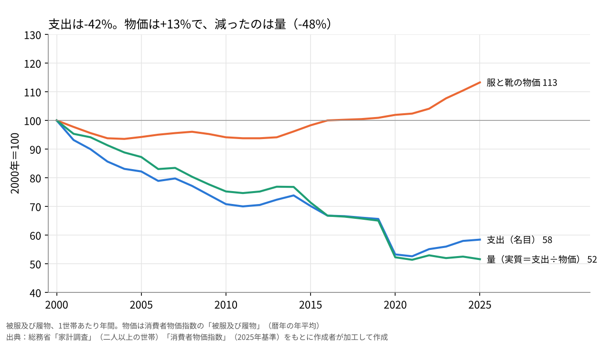
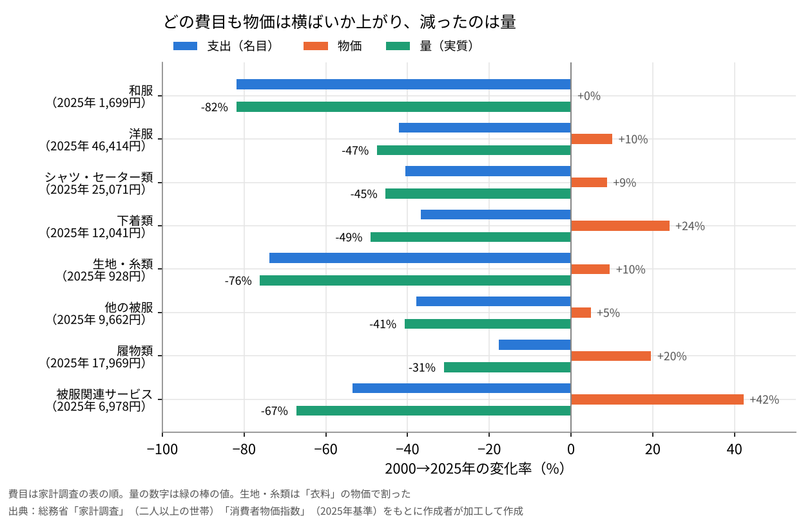
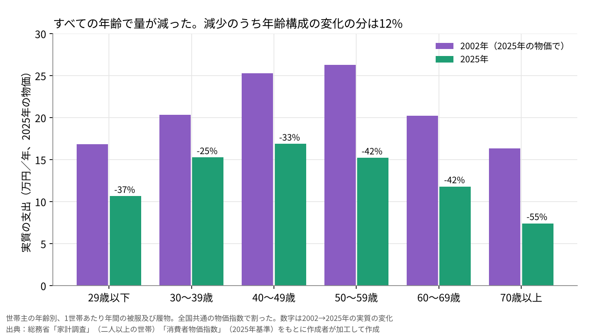
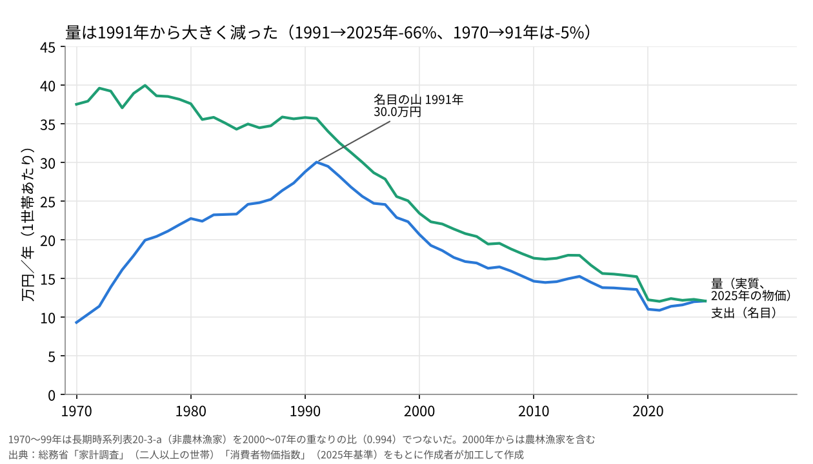

# F383 「服にお金をかけなくなった」は、価格が下がったからか、買う量が減ったからか？ 2000→2025年で服と靴の支出は42%減。物価は13%上がり、量（実質）は48%減った

## 結論（先に）

- 家計調査（二人以上の世帯）の「被服及び履物」は、1世帯あたり年206,742円（2000年）から120,761円（2025年）へ、名目で41.6%減りました。消費支出に占める割合は5.43%から3.20%です。
- 同じ期間に、消費者物価指数の「被服及び履物」は+13.3%でした（2004年までに−6.5%下がり、そこから2025年までに+21.1%上がった）。物価で割った量（実質）は−48.4%で、支出が減ったのは「安くなったから」ではなく「買う量が減ったから」と読めます。
- 費目別でも、物価が下がった費目はありませんでした（和服は+0.1%で横ばい）。実質の減り方は、洋服−47.5%、シャツ・セーター類−45.4%、下着類−49.0%、履物類−31.1%などです。
- 世帯主の年齢別（2002→2025年）では、6つの年齢区分すべてで実質が減りました（−25.0%〜−54.7%）。全体の減少のうち、70歳以上の世帯が増えたなど年齢構成の変化の分は11.8%で、残りは同じ年齢の中で減った分です。
- 結果を見てから足した問いでは、洋服の実質の減り方は女性用（−51.0%）と子供用（−50.8%）が男性用（−39.8%）より大きく、2019→2025年の名目でも女性用は−21.0%、男性用は−4.5%でした。

## 問い

家計の服と靴への支出は、長く減り続けているといわれます。よく聞く説明は「低価格の衣料が広がって、服が安くなったから」ですが、「買う量そのものが減ったから」とも考えられます。衣料品の小売・メーカー・商業施設の仕事では、市場が縮んだのが単価なのか量なのかで、見方が変わります。

この記事では、名目の支出の変化を、消費者物価指数の被服の指数で「価格の分」と「量（実質）の分」に分けました。費目（洋服・シャツ・下着・履物など）と、世帯主の年齢でも分けました。

既存の記事との違い：F286（別のリポジトリ）は2020→2025年の物価高の時期に、購入数量で節約がどこに出たかを品目ごとに見ました。服と靴の支出を2000年からの長い期間で価格と量に分け、年齢でも分けた記事はありません。

## データ（出典）

- 総務省「家計調査」家計収支編 二人以上の世帯
  - 長期時系列表 1-2 品目分類（小分類まで）支出金額（年、2000〜2025年）、同 実質増減率（照合用）
  - 長期時系列表 20-3-a 品目別支出金額（年、1963〜2007年、二人以上の非農林漁家世帯）
  - 詳細結果表 第4-6表 世帯主の年齢階級別（品目分類、2002〜2025年）
- 総務省「消費者物価指数」2025年基準 全国 中分類指数（暦年の年平均、1970〜2025年）
- 29ファイル（約13MB）を `data/raw/` に同梱（URL・取得日は `data/raw/SOURCES.md`）。
- 注：e-Stat の消費者物価指数の表のうち、statInfId=000040482957（中分類）と000040482959（品目別）は**年度平均**です（2025年の総合が100.4）。ここでは暦年の000040482829を使いました。

## 事前の計画

計画は [PLAN.md](PLAN.md)（2026-11-18、物価で割る計算の前に作成）です。表の形を確かめるときに、全国の名目の支出（2000〜2025年）を見ていたので、計画にそう書いています。

| 仮説 | 外れの基準 | 結果 | 判定 |
|---|---|---|---|
| H1 被服及び履物の物価は2000→2025年で下がっていない | 下がっていれば外れ | +13.3% | 支持 |
| H2 名目の減少のうち、量の分が半分以上 | 価格の分が50%以上なら外れ | 価格は逆向き（−23.1%）。量の分が名目の減少より大きい | 支持 |
| H3 実質の減り方は洋服のほうが下着類より大きい | 下着類のほうが大きければ外れ | 洋服−47.5%、下着類−49.0% | 外れ（差は小さい） |
| H4 すべての年齢で実質が減り、年齢の中の変化の分が年齢構成の分より大きい | どちらかが崩れれば外れ | 6区分すべてで減少。年齢構成の分は11.8% | 支持 |

## やったこと

1. 実質＝名目÷（物価指数÷100）としました（2025年の物価の円）。費目ごとに、対応する中分類の物価指数で割りました（生地・糸類は「衣料」）。
2. 対数で「名目の変化＝価格の変化＋実質の変化」に分けました。
3. 年齢別は、2002→2025年の全国の実質の変化を、年齢の世帯の割合が変わった分と、年齢の中で変わった分に分けました。
4. 1970〜1999年は20-3-a表を、2000〜07年の重なりの比（0.9936）でつないで長い期間を見ました。

## 分かったこと

### 図1 支出は42%減、物価は13%上がり、量は48%減



- 被服及び履物の物価は、2000年から2004年までに6.5%下がりましたが、2015年ごろから上がり、2025年は2000年の1.13倍でした（総合は1.15倍）。
- 2000→2019年（感染症の前）でも、物価は+0.9%でほぼ横ばい、名目は−34.4%、実質は−35.0%でした。物価が下がった時期は2004年ごろまでで、その後の減少は量で起きています。
- 2020年に名目は前年より18.9%減り、2025年も2019年より11.0%少ないままです。物価が上がったので、実質では2019年より20.7%少なくなっています。

### 図2 どの費目も物価は横ばいか上がり、減ったのは量



- 物価の変化は、和服+0.1%、洋服+10.1%、シャツ・セーター類+8.8%、下着類+24.1%、他の被服+4.8%、履物類+19.6%、被服関連サービス（クリーニングなど）+42.2%でした。
- 実質は、和服−81.9%、生地・糸類−76.1%、被服関連サービス−67.3%と大きく、履物類は−31.1%と小さめでした。
- 名目の減少（1世帯年85,981円）のうち、洋服が33,829円、シャツ・セーター類が17,103円で、この2つで6割近くです。

### 図3 すべての年齢で量が減った



- 2002→2025年の実質の変化は、29歳以下−36.8%、30代−25.0%、40代−33.3%、50代−42.2%、60代−41.7%、70歳以上−54.7%でした。物価は全年齢で同じ+18.5%として計算しています。
- 70歳以上の世帯の割合は14.7%から34.5%に増えました。70歳以上は服の支出が少ないので、年齢構成が変わっただけでも全体は減ります。その分は全体の減少（年99,650円、2025年の物価）のうち11,710円（11.8%）で、残りの87,941円は年齢の中で減った分でした。

### 図4 量は1991年から大きく減った



- つないだ系列で、名目の山は1991年（年30.0万円）です。1970→1991年は名目+222.9%のほとんどが物価の上昇（+239.5%）で、実質は−4.9%でした。
- 1991→2025年は名目−59.8%、物価+18.8%、実質−66.1%です。量の減少は、1990年代から続いています。

## 問い直し（結果を見てから足した）

洋服の減少が大きかったので、「男性用・女性用・子供用で減り方は違うか」を足しました（洋服の物価指数で割った）。

| 費目 | 名目 2000年→2025年 | 名目の変化 | 実質の変化 | 名目の変化（2019→2025年） |
|---|---|---|---|---|
| 男性用洋服 | 25,040円→16,590円 | −33.7% | −39.8% | −4.5% |
| 女性用洋服 | 44,517円→24,031円 | −46.0% | −51.0% | −21.0% |
| 子供用洋服 | 10,686円→5,793円 | −45.8% | −50.8% | −19.2% |

- 女性用の洋服の支出は男性用の約1.8倍（2000年）でしたが、2025年は約1.45倍に縮みました（男性用÷女性用 0.562→0.690）。差が縮んだのはほとんど2019年以降です。
- 子供用の減少には、1世帯あたりの子どもの数が減った分も入っていると考えられます（推測。このデータでは分けていません）。

## 頑健性

| 確かめ | 名目 | 物価 | 実質 | 結論 |
|---|---|---|---|---|
| 0 主：2000→2025年 | −41.6% | +13.3% | −48.4% | — |
| 1a 始まりを2005年に | −28.9% | +20.2% | −40.9% | 変わらない |
| 1b 始まりを2010年に | −17.5% | +20.3% | −31.4% | 変わらない |
| 1c 終わりを2019年に | −34.4% | +0.9% | −35.0% | 変わらない（物価はほぼ横ばい） |
| 2 1人あたり（世帯人員3.31→2.87人） | −32.6% | +13.3% | −40.5% | 変わらない |
| 3 費目ごとに物価で割って足す | −41.6% | +13.6% | −48.6% | 変わらない |
| 4 公表の実質増減率をつなぐ（照合） | — | — | −48.4% | 自分の計算（−48.4%）と一致 |
| 5 長い期間 1970→2025年 | +29.8% | +303.2% | −67.8% | 量の減少は長く続いている |

どの確かめでも、物価は下がっておらず、支出の減少は量の減少でした。

## 言えないこと

- 「量」は物価指数で割った実質で、枚数そのものではありません。消費者物価指数の衣料には、品質の変化の調整や、調べる店・品目の選び方の限界があります。安い店で買う人が増えた分は、物価指数には出にくく、実質の減少に入っている可能性があります。
- 二人以上の世帯だけです。単身の世帯は入っていません。
- 年齢別の実質は全国共通の物価指数で割っています。年齢によって買う店や品の値段は違うかもしれません。
- なぜ量が減ったのか（好み、働き方、中古品や貸し借り、ネットで個人から買うことなど）は、このデータでは分かりません。理由についての話はすべて推測になります。
- 標本調査の推計値で、年齢別の値、とくに29歳以下は世帯数が少なく誤差が大きくなります。

## 仕事で使うなら

- 「支出が減った」を見るときは、同じ期間の物価指数と並べて、単価と量のどちらで減ったかを分けると読み違えにくくなります。
- 2000年代前半の「安くなった」時期と、2015年ごろからの「物価が上がった」時期で、見え方が変わります。期間をそろえて示すと伝わりやすくなります。
- 年齢構成の変化（高齢の世帯の増加）で説明できるのは減少の1割ほどなので、年齢別に並べて示すと誤解が少なくなります。

## 計画からの変更

- 計画どおりに計算しました。問い直しは候補のうち男性用・女性用・子供用の洋服にしました。感染症の時期の落ち込みは図1の説明に入れました。

## 再現のしかた

```sh
pip install -r requirements.txt
python3 src/01_fetch.py   # 取得（ネットが必要。data/raw に同梱済みなので通常は不要）
sh src/run_all.sh         # 02 → 03 → 04（オフライン）
```

| ファイル | 中身 |
|---|---|
| src/01_fetch.py | 元データの取得（e-Stat、28ファイル） |
| src/kakei_parse.py | 第4-6表の読み出し |
| src/02_build.py | data/ の5つの CSV を作る。合計の確かめ |
| src/03_analysis.py | 分解・年齢別・長い期間・頑健性・問い直し |
| src/04_figures.py | figures/ の4枚 |
| results/main.json | 本文の数字 |
| results/annual_national.csv・items_decomposition.csv・age_decomposition.csv・long_1970_2025.csv など | 表 |
| results/robustness.csv・requestion_mens_womens.csv | 頑健性・問い直し |

所要時間は約8秒（CPU 1つ）。`results/repro_check.txt` に、/tmp に写して流し直し、18ファイルがバイト単位で一致した結果を書いています。

## レビューで直したこと
独立レビューで数字の照合・再実行（/tmp で18ファイル一致）・図を確かめ、直すところはなかった。消費者物価指数は暦年の年平均の表（statInfId 000040482829、2025年の総合が100.0）を使っていて、本文の「暦年の年平均」と合っています。

## 出典

- 総務省統計局「家計調査」 https://www.stat.go.jp/data/kakei/index.html
- 家計調査 長期時系列表（e-Stat） https://www.e-stat.go.jp/stat-search/files?toukei=00200561&tstat=000000330001&tclass1=000001228280
- 総務省統計局「消費者物価指数」 https://www.stat.go.jp/data/cpi/index.html
- 消費者物価指数 2025年基準 長期時系列（e-Stat） https://www.e-stat.go.jp/stat-search/files?tstat=000001243876

（いずれも 総務省「家計調査」「消費者物価指数」 をもとに作成者が加工して作成）
