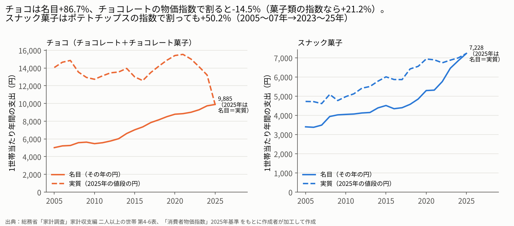
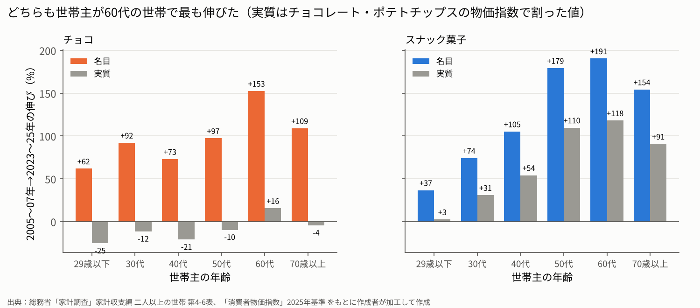
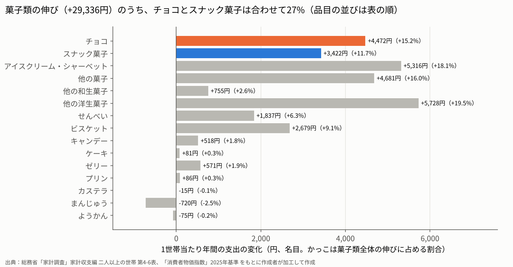
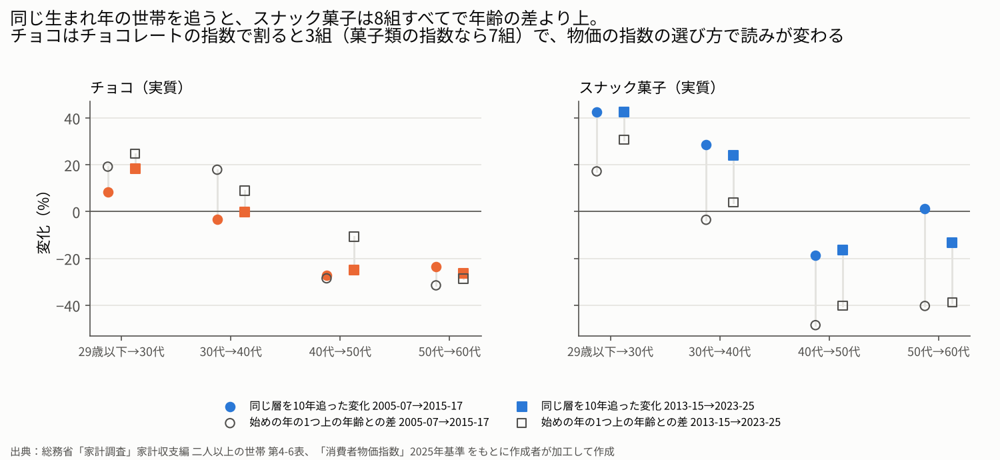

# F384 チョコレートやスナックへの支出が増えたのは、どの年齢の世帯か？ 伸びが最大は世帯主60代（チョコ+152.5%、スナック菓子+190.5%）。平均のチョコは+86.7%で、値段の上がり（+124.3%）より小さい

## 結論（先に）
- 二人以上の世帯の1世帯当たり年間の支出（2005〜07年平均→2023〜25年平均）は、チョコ（チョコレート＋チョコレート菓子）が5,161円→9,634円（+86.7%）、スナック菓子が3,424円→6,846円（+100.0%）でした。
- 世帯主の年齢別では、どちらも60代の世帯の伸びが最も大きく、チョコ+152.5%、スナック菓子+190.5%でした。金額そのものは、今も40代の世帯が最も多いままです。
- チョコの値段（消費者物価指数のチョコレート）は同じ期間に+124.3%上がり、支出の伸び（+86.7%）を上回りました。チョコの伸びの半分以上が値上がりという点は、試した2つの物価指数のどちらで割っても変わりません。ただし実質の増減そのものは、チョコレートの指数で割ると−14.5%、菓子類の指数で割ると+21.2%で、向きが決まりません。スナック菓子はポテトチップスの指数で割っても+50.2%です。
- 平均の世帯のチョコの伸び（年齢別の値を世帯の割合で足し直すと+4,467円）は、年齢の中の伸び+4,976円と、年齢構成が高い方へ移った分−509円に分かれます。
- 問い直しで同じ生まれ年の世帯を10年追うと、スナック菓子は年を重ねても落ちにくい形でした（8組すべてで年齢の差より上。物価指数を替えても同じ）。チョコは物価指数の選び方で読みが変わります（年齢の差より上がチョコレートの指数で3組、菓子類の指数で7組）。

## 問い
総務省統計局の「家計調査通信」（2019年2月号）は、菓子類の中でチョコレートだけが年々増える傾向にあり、2017年は世帯主が40代の世帯で最も多い、とまとめています。では、20年の間に**買い増した**のはどの年齢の世帯なのか。チョコレートは2024〜25年に大きく値上がりしたので、増えたのは値段なのか量なのか。スナック菓子も同じなのか。

知りたい人は、菓子や食品の企画・販売で「どの年齢の世帯が増えているか」を確かめたい人と、家計の統計を読む人です。数字と読み方までで、値段や販売の助言はしません。

## データ（出典）
- 総務省「家計調査」家計収支編 二人以上の世帯 第4-6表「世帯主の年齢階級別1世帯当たり支出金額、購入数量及び平均価格」2005〜2025年（e-Stat、21ファイル、data/raw に同梱）。年齢は6区分、品目は菓子類とその中の15品目
- 総務省「消費者物価指数」2025年基準 全国 品目別価格指数（月次。年平均にした）：菓子類、チョコレート、ポテトチップス
- チョコ＝「チョコレート」＋「チョコレート菓子」。チョコレート菓子が別の品目として載るのは2005年からなので（家計調査通信456号の注記）、分析は2005年からです。
- 取得日（2026-11-18）と URL は data/raw/SOURCES.md。

## 事前の計画
集計の前に [PLAN.md](PLAN.md) を書きました（2026-11-18）。伸びは3年平均どうし、実質は品目の物価指数で割る（スナック菓子はポテトチップスで代用）と決めました。

| 仮説（外れの基準） | 結果 | 判定 |
|---|---|---|
| H1：チョコの名目の伸び率は、60代・70歳以上とも、29歳以下・30代の両方より大きい | 60代+152.5%、70歳以上+109.0%、29歳以下+61.9%、30代+92.1% | 支持 |
| H2：チョコの名目の伸びの半分以上は値上がり（実質が名目の半分を超えたら外れ） | 名目+86.7%、実質−14.5%（菓子類の指数でも+21.2%で名目の半分未満） | 支持 |
| H3：スナック菓子の名目の伸び率は、どの年齢でもチョコより小さい | 40代以上の4区分でスナック菓子が上 | 外れ |
| H4：チョコの平均の伸びのうち、年齢構成の変化の分はマイナス | −509円 | 支持 |

## やったこと
1. 第4-6表21年分から、菓子類と15品目を年×年齢で取り出しました。品目の合計＝菓子類、年齢の重みづけ平均≒「平均」の列（1%以内）をスクリプトで確かめています。
2. 年齢ごとに3年平均どうしの伸びを、名目・実質・1人あたり（世帯人員で割る）で出しました。
3. 平均の世帯の伸びを「年齢の中の伸び」と「年齢構成の変化」に分けました（始点と終点の平均を重みにする対称な分け方）。
4. 菓子類の伸びを品目の寄与に分け、頑健性を6通り確かめ、問い直しで同じ生まれ年の層を追いました。

## 分かったこと

### 図1：チョコの伸びの半分以上は値上がり。スナック菓子は値上がりより大きく増えた


- チョコレートの物価指数は2005→2025年で2.8倍、2024→2025年だけで+35.7%でした。2025年の名目の支出は前年比+1.6%にとどまり、実質（2025年の値段の円）は13,208円→9,885円に下がりました。
- 実質のチョコは2005〜2022年に1万2千〜1万5千円台を上下し、終点をコロナ前（2017〜19年）にしても実質の伸びは−2.3%です。ただし菓子類の指数で割ると実質は+21.2%です。試した2つの指数のどちらでも、名目の伸び（+86.7%）の半分以上は値上がりで説明できます。チョコの量が増えたか減ったかは言い切れません。
- スナック菓子は、ポテトチップスの指数で割っても4,685円→7,035円（+50.2%）で、量の増加がうかがえます（推測。家計調査にスナック菓子の購入数量はありません）。名目では2019→2025年の6年で+49.0%でした。

### 図2：伸びが最も大きいのは60代の世帯


- チョコの名目の伸びは、若い方から+61.9%（29歳以下）、+92.1%、+72.9%、+97.3%、+152.5%（60代）、+109.0%（70歳以上）でした。チョコレートの指数で割った実質でプラスは60代だけ（10,400円→12,021円、+15.6%）です。菓子類の指数で割ると、すべての年齢でプラス（+5.4%〜+64.0%）になります。
- スナック菓子の名目の伸びは、若い方から+36.7%、+74.2%、+105.2%、+179.3%、+190.5%（60代）、+154.2%で、年齢が上がるほど大きい形でした。実質でも60代は+118.1%です。
- 金額は、2023〜25年もチョコ（13,064円）・スナック菓子（11,888円）とも40代が最も多く、60代はチョコ9,338円・スナック菓子5,172円です。60代は「少なかったところから大きく伸びた」と読めます。
- 世帯主が60歳以上の世帯の割合は41.3%→53.3%に上がり、平均をチョコで−509円、スナック菓子で−620円押し下げました（高齢の世帯は買う額が少ないため）。

### 図4：菓子類全体では、チョコとスナック菓子は伸びの27%


- 菓子類は75,486円→104,821円（+29,336円）。チョコは+4,472円（15.2%）、スナック菓子は+3,422円（11.7%）で、他の洋生菓子（+5,728円）やアイスクリーム・シャーベット（+5,316円）の方が大きく伸びました。まんじゅう・ようかん・カステラは減りました。

## 問い直し（結果を見てから足した）
60代の伸びは、「60代になって買うようになった」のか、「よく買う世代が60代に入ってきた」のか。年齢の10歳きざみと10年の間隔をそろえ、同じ生まれ年の層を実質で追いました（例：2005〜07年の50代→2015〜17年の60代）。窓は2005〜07→2015〜17年と2013〜15→2023〜25年の2つです。



- スナック菓子：2005〜07年の50代の層は4,081円、10年後の60代の層は4,134円（+1.3%）でした。始めの年の60代は50代より40.3%少なかったので、年齢の差だけなら4割減るところ、ほとんど減っていません。8組すべてで「10年追った変化」が「始めの年の1つ上の年齢との差」を上回りました。
- チョコ（チョコレートの指数で割った実質）：40代→50代は−27.1%・−25.0%、50代→60代は−23.6%・−26.4%で、10年で2〜3割減りました。「10年追った変化」が「始めの年の差」を上回ったのは8組のうち3組です。
- ただし、チョコを菓子類の指数で割ると、50代→60代は+3.7%・−14.9%で、上回ったのは8組のうち7組でした（results/cohort.csv の choco_real_sweetscpi。レビューで追加）。チョコの形は物価指数の選び方で変わるので、言い切りません。スナック菓子は菓子類の指数で割っても8組すべてで上回りました。
- 読み方（推測）：スナック菓子の60代の伸びは、よく買っていた層が60代に入ってきたことと合っています。世代と時代の影響は、このデータでは完全には分けられません（「10年追った変化」には、その10年の全体の伸びも入っています）。

## 頑健性

| 確かめ | チョコ 平均 | 29歳以下 | 30代 | 40代 | 50代 | 60代 | 70歳以上 | スナック 平均 |
|---|---|---|---|---|---|---|---|---|
| 基準（3年平均、名目） | +86.7% | +61.9% | +92.1% | +72.9% | +97.3% | +152.5% | +109.0% | +100.0% |
| 端点を単年（2005→2025） | +97.1% | +71.7% | +93.7% | +90.2% | +112.8% | +172.4% | +110.3% | +112.5% |
| 1人あたり（名目） | +104.4% | +72.8% | +90.2% | +82.6% | +112.9% | +165.5% | +117.0% | +118.9% |
| 終点をコロナ前（2017〜19） | +58.3% | +65.5% | +60.5% | +42.5% | +73.4% | +103.0% | +72.9% | +34.6% |
| 実質（品目の指数） | −14.5% | −25.3% | −11.5% | −21.0% | −9.6% | +15.6% | −4.4% | +50.2% |
| 実質（菓子類の指数） | +21.2% | +5.4% | +25.0% | +12.2% | +28.1% | +64.0% | +35.6% | +29.7% |
| 実質（品目の指数）・終点をコロナ前 | −2.3% | +2.2% | −0.9% | −12.0% | +7.1% | +25.4% | +6.8% | +34.1% |

- どの確かめでも、チョコの伸びが最大なのは60代で、H1 は成り立ちました。
- H3 は終点をコロナ前にしたときだけ成り立ちます。スナック菓子は2020年以降に大きく伸びました。
- 実質のチョコは、物価の指数の選び方で平均が−14.5%〜+21.2%まで変わるので、「量が増えたか」は言い切りません。問い直しのチョコの形も、指数を替えると変わります（上の節）。

## 言えないこと
- 誰が食べたのか（世帯の中の誰か、贈り物か）は分かりません。贈答用に買った分も支出に入ります。
- 二人以上の世帯だけで、単身の世帯は入りません。
- 家計調査にチョコ・スナック菓子の購入数量はなく、量そのものは確かめていません。スナック菓子の実質化はポテトチップスの指数での代用です。物価指数は内容量の減少を値上がりとして扱いますが、高い商品への入れ替わりは十分には映りません。
- 29歳以下の世帯は標本が少なく（集計世帯数は年に93〜227世帯、2025年は99世帯）、振れが大きいので、幅を持って読む必要があります。
- 支出が伸びた理由（好み・商品・売り場の変化など）は、このデータでは確かめられません。

## 仕事で使うなら
- 「チョコの支出が増えた」を引くときは、名目と実質を並べ、2024〜25年の値上がりを添えると誤解が減ります。
- 伸び率は出発点が低いと大きく出るので、金額の差（results/growth_by_age.csv）と一緒に読むのが安全です。

## 計画からの変更
- 2002〜2004年のファイルは使わないため同梱から外しました。
- 頑健性に「実質（品目の指数）・終点をコロナ前」を、結果を見てから足しました（2025年の値上がりの影響を見るため）。
- 問い直しは PLAN.md の候補をそのまま使いました。

## 再現のしかた
```
sh src/run_all.sh        # オフライン。所要約6秒（CPU 1つ）
python3 src/01_fetch.py  # 元データを取り直すときだけ（ネットを使う）
```

| ファイル | 中身 |
|---|---|
| src/01_fetch.py | 元データの取得（run_all.sh からは呼ばない） |
| src/02_build.py | Excel 21本と CPI → data/sweets.csv・households.csv・cpi_annual.csv |
| src/03_analysis.py | 伸び・仮説・年齢構成の分け方・品目の寄与・頑健性 → results/main.json ほか CSV 5本 |
| src/03b_requestion.py | 問い直し → results/cohort.csv・requestion.json |
| src/04_figures.py | 図4枚 |

repro_check：/tmp/rep_F384（レビュー後は /tmp/rv_F384）で 02 以降の出力を消して流し、15ファイル（results 8、figures 4、data 3）が cmp で一致（results/repro_check.txt）。乱数なし。data は12MB。

## レビューで直したこと

| # | 指摘 | 直し方 |
|---|---|---|
| 1 | 題名の「チョコは値上がりを除くと平均−14.5%」は、物価指数をチョコレートにしたときの値で、菓子類の指数なら+21.2%と向きが逆になる | 題名を、どの指数でも変わらない「平均のチョコ+86.7%は値段の上がり+124.3%より小さい」に替えた。結論・図1の見出しも「伸びの半分以上は値上がり」に弱めた |
| 2 | 「実質でプラスは60代だけ」も指数しだい | 「チョコレートの指数で割った場合」と書き、菓子類の指数ならすべての年齢でプラスと足した。図2の題も直した |
| 3 | 問い直しの「チョコは40代を過ぎると10年で2〜3割減る」は、菓子類の指数で割ると8組のうち7組で年齢の差より上になり、読みが変わる | 03b に菓子類の指数で割った追跡（choco・snack）を足し、本文・図3の題を「チョコは指数の選び方で読みが変わる」に直した。スナック菓子の結果は変わらない |
| 4 | 年齢構成の分け方の合計（+4,467円）が「平均」の列の差（+4,472円）と5円ずれるのに説明がない | 「年齢別の値を世帯の割合で足し直した値」と書き添えた |

## 出典
- 総務省「家計調査」家計収支編 二人以上の世帯 第4-6表（e-Stat）：https://www.e-stat.go.jp/stat-search/files?toukei=00200561&tstat=000000330001 （各年の URL は data/raw/SOURCES.md）
- 総務省「消費者物価指数」2025年基準 品目別価格指数（e-Stat）：https://www.e-stat.go.jp/stat-search/files?toukei=00200573
- 総務省統計局「家計調査通信」2019年2月号：https://www.stat.go.jp/data/kakei/tsushin/pdf/2019_02.pdf
- 総務省統計局「家計調査通信」456号：https://www.stat.go.jp/data/kakei/tsushin/pdf/24_2.pdf

（いずれも 総務省「家計調査」「消費者物価指数」をもとに作成者が加工して作成）
