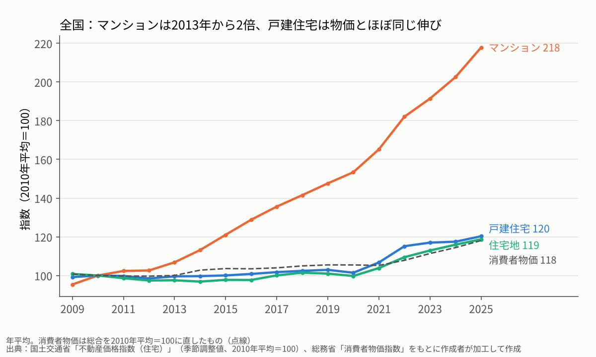
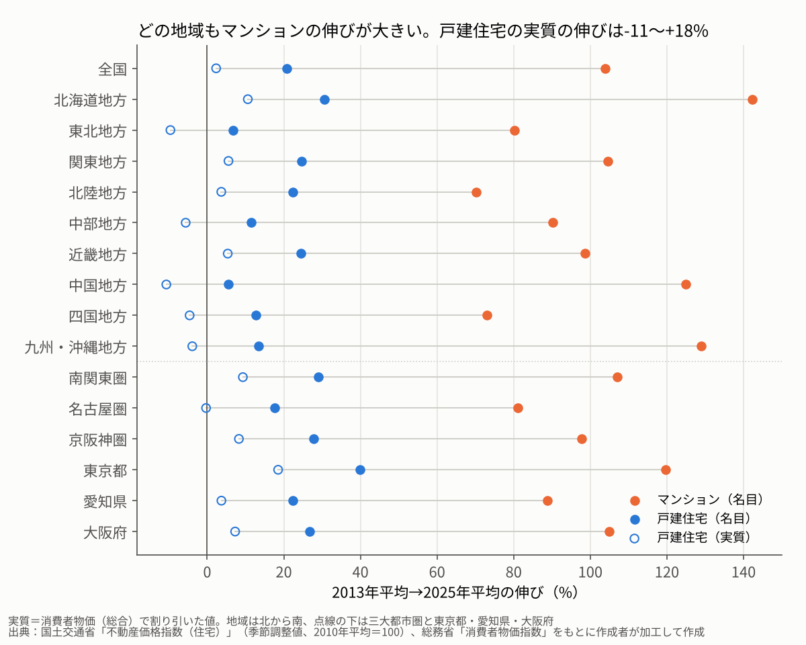
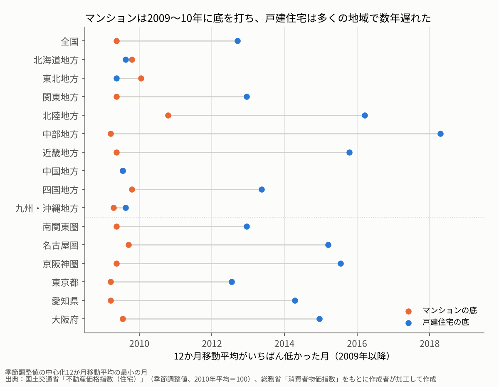
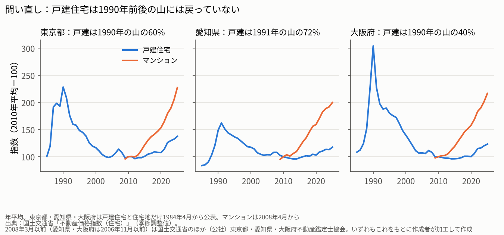

# F385 「マンションの価格は上がったが、一戸建ては上がっていない」は、不動産価格指数でどう見えるか？ 2013→2025年でマンション+104%、戸建住宅+21%。戸建も16地域中14で1割以上上がったが、物価を除くと全国+2%

## 結論（先に）

- 全国の2013年平均→2025年平均で、マンションは +103.9%、戸建住宅は +20.8%（伸びは約5.0倍）でした
- 「一戸建ては上がっていない」は、名目では当たりません。16地域のうち14地域で戸建住宅は +10% 以上上がりました（+10% 未満は東北地方 +6.7%、中国地方 +5.5%）
- ただし同じ期間に消費者物価は +18.1% 上がりました。実質では全国の戸建住宅は +2.3%（16地域で −10.7%〜+18.5%）で、「物価ほどしか上がっていない」と言い直すとおおむね当たります
- マンションの伸びは16地域すべてで戸建住宅を上回り、底も12地域で3年以上早く（中央値 3.6年）、全国の戸建住宅の上がりの約84%は2019年より後でした
- 問い直し：1984年からの長い系列がある東京都・愛知県・大阪府では、戸建住宅の2025年の値は1990年前後の山の 40〜72% にとどまっています

## 問い

「マンションは高くなったが、一戸建ては上がっていない」という言い方があります。国土交通省の不動産価格指数（住宅）は、住宅地・戸建住宅・マンション（区分所有）を分けて地域ごとに毎月出しているので、言い方のどこが当たり、どこが言い過ぎかを数字で分けられます。

知りたい人は、住宅・不動産・金融の実務で価格の動きを説明する人や、住まいの記事を書く人です。過去の値動きを読むところまでとし、先の値動きや売り買いの判断は扱いません。

既存の F208（マンションと地価）、F56（指数の作り方）とは違い、この記事は公表された指数を種類どうしで比べ、地域・時期・物価の3つの軸で確かめます。

## データ（出典）

| データ | 中身 | 使い方 |
|---|---|---|
| 国土交通省「不動産価格指数（住宅）」 | 2010年平均＝100、月次、2008年4月〜2025年12月。全国・10地方・三大都市圏・東京都・愛知県・大阪府の16地域×4種類 | 主の分析（季節調整値の年平均） |
| 同 3都府県の長い系列 | 住宅地・戸建住宅は1984年4月から | 問い直し |
| 国土交通省「不動産取引件数・面積」 | 同じ16地域、月次。指数の作成に使った件数 | 件数の動き |
| 総務省「消費者物価指数」2025年基準 | 全国 総合、月次 | 実質化（物価の上がりを除く） |

用語：「実質」は指数を消費者物価（総合）で割り、2010年の物価にそろえた値、「季節調整値」は毎年決まった月の上下を除いた値です。

## 事前の計画

計画は [PLAN.md](PLAN.md) にあります。比べる期間（2013年平均→2025年平均）、底の月の決め方（12か月移動平均の最小）、4つの仮説と外れの基準、頑健性の確かめを、集計の前に書いています。

注意：この記事は途中で止まったものを引き継いで仕上げました。ファイルの時刻は「計画 → 集計」の順ですが、取得から計画まで30秒しかなく、計画の時点で結果を見ていなかったとは確かめられません（PLAN.md の末尾）。下の判定は「事前の計画どおり」とまでは言い切りません。基準と実際の値は離れていて、基準を少し動かしても判定は変わりません。

| 仮説 | 外れの基準 | 結果 | 判定 |
|---|---|---|---|
| H1（参考）全国でマンションの伸びは戸建住宅の3倍以上 | 3倍未満 | 4.99倍 | 支持（全国の最終月の値を計画前に見ていたため参考扱い） |
| H2 名目では戸建住宅も16地域の過半（9以上）で +10% 以上 | 8以下 | 14地域 | 支持 |
| H3 16地域すべてでマンションの伸び＞戸建住宅の伸び | 1地域でも逆 | 16地域 | 支持 |
| H4 過半の地域で、マンションの底が戸建住宅より3年以上早い | 8以下 | 12地域 | 支持 |

## やったこと

1. 元データを `data/raw/` に同梱し、地域・種類・月の縦長の表に直しました
2. 季節調整値の年平均で、2013年平均→2025年平均の名目・実質の伸びを16地域×4種類で計算しました
3. 12か月の中心化移動平均（前後6か月ずつの平均）が2009年以降でいちばん低い月を「底の月」とし、種類の差を年数で測りました
4. 取引件数の伸びと価格の伸びの順位相関（スピアマン）を見ました
5. 頑健性を6通り、問い直しを1つ足し、図を4枚作りました

## 分かったこと

### 図1：全国ではマンションが2倍、戸建住宅は物価とほぼ同じ伸び



- 全国の季節調整値の年平均は、マンションが 106.8（2013年）→ 217.8（2025年）で +103.9% です
- 戸建住宅は 99.6 → 120.3 で +20.8%、住宅地は +21.7% でした
- 同じ期間の消費者物価（総合）は +18.1% です。実質では戸建住宅 +2.3%、住宅地 +3.1%、マンション +72.7% です
- 戸建住宅の2013→2025年の上がり幅のうち 83.8% は2019年より後のものです

### 図2：どの地域もマンションの伸びが大きいが、戸建住宅も名目では上がった



- 伸びはマンションが +70.3%〜+142.3%、戸建住宅が +5.5%〜+39.9% で、16地域すべてでマンションが上回ります
- 戸建住宅が +10% 以上だったのは14地域です。+10% 未満は東北地方と中国地方の2つでした
- 実質で見ると、戸建住宅がプラスなのは16地域のうち10、+10% 以上は北海道地方（+10.6%）と東京都（+18.5%）の2つだけです
- 地域は北から南の順です（値の順には並べていません）

### 図3：マンションは2009〜10年に底を打ち、戸建住宅は多くの地域で数年遅れた



- マンションの底は16地域すべてで2009年3月〜2010年10月、戸建住宅は全国2012年9月、中部地方2018年4月などばらつきます
- マンションの底が3年以上早かったのは12地域、差の中央値は3.6年です
- 北海道地方・東北地方・中国地方・九州・沖縄地方では差が1年未満で、戸建住宅も2009年ごろに底を打っていました

### 取引件数：価格の伸びの差は、件数の伸びの差では説明しにくい

- 全国の取引件数（指数の作成に使った件数）は、戸建住宅が 159,579件（2013年）→ 232,575件（2025年）で +45.7%、マンションが 160,246件 → 234,545件で +46.4% でした。件数の伸びは種類でほぼ同じです
- 15地域で価格の伸びと件数の伸びの順位相関は、戸建住宅 −0.14、マンション +0.21 と弱いものでした

## 問い直し（結果を見てから足した）

どこから測るかで印象は変わります。東京都・愛知県・大阪府は戸建住宅と住宅地が1984年4月からあるので、1990年前後の山と比べました（図4）。



| 都府県 | 戸建住宅の山（年・値） | 2025年 | 山に対する% | 住宅地の2025年は山の% | マンション2025年 |
|---|---|---|---|---|---|
| 東京都 | 1990年・228.4 | 137.4 | 60.2% | 47.2% | 227.4 |
| 愛知県 | 1991年・162.2 | 117.4 | 72.4% | 46.6% | 199.9 |
| 大阪府 | 1990年・304.2 | 123.1 | 40.5% | 21.3% | 216.7 |

- 戸建住宅は山の40〜72%、住宅地は21〜47%でした
- マンションの長い系列は公表されていないので、マンションが山と比べてどこにいるかは、この指数では分かりません
- 2008年3月以前（愛知県・大阪府は2006年11月以前）は各都府県の不動産鑑定士協会も出典に入る系列で、つなぎ目の前後で作り方が同じとは限りません

## 頑健性

| 設定 | 全国マンション | 全国戸建住宅 | 倍率 | H2：戸建+10%以上 | H3：マンション＞戸建 | H4：3年以上早い |
|---|---|---|---|---|---|---|
| 主（季節調整・2013→2025年・名目） | +103.9% | +20.8% | 4.99 | 14 | 16 | 12 |
| 期間 2010→2025年 | +117.8% | +20.3% | 5.81 | 14 | 16 | 12 |
| 期間 2019→2025年 | +47.6% | +16.9% | 2.82 | 11 | 16 | 12 |
| 実質（消費者物価で割り引く） | +72.7% | +2.3% | 31.11 | 2 | 16 | 12 |
| 原系列の年平均 | +104.0% | +20.9% | 4.98 | 14 | 16 | 12 |
| 年の中央値で比べる | +103.1% | +20.7% | 4.99 | 14 | 16 | 12 |
| 底を年平均の最小の年で決める | +103.9% | +20.8% | 4.99 | 14 | 16 | 12 |

- どの設定でも H3（16地域）と H4（12地域）は変わりません。H2 だけが実質で2地域に減り、これが「名目では上がった、実質ではほぼ横ばい」の中身です

## 言えないこと

- 指数は広さ・築年などをそろえた値ですが、取引される物件や場所の変化を完全には除けません
- 戸建住宅の指数は土地と建物を合わせた価格です。建物の古さによる値下がりの扱いが、マンションと同じとは限りません
- なぜ差が出たか（建築費、金利、需要の場所など）は、この指数だけでは分かりません
- データが2008年4月からのため、2009年より前の底は見えません。底の時期の差は小さめに出ているかもしれません（推測）。取引件数も集め方の変化を含むかもしれません（推測）
- 実質化は消費者物価の総合によるもので、建築費や所得で割ると数字は変わります
- 先の値動きや、買う・売るの判断は扱いません

## 仕事で使うなら

- 「一戸建ては上がっていない」と言うときは、名目か実質かを添えると誤解が減ります。名目では多くの地域で1割以上、実質では全国で+2% 程度です
- 種類どうしを比べるときは、底の時期のずれ（中央値3.6年）があることを添えると伝わりやすくなります

## 計画からの変更

- 計画にない分析として、取引件数との順位相関（スピアマン）を加えました。計画では「取引件数の動きを見る」とだけ書いていました
- 問い直しは「3都府県の長い系列で1990年前後の山と比べる」にしました
- 引き継ぎの担当は分析の中身を変えていません

## 再現のしかた

```sh
pip install -r requirements.txt
sh src/run_all.sh        # 02_build → 03_analysis → 04_figures（オフライン）
```

| ファイル | 中身 |
|---|---|
| src/01_fetch.py | 元データの取得（run_all.sh からは呼ばない。取得日・URL は data/raw/SOURCES.md） |
| src/02_build.py | Excel・CSV → data/ の CSV 3つ |
| src/03_analysis.py | 伸び・実質・底の月・取引件数・頑健性・問い直し → results/main.json と CSV 6つ |
| src/04_figures.py、src/figstyle.py | 図4枚 |
| data/raw/ | 元データ3ファイル（約3.7MB）と SOURCES.md |

- 所要時間：5〜14秒（CPU 1つ）。乱数は使っていません
- 日本語の図には Noto Sans CJK JP を使います（`fonts-noto-cjk`）
- 再現の確かめ：results/repro_check.txt（/tmp で出力を消して流し直し、results と figures が cmp で一致）

## レビューで直したこと

| # | 指摘 | 直し方 |
|---|---|---|
| 1 | README の見出しが、status の題名・note の1行目（「2013→2025年でマンション+104%、戸建住宅+21%。」を含む）と違っていた | README の見出しを status の題名にそろえた |

数字の照合・再実行（/tmp で14ファイル一致）・図4枚は独立レビューで確かめ、ほかに直すところはなかった。計画が結果より前に書かれたかを確かめきれない点は、本文の開示のとおり。

## 出典

- 国土交通省「不動産価格指数」 https://www.mlit.go.jp/totikensangyo/totikensangyo_tk5_000085.html
  - 不動産価格指数（住宅）（Excel） https://www.mlit.go.jp/totikensangyo/content/001473668.xlsx
  - 不動産取引件数・面積（Excel） https://www.mlit.go.jp/common/001465569.xlsx
  - 東京都の2008年3月以前、愛知県・大阪府の2006年11月以前は、国土交通省のほか（公社）東京都不動産鑑定士協会・（公社）愛知県不動産鑑定士協会・（公社）大阪府不動産鑑定士協会
- 総務省統計局「消費者物価指数」2025年基準 全国 中分類指数（e-Stat） https://www.e-stat.go.jp/stat-search/file-download?statInfId=000040482943&fileKind=1

（いずれも 国土交通省「不動産価格指数（住宅）」「不動産取引件数・面積」、総務省「消費者物価指数」をもとに作成者が加工して作成）
