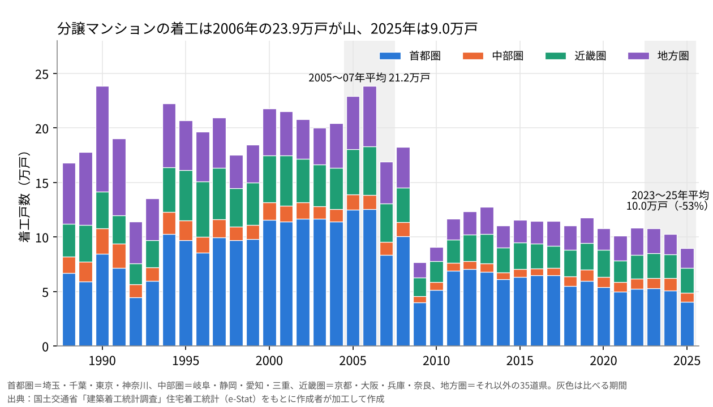
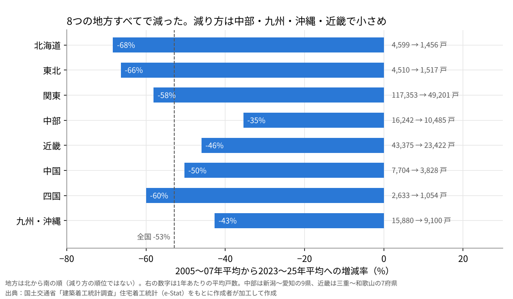
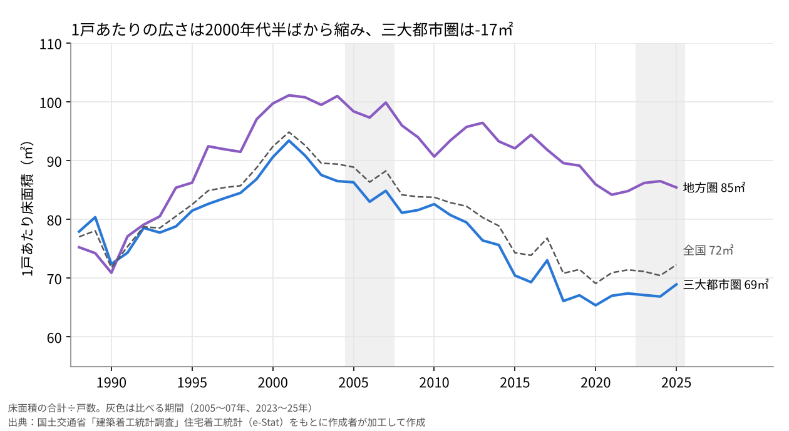
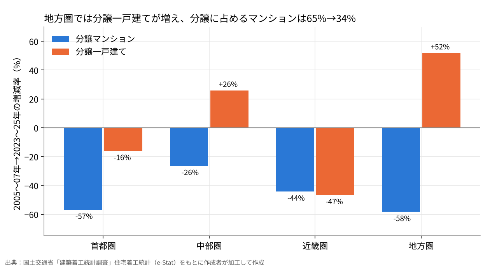

# F386 分譲マンションの建設は、どの地域で減ったのか？ 2005〜07年→2023〜25年で全国53%減、地方圏58%減。地方圏では分譲一戸建てが52%増え、分譲に占めるマンションは65%→34%に

## 結論（先に）

- 国土交通省「建築着工統計調査」で、分譲マンションの着工戸数は、2005〜07年の平均21.2万戸から2023〜25年の平均10.0万戸へ、52.9%減りました。山は2006年の23.9万戸、2025年は9.0万戸です。
- 減り方は、地方圏（三大都市圏以外の35道県）が−58.3%、三大都市圏が−51.3%で、地方圏のほうが大きくなりました。8つの地方はすべて減り、47都道府県では沖縄県を除く46で減りました。
- 減った戸数の75%は三大都市圏、とくに56%は首都圏（埼玉・千葉・東京・神奈川）の分です。ただし首都圏も−56.8%減ったので、全国に占める首都圏の割合は52.4%から48.0%に下がりました。割合が上がったのは中部圏（6.2%→9.7%）と近畿圏（19.0%→22.5%）です。
- 1戸あたりの床面積は、全国で87.8㎡から71.2㎡になりました（−16.5㎡）。三大都市圏は−17.1㎡、地方圏は−12.3㎡です。
- 結果を見てから足した問いでは、地方圏の分譲一戸建ての着工は+51.7%で、分譲住宅に占めるマンションの割合は64.8%から34.1%に下がりました。

## 問い

新しく建つ分譲マンションは、2000年代の半ばより大きく減ったといわれます。全国の数はよく知られていますが、「どの地域で減ったのか」はあまり並べて見られません。地方の都市で「マンションが建たなくなった」と感じる人には、それが全国と同じ動きかが知りたいところです。住宅・不動産・建設・地域の仕事で、新築マンションの供給の形を数字で押さえたい人にも役に立ちます。

この記事では、建築着工統計調査の都道府県別の表で、分譲マンションの着工戸数が、三大都市圏と地方圏、8つの地方のどこで、どれだけ減ったのかを確かめました。あわせて、1戸あたりの床面積の変化を見ました。価格や買い時は扱いません。

既存の看板記事（F385 価格指数、F391 リフォーム、F392 公営の借家、F393 建設費、F181 着工全体と金利・人口）に、分譲マンションの着工を地域に分けて見たものはありません。

## データ（出典）

- 国土交通省「建築着工統計調査」住宅着工統計 時系列表（e-Stat）
  - 【住宅】利用関係別 構造別 建て方別 都道府県別 戸数（年計、1988〜2025年。戸数と床面積の合計）
  - 利用関係別－新設住宅の戸数、床面積の合計（年計、1948〜2025年。分譲住宅のうちマンション・一戸建の再掲つき）
- 2ファイル（約4.6MB）を `data/raw/` に同梱（URL・取得日は `data/raw/SOURCES.md`）。
- **分譲マンションの定義**は国交省に合わせました。利用関係が分譲住宅、建て方が共同建、構造が鉄骨鉄筋コンクリート造・鉄筋コンクリート造・鉄骨造のものです。都道府県の表からこの3つの構造を足して作り、全国の合計が時系列表の「うちマンション」と一致することを確かめました（2008年だけ時系列表が9戸多く、差は0.005%です）。
- **三大都市圏**は住宅着工統計の区分です。首都圏＝埼玉・千葉・東京・神奈川、中部圏＝岐阜・静岡・愛知・三重、近畿圏＝京都・大阪・兵庫・奈良。それ以外の35道県を地方圏とします。
- **8地方**：北海道、東北（6県）、関東（茨城〜神奈川の7都県）、中部（新潟〜愛知の9県）、近畿（三重〜和歌山の7府県）、中国、四国、九州・沖縄。北から南の順に並べます。

## 事前の計画

計画は [PLAN.md](PLAN.md)（2026-11-18、地域別の集計の前に作成）です。PLAN.md の冒頭の作成時刻「13:20」は誤りです（レビューで確かめた事実。レビューの時点の 04 時台より後の時刻になっています）。ファイルの最終更新は 04:06 で、集計のスクリプト（03_analysis.py、04:08）と結果のファイル（04:09）より前でした。順番は「計画 → 集計」と読めますが、記載の時刻は当てにできません（PLAN.md の本文は変えていません）。表の形を確かめるときに、全国の分譲マンションの年の戸数（1985〜2025年）を見ていたので、計画にそう書いています。

| 仮説 | 外れの基準 | 結果 | 判定 |
|---|---|---|---|
| H1 全国は2023〜25年平均が2005〜07年平均より50%以上少ない | 50%未満の減少 | −52.9% | 支持（見たうえでの仮説） |
| H2 減少率は地方圏のほうが三大都市圏より大きい | 地方圏が三大都市圏以下 | 地方圏−58.3%、三大都市圏−51.3% | 支持（ただし基準を2013〜15年にすると逆） |
| H3 全国に占める首都圏の割合は上がる | 同じか低い | 52.4%→48.0% | 外れ |
| H4 全国の1戸あたり床面積は小さくなる（三大都市圏と地方圏の両方で） | 同じか大きい | 全国−16.5㎡、三大都市圏−17.1㎡、地方圏−12.3㎡ | 支持 |

## やったこと

1. 都道府県別の表（38年分）を縦長にし、47都道府県の合計＝全国、内訳の合計＝「計」を確かめました。
2. 2005〜07年と2023〜25年の3年平均（大きな建物1棟の影響をならすため）を、三大都市圏・地方圏、4つの圏、8地方で比べました。
3. 減った戸数のうちの各地域の分（減少への寄与）と、1戸あたり床面積（床面積の合計÷戸数）を出しました。

## 分かったこと

### 図1 2006年の23.9万戸が山で、2009年に7.7万戸まで落ち、その後も戻っていない



- 全国の分譲マンションの着工は、1988〜2025年では2006年の23.9万戸が最も多く、2009年に7.7万戸まで落ちました。2010〜2024年は9万〜13万戸、2025年は9.0万戸です。
- 2005〜07年平均の21.2万戸に対し、2023〜25年平均は10.0万戸で、−52.9%です。
- 同じ期間に住宅の着工全体は、三大都市圏で−31.9%、地方圏で−38.3%でした。分譲マンションは住宅全体より大きく減っています。

### 図2 8つの地方すべてで減った



- 減少率は、北海道−68.3%、東北−66.4%、関東−58.1%、中部−35.4%、近畿−46.0%、中国−50.3%、四国−60.0%、九州・沖縄−42.7%でした（北から南の順）。
- 三大都市圏は−51.3%、地方圏は−58.3%です。4つの圏で見ると、首都圏−56.8%、中部圏−26.4%、近畿圏−44.2%、地方圏−58.3%でした。
- 減った戸数（年11.2万戸）のうち、首都圏が56.3%、近畿圏15.8%、中部圏3.1%、地方圏24.7%です。
- 47都道府県のうち減ったのは46で、増えたのは沖縄県だけでした。半分以下になったのは、三大都市圏の12都府県のうち9、地方圏の35道県のうち24です。
- 全国に占める首都圏の割合は52.4%→48.0%に下がり、中部圏は6.2%→9.7%、近畿圏は19.0%→22.5%に上がりました。H3（首都圏への集中が進む）は外れです。

### 図3 1戸あたりの広さは2000年ごろから縮んだ



- 全国の1戸あたり床面積は87.8㎡から71.2㎡になりました。年の値では2001年の94.9㎡が最も広い年です。
- 三大都市圏は84.7㎡→67.6㎡（−17.1㎡）、地方圏は98.4㎡→86.1㎡（−12.3㎡）です。地方圏のほうが広く、その差は13.7㎡から18.5㎡に開きました。
- 4つの圏では、中部圏が97.4㎡→65.0㎡と最も大きく縮みました。小さな住戸の多い建物が増えたためかもしれませんが、これは推測で、このデータでは住戸の間取りや使われ方は分かりません。

## 問い直し（結果を見てから足した）

地方圏でマンションが大きく減ったので、「分譲の一戸建てに置き換わったのか」を足しました。分譲一戸建て（利用関係が分譲住宅、建て方が一戸建）の着工を同じ期間で比べました。



- 分譲一戸建ては、地方圏で+51.7%（年2.5万戸→3.8万戸）、中部圏で+25.7%増えました。首都圏は−16.0%、近畿圏は−46.6%でした。
- 分譲住宅に占めるマンションの割合は、三大都市圏で60.1%→47.6%、地方圏で64.8%→34.1%に下がりました。地方圏の分譲住宅は、2005〜07年にはマンションが3分の2でしたが、2023〜25年には一戸建てが3分の2になりました。
- 8地方では、分譲一戸建ては東北（+66.3%）、中国（+58.7%）、九州・沖縄（+172.1%）などで増え、北海道・関東・近畿では減りました。
- 地方圏の分譲住宅の合計は−20.7%（7.3万戸→5.8万戸）で、マンションの減少（−2.8万戸）の半分近くを一戸建ての増加（+1.3万戸）が埋めた形です。同じ人が一戸建てを選ぶようになったのかは、着工の数からは分かりません。

## 頑健性

| 確かめ | 全国の変化 | 三大都市圏 | 地方圏 | 首都圏の割合（基準→直近） | 全国の1戸あたり床面積 | 結論 |
|---|---|---|---|---|---|---|
| 0 主：2005〜07年→2023〜25年 | −52.9% | −51.3% | −58.3% | 52.4%→48.0% | 87.8→71.2㎡ | — |
| 1a 基準を1994〜96年に | −52.0% | −49.5% | −60.2% | 45.6%→48.0% | 82.6→71.2㎡ | H2・H4 は同じ。H3 は逆（首都圏の割合は上がる） |
| 1b 基準を2013〜15年に | −15.1% | −16.4% | −9.7% | 54.3%→48.0% | 77.9→71.2㎡ | この10年は地方圏の減り方が小さい（H2 は逆） |
| 1c 直近を2025年の1年だけに | −57.7% | −56.5% | −61.7% | 52.4%→44.8% | 87.8→72.3㎡ | 変わらない |
| 2 定義：分譲の共同住宅すべて（木造なども） | −52.5% | −50.8% | −58.4% | 52.4%→48.5% | 87.5→70.7㎡ | 変わらない |
| 3 都道府県で数える | 47のうち46で減少 | 12のうち12 | 35のうち34 | — | — | 変わらない |
| 4 東京都を除く | −52.3% | −49.7% | −58.3% | 35.4%→30.1%（埼玉・千葉・神奈川） | 92.6→71.7㎡ | 変わらない |

- ただし、2013〜15年と比べると、この10年は三大都市圏（−16.4%）のほうが地方圏（−9.7%）より減っています。地方圏の大きな減少は、2008〜09年までの落ち込みで起きたものです。
- 首都圏の割合は、基準の年で上がりも下がりもします。「首都圏に集中した」とも「首都圏から離れた」とも言い切れません。

## 言えないこと

- 着工の戸数で、販売された戸数・売れた価格・売れ残り（在庫）ではありません。
- なぜ減ったのか（用地、建設費、買う人の数、事業者の判断など）は、このデータでは分かりません。理由についての話はすべて推測になります。
- 分譲マンションには、住むために買われる住戸も、貸すために買われる住戸も入っていて、区別できません。1戸あたり床面積が縮んだ理由も、このデータからは分かりません。
- 都道府県より細かい地域（市区町村など）は見ていません。
- 小さい県では、大きな建物1棟で1年の数が大きく動きます。都道府県の値は地方や圏の合計として使い、県の順位は作っていません。
- 価格・買い時・投資の判断には使えません。

## 仕事で使うなら

- 地域の新築マンションの供給を話すときは、全国の減少率（−53%）だけでなく、地方圏（−58%）と三大都市圏（−51%）、どの期間と比べたか（2013〜15年と比べると逆になる）をそろえて示すと、誤解が少なくなります。
- 地方圏では、分譲住宅の中心がマンションから一戸建てに移っています。分譲住宅の数を見るときは、建て方を分けて並べると動きが読みやすくなります。
- 戸数と床面積の両方を見ると、建設の量の変化を取り違えにくくなります。

## 計画からの変更

- 計画どおりに計算しました。図の題名は結果を見てから決めました。

## 再現のしかた

```sh
pip install -r requirements.txt
python3 src/01_fetch.py   # 取得（ネットが必要。data/raw に同梱済みなので通常は不要）
sh src/run_all.sh         # 02 → 03 → 04（オフライン）
```

| ファイル | 中身 |
|---|---|
| src/01_fetch.py | 元データの取得（e-Stat、2ファイル） |
| src/02_build.py | data/ の2つの CSV を作る。合計と定義の確かめ |
| src/03_analysis.py | 比較・寄与・床面積・頑健性・問い直し |
| src/04_figures.py | figures/ の4枚 |
| results/main.json | 本文の数字 |
| results/annual_by_metro.csv・floor_per_unit_annual.csv | 年ごとの推移 |
| results/metro_compare.csv・region8_compare.csv・pref_table_north_to_south.csv | 期間の比較（都道府県は北から南の順） |
| results/robustness.csv・requestion_detached.csv・requestion_share_metro3.csv | 頑健性・問い直し |

所要時間は約4秒（CPU 1つ）。`results/repro_check.txt` に、/tmp に写して流し直し、15ファイルがバイト単位で一致した結果を書いています。

## レビューで直したこと

| # | 指摘 | 直し方 |
|---|---|---|
| 1 | PLAN.md の作成時刻「13:20」が、ファイルの更新時刻（04:06）・結果のファイル（04:09）と合わない | 「事前の計画」に、記載の時刻は誤りで、ファイルの時刻では計画が集計より前であることを書き足した（PLAN.md の本文は変えていない） |
| 2 | note の「言えないこと」が「市区町村より細かい地域は見ていません」となっていた（見ていないのは都道府県より細かい地域） | 「都道府県より細かい地域（市区町村など）は見ていません」に直した |
| 3 | README の見出しと status・note の題名の言い回しが少し違っていた | README の見出しを status の題名にそろえた |

## 出典

- 国土交通省「建築着工統計調査」 https://www.mlit.go.jp/sogoseisaku/jouhouka/sosei_jouhouka_tk4_000002.html
- 住宅着工統計 時系列表（e-Stat） https://www.e-stat.go.jp/stat-search/files?toukei=00600120&tstat=000001016966

（いずれも 国土交通省「建築着工統計調査」 をもとに作成者が加工して作成）
