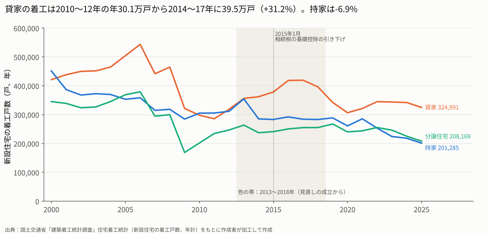
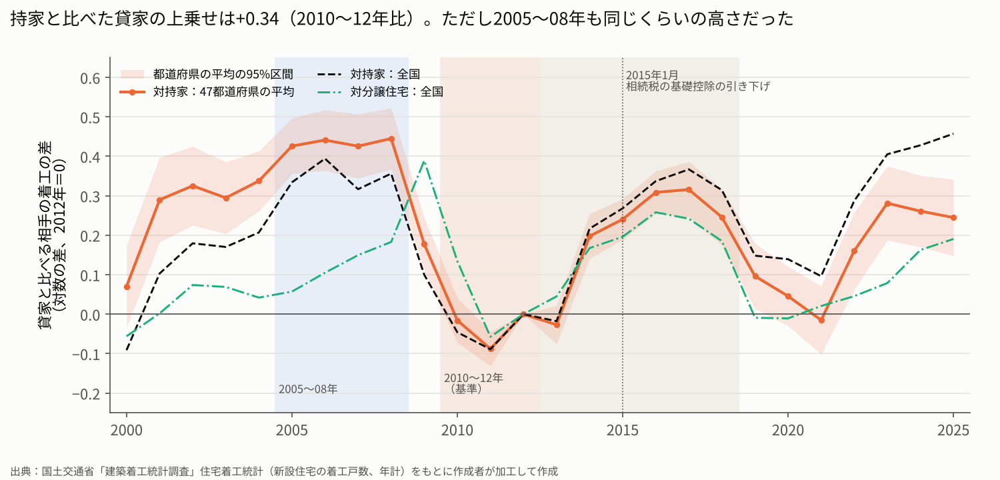
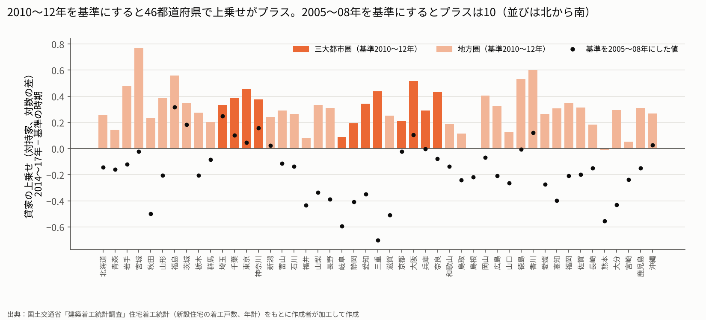
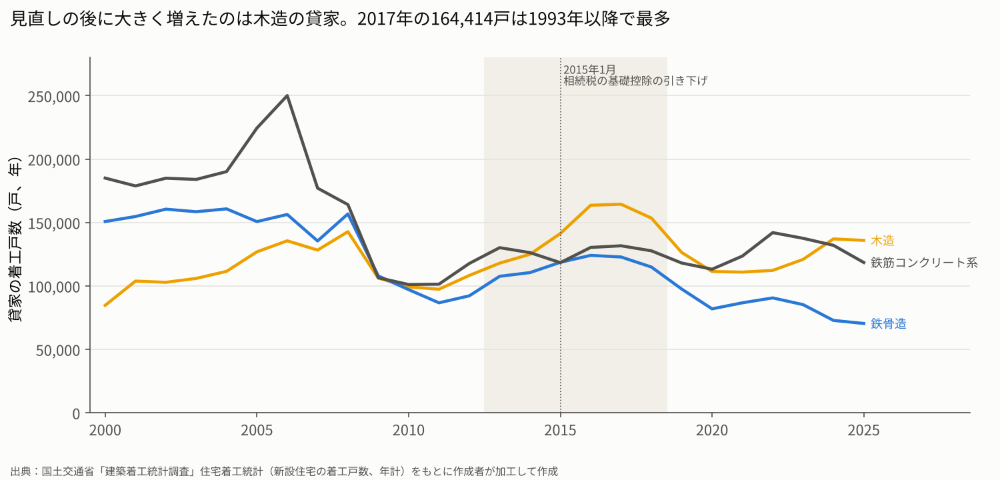

# F387 2015年の相続税の見直しの前後で、貸家の建設はどれだけ増えたのか？ 年30.1万戸→39.5万戸（+31.2%）。持家と比べた上乗せは46都道府県でプラスだが、2005〜08年と比べるとほぼ消える

## 結論（先に）
- 貸家（賃貸用の住宅）の新設着工は、2010〜12年の平均で年30.1万戸、2014〜17年の平均で39.5万戸でした（+31.2%）。山は2017年の41.9万戸です。同じ期間に持家は−6.9%、分譲住宅は+8.0%でした。
- 持家と比べた差の差（対数の差の変化）は全国で+0.34（約41%の上乗せ）で、47都道府県のうち46でプラスでした。
- ただし、基準の2010〜12年は、2009年に貸家が大きく落ち込んだあとの谷でした。2005〜08年を基準にすると差の差は−0.05で、プラスは10都道府県だけです。「見直しの後に貸家が持家より増えた」は確かですが、2000年代半ばの関係に戻った分と区別できず、見直しの効果の大きさは言えません。
- 問い直しで建物の種類を見ると、2014〜17年に増えた分の50.0%は木造でした。木造の貸家は2017年に16.4万戸で、1993年以降で最多です。鉄筋コンクリート系は2005〜08年の6割強にとどまりました。

## 問い
相続税の基礎控除は、2013年の税制改正で「5,000万円＋1,000万円×法定相続人の数」から「3,000万円＋600万円×法定相続人の数」に下がり、2015年1月1日以後の相続から適用されました。国税庁によると、相続税がかかった人の割合は2014年分の4.4%から2015年分の8.0%に上がりました。日本銀行の金融システムレポート別冊（2016年3月）は、近年の貸家の増加には富裕層の資産運用や節税のニーズという動機もある、と指摘しています。

では、貸家の着工は見直しの前後でどれだけ増え、持家や分譲住宅と比べてどれだけ上乗せがあったのか。住宅の需要や地域の賃貸住宅の供給を見る人に向けて、数字と読み方までをまとめます。税や建てる・貸すことの助言はしません。

## データ（出典）
- 国土交通省「建築着工統計調査」住宅着工統計 時系列表：利用関係別・構造別・建て方別・都道府県別の戸数（年計、1988〜2025年）。照合用に全国の利用関係別の時系列表（e-Stat、data/raw に同梱、2026-11-18 取得）
- 都道府県の合計＝全国、構造・建て方・利用関係の合計＝計、全国の時系列表との一致を 02_build.py で確かめています。
- 利用関係：持家＝自分で住むために建てる家、貸家＝賃貸用、分譲住宅＝売るために建てる家。

## 事前の計画
集計の前に [PLAN.md](PLAN.md) を書きました（2026-11-18）。基準を2010〜12年、見直しの後を2014〜17年、対照を持家と決め、消費税の引き上げ（2014年4月）で持家が揺れることを頑健性で確かめると決めました。

| 仮説（外れの基準） | 結果 | 判定 |
|---|---|---|
| H1：全国の上乗せ（対持家）は+0.15以上 | +0.342 | 支持 |
| H2：2020〜22年に、山から半分以上戻る | 46.8%戻った。2023〜25年は再び+0.47（持家の減少による） | 外れ |
| H3：見直しの前（2003〜06年→2010〜12年）の差の動きは±0.10以内 | −0.321 | 外れ（前提が弱い） |
| H4：上乗せは三大都市圏より地方圏で大きい（都道府県の中央値） | 三大都市圏0.359、地方圏0.274 | 外れ |

## やったこと
1. 都道府県×年×利用関係の着工戸数から、貸家と持家の対数の差 G を作りました。
2. 差の差＝（2014〜17年の G の平均）−（2010〜12年の G の平均）を、全国と47都道府県で出しました。年ごとの G（2012年＝0）も、都道府県の平均と95%区間で出しました。
3. 超過戸数の目安として、貸家が持家と同じ伸び率だった場合との差を2013〜2018年で足しました。
4. 頑健性を9通り、問い直しで建物の種類を見ました。

## 分かったこと

### 図1：貸家は増え、持家は減った


- 貸家は2012年の31.9万戸から2017年の41.9万戸まで増え、2019年に34.2万戸へ戻りました。新設住宅に占める貸家の割合は2012年の36.1%から2017年の43.5%に上がりました。
- 持家は2013年に35.5万戸（消費税の引き上げ前の駆け込みと考えられる、推測）のあと、2014〜18年は28万〜29万戸台でした。
- 2014〜17年の貸家（年39.5万戸）は、2005〜08年の平均（48.9万戸）より少ない水準です。

### 図2：持家と比べた上乗せは大きいが、2005〜08年も同じ高さだった


- 2012年を0とした差 G（都道府県の平均）は、2014年+0.20、2016年+0.31、2017年+0.32でした。
- 2005〜08年も+0.43〜+0.44で、2009〜11年に大きく下がっていました。見直しの前に、差はすでに大きく動いていたことになります。
- 2013年は−0.03で、見直しが成立した年にはまだ上乗せは見えません。
- 2022年以降、全国の差は再び+0.29〜+0.46に広がりました。貸家は2022〜25年に年32.5万〜34.5万戸で大きくは増えておらず、主に持家が2025年の20.1万戸まで減ったためです。

### 図3：基準をどこに置くかで、都道府県の答えが変わる


- 2010〜12年を基準にすると、上乗せは46都道府県でプラス、中央値+0.29（四分位で+0.21〜+0.38）でした。
- 2005〜08年を基準にすると、プラスは10都道府県（埼玉・千葉・東京・神奈川・大阪など）で、中央値は−0.15です。
- 地方別では、東北の上乗せ（+0.56）が大きく、貸家が+92.2%でした。東日本大震災の復興の建設が重なっている可能性があります（推測）。岩手・宮城・福島を除いても、全国の上乗せは+0.33でした。

## 問い直し（結果を見てから足した）
2014〜17年の増え方が2005〜08年の山と同じ形なのかを確かめるため、全国の貸家を構造と建て方に分けました（results/rental_mix.csv）。



- 2010〜12年→2014〜17年の増加（+9.4万戸）の50.0%は木造、28.8%は鉄骨造、21.2%は鉄筋コンクリート系でした。建て方では共同住宅が77.1%、長屋建が21.0%です。
- 木造の貸家は2014〜17年に年14.9万戸で、2005〜08年（13.3万戸）を上回りました。2017年の16.4万戸は1993年以降で最多です。鉄筋コンクリート系は12.7万戸で、2005〜08年（20.4万戸）の62%でした。
- 貸家を木造・鉄骨造に絞り2005〜08年を基準にしても、上乗せは+0.10でした。2000年代半ばの山は鉄筋コンクリートの大きな賃貸住宅、2014〜17年の山は木造・鉄骨造の低い共同住宅（アパート）が中心で、形が違います。土地を持つ人が建てるアパートが増えた、という見方と合いますが、建てた人はこの統計には載っていません（推測）。

## 頑健性

| 確かめ | 差の差（全国） | 都道府県の中央値 | プラスの数 | 超過戸数 2013〜18年 |
|---|---|---|---|---|
| 基準：対照＝持家、2014〜17 vs 2010〜12 | +0.342 | +0.293 | 46 | 58.7万 |
| 対照＝分譲住宅 | +0.190 | +0.037 | 25 | 34.6万 |
| 対照＝持家＋分譲住宅 | +0.275 | +0.223 | 44 | 48.4万 |
| 後を2015〜17年（消費税の前後を除く） | +0.369 | +0.322 | 46 | — |
| 基準を2009〜12年 | +0.306 | +0.237 | 45 | 52.4万 |
| 貸家を木造・鉄骨造だけに | +0.392 | +0.340 | 47 | 44.1万 |
| 岩手・宮城・福島を除く | +0.332 | +0.291 | 43 | 54.0万 |
| 基準を2005〜08年 | −0.053 | −0.149 | 10 | −25.9万 |
| 基準を2005〜08年・対照＝分譲住宅 | +0.092 | −0.033 | 22 | 14.4万 |
| 基準を2005〜08年・木造・鉄骨造だけ | +0.100 | −0.090 | 16 | 6.3万 |

基準を2010〜12年に置く限り、対照や期間を変えても上乗せはプラスでした。基準を2005〜08年に置くと、ほぼ消えます。超過戸数は34.6万〜58.7万戸から−25.9万戸まで動くので、「何万戸増えた」とは言えません。

## 言えないこと
- 増えた分のうち相続税の見直しによる分は分かりません。2013年からの金融緩和、2016年のマイナス金利、金融機関の貸出の姿勢、賃貸の需要の変化が同じ時期に重なり、このデータでは分けられません。
- 対照の持家は、2014年の消費税の引き上げや2022年以降の減少で大きく動いていて、「貸家がなければどうだったか」の物差しとして不安定です。
- 建てた人（地主か事業者か）や理由は、着工統計には載っていません。
- 空き家・家賃・入居への影響は、このデータでは見られません。

## 仕事で使うなら
- 「相続税の見直しで貸家が増えた」を引くときは、基準の年を書き、2005〜08年と比べた数字も添えると、過大に読まれにくくなります。
- 構造別の推移（results/rental_mix.csv）を見ると、2010年代後半の増加は木造・鉄骨造の共同住宅と長屋建が中心でした。

## 計画からの変更
- 頑健性に「基準を2005〜08年」の3通りと「岩手・宮城・福島を除く」を、結果を見てから足しました（図2で2005〜08年の高さ、地方別で東北の大きさが見えたため）。
- 月次は使わず、年計で分析しました（PLAN.md のとおり）。

## 再現のしかた
```
sh src/run_all.sh        # オフライン。所要約5秒（CPU 1つ）
python3 src/01_fetch.py  # 元データを取り直すときだけ（ネットを使う）
```

| ファイル | 中身 |
|---|---|
| src/01_fetch.py | 元データの取得（run_all.sh からは呼ばない） |
| src/02_build.py | Excel 2本 → data/starts_pref.csv・national_tenure.csv（合計の確かめつき） |
| src/03_analysis.py | 差の差・年ごとの差・超過戸数・都道府県・地方別・頑健性 → results/main.json ほか CSV 4本 |
| src/03b_requestion.py | 問い直し（構造・建て方） → results/rental_mix.csv・requestion.json |
| src/04_figures.py | 図4枚 |

repro_check：/tmp/rep_F387（レビュー後は /tmp/rv_F387）で 02 以降の出力を消して流し、13ファイル（results 7、figures 4、data 2）が cmp で一致（results/repro_check.txt）。乱数なし。data は7MB。

## 関連する記事
- F181「家が建つ数は、金利と人口のどちらで決まるのか？」：新設住宅の着工全体を金利と人口で説明する記事です。この記事は、貸家と持家の差が相続税の見直しの前後でどう動いたかを見る点が違います。

## レビューで直したこと

| # | 指摘 | 直し方 |
|---|---|---|
| 1 | README の題名（差の差+0.34を前に出す形）が、note と status の題名と食い違っていた。+0.34は基準の年しだいで消える値で、題名に置くと強すぎる | README の題名を note・status と同じ「46都道府県でプラスだが、2005〜08年と比べるとほぼ消える」にそろえた |
| 2 | 「2022年以降に差が広がったのは貸家が増えたからではなく」は言い切りすぎ（2021→22年は貸家も+7%） | 「主に持家が減ったため」に弱めた（README・note） |
| 3 | 着工全体を扱う既存の F181 への言及がなかった | 「関連する記事」を足した |

## 出典
- 国土交通省「建築着工統計調査」住宅着工統計（e-Stat）：https://www.e-stat.go.jp/stat-search/files?toukei=00600120&tstat=000001016966 （ファイルの URL は data/raw/SOURCES.md）
- 財務省「所得税法等の一部を改正する法律案（平成25年3月）」の概要：https://www.mof.go.jp/about_mof/bills/183diet/st250301g.htm
- 国税庁「平成27年分の相続税の申告状況について」：https://www.nta.go.jp/information/release/kokuzeicho/2016/sozoku_shinkoku/index.htm
- 日本銀行「金融システムレポート別冊：地域金融機関の貸家業向け貸出と与信管理の課題」（2016年3月）：https://www.boj.or.jp/research/brp/fsr/fsrb160324.htm

（いずれも 国土交通省「建築着工統計調査」をもとに作成者が加工して作成）
