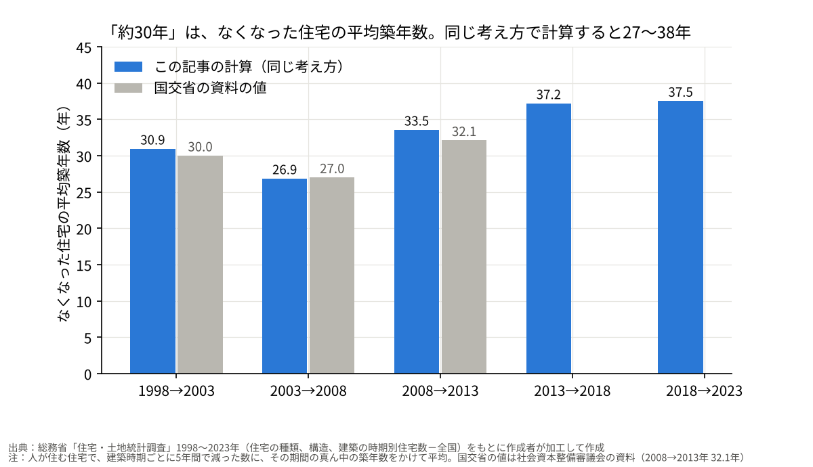
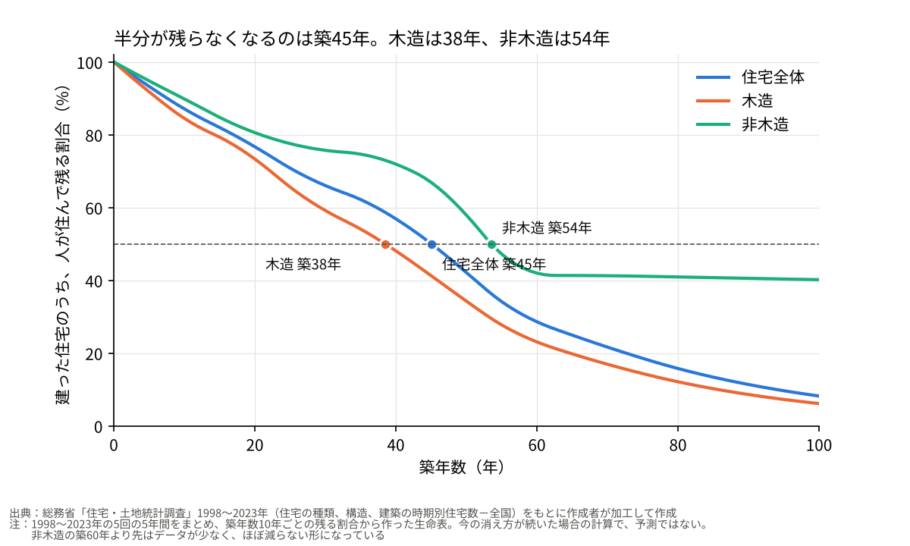
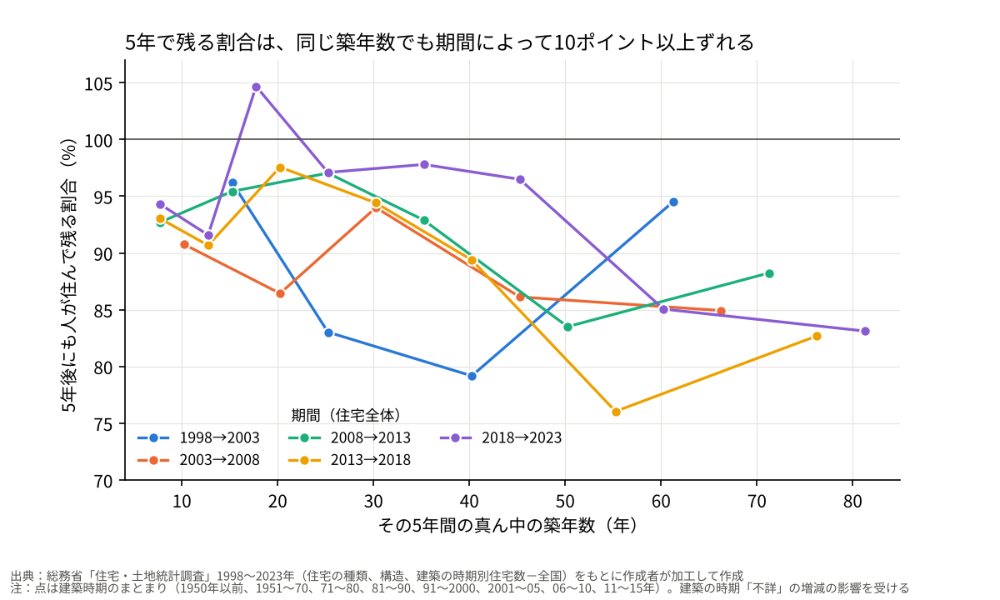
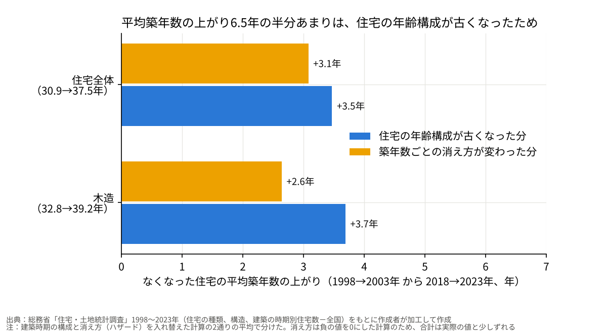

# F388 「住宅は30年で建て替え」は、住宅の残り方で見るとどうか？ なくなった住宅の平均は築27〜38年、半分が残らなくなるのは築45年（木造38年・非木造54年）

## 結論（先に）

- 「日本の住宅は約30年」のもとの数字は、国土交通省の審議会資料にある「滅失住宅の平均築後年数」（2008→2013年で32.1年）です。これは「なくなった住宅が、なくなったときに平均で築何年だったか」です。同じ住宅・土地統計調査で同じ考え方の計算をすると、1998→2003年 30.9年、2003→2008年 26.9年、2008→2013年 33.5年となり、資料の値（30.0、27.0、32.1年）をほぼ再現できました。その後は 2013→2018年 37.2年、2018→2023年 37.5年に上がっています。
- 同じ建築時期の住宅が5年後にどれだけ残るかから「住宅の生命表」（築年数ごとに何割が残るか）を作ると、1998〜2023年の5回の5年間をまとめた値で、半分が残らなくなるのは築45.1年でした。築30年で残っているのは66%です。
- 木造は築38.5年、非木造は築53.6年で半分を下回りました。5つの期間のどれでも木造の方が短く出ましたが、2013→2018年は差が小さく（44.5年と46.9年）、建築の時期「不詳」を配り直すと逆になりました。
- 「なくなった住宅の平均築年数」が 30.9年から37.5年へ6.5年上がった分を分けると、住宅の年齢構成が古くなったことで3.5年、築年数ごとの消え方が変わったことで3.1年でした（結果を見てから足した問い）。
- ただし生命表の値は、期間（33〜62年）と「不詳」の扱いで大きく動きます。取り壊しと空き家になったことは分けられません。

## 問い

「日本の住宅は約30年で建て替えられる。米国は約67年、英国は約81年」という比べ方は、住宅の長寿命化の話でよく使われます。もとは国交省の審議会の補足資料にある「滅失住宅の平均築後年数（国際比較）」です（[社会資本整備審議会 住宅宅地分科会の資料](https://www.mlit.go.jp/policy/shingikai/content/001323215.pdf) 40ページ）。

この数字は「なくなった住宅の平均の年齢」です。新しい住宅が多い時代には、なくなる住宅の中にも若い住宅が多く混じるので、平均は若く出ます。そこで、同じ時期に建った住宅が調査ごとにどれだけ残るかから、住宅の「残り方」を作り直しました。住宅・建設・不動産・損害保険の実務の人や、記事で「30年」を使う人に向けた確かめです。どの住宅を建て替えるべきか、税や制度をどうすべきかは扱いません。

既存の F328 は1980年以前の住宅の減り方と地域差を見ました。この記事は全部の建築時期で生命表を作る点が違います。

## データ（出典）

- 総務省「住宅・土地統計調査」1998・2003・2008・2013・2018・2023年の「住宅の種類、構造、建築の時期別住宅数－全国」（6ファイル、計0.6MB、`data/raw/` に同梱。取得日・URL は `data/raw/SOURCES.md`）
- 数えているのは人が住んでいる住宅（居住世帯のある住宅）です。空き家には建築の時期が調べられていません。
- 構造は「木造（防火木造を含む）」と「非木造（鉄筋・鉄骨コンクリート造、鉄骨造など）」の2つにそろえました。
- 建築の時期は回ごとに区切りが違うため、1950年以前、1951〜70、71〜80、81〜90、91〜2000、2001〜05、06〜10、11〜15年の8つにまとめました。調査の年に建った途中の区分は使っていません。

## 事前の計画

[PLAN.md](PLAN.md)（2026-11-18 04:06、残る割合と寿命を集計する前に作成）。

レビューで確かめた事実：PLAN.md のファイルの最終更新は 04:16 で、結果のファイル（04:09）より後でした（selfcheck.md と同じ秒に更新）。記載の作成時刻 04:06 は 02_build.py（04:07）より前ですが、集計のあとに PLAN.md が書き直されたかどうか、何が変わったかはファイルからは確かめられません。仮説の判定は PLAN.md の今の文面どおりに行っています（PLAN.md の本文は変えていません）。

| 仮説 | 内容（外れの基準） | 結果 | 判定 |
|---|---|---|---|
| H1（再現） | 2008→2013年の「なくなった住宅の平均築年数」が32.1年の±3年以内 | 33.5年 | 支持 |
| H2 | 生命表の中央値が、なくなった住宅の平均築年数より10年以上長い（主：2018→2023年） | 62.0年 対 37.5年（差24.5年） | 支持（ただし期間で差は3〜24年、5期間中3つで10年未満） |
| H3 | 木造の中央値が非木造より短い（主：2018→2023年） | 43.2年 対 築200年まで半分を下回らず | 支持（「不詳」を配り直した2013→2018年では逆） |
| H4 | 新しい時期の住宅ほど、同じ築年数で残る割合が高い（1971〜80年の住宅と81〜90年の住宅、1ポイント以上） | 築23年から：+14.0ポイント、築28年から：+0.4ポイント | 外れ |

## やったこと

1. 各回の表から構造×建築時期の住宅数を取り出し、合計が住宅総数と一致することを確かめました（`src/02_build.py`）。
2. 同じ建築時期・同じ構造の住宅数を5年後の調査と比べ、「5年で残る割合」を出しました。年あたりの消える率（ハザード、−ln(残る割合)/5）を、その5年間の真ん中の築年数に置きました（`src/03_analysis.py`）。1950年以前の住宅は建築年の真ん中を1940年と仮定しました。
3. 消える率を築年数に沿って線でつなぎ（築80年より先は一定）、生まれた住宅のうち何割が残るかの曲線（生命表）を作りました。消える率が負（住宅が増えた）のところは0にしました。
4. 国交省と同じ考え方で、建築時期ごとの減った数に、その期間の真ん中の築年数をかけた平均を出しました。
5. 5つの期間をまとめた値は、築年数10年ごとの帯で5年前・5年後の数をそれぞれ足して残る割合を出したものです。

## 分かったこと

### 図1：「約30年」は再現できる。最近は37年台



- なくなった住宅の平均築年数は、1998→2003年 30.9年、2003→2008年 26.9年、2008→2013年 33.5年でした。国交省の資料の 30.0、27.0、32.1年との差は1.4年以内です。
- 2013→2018年は37.2年、2018→2023年は37.5年でした。
- 木造は 30.3〜40.9年、非木造は 16.1〜30.1年でした。非木造が若いのは、若い共同住宅でも人が住まなくなると統計から消えるためと考えられます（推測）。

### 図2：半分が残らなくなるのは築45年



- 5つの期間をまとめた生命表では、半分が残らなくなるのは住宅全体で築45.1年、木造38.5年、非木造53.6年でした。
- 築30年で残っている割合は住宅全体66.0%、木造59.2%、非木造75.7%でした。築50年では42.1%、34.3%、57.9%です。
- 同じ期間をまとめた「なくなった住宅の平均築年数」は32.5年で、生命表の中央値より12.5年短く出ます。
- 非木造の築60年より先は住宅数が少なく、ほぼ減らない形です。平均寿命（99.3年）はこれに引っ張られるため、中央値を使います。

### 図3：同じ築年数でも、期間によって10ポイント以上ずれる



- 築25年前後で5年後に残る割合は、1998→2003年 83.0%、2018→2023年 97.1% と大きく違いました。
- 2018→2023年の2001〜05年の住宅は、5年で4.7%増えていました。建築の時期「不詳」は2018年の471万戸から2023年の362万戸に減っており、「不詳」だった住宅に建築時期が付いた分が入っていると考えられます（推測）。
- このため、1つの期間だけで作った生命表の中央値は 33.4〜62.0年（住宅全体）と大きく動きます。

## 問い直し（結果を見てから足した）

**問い：なくなった住宅の平均築年数が上がったのは、住宅が長くもつようになったからか、古い住宅が増えたからか？**



- 「建築時期の構成（どの年齢の住宅がどれだけあるか）」と「築年数ごとの消える率」を期間の間で入れ替えて計算しました（`results/requestion_counterfactual.csv`）。
- 1998→2003年から2018→2023年への上がり6.5年のうち、年齢構成が古くなった分が3.5年、消え方が変わった分が3.1年でした。木造では3.7年と2.6年です。
- 平均築年数の上がりの半分あまりは、住宅が長もちになったからではなく、古い住宅が増えたためです。

## 頑健性

| 確かめ | 住宅全体の中央値 | 木造 | 非木造 | なくなった住宅の平均築年数（全体） | 結論は変わったか |
|---|---|---|---|---|---|
| 主（PLAN：2018→2023年） | 62.0年 | 43.2年 | 200年まで半分を下回らず | 37.5年 | － |
| 「不詳」を分かっている時期の割合で配り直す（2018→2023年） | 53.7年 | 35.7年 | 100.3年 | 35.7年 | 中央値が平均築年数より長い点は同じ |
| 期間 2013→2018年 | 45.7年 | 44.5年 | 46.9年 | 37.2年 | 木造と非木造の差が小さい |
| 期間 2008→2013年 | 48.0年 | 44.8年 | 51.6年 | 33.5年 | 同じ |
| 負の消える率をそのまま使う | 63.8年 | 43.2年 | 200年まで下回らず | 37.5年 | 同じ |
| 消える率を階段（区間で一定）にする | 62.0年 | 43.2年 | 200年まで下回らず | 37.5年 | 同じ |
| 5つの期間をまとめる（本文の値） | 45.1年 | 38.5年 | 53.6年 | 32.5年 | 中央値は短くなるが、平均築年数より長い点は同じ |
| 5つの期間をまとめ、「不詳」も配り直す（レビューで表に追加。値は results/life_table_summary.csv） | 46.8年 | 41.5年 | 53.3年 | 33.5年 | 本文の値とほぼ同じ |
| 平均築年数の築年数を期間の終わりで数える（2008→2013年） | － | － | － | 36.1年 | 再現の差が4年に広がる |

「中央値の方が平均築年数より長い」はどの確かめでも同じでした。差の大きさと、木造と非木造の差は確かめによって動きます（`results/robustness.csv`）。

## 言えないこと

- 統計は人が住む住宅だけを数えます。「残らない」には、取り壊し・建て替えのほかに、空き家になったものが入ります。取り壊しだけの寿命は出せません。
- 標本調査の誤差と「不詳」の増減（108万〜471万戸）で、5年の残る割合は数ポイント動きます。
- 生命表は「その期間の消え方が続いたら」の計算で、これから建つ住宅が何年もつかの予測ではありません。
- 建築時期が10〜20年の幅でまとめられているため、築年数には数年のずれがありえます。
- 建て替えの理由は分かりません。米国・英国との比較もしていません。

## 仕事で使うなら

- 「約30年」は「なくなった住宅の平均築年数」と添えて使う。
- 残り方は「築30年で約3分の2が残る」「半分が残らないのは築45年前後（期間で動く）」と幅で示す。

## 計画からの変更

- 生命表の主な値を、PLAN の2018→2023年から「5つの期間をまとめた値」に変えて見出しに使いました。2018→2023年は「不詳」の減少で残る割合が高く出ており、非木造は200年まで半分を下回らないなど、1つの期間では値が安定しなかったためです。PLAN どおりの値は仮説の判定と頑健性の表に残しています。
- 問い直しとして、平均築年数の上がりの分け方（`requestion_decomposition`）を足しました。

## 再現のしかた

```
pip install -r requirements.txt
sh src/run_all.sh        # 02_build → 03_analysis → 04_figures（オフライン）
python3 src/01_fetch.py  # 元データを取り直すときだけ（ネットが要る）
```

| ファイル | 中身 |
|---|---|
| `src/01_fetch.py` | e-Stat から6表を取る（run_all.sh からは呼ばない） |
| `src/02_build.py` | 表を「構造×建築時期」の長い表 `data/stock_by_period.csv` に |
| `src/03_analysis.py` | 残る割合・生命表・平均築年数・頑健性・問い直し → `results/` |
| `src/04_figures.py` | 図4枚 → `figures/` |
| `results/main.json` | 本文の数字すべて |

所要時間：約3秒（CPU 1つ）。`results/repro_check.txt`：/tmp に写して生成物を消して流し直し、13ファイルがバイト単位で一致しました。

## レビューで直したこと

| # | 指摘 | 直し方 |
|---|---|---|
| 1 | PLAN.md のファイルの更新時刻（04:16）が結果のファイル（04:09）より後で、計画が集計の前に書かれたままかを確かめられない | 「事前の計画」にその事実を書き足した（PLAN.md の本文は変えていない） |
| 2 | 見出しに使った「5つの期間をまとめた値」は結果を見てから選んだもので、「不詳」を配り直した場合の値が頑健性の表になかった（results には出ていた） | 頑健性の表に「まとめた値＋不詳の配り直し」（住宅全体46.8年、木造41.5年、非木造53.3年）を足した |
| 3 | README の見出しと status・note の題名の言い回しが少し違っていた | README の見出しを status の題名にそろえた |

## 出典

- 総務省「住宅・土地統計調査」平成10年・15年・20年・25年・30年・令和5年（[e-Stat](https://www.e-stat.go.jp/stat-search/files?toukei=00200522)）
- 国土交通省 社会資本整備審議会 住宅宅地分科会 参考資料「我が国の住宅ストックをめぐる状況について（補足資料）」40ページ「滅失住宅の平均築後年数の国際比較」（[PDF](https://www.mlit.go.jp/policy/shingikai/content/001323215.pdf)）

（いずれも総務省「住宅・土地統計調査」をもとに作成者が加工して作成）
