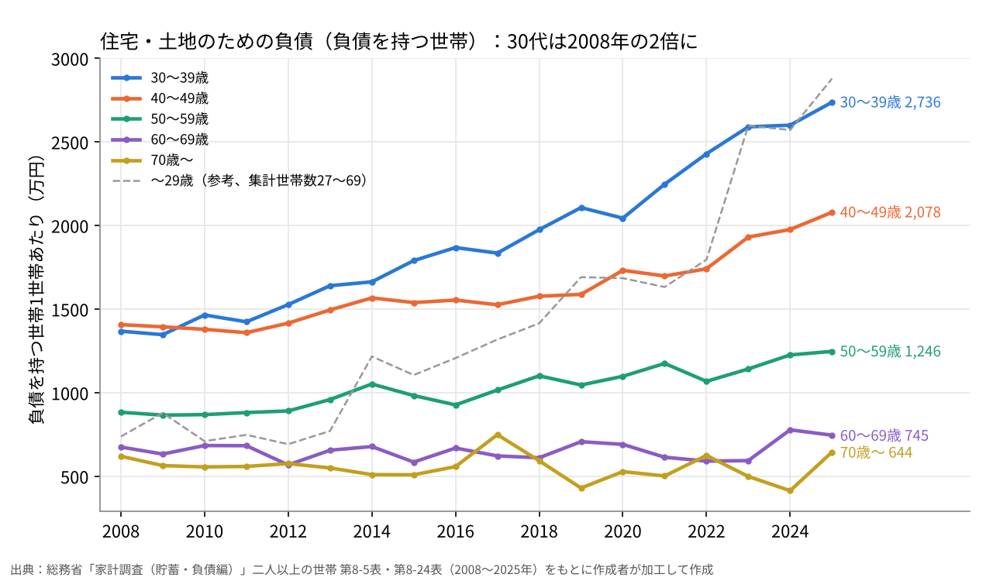
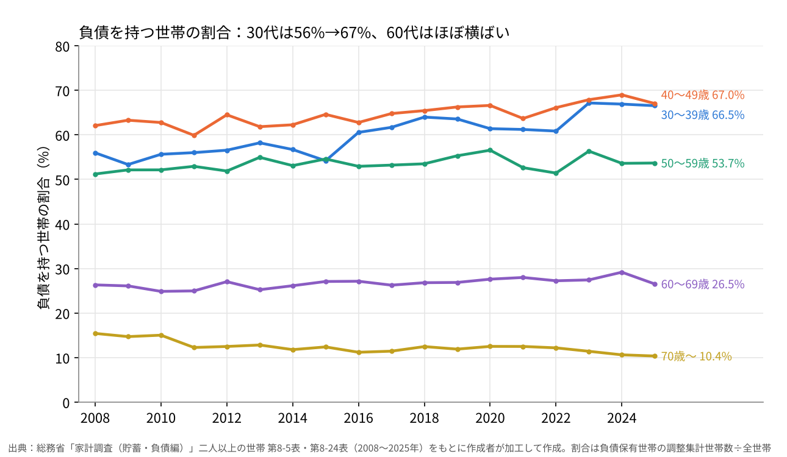
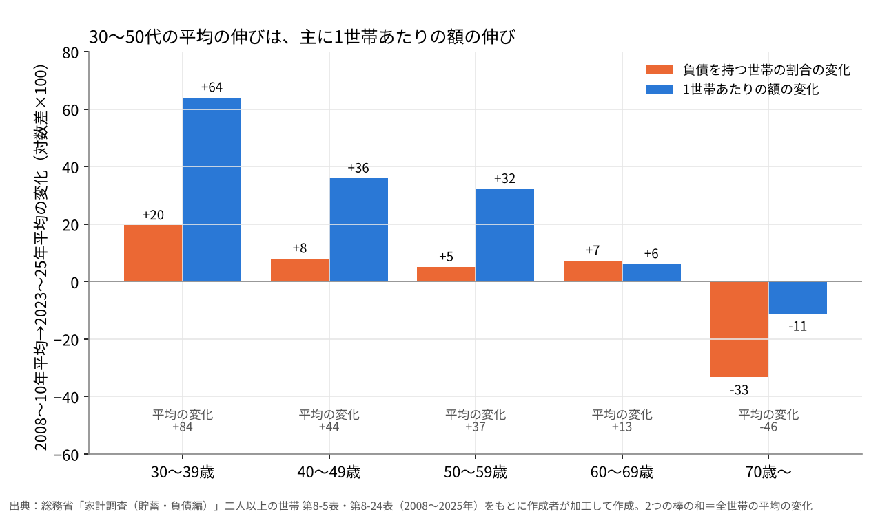
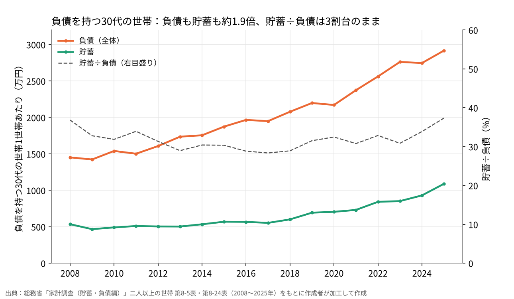

# F389 住宅ローンを返している世帯の負債は、世帯主の年齢でどう変わったのか？ 30代の負債を持つ世帯は1,392万円→2,641万円（1.9倍）、年収の3.4倍に

## 結論（先に）

- 家計調査（貯蓄・負債編）で、負債を持つ30代の世帯（二人以上の世帯）の「住宅・土地のための負債」は、2008〜10年平均の1,392万円から2023〜25年平均の2,641万円へ、1.90倍になりました。40代は1.43倍、50代は1.38倍、60代は1.06倍です。
- 負債を持つ30代の世帯の年間収入に対する倍率は、2.32倍から3.43倍になりました。40代は1.82倍→2.29倍です。
- 全世帯で割った30代の平均は766万円→1,766万円（対数差で+84）。このうち+64は1世帯あたりの額の伸び、+20は負債を持つ世帯の割合の上昇（55.0%→66.9%）です。40代・50代も、伸びの8割以上は1世帯あたりの額でした。
- 60代で負債を持つ世帯の割合は25.8%→27.7%と少し上がりましたが、単年（2008年→2025年）で比べると26.3%→26.5%で、はっきりした上昇とは言えません。
- 問い直しとして、負債を持つ30代の世帯の貯蓄を見ました。貯蓄も497万円→956万円と負債（全体）と同じくらい（1.9倍）増え、貯蓄÷負債は34%前後のままでした。

## 問い

「若い世帯の住宅ローンが大きくなった」という話をよく聞きます。住宅の販売や金融、家計の相談の仕事をしている人にとっては、それが「借りる世帯が増えた」のか「1世帯の借りる額が増えた」のかで、意味が変わります。また、借りたまま60代に入る世帯が増えたのかも気になるところです。

総務省「家計調査（貯蓄・負債編）」には、世帯主の年齢別に、全世帯の平均（第8-5表）と、負債を持つ世帯だけの平均（第8-24表）が毎年あります。全世帯の平均は「負債を持つ世帯の割合 × 負債を持つ世帯1世帯あたりの額」に分けられるので、どちらが動いたのかを年齢ごとに見ました。

既存の看板記事に、家計調査の負債を年齢別に分けたものはありません（F327 は持ち家率、F347 は貯蓄率）。

## データ（出典）

- 総務省「家計調査（貯蓄・負債編）」詳細結果表、二人以上の世帯（全体と、うち勤労者世帯）、2008〜2025年の各年平均。
  - 第8-5表 世帯主の年齢階級別 貯蓄及び負債の1世帯当たり現在高（全世帯）
  - 第8-24表 負債保有世帯の世帯主の年齢階級別 貯蓄及び負債の1世帯当たり現在高
- 2007年以前の年は e-Stat にファイルがない（データベースのみ）ため使っていません。
- 36ファイル（約1.7MB）を `data/raw/` に同梱しています。URL と取得日は `data/raw/SOURCES.md` にあります。

言葉の定義：
- 負債を持つ世帯の割合 p ＝ 第8-24表の調整集計世帯数 ÷ 第8-5表の調整集計世帯数（同じ年・同じ年齢）。何かの負債を持つ世帯の割合で、住宅ローンだけの割合ではありません。
- 1世帯あたりの額 D ＝ 第8-24表の「住宅・土地のための負債」。
- 全世帯の平均 M ＝ 第8-5表の「住宅・土地のための負債」。

## 事前の計画

計画は [PLAN.md](PLAN.md)（2026-11-16、年ごとの集計の前に作成）です。表の形を確かめるときに2008年と2025年の第8-24表の値を見ていたので、H1 は値を見たうえでの仮説だと計画に書いています。

| 仮説 | 外れの基準 | 結果 | 判定 |
|---|---|---|---|
| H1 30代の D は1.5倍以上 | 1.5倍未満 | 1.90倍 | 支持（端の年を見たうえでの仮説） |
| H2 30代・40代の M の伸びの半分以上は D の伸び | D の寄与が半分未満 | 30代 +64/+84、40代 +36/+44 | 支持 |
| H3 60代の p は1ポイント以上上がる | 上がりが1ポイント未満 | 25.8%→27.7%（+1.95） | 支持（ただし単年比較では +0.2 で弱い） |
| H4 30代の倍率は3倍を超える | 3倍以下 | 3.43倍 | 支持 |

## やったこと

1. 18年分の第8-5表・第8-24表から、年×年齢×項目の表を作りました（`src/02_build.py`）。
2. p・D・M と、負債を持つ世帯の「住宅・土地のための負債 ÷ 年間収入」（倍率）を計算しました。
3. 2008〜10年平均と2023〜25年平均を比べ、M の変化（対数差×100）を p の変化と D の変化に分けました。対数差は足し算で分けられるので、2つの和が M の変化になります。
4. 〜29歳は負債を持つ世帯の集計世帯数が27〜69しかなく年ごとの揺れが大きいので、参考として扱いました。

## 分かったこと

### 図1 負債を持つ世帯1世帯あたりの額：30代は2008年の2倍に



- 30代は2008年1,367万円、2013年1,639万円、2019年2,106万円、2025年2,736万円でした。3年平均どうしで1.90倍です。
- 2008〜2012年は30代と40代がほぼ同じ額でしたが、その後30代が上回り、2025年は30代2,736万円、40代2,078万円です。
- 60代（674万円→745万円）と70歳以上は、ほとんど変わっていません。

### 図2 負債を持つ世帯の割合：30代は上がり、60代はほぼ横ばい



- 30代は2008年56.0%から2025年66.5%に上がりました。2015〜16年と2022〜23年に段のように上がっています。
- 40代は62.1%→67.0%、50代は51.2%→53.7%です。
- 60代は26.3%→26.5%で、年ごとに25〜29%の間を動いています。70歳以上は15.4%→10.4%に下がりました。
- 全年齢の平均は41.1%→37.5%に下がりました。負債を持つ世帯の少ない高齢の世帯の割合が増えたためと考えられます（推測。年齢の構成で分けて確かめてはいません）。

### 図3 平均の伸びは、主に1世帯あたりの額の伸び



- 30代の全世帯の平均（M）は766万円→1,766万円で、対数差+84です。このうち1世帯あたりの額が+64（77%）、割合が+20でした。
- 40代は+44のうち+36（82%）、50代は+37のうち+32（86%）が1世帯あたりの額です。
- 60代は+13のうち、割合+7、額+6と半々です。70歳以上は割合が下がり、平均は−46でした。

## 問い直し（結果を見てから足した）

30代の負債が2倍近くになったので、「負債を持つ30代の世帯は、貯蓄も増えているのか」を足しました。第8-24表の貯蓄と負債（住宅以外も含む全体）を比べました。



- 負債を持つ30代の世帯の貯蓄は、2008〜10年平均497万円→2023〜25年平均956万円（1.92倍）、負債は1,471万円→2,807万円（1.91倍）でした。
- 貯蓄÷負債は33.8%→34.1%で、ほとんど変わっていません。差（貯蓄−負債）は−974万円→−1,851万円に広がりました。
- 40代は貯蓄1.35倍、負債1.40倍で、貯蓄÷負債は59.4%→57.1%でした。

## 頑健性

主な比較は二人以上の世帯、2008〜10年平均→2023〜25年平均、金額です。

| 確かめ | 30代の D の倍率 | 30代の M の変化のうち D の分 | 30代の倍率（最後） | 60代の p | 結論 |
|---|---|---|---|---|---|
| 0 主 | 1.90 | +64 / +84 | 3.43 | 25.8→27.7 | — |
| 1 勤労者世帯 | 1.92 | +65 / +85 | 3.45 | 30.4→31.1 | 変わらない（60代の上昇は+0.7で H3 の基準に届かない） |
| 2a 単年（2008→2025） | 2.00 | +69 / +87 | 3.35 | 26.3→26.5 | 変わらない（60代は横ばい） |
| 2b 3年平均をずらす（2009-11→2022-24） | 1.80 | +59 / +76 | 3.44 | 25.3→27.9 | 変わらない |
| 3 M ≒ p×D の一致 | 30〜50代のずれは各年 ±0.4% 以内（全年齢・全年の平均 0.62%、最大 11.2% は70歳以上の勤労者世帯） | | | | p の定義は合っている |
| 4 倍率（年収に対する比）で分ける | — | +39 / +60 | 3.43 | — | 変わらない（収入の伸びを除いても額の分が大きい） |

30代・40代の結論（額の伸びが主）は、どの確かめでも変わりませんでした。60代の割合の上昇（H3）は、主の比較では基準を満たしますが、勤労者世帯と単年の比較では満たしません。「借りたまま60代に入る世帯が増えた」とは、このデータでは言い切れません。

## 言えないこと

- 毎年違う世帯を調べた横断の表なので、同じ世帯の借り方の変化（借り換えや繰上げ返済）は分かりません。30代の世帯が40代になったときの残高も追えません。
- 「負債を持つ世帯の割合」は何かの負債を持つ世帯の割合で、住宅ローンだけの割合ではありません。住宅・土地のための負債は負債全体の9割前後なので近い値ですが、同じではありません。
- 額が増えた理由（住宅の値段、金利、共働きで借りられる額が増えたことなど）は、このデータでは分かりません。理由を書くときはすべて推測です。
- 二人以上の世帯だけで、単身世帯は入っていません。
- 〜29歳は集計世帯数が少なく（負債を持つ世帯で27〜69）、3年平均どうしで3.5倍（単年の2008年→2025年では3.9倍）という値も揺れが大きいので、結論には使っていません。
- 金額は名目（その年の値段）です。倍率（年収に対する比）で見た頑健性4では収入の伸びを除いていますが、物価で割った実質の比較はしていません。

## 仕事で使うなら

- 「若い世帯の負債が増えた」という数字を見るときは、全世帯の平均なのか、負債を持つ世帯の平均なのかを確かめると、読み違えにくくなります。この2つは30代で約1.5倍違います（2025年、1,821万円と2,736万円）。
- 平均の変化を「持つ世帯の割合」と「1世帯あたりの額」に分けて並べると、増えた理由の候補を絞り込みやすくなります。
- 年齢の若い階級は集計世帯数が少ないので、3年平均などでならして読むと揺れに振り回されにくくなります。

## 計画からの変更

- 計画どおりに計算しました。図2の題名と、図3の題名（60代と70歳以上は額の伸びが主ではないため「30〜50代」とした）は、結果を見てから決めました。
- H3 は主の比較では「支持」ですが、頑健性で弱いことが分かったので、結論では「はっきりした上昇とは言えない」と書きました。

## 再現のしかた

```sh
pip install -r requirements.txt
python3 src/01_fetch.py   # 取得（ネットが必要。data/raw に同梱済みなので通常は不要）
sh src/run_all.sh         # 02 → 03 → 04（オフライン）
```

| ファイル | 中身 |
|---|---|
| src/01_fetch.py | 元データの取得（e-Stat、36ファイル） |
| src/02_build.py | data/panel_long.csv（年×世帯区分×表×年齢×項目）を作る |
| src/03_analysis.py | p・D・M・倍率、分解、頑健性、問い直し、仮説の判定。results/ に出力 |
| src/04_figures.py | figures/ の4枚 |
| results/main.json | 本文の数字のもと |
| results/panel_wide.csv | 年×年齢の p・D・M・倍率・貯蓄 |
| results/decomposition_main.csv | 分解の表 |
| results/robustness.csv・identity_check.csv | 頑健性 |
| results/requestion_savings_vs_debt.csv | 問い直し |

所要時間は約3秒（CPU 1つ）。`results/repro_check.txt` に、/tmp に写して流し直し、11ファイルがバイト単位で一致した結果を書いています。

## レビューで直したこと

独立レビューで数字の照合・再実行・図を確かめ、直すところはなかった。

## 出典

- 総務省統計局「家計調査（貯蓄・負債編）」詳細結果表 https://www.e-stat.go.jp/stat-search/files?toukei=00200561&tstat=000000330001
- 家計調査の説明 https://www.stat.go.jp/data/kakei/index.html

（いずれも 総務省「家計調査（貯蓄・負債編）」 をもとに作成者が加工して作成）
