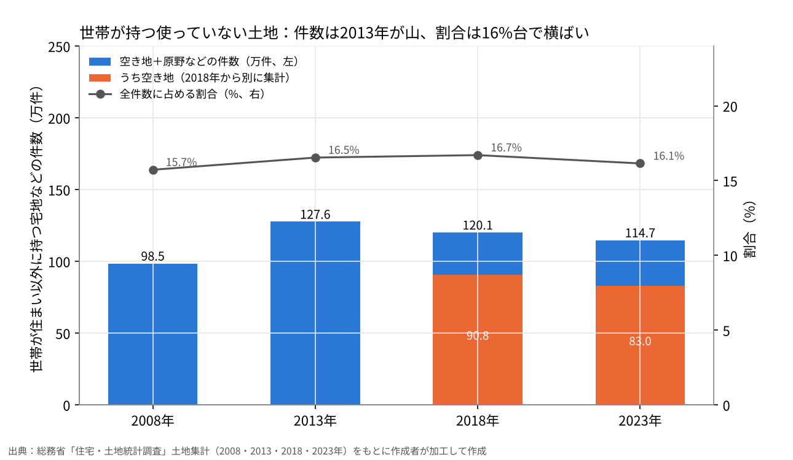
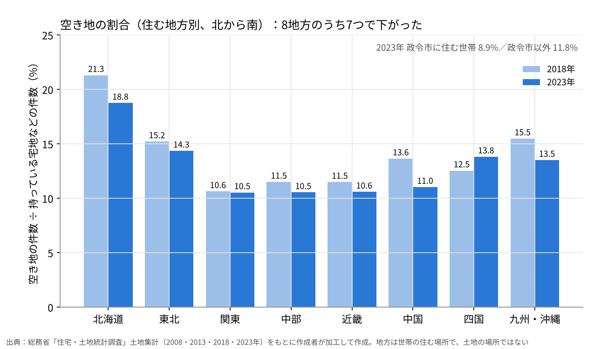
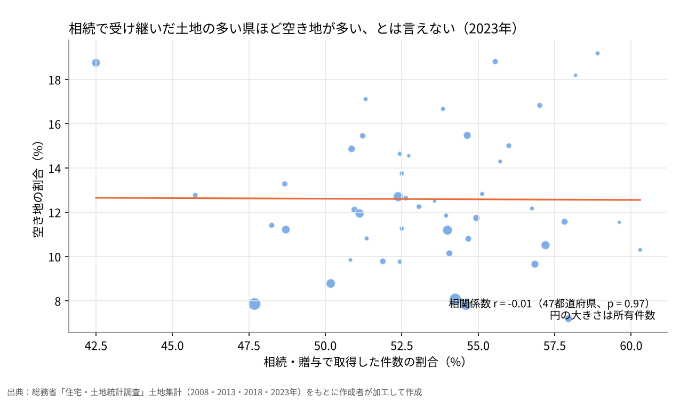
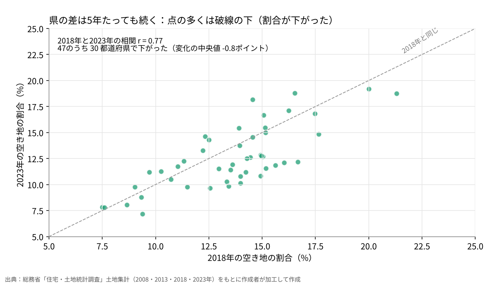

# F390 世帯が持つ「使っていない空き地」は増えているのか？ 2018→2023年で90.8万→83.0万件に減り、8地方のうち7つで割合が下がった。相続の多い県ほど多い関係は見えない

## 結論（先に）

- 世帯が住まいの敷地以外に持つ宅地などのうち、「利用していない（空き地）」は、2018年の90.8万件から2023年の83.0万件に減りました。持っている件数全体に占める割合は12.6%から11.7%です。
- 定義をそろえるため「空き地＋原野など」で長く見ると、2008年98.5万、2013年127.6万、2018年120.1万、2023年114.7万件で、山は2013年でした。割合は15.7%→16.5%→16.7%→16.1%とほぼ横ばいです。
- 住む地方別（北から南の8地方）では、空き地の割合は8地方のうち7つで下がりました。上がったのは四国（12.5%→13.8%）だけです。政令市に住む世帯は8.9%、政令市以外に住む世帯は11.8%（2023年）でした。
- 「相続で受け継いだ土地の多い県ほど空き地の割合が高い」という関係は、47都道府県では見えませんでした（相関係数 −0.01）。年や数え方を変えても −0.16〜+0.15 でした。
- 問い直しとして、県の差が5年で入れ替わるのかを見ました。2018年と2023年の空き地の割合の相関は0.77で、県の差は続いています。

**注意**：この統計は、土地を持つ世帯が**住んでいる地域**で分けた数字です。土地のある場所の数字ではありません。

## 問い

人口が減り、相続で土地を受け継ぐ世帯が増えると、使われない土地が増える、という話をよく聞きます。土地や住宅の仕事をしている人、自治体で土地を扱う人にとっては、それが本当に増えているのか、どんな地域に住む世帯に多いのかが気になるところです。

総務省「住宅・土地統計調査」の土地集計には、世帯が住まい以外に持つ宅地などを、利用のしかた（建物の敷地、駐車場、空き地など）と、手に入れ方（購入、相続・贈与など）で分けた表があります。この表で、空き地の件数と割合の変化を見ました。

たたき台は「空き地はどこで増えているのか」でしたが、表は土地の場所ではなく持ち主の住む地域で分かれているため、「どの地方に住む世帯が持つ空き地か」に直しました（PLAN.md に記載）。既存の記事（jodn 120、F127、F278）は住宅の空き家で、土地の空き地を扱ったものはありません。

## データ（出典）

- 総務省「住宅・土地統計調査」土地集計。現住居の敷地以外に所有する宅地などを持つ世帯の数、所有件数、1件当たり所有面積。
  - 2023年：第252-1表（全国、利用現況13区分）、第252-2表（都道府県・政令市、6区分）、第249表（取得方法5区分）
  - 2018年：第253-1表、第253-2表、第250表（同じ形）
  - 2013年：第172表、2008年：第145表（全国のみ。「利用していない（空き地・原野など）」はひとまとめ）
- 8ファイル（約0.3MB）を `data/raw/` に同梱しています。URL と取得日は `data/raw/SOURCES.md` にあります。
- 2018年は「普通世帯」、2023年は「主世帯」で数えています（ほぼ同じ範囲ですが、言葉が違います）。値は千件単位に丸められています。

言葉の定義：
- 空き地の割合 ＝「利用していない（空き地）」の件数 ÷ 所有件数の総数。
- 相続の割合 ＝「相続・贈与で取得」の件数 ÷ 所有件数の総数。
- 政令市以外 ＝ 政令市のある都道府県の値 − その中の政令市（特別区部を含む21市区）の値。

## 事前の計画

計画は [PLAN.md](PLAN.md)（2026-11-16、地方別・都道府県別の集計の前に作成）です。表の形を確かめるときに全国の件数を見ていたので、H1 は値を見たうえでの仮説だと書いています。

| 仮説 | 外れの基準 | 結果 | 判定 |
|---|---|---|---|
| H1 空き地＋原野などの件数は2023年が2013年より少ない | 多ければ外れ | 127.6万→114.7万件 | 支持（見たうえでの仮説） |
| H2 空き地の割合は8地方のうち5つ以上で下がる | 4つ以下 | 7地方で下がった | 支持 |
| H3 相続の割合と空き地の割合の相関が0.3を超える | 0.3以下 | −0.01 | **外れ** |
| H4 政令市に住む世帯の空き地の割合は、それ以外より低い | 低くなければ外れ | 8.9% 対 11.8% | 支持 |

## やったこと

1. 4時点の全国の表から、総数と「利用していない」の件数を取り出しました。2018年以降は空き地と原野などに分かれているので、足して2013年以前とそろえました。
2. 2018年と2023年の都道府県・政令市の表から、空き地の割合と相続の割合を計算し、8地方（北から南）にまとめました。
3. 47都道府県で、相続の割合と空き地の割合の相関を見ました。
4. 政令市とそれ以外に住む世帯で、空き地の割合を比べました。

## 分かったこと

### 図1 件数の山は2013年、割合は16%台で横ばい



- 空き地＋原野などは、2008年98.5万、2013年127.6万、2018年120.1万、2023年114.7万件でした。
- 所有件数の総数も2013年が772万件で最も多く、割合（15.7%→16.5%→16.7%→16.1%）はほとんど変わっていません。
- 空き地だけ（2018年から別に集計）は90.8万→83.0万件、面積（件数×1件当たり面積）は約509km²→約492km²でした。

### 図2 空き地の割合は、8地方のうち7つで下がった



- 北海道21.3%→18.8%、東北15.2%→14.3%、関東10.6%→10.5%、中部11.5%→10.5%、近畿11.5%→10.6%、中国13.6%→11.0%、四国12.5%→13.8%、九州・沖縄15.5%→13.5%でした。
- 北海道・東北・九州・沖縄に住む世帯で高く、関東・中部・近畿で低い形は、両方の年で同じです。
- 政令市に住む世帯は8.9%、政令市以外は11.8%（2023年）で、2018年（9.9%と12.7%）も同じ向きでした。

### 図3 相続の多い県ほど空き地が多い、とは言えない



- 相続・贈与で手に入れた件数の割合は、2023年に42〜60%と県で違います。しかし空き地の割合との相関は −0.01（p=0.97）で、関係は見えませんでした。
- 2018年（−0.16）、順位相関（+0.03）、北海道を除く（+0.15）、世帯数で数える（−0.04）、空き地＋原野など（+0.01）でも同じでした。
- これは県の単位の比べ方です。「相続で受け継いだ土地は空き地になりにくい」という意味ではありません（取得方法と利用のしかたを掛け合わせた表がないため、土地1件ずつの関係は分かりません）。

## 問い直し（結果を見てから足した）

地方の割合が5年で下がったので、「県の差は5年で入れ替わる程度の揺れなのか、続く差なのか」を足しました。



- 2018年と2023年の空き地の割合の相関は0.77でした。高い県は5年後も高い傾向が続いています。
- 47都道府県のうち30で下がりました。変化の中央値は −0.8ポイント（最小 −4.5、最大 +3.6）です。
- 2018年に高かった県ほど下がり方が大きい傾向もありました（相関 −0.31、p=0.04）。標本調査の揺れで、高く出た県が次に低めに出る「平均への回帰」も混じっていると考えられます（推測）。
- 住まいの種類で分けると、持ち家に住む世帯の空き地の割合は12.7%→11.8%、借家に住む世帯は11.9%→10.2%で、どちらも下がりました。

## 頑健性

| 確かめ | 値 | 結論 |
|---|---|---|
| 0 主：H3、2023年、ピアソン、件数 | r = −0.01 | — |
| 1 2018年で計算 | r = −0.16 | 変わらない |
| 2a スピアマンの順位相関 | r = +0.03 | 変わらない |
| 2b 北海道を除く（46都府県） | r = +0.15 | 変わらない（0.3に届かない） |
| 3a 割合を世帯数で数える | r = −0.04 | 変わらない |
| 4a 空き地＋原野などの割合 | r = +0.01 | 変わらない |
| 3b H2 を世帯数の割合で | 8地方のうち7つで下がった | 変わらない |
| 4b H2 を空き地＋原野などで | 8地方のうち6つで下がった | 変わらない |
| 3c H4 を世帯数の割合で（2023年） | 政令市 11.9%、政令市以外 16.3% | 変わらない |

どの確かめでも結論（割合はおおむね下がった、相続の割合とは関係が見えない、政令市の世帯は低い）は変わりませんでした。

## 言えないこと

- 土地のある場所ではなく、持ち主の世帯が住む地域の数字です。「北海道の空き地」ではなく「北海道に住む世帯が持つ空き地」です。
- 法人や国・自治体の持つ土地は入っていません。空き地全体が減ったかどうかは、この統計だけでは分かりません。
- 標本調査の推計値で、千件単位に丸められています。小さい県の変化は誤差が大きく、県の値を並べた順位には意味がありません。
- 相続の割合と空き地の割合の関係は県の単位の相関です。土地1件ずつで相続と空き地の関係を見た結果ではありません。
- 2013年以前は空き地と原野などが分かれていないので、空き地だけの長期の変化は分かりません。2018年と2023年は数える世帯の言葉（普通世帯・主世帯）も違います。
- 空き地が減った理由（売却、駐車場などへの転用、手放した土地が法人の持ち物になったなど）は、このデータでは分かりません。

## 仕事で使うなら

- 空き地の数字を見るときは、「土地の場所で分けた数字」か「持ち主の住む地域で分けた数字」かを確かめると、読み違えにくくなります。
- 件数は調査ごとの総数の動きに左右されるので、割合（空き地 ÷ 全件数）と並べて読むと、増減の意味をつかみやすくなります。
- 標本調査の県別の値は5年で数ポイント動くことがあるので、地方の合計や複数時点で読むと揺れの影響が小さくなります。

## 計画からの変更

- 問い直しの候補だった「持ち家と借家」は短く載せ、主には「県の差が続くか（2018年と2023年の相関）」を足しました。地方の割合が下がった結果を見て、県の差の安定性のほうが大事だと考えたためです。
- それ以外は計画どおりです。

## 再現のしかた

```sh
pip install -r requirements.txt
python3 src/01_fetch.py   # 取得（ネットが必要。data/raw に同梱済みなので通常は不要）
sh src/run_all.sh         # 02 → 03 → 04（オフライン）
```

| ファイル | 中身 |
|---|---|
| src/01_fetch.py | 元データの取得（e-Stat、8ファイル） |
| src/02_build.py | data/pref_use.csv・pref_acq.csv・japan_long.csv を作る |
| src/03_analysis.py | 全国の推移、地方別、相関、政令市、頑健性、問い直し。results/ に出力 |
| src/04_figures.py | figures/ の4枚 |
| results/main.json | 本文の数字のもと |
| results/japan_trend.csv・region_table.csv・prefecture_table.csv | 全国・地方・都道府県の表 |
| results/robustness.csv | 頑健性 |
| results/requestion_stability.csv・requestion_tenure.csv | 問い直し |

所要時間は約3秒（CPU 1つ）。`results/repro_check.txt` に、/tmp に写して流し直し、14ファイルがバイト単位で一致した結果を書いています。

## レビューで直したこと

独立レビューで数字の照合・再実行・図を確かめ、直すところはなかった。

## 出典

- 総務省統計局「住宅・土地統計調査」 https://www.stat.go.jp/data/jyutaku/index.html
- 令和5年 土地集計 https://www.e-stat.go.jp/stat-search/files?toukei=00200522&tstat=000001207800
- 平成30年 土地集計 https://www.e-stat.go.jp/stat-search/files?toukei=00200522&tstat=000001127155
- 平成25年・平成20年 全国編 https://www.e-stat.go.jp/stat-search/files?toukei=00200522

（いずれも 総務省「住宅・土地統計調査」 をもとに作成者が加工して作成）
