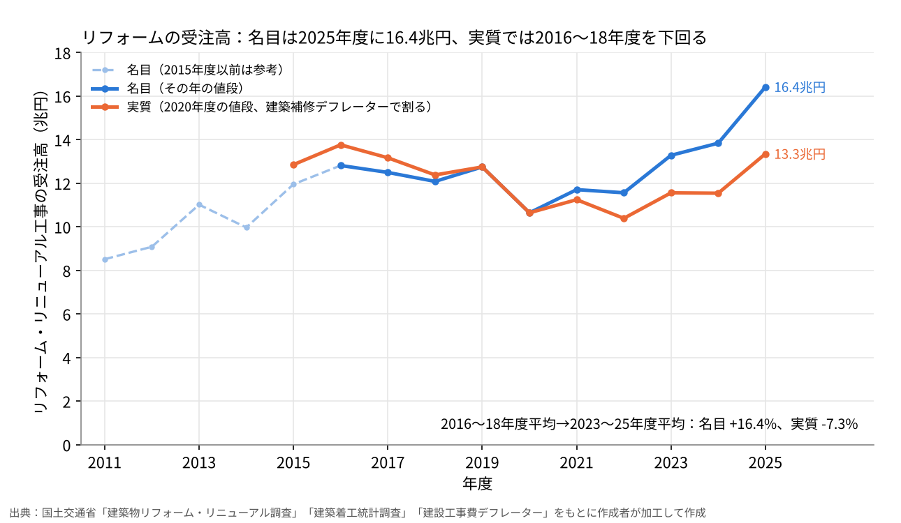
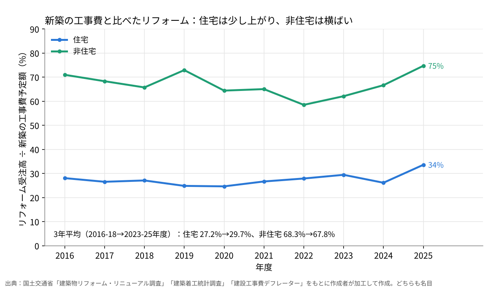
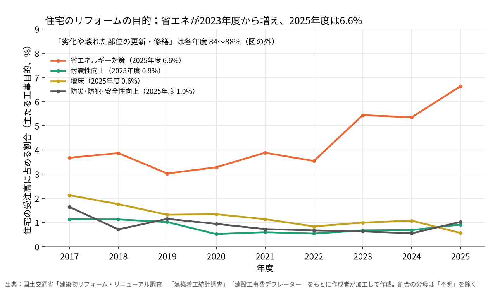
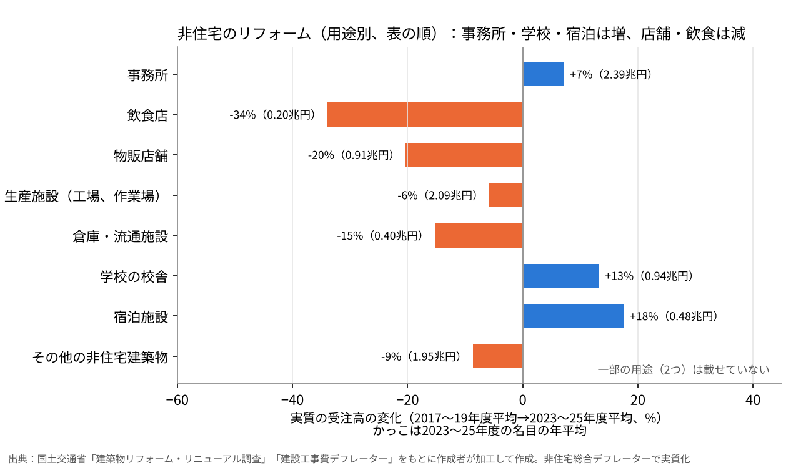

# F391 建物のリフォームの工事は、伸びているのか？ 受注高は名目で16%増えたが、工事の値段の上がりを除くと7%減っていた

## 結論（先に）

- 建設業者が受注したリフォーム・リニューアル工事は、2025年度に16.4兆円で、2016年度からの調査で最も大きくなりました。2016〜18年度平均と2023〜25年度平均を比べると、名目（その年の値段）で+16.4%です。
- ところが、同じ期間に建築補修の工事の値段（建設工事費デフレーター）が+25.3%上がっています。値段の上がりを除いた実質では −7.3% で、2016〜18年度の水準を下回りました。
- 新築の工事費（建築着工統計の工事費予定額）と比べると、住宅のリフォームは新築の27.2%→29.7%と少し上がりましたが、非住宅は68.3%→67.8%で横ばいでした。「新築からリフォームへ移った」とまでは言えません。
- 住宅のリフォームの目的は、どの年度も「劣化や壊れた部位の更新・修繕」が84〜88%を占めます。省エネルギー対策は3.5%（2017〜19年度平均）から5.8%（2023〜25年度平均）に増え、2025年度は6.6%でした。
- 問い直しとして非住宅の用途別に見ると、実質で増えたのは事務所（+7%）・学校の校舎（+13%）・宿泊施設（+18%）で、飲食店（−34%）・物販店舗（−20%）・倉庫（−15%）は減りました。

## 問い

新築の住宅が減るなかで、「これからはリフォーム（改装・改修）の時代」とよく言われます。建設・住宅設備・建材の仕事では、リフォームの市場が本当に大きくなっているのか、何のための工事が増えているのかが、計画の前提になります。

国土交通省の「建築物リフォーム・リニューアル調査」は、建設業者が受注したリフォーム工事の金額を年度ごとに出しています。この受注高を、(1) 工事の値段の上がりを除いても伸びているのか、(2) 新築の工事費と比べて大きくなっているのか、(3) どんな目的の工事が伸びたのか、の3つで見ました。

既存の看板記事（F326 は新築の床面積、F328 は古い耐震基準の住宅の数）に、リフォームの受注を扱ったものはありません。

## データ（出典）

- 国土交通省「建築物リフォーム・リニューアル調査」年度計の公表資料（2016〜2025年度、10ファイル）。表1-1（受注高の推移、住宅・非住宅）、表2-3-3（用途×主たる工事目的別の受注高）。各年度の受注高は、その年度を含む最も新しい公表資料の値を使いました（2016年度は、2018年度の公表資料で外れ値の処理をした後の値）。
- 国土交通省「建築着工統計調査」構造別・用途別・都道府県別（年度）の工事費予定額。住宅は都道府県ごとの「住宅計」の合計、非住宅は全国計−住宅としました。
- 国土交通省「建設工事費デフレーター（2020年度基準）」年度別。主に「建築補修」、頑健性で「住宅総合」「非住宅総合」。2024・2025年度は暫定値です。
- 12ファイル（約12MB、うち着工統計が9.5MB）を `data/raw/` に同梱しています。URL と取得日は `data/raw/SOURCES.md` にあります。

## 事前の計画

計画は [PLAN.md](PLAN.md)（2026-11-16、年度ごとの集計の前に作成）です。表の形を確かめるときに、2023〜25年度の名目の受注高と、2016・2025年度の省エネの額を見ていたので、計画にそう書いています。

| 仮説 | 外れの基準 | 結果 | 判定 |
|---|---|---|---|
| H1 実質の受注高は2016-18→2023-25年度平均で10%以上増える | 10%未満 | −7.3% | **外れ** |
| H2 新築との比は住宅・非住宅とも上がる | どちらかが下がれば外れ | 住宅 27.2%→29.7%、非住宅 68.3%→67.8% | **外れ**（非住宅が横ばい〜わずかに低下） |
| H3 住宅の省エネ目的の割合は1ポイント以上上がる | 1ポイント未満 | +2.3ポイント | 支持（端の年の額を見たうえでの仮説） |
| H4 住宅の劣化・修繕の割合はどの年度も70%以上 | 70%を下回る年度がある | 最も低い年度で83.4% | 支持 |

## やったこと

1. 各年度の受注高（計・住宅・非住宅）を、建築補修デフレーター（2020年度=100）で割って実質にしました。
2. リフォームの受注高を、同じ年度の新築の工事費予定額で割りました（どちらも名目）。
3. 主たる工事目的の割合を、「不明」を除いた合計で割って出しました。2016年度の表2-3-3は外れ値の処理の前の値で、「不明」も1割あるため、目的の比較は2017〜19年度平均と2023〜25年度平均で行いました（計画からの変更）。

## 分かったこと

### 図1 名目は過去最高、実質では2016〜18年度を下回る



- 名目の受注高は、2016年度12.8兆円、2019年度12.7兆円、2020年度10.6兆円、2023年度13.3兆円、2024年度13.8兆円、2025年度16.4兆円でした。
- 実質（2020年度の値段）は、2016年度13.8兆円から2022年度10.4兆円まで下がり、2025年度に13.3兆円まで戻りました。
- 2016〜18年度平均→2023〜25年度平均で、名目+16.4%、実質−7.3%（住宅−10.9%、非住宅−5.6%）です。建築補修の工事の値段は+25.3%でした。
- 2015年度以前の値（点線）は2016〜17年度の公表資料に載っている参考の値です。

### 図2 新築の工事費と比べると、住宅は少し上がり、非住宅は横ばい



- 住宅のリフォームは新築の工事費予定額の24.6〜33.6%で、3年平均では27.2%→29.7%と少し上がりました。2025年度の33.6%が大きく効いています。
- 非住宅は58.5〜74.7%の間を動き、3年平均は68.3%→67.8%でした。非住宅の新築の工事費も名目で+19.3%増えていて、リフォームの伸び（+18.6%）とほぼ同じです。

### 図3 住宅のリフォームの目的は、ほとんどが劣化の修繕。省エネが増えた



- 「劣化や壊れた部位の更新・修繕」は、2017〜19年度平均85.7%、2023〜25年度平均86.9%でした。
- 省エネルギー対策は3.5%→5.8%で、2023年度に5.4%に上がってからは5%台以上です。額は2019・2020年度の約1,050億円から、2025年度の3,252億円になりました。
- 増床（1.7%→0.9%）や耐震性の向上（1.1%→0.8%）は下がりました。
- 非住宅でも劣化・修繕が66.7%→74.4%に上がり、省エネは4.9%→5.2%とほぼ同じでした。

## 問い直し（結果を見てから足した）

非住宅の実質の受注高は−5.6%でしたが、用途でばらつきがありそうなので、表2-3-3の用途別の受注高を非住宅総合デフレーターで実質にして、2017〜19年度平均と2023〜25年度平均を比べました。この記事で扱わない分野の施設（2つの用途）は図と本文から除きました（合計には入っています）。



- 実質で増えたのは、事務所+7%（2023〜25年度の名目の年平均2.39兆円）、学校の校舎+13%（0.94兆円）、宿泊施設+18%（0.48兆円）でした。
- 減ったのは、飲食店−34%（0.20兆円）、物販店舗−20%（0.91兆円）、倉庫・流通施設−15%（0.40兆円）、生産施設−6%（2.09兆円）、その他−9%（1.95兆円）でした。
- 用途別の合計（全用途）では−4.0%です。

## 頑健性

| 確かめ | 実質の受注高の変化 | 新築との比（住宅） | 新築との比（非住宅） | 住宅の省エネの割合の変化 |
|---|---|---|---|---|
| 0 主（建築補修デフレーター、2016-18→2023-25年度、目的は2017-19→2023-25年度） | −7.3% | 27.2%→29.7% | 68.3%→67.8% | +2.29ポイント |
| 1 デフレーターを住宅総合・非住宅総合に替える | −6.5% | 同じ | 同じ | — |
| 2 単年（2016→2025年度、目的は2017→2025年度） | −3.0% | 28.0%→33.6% | 70.9%→74.7% | +2.96ポイント |
| 3a 2020年度を除く（2016-19 と 2023-25 年度） | −6.6% | 26.6%→29.7% | 69.5%→67.8% | — |
| 3b 2025年度を除く（2016-18 と 2022-24 年度） | −14.8% | 27.2%→27.8% | 68.3%→62.4% | +1.25ポイント |
| 4 目的の割合の分母に不明を入れる | — | — | — | +2.34ポイント |
| 4b 目的の早い期間に2016年度を入れる | — | — | — | +1.83ポイント |

実質で減ったことは、どの確かめでも変わりませんでした。非住宅の新築との比は、単年（2016→2025年度）では上がりますが、3年平均や2025年度を除くと横ばいか下がります。2025年度の大きな伸びが続くかどうかで、この比の見え方は変わります。省エネの割合の上がりは、どの確かめでも1ポイント以上でした。

## 言えないこと

- 受注した額で、工事が終わった額ではありません。標本調査で、年度ごとの誤差があります。2016年度の値は、のちの外れ値の処理で約15.7兆円から12.8兆円に直されていて、値が大きく直されることがあります。
- 新築の工事費予定額は建築確認の届け出の予定額で、受注高とは集め方が違います。新築との比は目安です。
- デフレーターは建築工事の値段の指数で、リフォームの値段そのものではありません。2024・2025年度は暫定値です。
- 受注高が伸びた理由（補助金、資材の値上がり、人手不足、訪日客の増加など）は、このデータでは分かりません。理由はすべて推測になります。
- 工事目的は「主たる目的」を1つ選ぶ答え方で、省エネを兼ねた修繕などは修繕に入ります。

## 仕事で使うなら

- リフォームの市場の大きさを年度で比べるときは、名目の受注高と、建築補修デフレーターで割った実質の値を並べると、値段の上がりと工事の量の違いを分けて読めます。
- 新築との比は年度の振れが大きいので、3年平均などで読むと、1年の大きな伸びに引っ張られにくくなります。

## 計画からの変更

- 工事目的の比較の早い期間を、計画の2016〜18年度から2017〜19年度に変えました。2016年度の表2-3-3が外れ値の処理の前の値で、「不明」が1割あったためです。2016年度を入れた場合は頑健性4bに載せました（結論は同じ）。
- 問い直しの用途別の図から、この記事で扱わない分野の施設（2つの用途）を除きました。
- 図1に2015年度以前の参考の値を点線で加えました。

## 再現のしかた

```sh
pip install -r requirements.txt
python3 src/01_fetch.py   # 取得（ネットが必要。data/raw に同梱済みなので通常は不要）
sh src/run_all.sh         # 02 → 03 → 04（オフライン）
```

| ファイル | 中身 |
|---|---|
| src/01_fetch.py | 元データの取得（e-Stat、12ファイル） |
| src/02_build.py | data/reform_total.csv・reform_purpose.csv・reform_nonres_use.csv・starts.csv・deflator.csv を作る |
| src/03_analysis.py | 実質化、新築との比、目的の割合、頑健性、問い直し。results/ に出力 |
| src/04_figures.py | figures/ の4枚 |
| results/main.json | 本文の数字のもと |
| results/annual_table.csv・purpose_shares.csv | 年度の表 |
| results/robustness.csv | 頑健性 |
| results/requestion_nonres_use.csv | 問い直し |

所要時間は約7秒（CPU 1つ）。`results/repro_check.txt` に、/tmp に写して流し直し、14ファイルがバイト単位で一致した結果を書いています。

## レビューで直したこと

| # | 指摘 | 直し方 |
|---|---|---|
| 1 | 問い直しの説明と図4の注記で、除いた用途として医療・福祉の施設の名前を出していた（扱わない話題に触れる書き方） | 「この記事で扱わない分野の施設（2つの用途）」「一部の用途（2つ）は載せていない」に直した（README・note・src/04_figures.py、図4を作り直し）。合計に入っていることは変わらない |

直したあとに /tmp で流し直し、results と figures の 9 ファイルが一致することを確かめました（results/repro_check.txt）。

## 出典

- 国土交通省「建築物リフォーム・リニューアル調査」 https://www.e-stat.go.jp/stat-search/files?toukei=00600900&tstat=000001031111
- 国土交通省「建築着工統計調査」 https://www.e-stat.go.jp/stat-search/files?toukei=00600120&tstat=000001016965
- 国土交通省「建設工事費デフレーター」 https://www.e-stat.go.jp/stat-search/files?toukei=00600270&tstat=000001013583

（いずれも 国土交通省「建築物リフォーム・リニューアル調査」「建築着工統計調査」「建設工事費デフレーター」 をもとに作成者が加工して作成）
