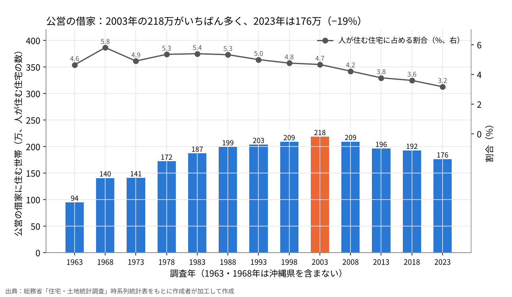
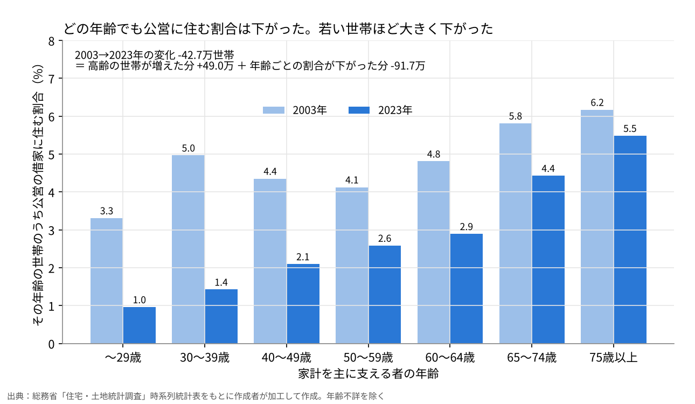
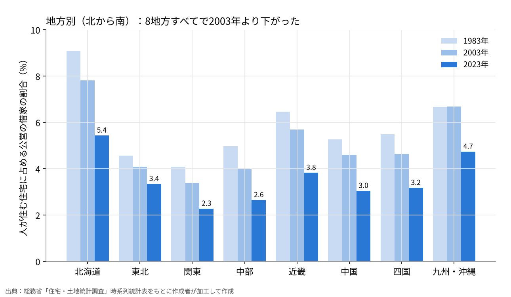
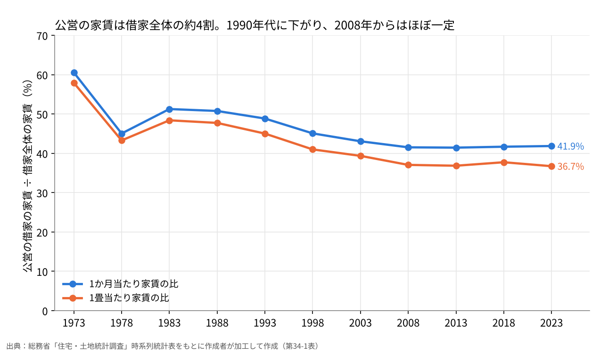

# F392 公営住宅に住む世帯は、どれだけ減ったのか？ 2003年の218万から2023年の176万へ19%減。どの年齢でも住む割合が下がり、高齢の世帯が増えた分を打ち消した

## 結論（先に）

- 住宅・土地統計調査で、公営の借家（都道府県や市町村が持つ賃貸住宅）に住む世帯は、2003年の218.3万が最も多く、2023年は176.0万でした（−19.4%）。人が住む住宅に占める割合は4.7%から3.2%に下がりました。
- 8地方（北から南）のすべてで、公営の割合は2003年より2023年が低くなりました。47都道府県では46で下がりました。
- 年齢別に見ると、その年齢の世帯のうち公営に住む割合は、すべての年齢で下がりました。29歳以下は3.3%→1.0%、30代は5.0%→1.4%と、若い世帯ほど大きく下がっています。
- 高齢の世帯が増えたことだけなら公営に住む世帯は+49.0万増えるはずでしたが、年齢ごとの割合が下がった分（−91.7万）がそれを上回り、差し引きで−42.7万になりました（年齢不詳を除く）。
- 公営に住む世帯のうち65歳以上の世帯の割合は、2003年の21.8%から2023年の43.8%になりました（全世帯では17.2%→27.9%）。

## 問い

都道府県や市町村が持つ公営住宅は、新しく建てる数が少なく、古い団地の建て替えや取り壊しが進んでいるといわれます。住宅や不動産、団地のある地域の仕事をしている人にとっては、公営住宅に住む世帯がどれだけ減ったのか、どんな年齢の世帯が住んでいるのかが、地域の借家の形を考える前提になります。

この記事では、総務省「住宅・土地統計調査」の時系列の表で、公営の借家に住む世帯の数・割合・年齢・地方別の変化を見ました。住む世帯の収入や暮らしぶりは扱いません。

既存の看板記事（F327 若い世代の持ち家率、F311 家賃、F322 ひとり暮らし）に、公営の借家を扱ったものはありません。

## データ（出典）

- 総務省「住宅・土地統計調査」令和5年の時系列統計表。
  - 第9-1表 住宅の所有の関係（5区分）別住宅数、全国、1963〜2023年（1963・1968年は沖縄県を含まない）
  - 第10表 所有の関係×建て方別住宅数、全国・都道府県、1983〜2023年
  - 第21-1表 所有の関係×家計を主に支える者の年齢別の主世帯数、全国、1968〜2023年
  - 第34-1表 所有の関係別の1か月当たり家賃・1畳当たり家賃、全国、1973〜2023年
- 4ファイル（約0.3MB）を `data/raw/` に同梱しています。URL と取得日は `data/raw/SOURCES.md` にあります。
- 住宅数は人が住んでいる住宅の数で、空き家は入りません。公営住宅の管理戸数とは違います。

## 事前の計画

計画は [PLAN.md](PLAN.md)（2026-11-16、比や分解の計算の前に作成）です。表の形を確かめるときに全国の公営の借家の数と年齢別の世帯数を見ていたので、計画にそう書いています。

| 仮説 | 外れの基準 | 結果 | 判定 |
|---|---|---|---|
| H1 2023年は2003年より15%以上少ない | 15%未満 | −19.4% | 支持（見たうえでの仮説） |
| H2 公営の割合は8地方すべてで下がる | 1つでも上がれば外れ | 8地方すべてで低下 | 支持 |
| H3 65歳未満のすべての年齢区分で、公営に住む割合は2003年より低い | 1つでも高ければ外れ | 5区分すべてで低下 | 支持 |
| H4 減少は、年齢ごとの割合の低下の分が年齢構成の分より大きい | 年齢構成の分が大きければ外れ | −91.7万 対 +49.0万 | 支持 |

## やったこと

1. 全国の公営の借家の数と、人が住む住宅に占める割合を1963〜2023年で並べました。
2. 第10表の都道府県の値を8地方にまとめ、1983・2003・2023年の割合を比べました。
3. 年齢別に「その年齢の世帯のうち公営に住む割合」を出し、2003→2023年の変化を、年齢の世帯数が変わった分（割合は2003年のまま）と、割合が変わった分（2023年の世帯数で重みづけ）に分けました。年齢は 〜29、30〜39、40〜49、50〜59、60〜64、65〜74、75歳以上 の7区分です。

## 分かったこと

### 図1 2003年が山、2023年は176万



- 公営の借家は、1963年94.4万、1983年186.8万、2003年218.3万、2013年195.9万、2018年192.2万、2023年176.0万でした。
- 人が住む住宅に占める割合は、1980年代の5.3〜5.4%から2023年の3.2%に下がりました。借家の中の割合も、2003年12.7%から2023年9.0%です。
- 2018→2023年の5年だけで−8.4%で、減り方はこの5年で速くなっています。

### 図2 どの年齢でも公営に住む割合が下がった



- 2003→2023年に、29歳以下3.3%→1.0%、30代5.0%→1.4%、40代4.4%→2.1%、50代4.1%→2.6%、60〜64歳4.8%→2.9%、65〜74歳5.8%→4.4%、75歳以上6.2%→5.5%でした。
- 公営に住む世帯の数は、75歳以上だけが25.2万から60.1万に増え、ほかの年齢はすべて減りました。
- 高齢の世帯は全体で大きく増えたので、割合が2003年のままなら公営の世帯は+49.0万増えたはずです。実際は割合が下がった分が−91.7万で、差し引き−42.7万でした。
- 公営に住む世帯のうち65歳以上の割合は、1983年8.9%、2003年21.8%、2023年43.8%です。全世帯（9.2%、17.2%、27.9%）より速く上がりました。

### 図3 8地方すべてで下がった



- 2003→2023年に、北海道7.8%→5.4%、東北4.1%→3.4%、関東3.4%→2.3%、中部4.0%→2.6%、近畿5.7%→3.8%、中国4.6%→3.0%、四国4.6%→3.2%、九州・沖縄6.7%→4.7%でした。
- 数の減り方は、東北（−12.1%）と関東（−13.6%）が小さく、中国（−27.0%）・四国（−27.9%）・北海道（−25.2%）が大きくなりました。
- 北海道・近畿・九州・沖縄で割合が高い形は、1983年から変わっていません。

## 問い直し（結果を見てから足した）

若い世帯ほど公営に住む割合が大きく下がったので、「公営の家賃と借家全体の家賃の差は、広がったのか」を足しました（第34-1表）。



- 公営の借家の1か月当たり家賃は、借家全体の家賃の60.5%（1973年）、48.8%（1993年）、43.1%（2003年）、41.9%（2023年）でした。
- 1畳当たりでは、45.0%（1993年）→39.4%（2003年）→36.7%（2023年）です。
- 1990年代から2000年代はじめに差が広がり、2008年からはほぼ一定でした。若い世帯の割合が下がった2003〜2023年に、家賃の差が大きく変わったわけではありません。

## 頑健性

| 確かめ | 公営の変化 | 割合が下がった地方 | 年齢構成の分 | 割合の変化の分 | 結論 |
|---|---|---|---|---|---|
| 0 主（2003→2023年） | −19.4% | 8／8 | +49.0万 | −91.7万 | — |
| 1a 期間 1993→2023年 | −13.4% | 8／8 | +43.3万 | −96.7万 | 変わらない |
| 1b 期間 2013→2023年 | −10.1% | 8／8 | +21.6万 | −35.2万 | 変わらない |
| 2 分母を借家の総数に（2003→2023年） | 12.7%→9.0%（−3.7ポイント） | 8／8 | — | — | 変わらない |
| 3 分解の年齢区分を細かく（5歳刻み、75歳以上はまとめる） | — | — | +49.3万 | −92.0万 | 変わらない |
| 4 都道府県で数える | — | 46／47 都道府県で低下 | — | — | 変わらない |

どの確かめでも、割合はすべての地方で下がり、減少は年齢ごとの割合の低下によるものでした。

## 言えないこと

- 人が住んでいる公営の借家の数で、公営住宅の管理戸数や空き住戸の数ではありません。空き住戸が増えたのか、建物自体が減ったのかは区別できません。
- 入居の条件・募集・建て替えや取り壊しの計画など、減った理由はこのデータでは分かりません。理由についての話はすべて推測になります。
- 住む世帯の収入や暮らしの様子は扱っていません。
- 標本調査の推計値で、小さい県の値は誤差が大きくなります。都道府県の値は地方の合計として使い、県の順位は作っていません。
- 年齢別の表には年齢不詳の世帯があり、分解の合計（−42.7万）は全体の減少（−42.2万）と少し違います。

## 仕事で使うなら

- 公営の借家の数を地域で比べるときは、数だけでなく、人が住む住宅に占める割合や、年齢別の割合と並べると、高齢化の影響と住み方の変化を分けて読めます。
- 「高齢の世帯が増えたから公営も増える」という見方は、年齢ごとの割合が変わらない場合の話です。分解して並べると、前提の違いが見えやすくなります。
- 公営と借家全体の家賃の比は2008年から4割前後で安定しているので、地域の家賃の比較に使う目安になります。

## 計画からの変更

- 計画どおりに計算しました。図の題名は結果を見てから決めました。

## 再現のしかた

```sh
pip install -r requirements.txt
python3 src/01_fetch.py   # 取得（ネットが必要。data/raw に同梱済みなので通常は不要）
sh src/run_all.sh         # 02 → 03 → 04（オフライン）
```

| ファイル | 中身 |
|---|---|
| src/01_fetch.py | 元データの取得（e-Stat、4ファイル） |
| src/02_build.py | data/tenure_japan.csv・tenure_pref.csv・tenure_age.csv・rent.csv を作る |
| src/03_analysis.py | 推移、地方別、年齢別の割合と分解、頑健性、問い直し。results/ に出力 |
| src/04_figures.py | figures/ の4枚 |
| results/main.json | 本文の数字のもと |
| results/japan_trend.csv・region_trend.csv・age_rates.csv | 表 |
| results/robustness.csv・requestion_rent.csv | 頑健性・問い直し |

所要時間は約2秒（CPU 1つ）。`results/repro_check.txt` に、/tmp に写して流し直し、14ファイルがバイト単位で一致した結果を書いています。

## レビューで直したこと

独立レビューで数字の照合・再実行・図を確かめ、直すところはなかった。

## 出典

- 総務省統計局「住宅・土地統計調査」 https://www.stat.go.jp/data/jyutaku/index.html
- 令和5年 時系列統計表 https://www.e-stat.go.jp/stat-search/files?toukei=00200522&tstat=000001207800

（いずれも 総務省「住宅・土地統計調査」 をもとに作成者が加工して作成）
