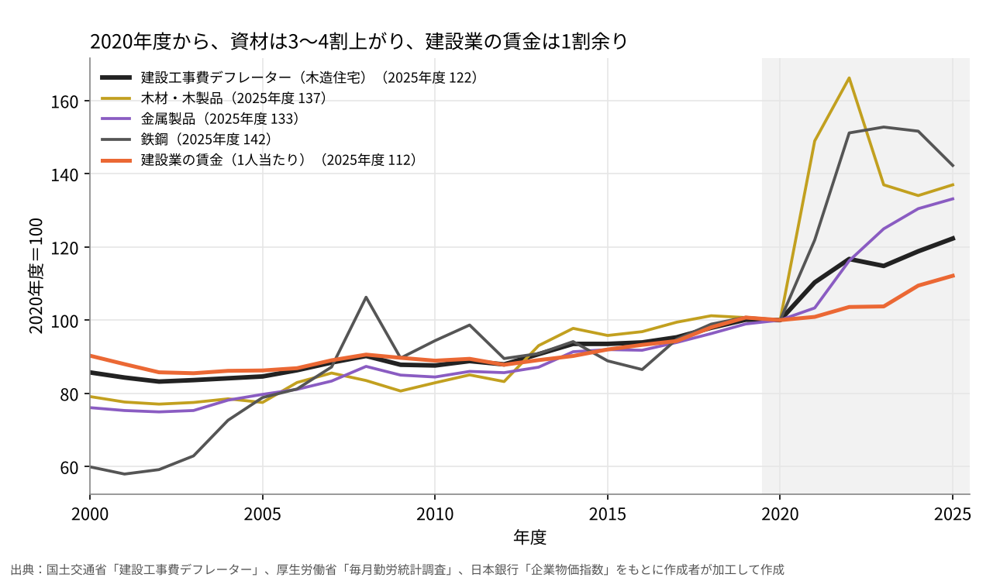
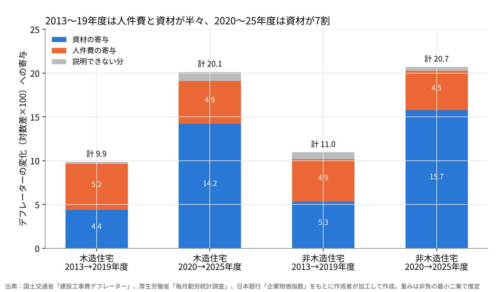
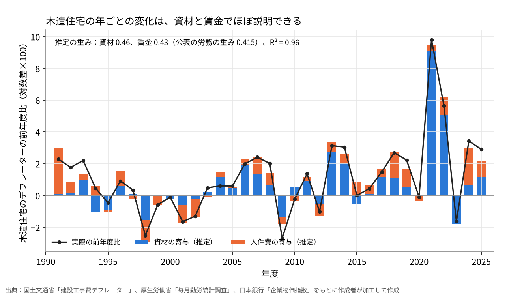
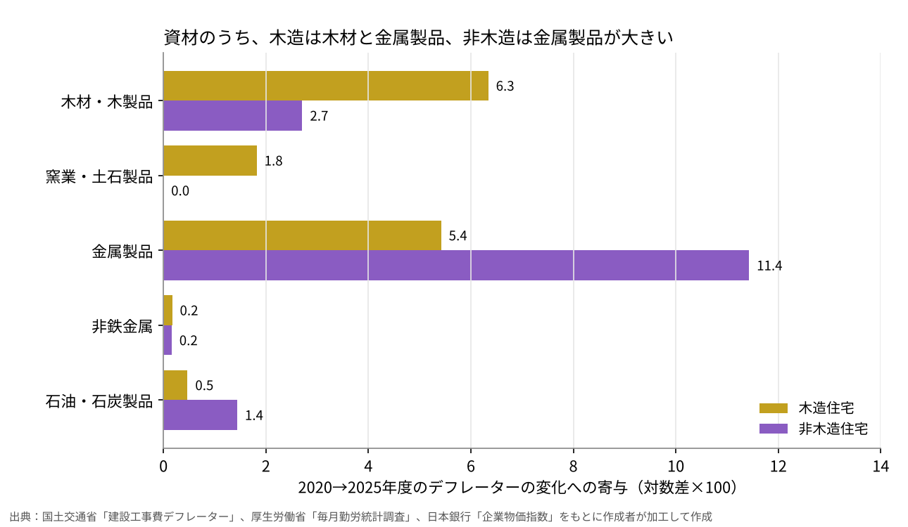

# F393 住宅の建設費は、資材と人件費のどちらで上がったのか？ 2020→2025年度の木造住宅の上がり20.1のうち資材14.2、人件費4.9。2013〜19年度は人件費5.2、資材4.4だった

## 結論（先に）

- 国土交通省の建設工事費デフレーター（工事の値段の指数）で、木造住宅は2020年度から2025年度に22.3%上がりました。資材の値段（企業物価指数の類別）と建設業の賃金（毎月勤労統計）で分けると、対数差で20.1のうち資材の寄与が14.2（約7割）、人件費の寄与が4.9でした。
- コロナの前の2013→2019年度は、9.9のうち人件費が5.2、資材が4.4で、人件費のほうが少し大きくなっていました。最近の上がりは、それまでとは中身が違います。
- 非木造住宅も同じで、2020→2025年度の20.7のうち資材が15.7、人件費が4.5でした。資材のうち、木造住宅は木材・木製品（6.3）と金属製品（5.4）、非木造住宅は金属製品（11.4）が大きく効いています。
- 重みは「デフレーターの毎年の変化を、資材と賃金の変化の重み付きの和で表す」として推定しました（非負の最小二乗）。木造住宅の賃金の重みは0.43で、国交省が公表しているウエイト表の労務の重み（0.415）とほぼ同じでした。年ごとの変化の96%を説明しています。
- 賃金を1時間当たりにする、推定期間を2000年度からにする、労務の重みを公表値に固定する、のどれでも、「2020〜25年度は資材が主」は変わりませんでした。

## 問い

住宅の建設費は2021年ごろから大きく上がりました。「ウッドショック」や鋼材の値上がりなど資材の話と、職人の不足による人件費の話の両方がよく言われます。住宅・建設・建材の仕事では、どちらが主なのかで、この先の見通しの立て方が変わります。

そこで、国土交通省の建設工事費デフレーターの毎年の変化を、日本銀行の企業物価指数（資材の値段）と、厚生労働省の毎月勤労統計（建設業の賃金）で説明し、期間ごとに資材と人件費の寄与に分けました。値段の見通しや、価格の決め方の助言はしません。

既存の看板記事に、建設費を資材と人件費に分けたものはありません（F391 はリフォームの受注をデフレーターで実質化、F309 は外食の値上がり）。

## データ（出典）

- 国土交通省「建設工事費デフレーター（2020年度基準）」年度別：木造住宅、非木造住宅、住宅総合、非住宅総合（1980〜2025年度。2024・2025年度は暫定値）。
- 国土交通省「建設工事費デフレーター（平成23年度基準）」表-3 個別デフレーターウエイト表：賃金・俸給＋社会保険料の重み（労務の重み）。木造住宅0.415、RC住宅0.373、S住宅0.324 など。
- 厚生労働省「毎月勤労統計調査」実数・指数累積データ：建設業の現金給与総額指数・総実労働時間指数（5人以上、就業形態計、2020年=100）。四半期の値から年度（4〜翌3月）にしました（1990年度〜）。
- 日本銀行「企業物価指数（2020年基準）」国内企業物価指数の類別：木材・木製品、窯業・土石製品、鉄鋼、金属製品、非鉄金属、石油・石炭製品、プラスチック製品（月次を年度の平均に）。
- 5ファイル（約1.7MB）を `data/raw/` に同梱しています。URL と取得日は `data/raw/SOURCES.md` にあります。

## 事前の計画

計画は [PLAN.md](PLAN.md)（2026-11-16、回帰や寄与の計算の前に作成）です。表の形を確かめるときに、デフレーターの2021〜25年度の値、建設業の賃金指数の一部、木造住宅の労務の重みを見ていたので、計画にそう書いています。

| 仮説 | 外れの基準 | 結果 | 判定 |
|---|---|---|---|
| H1 木造住宅の2020→2025年度は資材の寄与が人件費より大きい | 人件費が同じか大きい | 資材14.2、人件費4.9 | 支持 |
| H2 木造住宅の2013→2019年度は人件費の寄与が資材より大きい | 資材が同じか大きい | 人件費5.2、資材4.4 | 支持（差は小さい） |
| H3 推定した賃金の重みは公表の労務の重み±15ポイント以内 | 外に出る | 0.426（公表0.415） | 支持 |
| H4 非木造住宅でも2020→2025年度は資材が大きい | 人件費が同じか大きい | 資材15.7、人件費4.5 | 支持 |

## やったこと

1. すべての指数を年度にそろえ、対数の差（前年度比）を取りました。
2. デフレーターの前年度比 ＝ Σ（重み × 資材の類別の前年度比）＋ 重み × 賃金の前年度比 として、1991〜2025年度（35年分）で重みを推定しました。重みは0以上、切片はなしです（非負の最小二乗）。重みの和（木造住宅0.89）が1に足りない分は、運送・機械の賃貸など、ここで扱わない費目とみなします。
3. 期間の対数の変化に重みを掛けて、資材と人件費の寄与に分けました。実際の変化との差を「説明できない分」としました。

## 分かったこと

### 図1 2020年度から、資材は3〜4割上がり、賃金は1割余り



- 2020→2025年度に、木材・木製品+37.0%、鉄鋼+42.3%、金属製品+33.1%、窯業・土石製品+39.3%上がりました。
- 建設業の賃金（1人当たり）は+12.1%、1時間当たりでは+15.6%でした（労働時間が−3.0%）。
- 木造住宅のデフレーターは+22.3%で、資材と賃金の間にあります。
- 2013→2019年度は、賃金+13.1%に対し、木材+8.2%、金属製品+13.5%と、資材と賃金の上がり方は近いものでした。

### 図2 2013〜19年度は半々、2020〜25年度は資材が7割



- 木造住宅：2013→2019年度は9.9のうち資材4.4・人件費5.2・説明できない分0.2、2020→2025年度は20.1のうち資材14.2・人件費4.9・説明できない分1.0でした。
- 非木造住宅：2013→2019年度は11.0のうち資材5.3・人件費4.9、2020→2025年度は20.7のうち資材15.7・人件費4.5でした。
- 人件費の寄与の大きさ（4.5〜5.2）は2つの期間でほぼ同じで、違いは資材の寄与の大きさです。

### 図4 年ごとの変化は、資材と賃金でほぼ説明できる



- 木造住宅の推定の重みは、木材・木製品0.20、金属製品0.19、窯業・土石製品0.06、石油・石炭製品0.01、賃金0.43でした。年ごとの前年度比の当てはまり（R²）は0.96です。
- 2021年度の+9.8、2022年度の+5.6は、ほとんどが資材の寄与でした。2024年度は、人件費の寄与（2.3）が資材（0.7）より大きくなりました。
- 推定した賃金の重み0.43は、国交省のウエイト表の労務の重み0.415とほぼ同じでした。データから推定した重みが、デフレーターの作り方と合っていることになります。

## 問い直し（結果を見てから足した）

2020〜25年度は資材が主だったので、「資材のうち、どれが効いたのか」を足しました。



- 木造住宅では、木材・木製品6.3、金属製品5.4、窯業・土石製品1.8でした。
- 非木造住宅では、金属製品11.4、木材・木製品2.7、石油・石炭製品1.4でした。
- 鉄鋼の重みは0と推定されました。鉄鋼と金属製品の値段は一緒に動くので、鉄鋼の分は金属製品の重みに入っていると考えられます（推測）。

## 頑健性

木造住宅について。

| 確かめ | 賃金の重み | 資材の重みの和 | R² | 2020→25 資材 | 2020→25 人件費 | 2013→19 資材 | 2013→19 人件費 |
|---|---|---|---|---|---|---|---|
| 0 主（1991〜2025年度、1人当たり賃金） | 0.43 | 0.46 | 0.96 | 14.2 | 4.9 | 4.4 | 5.2 |
| 1 賃金を1時間当たりに | 0.37 | 0.45 | 0.96 | 14.1 | 5.3 | 4.1 | 5.3 |
| 2 推定期間を2000〜2025年度に | 0.48 | 0.46 | 0.98 | 14.2 | 5.4 | 4.0 | 5.8 |
| 3 労務の重みを公表値（0.415）に固定 | 0.415 | 0.46 | 0.96 | 14.3 | 4.8 | 4.5 | 5.1 |
| 4 資材の指数を半年前にずらす | 0.56 | 0.20 | 0.67 | 7.9 | 6.4 | 1.9 | 6.9 |

1〜3では結論は変わりませんでした。4（資材の値段を半年前の期間で年度にする）は当てはまりが大きく落ち（R² 0.67）、資材の値段はほぼ同じ年度のうちにデフレーターに入っていることが分かります。それでも2020〜25年度は資材の寄与が人件費より大きいままでした。

## 言えないこと

- デフレーターは国交省が資材や賃金などの指数から作る「値段の指数」で、実際の請負価格そのものではありません。この分解は、デフレーターの作り方をなぞっている面があります。
- 毎月勤労統計の建設業の賃金は、事業所に雇われている人の平均の給与で、職人の日当（労務単価）や一人親方の手取りとは違います。
- 資材の類別どうしが一緒に動くと、重みの分け方は不安定になります（鉄鋼が0、金属製品が大きいなど）。資材の合計と人件費の分け方は安定していましたが、類別ごとの値は目安です。
- 2024・2025年度のデフレーターは暫定値で、改定されることがあります。
- 利益の上乗せ、下請けの構造、工期の変化などは扱えません。値段がこの先どうなるかも、このデータからは言えません。

## 仕事で使うなら

- 工事の値段の上がりを見るときに、資材の類別の指数と建設業の賃金の指数を同じ年度で並べると、どちらが動いているかを早く確かめられます。
- 資材と人件費の寄与は期間で大きく違うので、比べる期間をはっきり書いておくと、話がかみ合いやすくなります。
- 推定した重みを公表のウエイト表と比べると、分け方の当たり外れの目安になります。

## 計画からの変更

- 問い直しは計画の候補（時差の相関）ではなく、「資材のうちどれが効いたか」にしました。資材が主という結果を見て、中身のほうが知りたい人に役立つと考えたためです。時差は頑健性4で一部を確かめています。

## 再現のしかた

```sh
pip install -r requirements.txt
python3 src/01_fetch.py   # 取得（ネットが必要。data/raw に同梱済みなので通常は不要）
sh src/run_all.sh         # 02 → 03 → 04（オフライン）
```

| ファイル | 中身 |
|---|---|
| src/01_fetch.py | 元データの取得（e-Stat・国交省・日本銀行） |
| src/02_build.py | data/fy_panel.csv（年度のパネル）と data/labor_weights.csv を作る |
| src/03_analysis.py | 重みの推定、寄与、頑健性、問い直し。results/ に出力 |
| src/04_figures.py | figures/ の4枚 |
| results/main.json | 本文の数字のもと |
| results/weights.csv・contributions.csv・fit_wood_house.csv | 重み・寄与・当てはまり |
| results/robustness.csv | 頑健性 |

所要時間は約3秒（CPU 1つ）。`results/repro_check.txt` に、/tmp に写して流し直し、12ファイルがバイト単位で一致した結果を書いています。

## レビューで直したこと

独立レビューで数字の照合・再実行・図を確かめ、直すところはなかった。

## 出典

- 国土交通省「建設工事費デフレーター」 https://www.e-stat.go.jp/stat-search/files?toukei=00600270&tstat=000001013583 、ウエイト表 https://www.mlit.go.jp/sogoseisaku/jouhouka/sosei_jouhouka_tk4_000035.html
- 厚生労働省「毎月勤労統計調査」 https://www.e-stat.go.jp/stat-search/files?toukei=00450071&tstat=000001011791
- 日本銀行「企業物価指数」 https://www.stat-search.boj.or.jp/

（いずれも 国土交通省「建設工事費デフレーター」、厚生労働省「毎月勤労統計調査」、日本銀行「企業物価指数」 をもとに作成者が加工して作成）
