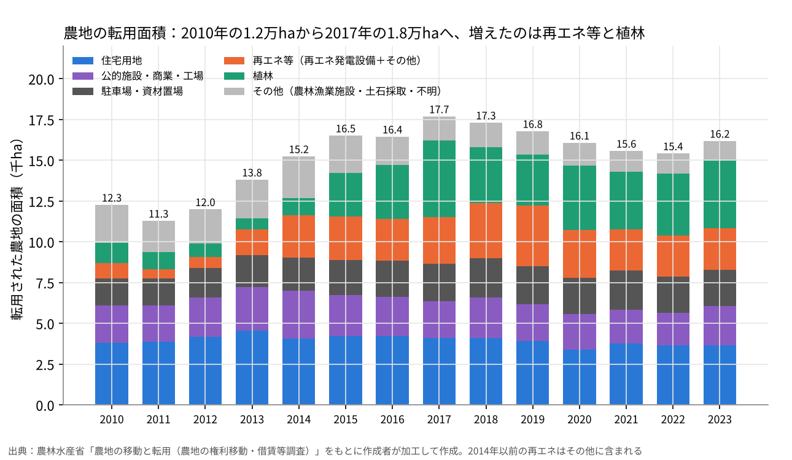
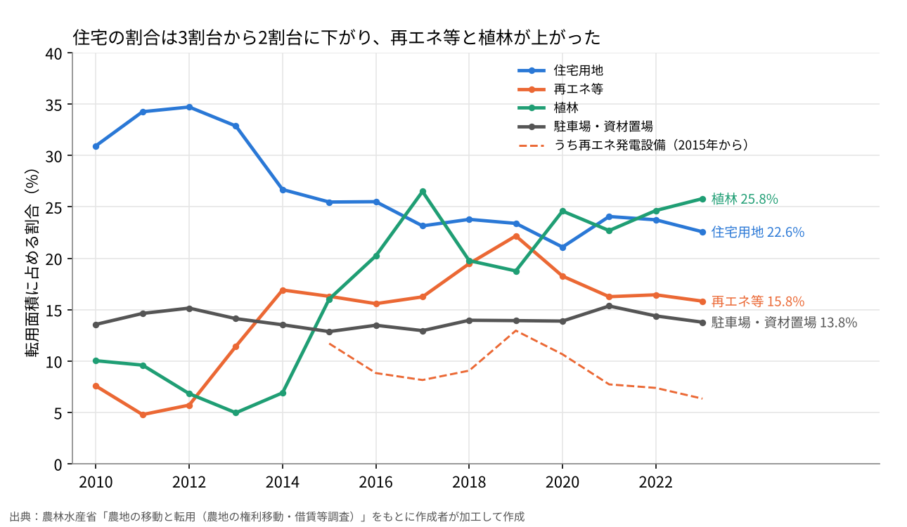
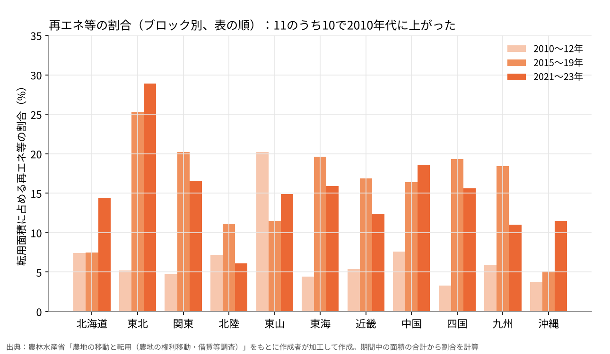
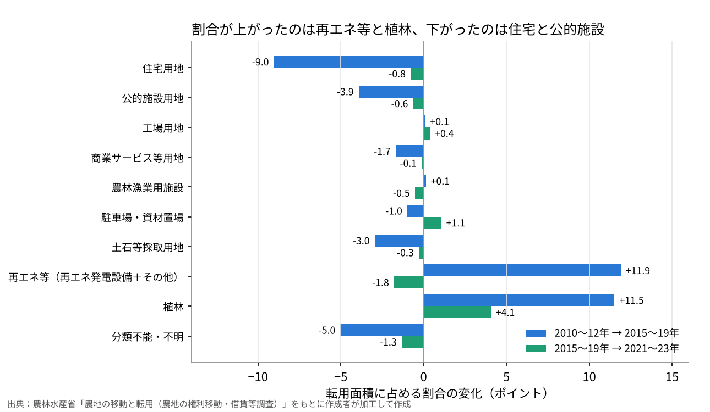

# F394 農地は、どんな用途に転用されているのか？ 住宅の割合は33%から23%に下がり、再エネ等（6%→18%）と植林（9%→24%）が上がった

## 結論（先に）

- 農林水産省の「農地の移動と転用」で、転用された農地の面積は、2010〜12年の年平均1.18万haから、2015〜19年の1.69万ha、2021〜23年の1.57万haになりました。
- 用途の割合（期間の面積の合計から計算）は、住宅用地が33.3%→24.2%→23.4%と下がりました。住宅用地の面積そのものは年3,940ha→3,685haで大きくは減っておらず、ほかの用途が増えたために割合が下がりました。
- 「再エネ等」（2015年から別の列になった再エネ発電設備と、その他の業務用地のその他の合計）は6.1%→18.0%→16.2%でした。11ブロックのうち10で、2010年代に割合が上がりました。再エネ発電設備だけでは、2015〜19年の10.1%から2021〜23年の7.1%に下がっています。
- 問い直しとして、割合が上がった用途を調べると、再エネ等とほぼ同じだけ「植林」が上がっていました（8.8%→20.3%→24.4%、年1,043ha→3,835ha）。2023年は植林（25.8%）が住宅用地（22.6%）を上回りました。
- 「住宅の転用が多い県ほど再エネ等の割合が低い」という関係は、47都道府県では弱く（相関 −0.24、順位相関 −0.10）、計画の基準（−0.3）に届きませんでした。

## 問い

農地が住宅や店、道路などに変わる「転用」は、毎年1万数千ヘクタールあります。2012年に再生可能エネルギーの固定価格買取制度が始まってから、田畑に太陽光パネルを置く転用が増えたといわれます。農業・不動産・地域の仕事では、農地がどんな使われ方に変わっているのかが、土地の利用の見通しの前提になります。

そこで、転用された面積を用途別に分けた表（2010〜2023年、全国・ブロック・都道府県）で、用途の内訳の変化を見ました。転用の是非や、手続きの助言はしません。

既存の看板記事（F339 は米の作付けが減った田んぼが何に変わったか）は作物の転換と耕地の減少を扱っています。転用の用途の内訳を扱った記事はありません。

## データ（出典）

- 農林水産省「農地の移動と転用（農地の権利移動・借賃等調査）」用途別の農地等の転用 ― 用途別の農地転用面積の合計（全国・ブロック・都道府県、ha、2010〜2023年の14年分）。
- 用途：住宅用地、公的施設用地、工鉱業（工場）用地、商業サービス等用地、その他の業務用地（農林漁業用施設、駐車場・資材置場、土石等採取用地、再エネ発電設備、その他）、植林、その他分類不能不明。
- 「再エネ発電設備」は2015年から別の列です。2014年以前は「その他の業務用地のその他」に入っていたとみられるので、長期の比較は「再エネ等」（再エネ発電設備＋その他）で行いました。
- 14ファイル（約0.6MB）を `data/raw/` に同梱しています。URL と取得日は `data/raw/SOURCES.md` にあります。都道府県の合計は全国の値と0.003%以内で一致しました。

## 事前の計画

計画は [PLAN.md](PLAN.md)（2026-11-16、年・地域ごとの集計の前に作成）です。表の形を確かめるときに一部の年の全国の行を見ていたので、H1・H2 は見たうえでの仮説だと書いています。

| 仮説 | 外れの基準 | 結果 | 判定 |
|---|---|---|---|
| H1 再エネ等の割合は2010〜12年→2015〜19年に10ポイント以上上がる | 10ポイント未満 | 6.1%→18.0%（+11.9） | 支持（見たうえでの仮説） |
| H2 住宅用地の割合は2010〜12年より2021〜23年が低い | 低くなければ外れ | 33.3%→23.4% | 支持（見たうえでの仮説） |
| H3 11ブロックのうち9つ以上で再エネ等の割合が上がる | 8以下 | 10ブロック | 支持 |
| H4 都道府県で再エネ等の割合と住宅用地の割合の相関が −0.3 より小さい | −0.3 以上 | −0.24 | **外れ** |

## やったこと

1. 14年分の表を、年×地域×用途の表にまとめました。
2. 期間（2010〜12年、2015〜19年、2021〜23年）ごとに、用途の面積を足してから総数で割り、割合を出しました。
3. ブロック（表の区分、北から南の順）ごとに同じ計算をしました。
4. 都道府県で、2015〜19年の再エネ等の割合と住宅用地の割合の相関を見ました。

## 分かったこと

### 図1 転用面積は2017年が最も大きく、増えたのは再エネ等と植林



- 転用面積は2010年1.23万ha、2017年1.77万ha、2023年1.62万haでした。
- 年平均で、再エネ等は717ha（2010〜12年）→3,042ha（2015〜19年）→2,542ha（2021〜23年）、植林は1,043ha→3,445ha→3,835haでした。
- 住宅用地は3,940ha→4,106ha→3,685ha、駐車場・資材置場は1,709ha→2,277ha→2,279haでした。

### 図2 住宅の割合が下がり、再エネ等と植林が上がった



- 住宅用地の割合は、2012年の34.7%から2023年の22.6%に下がりました。
- 再エネ等は2014年に16.9%になり、2019年の22.2%が最も高く、2023年は15.8%でした。再エネ発電設備だけでは、2019年の13.0%から2023年の6.3%に下がっています。
- 駐車場・資材置場は13〜15%で、ほとんど変わっていません。

### 図3 11ブロックのうち10で再エネ等の割合が上がった



- 2010〜12年→2015〜19年に、東北5.2%→25.3%、関東4.7%→20.2%、東海4.4%→19.6%、四国3.3%→19.3%、九州5.9%→18.4%などと上がりました。下がったのは東山（20.2%→11.5%）だけです。
- 2021〜23年は、東北（28.9%）・中国（18.6%）・北海道（14.4%）・沖縄（11.5%）でさらに上がり、関東・東海・近畿・九州・北陸などでは下がりました。
- 都道府県では、2015〜19年の再エネ等の割合は2.8%〜44.2%と大きく違いましたが、住宅用地の割合との関係は弱いものでした（相関 −0.24、p=0.10）。

## 問い直し（結果を見てから足した）

再エネ等の割合の上がりを見たあと、「ほかに割合が上がった用途はあるのか、何が押し下げられたのか」を足しました。



- 2010〜12年→2015〜19年に割合が上がったのは、再エネ等（+11.9ポイント）と植林（+11.5ポイント）で、ほぼ同じ大きさでした。
- 下がったのは、住宅用地（−9.0）、分類不能・不明（−5.0）、公的施設用地（−3.9）、土石等採取用地（−3.0）でした。
- 2015〜19年→2021〜23年は、植林がさらに+4.1ポイント上がり、再エネ等は−1.8ポイントでした。
- 「分類不能・不明」が年846haから123haに減っているので、分け方が細かくなったことも割合の変化に混じっています（推測）。

## 頑健性

| 確かめ | 再エネ等の割合 | 住宅用地の割合 | 再エネ等が上がったブロック |
|---|---|---|---|
| 0 主（期間の合計、2010〜12→2015〜19→2021〜23年） | 6.1%→18.0%→16.2% | 33.3%→23.4% | 10／11 |
| 1 単年（2011・2017・2023年） | 4.8%→16.2%→15.8% | 34.3%→22.6% | 11／11 |
| 2 再エネ発電設備だけ（2015〜19→2021〜23年） | 10.1%→7.1% | — | — |
| 3 面積（年平均ha） | 717→3,042→2,542 | 3,940→3,685 | 10／11（面積で） |
| 4 H4 を順位相関で | ρ = −0.10 | — | — |

再エネ等の割合が2010年代に上がったことは、どの確かめでも変わりませんでした。ただし2020年代は、再エネ発電設備だけで見ると下がっていて、「その他」が増えています。H4 の関係は、どの計算でも弱いままでした。

## 言えないこと

- 転用の許可・届出・協議などの面積で、実際に工事が終わったかどうかは分かりません。
- 再エネ発電設備の中身（太陽光・風力など）は分かりません。多くは太陽光とみられますが、推測です。
- 2014年以前は再エネの面積が「その他」と区別できないので、「再エネ等」には再エネ以外の用途も入っています。
- 植林が増えた理由（耕作されなくなった農地に木を植えたなど）や、転用の理由は、このデータでは分かりません。
- 転用されなかった農地（荒れた農地など）の面積は、この表には入りません。

## 仕事で使うなら

- 農地の転用の数字を見るときは、面積と割合を並べると、「住宅が減った」のか「ほかの用途が増えた」のかを分けて読めます。
- 再エネの転用は2015年から別の列なので、それより前と比べるときは「その他」と合わせた値で比べると、定義のずれを避けられます。
- ブロックや県によって用途の形が大きく違うので、地域の数字は全国の割合と並べて見ると位置づけが分かりやすくなります。

## 計画からの変更

- 計画どおりに計算しました。問い直しは計画の候補（どの用途の割合を押し下げたか）を、植林の伸びがはっきり見えるように、上がった用途も含めた割合の差の表にしました。

## 再現のしかた

```sh
pip install -r requirements.txt
python3 src/01_fetch.py   # 取得（ネットが必要。data/raw に同梱済みなので通常は不要）
sh src/run_all.sh         # 02 → 03 → 04（オフライン）
```

| ファイル | 中身 |
|---|---|
| src/01_fetch.py | 元データの取得（e-Stat、14ファイル） |
| src/02_build.py | data/conversion_long.csv（年×地域×用途、ha）を作る |
| src/03_analysis.py | 割合、ブロック別、都道府県の相関、頑健性、問い直し。results/ に出力 |
| src/04_figures.py | figures/ の4枚 |
| results/main.json | 本文の数字のもと |
| results/wide_table.csv・national_span_shares.csv・block_shares.csv・pref_mid_period.csv | 表 |
| results/robustness.csv・requestion_share_change.csv | 頑健性・問い直し |

所要時間は約3秒（CPU 1つ）。`results/repro_check.txt` に、/tmp に写して流し直し、12ファイルがバイト単位で一致した結果を書いています。古い xls ファイルを読むときに xlrd が「file size」の警告を出しますが、値の読み取りには影響しません（都道府県の合計が全国と一致することで確かめました）。

## レビューで直したこと

独立レビューで数字の照合・再実行・図を確かめ、直すところはなかった。

## 出典

- 農林水産省「農地の移動と転用（農地の権利移動・借賃等調査）」 https://www.e-stat.go.jp/stat-search/files?toukei=00500609&tstat=000001053180

（いずれも 農林水産省「農地の移動と転用（農地の権利移動・借賃等調査）」 をもとに作成者が加工して作成）
