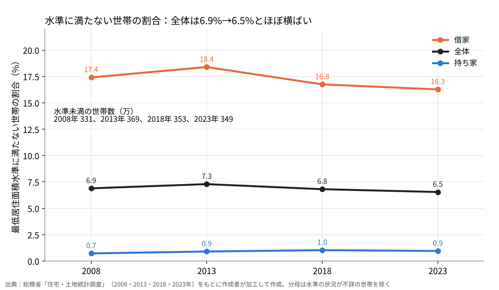
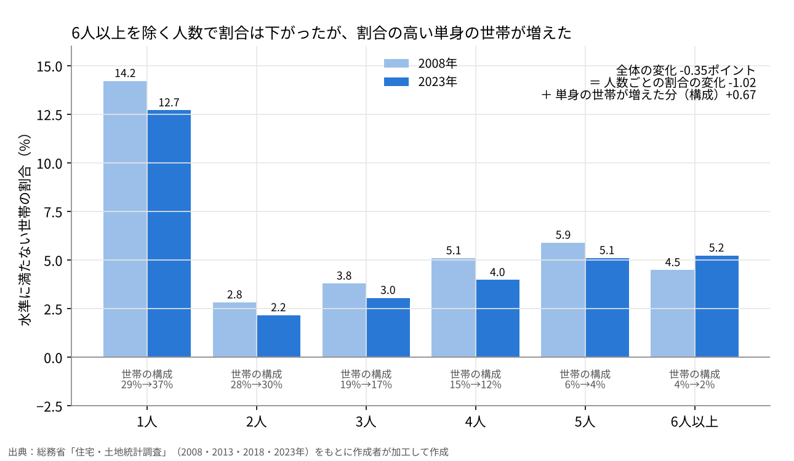
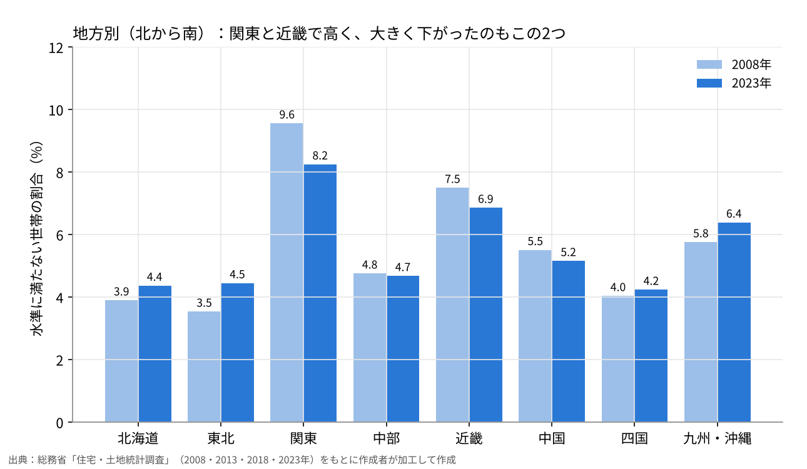
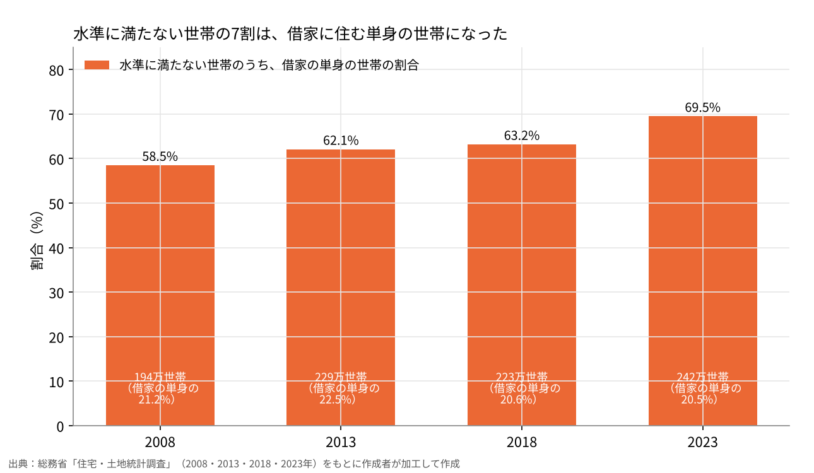

# F395 「最低居住面積水準に満たない世帯」は、どれだけ減ったのか？ 割合は15年で6.9%→6.5%とほぼ横ばい。人数ごとには下がったが、割合の高い単身の世帯が29%→37%に増えた

## 結論（先に）

- 住宅・土地統計調査で、最低居住面積水準（単身25㎡、2人30㎡、3人40㎡など、世帯人数に応じた広さの目安）に満たない世帯の割合は、2008年6.89%、2013年7.29%、2018年6.81%、2023年6.54%でした。15年で0.35ポイントしか下がっていません。世帯数では331万→349万と、むしろ増えました。
- 世帯人員別に見ると、1人14.2%→12.7%、2人2.8%→2.2%、4人5.1%→4.0% など、6人以上を除く人数で割合は下がりました。ところが、割合の高い単身の世帯が全体の29%から37%に増えたため、全体の下がりは小さくなりました。人数ごとの割合の変化の分が−1.02ポイント、構成の変化の分が+0.67ポイントです。
- ただし、持ち家・借家×人数の12区分で分けると、構成の分は−0.03ポイントとほぼなくなりました。単身の世帯が増えた影響は、主に「借家の単身の世帯が増えた」ことを通じたものですが、分け方で見え方が変わる点には注意が必要です。
- 借家の割合は17.4%→16.3%（−1.1ポイント）、持ち家は0.7%→0.9%でした。地方別（北から南）では、関東（9.6%→8.2%）と近畿（7.5%→6.9%）が高く、北海道・東北・四国・九州・沖縄ではむしろ上がりました。47都道府県のうち下がったのは18です。
- 問い直しとして、水準に満たない世帯の中身を見ると、借家に住む単身の世帯が58.5%（2008年）から69.5%（2023年）を占めるようになりました。

## 問い

国の住生活基本計画には、世帯人数に応じた「最低居住面積水準」があり、これに満たない世帯を早期になくすことが目標になっています。住宅・不動産の仕事、とくに賃貸住宅の企画をする人にとっては、狭い住宅に住む世帯が減っているのか、どんな世帯に多いのかが、つくる住宅の広さを考える前提になります。

そこで、住宅・土地統計調査の2008〜2023年の4回分で、水準に満たない世帯の割合と、その変化を世帯人員の構成で分けて見ました。水準は広さの目安で、暮らしの良し悪しを表すものではありません。世帯の収入などの事情は扱いません。

既存の看板記事（F326 新築の床面積、F322 ひとり暮らしの増加、F392 公営の借家）に、水準に満たない世帯を扱ったものはありません。

## データ（出典）

- 総務省「住宅・土地統計調査」2008・2013・2018・2023年。
  - 全国：住宅の所有の関係×世帯人員×最低居住面積水準の状況（2008年 第57表、2013年 第68表、2018年 第76-1表、2023年 第75-1表）
  - 都道府県：2008・2013年は第12表、2018・2023年は第76-1表・第75-1表の都道府県の行
- 水準の状況が「不詳」の世帯があるため、割合の分母は「水準以上＋水準未満」にしました（頑健性3で不詳を入れた場合も確かめました）。
- 6ファイル（約0.9MB）を `data/raw/` に同梱しています。URL と取得日は `data/raw/SOURCES.md` にあります。都道府県の合計は全国と0.001%以内で一致しました。

## 事前の計画

計画は [PLAN.md](PLAN.md)（2026-11-16、割合・分解・地方別の計算の前に作成）です。表の形を確かめるときに全国の総数と世帯人員別の行を見ていたので、H1 は見たうえでの仮説だと書いています。

| 仮説 | 外れの基準 | 結果 | 判定 |
|---|---|---|---|
| H1 全体の割合の2008→2023年の変化は±1ポイントの中 | 外に出る | −0.35ポイント | 支持（見たうえでの仮説） |
| H2 人数ごとの割合の分はマイナス、構成の分はプラスでその30%以上 | どれかを満たさない | −1.02、+0.67（66%） | 支持（ただし12区分では構成の分がほぼ0） |
| H3 借家の割合は1ポイント以上下がる | 下がりが1ポイント未満 | −1.14ポイント | 支持（ぎりぎり） |
| H4 関東が2008・2023年とも8地方でいちばん高い | そうでない | 両年とも関東 | 支持 |

## やったこと

1. 4回分の表から、全国の所有の関係（総数・持ち家・借家）×世帯人員の表と、都道府県の表を作りました。
2. 水準未満の割合を出し、2008→2023年の全体の変化を「世帯人員の構成の変化の分」（2008年の人数別の割合のまま構成だけ2023年にした場合）と「人数ごとの割合の変化の分」（2023年の構成で重みづけ）に分けました。
3. 都道府県を8地方（北から南）にまとめ、割合を比べました。

## 分かったこと

### 図1 全体はほぼ横ばい、借家は少し下がり、持ち家は少し上がった



- 全体の割合は6.89%→7.29%→6.81%→6.54%で、2013年がいちばん高くなっています。
- 借家は17.4%→18.4%→16.8%→16.3%、持ち家は0.7%→0.9%→1.0%→0.9%でした。
- 水準に満たない世帯の数は、331万→369万→353万→349万でした。

### 図2 人数ごとの割合は下がったが、単身の世帯が増えた



- 2008→2023年に、1人14.2%→12.7%、2人2.8%→2.2%、3人3.8%→3.0%、4人5.1%→4.0%、5人5.9%→5.1%、6人以上4.5%→5.2%でした。
- 世帯の構成は、単身が29.1%→36.7%と増え、4人以上は減りました。
- 全体の変化（−0.35ポイント）は、人数ごとの割合の変化の分（−1.02）と、割合の高い単身の世帯が増えた分（+0.67）の和です。

### 図3 関東と近畿で高く、北や南の地方ではむしろ上がった



- 2008→2023年に、北海道3.9%→4.4%、東北3.5%→4.5%、関東9.6%→8.2%、中部4.8%→4.7%、近畿7.5%→6.9%、中国5.5%→5.2%、四国4.0%→4.2%、九州・沖縄5.8%→6.4%でした。
- 関東は両年ともいちばん高く、下がり方もいちばん大きい地方でした。
- 47都道府県のうち、割合が下がったのは18、上がったのは29でした。県の値は標本の誤差があるので、県ごとの上下は目安です。

## 問い直し（結果を見てから足した）

単身の世帯と借家の割合が大きかったので、「水準に満たない世帯の中身は、どう変わったのか」を足しました。



- 水準に満たない世帯のうち、借家に住む単身の世帯は、58.5%（194万、2008年）→62.1%→63.2%→69.5%（242万、2023年）になりました。
- 借家に住む単身の世帯の中での水準未満の割合は、21.2%→22.5%→20.6%→20.5%とほぼ一定です。借家の単身の世帯そのものが916万から1,185万に増えたことが、中身の変化の大部分です。

## 頑健性

| 確かめ | 全体の変化 | 構成の分 | 人数ごとの割合の分 | 借家の割合の変化 |
|---|---|---|---|---|
| 0 主（2008→2023年、世帯人員6区分） | −0.35 | +0.67 | −1.02 | −1.14 |
| 1a 期間 2013→2023年 | −0.75 | +0.39 | −1.13 | −2.11 |
| 1b 期間 2008→2018年 | −0.08 | +0.41 | −0.49 | −0.66 |
| 2 所有の関係×世帯人員の12区分（2008→2023年） | −0.35 | −0.03 | −0.32 | — |
| 3 分母に不詳を入れる（2008→2023年） | −0.42 | — | — | −1.14 |
| 4 関東の1都6県の中央値／ほかの県の中央値 | 2008年 5.81／3.89、2023年 5.63／4.12 | — | — | — |
| 5 都道府県で数える（下がった県） | 18／47 | — | — | — |

全体がほぼ横ばいであることと、関東が高いことは、どの確かめでも変わりませんでした。H2 の「単身の世帯が増えた構成の分」は、世帯人員だけで分けると+0.67ですが、持ち家・借家も合わせて12区分で分けると−0.03になり、結論が変わります。持ち家・借家の中では、単身の世帯の増加は主に借家で起きていて、借家の単身の世帯の水準未満の割合はほぼ一定だったため、と考えられます（推測）。H3 は期間で−0.66〜−2.11と幅があります。

## 言えないこと

- 水準は広さの目安で、住む人の満足や暮らしの良し悪しを表すものではありません。
- 水準に満たない世帯が減らない理由（家賃、都市への集中、住宅の供給など）は、このデータでは分かりません。理由についての話はすべて推測です。
- 標本調査の推計値で、県の値には誤差があります。県の順位は作っていません。
- 世帯の収入や年齢などの事情は扱っていません。
- 分解の結果は、どの区分で分けるかで変わります（頑健性2）。

## 仕事で使うなら

- 「水準に満たない世帯の割合」を比べるときは、全体の割合だけでなく、世帯人員別の割合と世帯の構成を並べると、変化の中身を読み違えにくくなります。
- 水準に満たない世帯の7割は借家の単身の世帯なので、この層の住宅の広さの分布を見ると、全体の動きのほとんどが説明できます。
- 分解は区分の切り方で結果が変わるので、複数の切り方を並べておくと前提がそろいます。

## 計画からの変更

- 計画どおりに計算しました。図2・図3の題名は結果を見てから決めました（6人以上だけ割合が上がったので、図2の題名に書き添えました）。

## 再現のしかた

```sh
pip install -r requirements.txt
python3 src/01_fetch.py   # 取得（ネットが必要。data/raw に同梱済みなので通常は不要）
sh src/run_all.sh         # 02 → 03 → 04（オフライン）
```

| ファイル | 中身 |
|---|---|
| src/01_fetch.py | 元データの取得（e-Stat、6ファイル） |
| src/02_build.py | data/national.csv・pref.csv を作る |
| src/03_analysis.py | 割合、分解、地方別、頑健性、問い直し。results/ に出力 |
| src/04_figures.py | figures/ の4枚 |
| results/main.json | 本文の数字のもと |
| results/national_shares.csv・region_shares.csv | 表 |
| results/robustness.csv・requestion_rent_single.csv | 頑健性・問い直し |

所要時間は約4秒（CPU 1つ）。`results/repro_check.txt` に、/tmp に写して流し直し、11ファイルがバイト単位で一致した結果を書いています。

## レビューで直したこと

| # | 指摘 | 直し方 |
|---|---|---|
| 1 | 題名の「単身の世帯が増えて打ち消した」は、世帯人員だけで分けた場合の結果で、持ち家・借家×人数の12区分では構成の分が−0.03とほぼ0になり、言い切れない | 題名を「割合の高い単身の世帯が29%→37%に増えた」に弱め（status・note・README）、note の要点に「持ち家・借家も合わせて分けると構成の分はほぼ0」を足した |

直したあとに /tmp で流し直し、results と figures の 9 ファイルが一致することを確かめました（results/repro_check.txt）。

## 出典

- 総務省統計局「住宅・土地統計調査」 https://www.stat.go.jp/data/jyutaku/index.html （e-Stat https://www.e-stat.go.jp/stat-search/files?toukei=00200522 ）
- 国土交通省「住生活基本計画（全国計画）」の居住面積水準 https://www.mlit.go.jp/jutakukentiku/house/jutakukentiku_house_tk2_000032.html

（いずれも 総務省「住宅・土地統計調査」 をもとに作成者が加工して作成）
