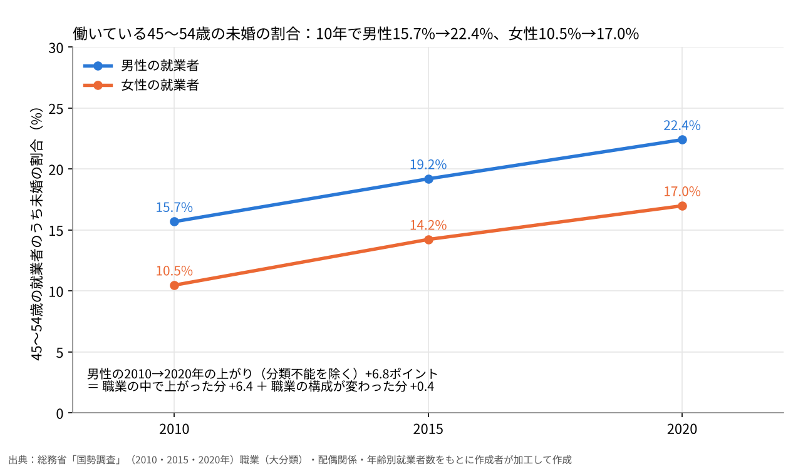
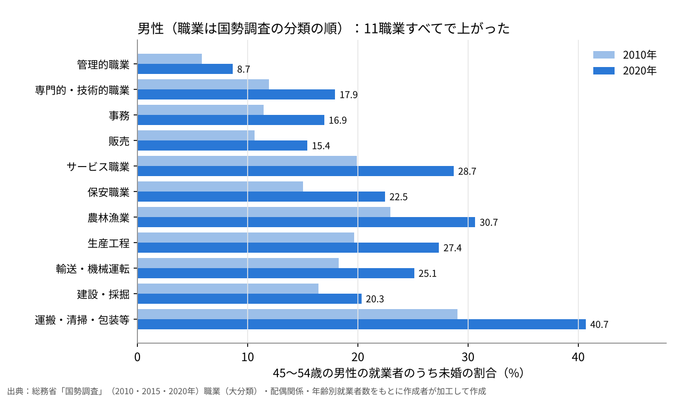
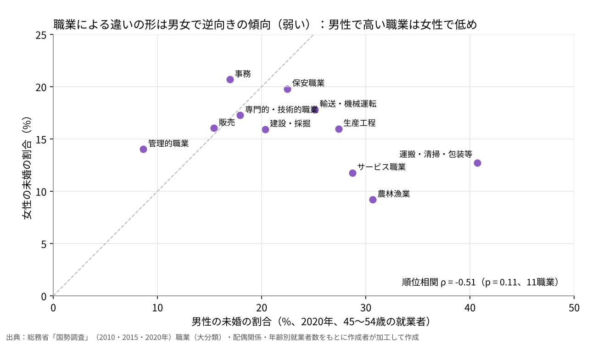
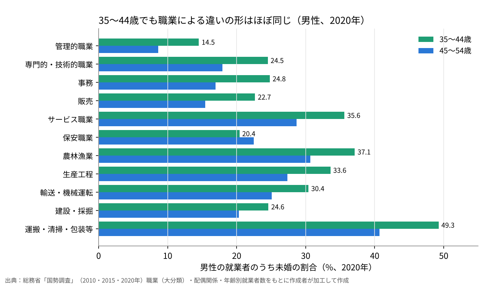

# F396 50歳前後で結婚したことがない人の割合は、職業でどれだけ違うのか？ 働く男性は職業で8.7%〜40.7%と開き、10年の上がり6.8ポイントの94%はどの職業の中でも起きていた

## 結論（先に）

- 国勢調査で、働いている45〜54歳の男性のうち未婚（結婚したことがない）の割合は、2010年15.7%、2015年19.2%、2020年22.4%でした。女性は10.5%→14.2%→17.0%です。
- 2020年の男性の割合は、職業（大分類の11区分）で8.7%（管理的職業）から40.7%（運搬・清掃・包装等）まで開きがありました。女性は9.2%（農林漁業）から20.7%（事務）です。
- 2010→2020年の男性の上がり（分類不能を除いて+6.8ポイント）のうち、+6.4（94%）は職業の中での上がりで、職業の構成が変わった分は+0.4でした。男女とも、11職業すべてで割合が上がっています。
- 職業による違いの形は、男女で逆向きの傾向がありました（11職業の男女の順位相関 −0.51）。男性で割合が高い農林漁業・サービス・運搬などは女性では低く、女性で高い事務・保安は男性では低めです。ただし p=0.11 で、はっきりした関係とまでは言えません。
- 問い直しとして35〜44歳の男性を見ると、職業による違いの形は45〜54歳とほぼ同じでした（順位相関0.88）。

## 問い

「50歳時の未婚割合」（いわゆる生涯未婚率）は男性で3割近く、女性で2割近くになったといわれます。人事や働き方の仕事、家族の形の変化を記事にする人にとっては、働いている人に限るとこの割合が職業でどれだけ違うのか、上がったのは職業の構成が変わったせいなのか、どの職業でも同じように上がったのかが気になるところです。

そこで、国勢調査の職業（大分類）×配偶関係×年齢×男女の就業者数（2010・2015・2020年）で、45〜54歳の未婚の割合を職業ごとに出しました。結婚を勧めたり、職業や結婚の良し悪しを評価したりするものではありません。数字の違いを見るだけです。

既存の看板記事（F322 ひとり暮らしの増加）は世帯の型を扱っています。職業別の未婚割合を扱った記事はありません。

## データ（出典）

- 総務省「国勢調査」全国の職業（大分類）×配偶関係×年齢（5歳階級）×男女別 15歳以上就業者数。
  - 2010年：職業等基本集計 第3-1表
  - 2015年：就業状態等基本集計 第9-1表
  - 2020年：就業状態等基本集計 第9-1表（国籍総数と日本人）
- 職業分類は2010年から同じ12区分（A 管理的職業従事者〜L 分類不能の職業）。L は比較から除きました。
- 対象は就業者（働いている人）だけです。働いていない人は入らないので、全人口の「50歳時未婚割合」とは違います。
- 3ファイル（約7.2MB、うち2020年の Excel が6.9MB）を `data/raw/` に同梱しています。URL と取得日は `data/raw/SOURCES.md` にあります。

言葉の定義：45〜54歳の未婚の割合 ＝（45〜49歳と50〜54歳の未婚）÷（同じ年齢の 未婚＋有配偶＋死別・離別）。配偶関係の不詳は除きました。

## 事前の計画

計画は [PLAN.md](PLAN.md)（2026-11-16、割合や分解の計算の前に作成）です。表の形を確かめるときに配偶関係の総数の行を見ましたが、未婚の行や割合は計算前に見ていません。

| 仮説 | 外れの基準 | 結果 | 判定 |
|---|---|---|---|
| H1 男性の割合は2010→2020年に3ポイント以上上がる | 3ポイント未満 | +6.7ポイント | 支持 |
| H2 男性の上がりの80%以上は職業の中の変化 | 80%未満 | 94% | 支持 |
| H3 職業ごとの割合の並びは男女で逆向き（順位相関がマイナス） | 0以上 | −0.51（p=0.11） | 支持（ただし弱い） |
| H4 男性の職業ごとの並びは2010年と2020年でほぼ同じ（0.8以上） | 0.8未満 | 0.99 | 支持 |

## やったこと

1. 3回分の表から、全国の 年×男女×配偶関係×年齢×職業 の就業者数を取り出しました。
2. 職業ごと・男女ごとに、45〜54歳の未婚の割合を出しました。
3. 2010→2020年の全体の変化を、職業の構成が変わった分（2010年の職業別の割合のまま構成だけ2020年にした場合）と、職業の中の変化の分（2020年の構成で重みづけ）に分けました。
4. 男女の職業ごとの割合の並び（順位相関）を比べました。

## 分かったこと

### 図1 10年で男性は+6.7、女性は+6.5ポイント



- 男性の就業者は15.7%→19.2%→22.4%、女性の就業者は10.5%→14.2%→17.0%でした。
- 分類不能を除く11職業で分けると、男性の上がり+6.8ポイントのうち、職業の中の変化が+6.4、構成の変化が+0.4でした。女性も+6.5のうち+6.2が職業の中の変化でした（94%）。

### 図2 男性は11職業すべてで上がった



- 2010→2020年に、管理的職業5.9%→8.7%、専門的・技術的職業12.0%→17.9%、事務11.4%→16.9%、販売10.6%→15.4%、サービス職業19.9%→28.7%、保安職業15.0%→22.5%、農林漁業23.0%→30.7%、生産工程19.7%→27.4%、輸送・機械運転18.3%→25.1%、建設・採掘16.5%→20.3%、運搬・清掃・包装等29.0%→40.7%でした。
- 職業ごとの並びは2010年と2020年でほとんど変わらず（順位相関0.99）、どの職業も同じように上がっています。

### 図3 職業による違いの形は男女で逆向きの傾向



- 女性の2020年は、事務20.7%、保安職業19.8%、輸送・機械運転17.8%、専門的・技術的職業17.3%が高く、農林漁業9.2%、サービス職業11.8%、運搬・清掃・包装等12.7%が低めでした。
- 男性で割合が高い職業ほど、女性では低い傾向があります（順位相関 −0.51）。ただし11職業しかなく、p=0.11 で偶然の範囲も否定できません。
- 職業の違いの幅は、男性（8.7〜40.7%）のほうが女性（9.2〜20.7%）より大きくなっています。

## 問い直し（結果を見てから足した）

職業による違いの形が10年でほとんど変わらなかったので、「より若い35〜44歳でも同じ形なのか」を足しました。



- 2020年の35〜44歳の男性の就業者の未婚の割合は29.1%（2010年27.4%）、女性は24.3%（同23.9%）でした。
- 男性の職業ごとの割合は、14.5%（管理的職業）から49.3%（運搬・清掃・包装等）で、45〜54歳との順位相関は0.88でした。保安職業だけは35〜44歳（20.4%）のほうが45〜54歳（22.5%）より低くなっています。
- 35〜44歳の10年の上がり（男性+1.8ポイント）は、45〜54歳（+6.7）よりずっと小さいものでした。

## 頑健性

男性について。

| 確かめ | 割合の変化 | 職業の中の変化の割合 | 構成の分 | 男女の順位相関 | 2時点の順位相関 |
|---|---|---|---|---|---|
| 0 主（2010→2020年、45〜54歳の合計） | +6.73 | 94% | +0.41 | −0.51 | 0.99 |
| 1 45〜49歳と50〜54歳の割合の単純平均 | +6.67 | — | — | −0.51 | 0.99 |
| 2 期間 2015→2020年 | +3.22 | 88% | +0.39 | −0.51 | 1.00 |
| 3 年齢 40〜49歳 | +4.29 | 89% | +0.52 | −0.45 | 0.99 |
| 4 日本人だけ（2020年） | 水準 22.50%（国籍総数 22.39%） | — | — | −0.43 | — |

どの確かめでも、上がりのほとんどは職業の中の変化で、職業の並びは安定していました。男女の逆向きの関係は −0.43〜−0.51 で、いつも弱めです。

## 言えないこと

- 職業は国勢調査の時点の職業で、結婚した時の職業ではありません。職業が結婚に影響したのか、結婚したかどうかが職業の選び方や続け方に影響したのか（因果の向き）は分かりません。
- 働いていない人は入っていません。全人口の「50歳時未婚割合」とは違う数字です。
- 収入・働く時間・学歴・住む地域など、職業と一緒に違うものは分けていません。職業の違いに見えるものの中に、それらの違いが入っています。
- 結婚の良し悪しや、どうすべきかは扱っていません。
- 職業の大分類は幅が広く、同じ分類の中にさまざまな仕事が入っています。

## 仕事で使うなら

- 「未婚の割合が上がった」という数字を見るときは、全体の数字と職業（や業種）ごとの数字を並べると、構成の変化なのか、どの集団でも起きている変化なのかを分けて読めます。
- 職業ごとの違いは男女で形が違うので、男女を分けて見ると読み違えにくくなります。
- 就業者だけの数字か、全人口の数字かを書き添えておくと、ほかの統計と比べるときの混乱を避けられます。

## 計画からの変更

- 計画どおりに計算しました。図2・図4の職業は割合の順ではなく、国勢調査の分類の順に並べました。

## 再現のしかた

```sh
pip install -r requirements.txt
python3 src/01_fetch.py   # 取得（ネットが必要。data/raw に同梱済みなので通常は不要）
sh src/run_all.sh         # 02 → 03 → 04（オフライン）
```

| ファイル | 中身 |
|---|---|
| src/01_fetch.py | 元データの取得（e-Stat、3ファイル） |
| src/02_build.py | data/national_long.csv（全国の 年×国籍×男女×配偶関係×年齢×職業）を作る |
| src/03_analysis.py | 割合、分解、順位相関、頑健性、問い直し。results/ に出力 |
| src/04_figures.py | figures/ の4枚 |
| results/main.json | 本文の数字のもと |
| results/rates_by_occupation.csv・requestion_35_44.csv・robustness.csv | 表 |

所要時間は約9秒（CPU 1つ。2020年の Excel の読み込みが大半）。`results/repro_check.txt` に、/tmp に写して流し直し、9ファイルがバイト単位で一致した結果を書いています。

## レビューで直したこと

| # | 指摘 | 直し方 |
|---|---|---|
| 1 | 図3の題「男女で逆向き」は、順位相関 −0.51（p=0.11）に対して強すぎた | 図3の題を「男女で逆向きの傾向（弱い）：男性で高い職業は女性で低め」に直した（src/04_figures.py、図3を作り直し） |

直したあとに /tmp で流し直し、results と figures の 8 ファイルが一致することを確かめました（results/repro_check.txt）。

## 出典

- 総務省統計局「国勢調査」 https://www.e-stat.go.jp/stat-search/files?toukei=00200521
  - 令和2年 就業状態等基本集計 https://www.e-stat.go.jp/stat-search/files?toukei=00200521&tstat=000001136464
  - 平成27年 就業状態等基本集計 https://www.e-stat.go.jp/stat-search/files?toukei=00200521&tstat=000001080615

（いずれも 総務省「国勢調査」 をもとに作成者が加工して作成）
