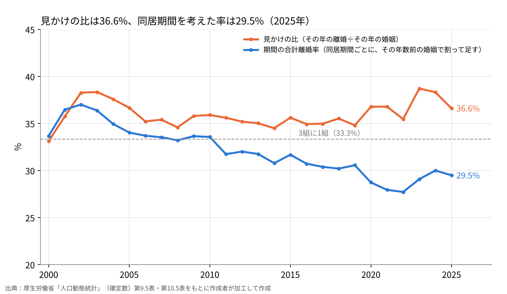
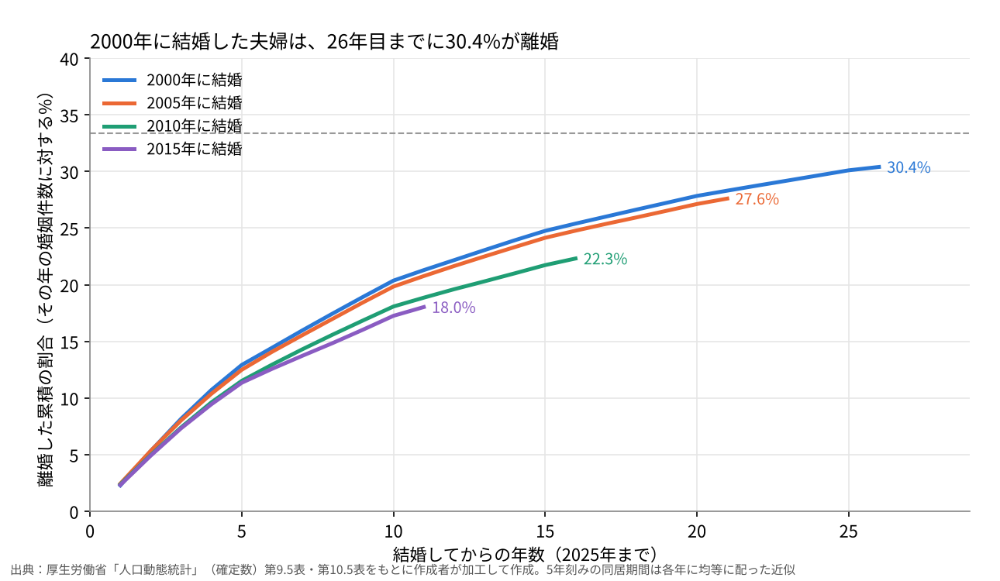
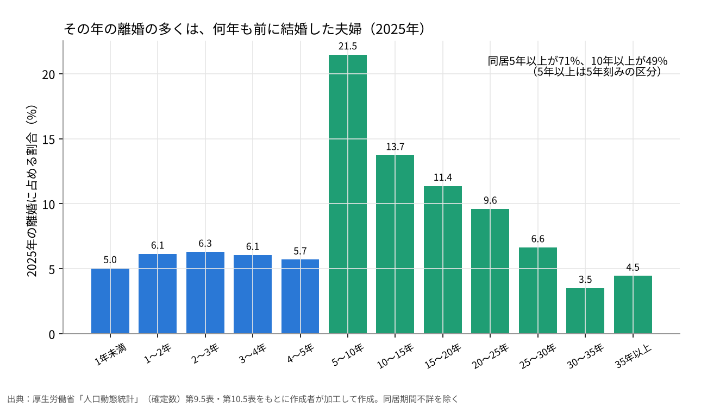
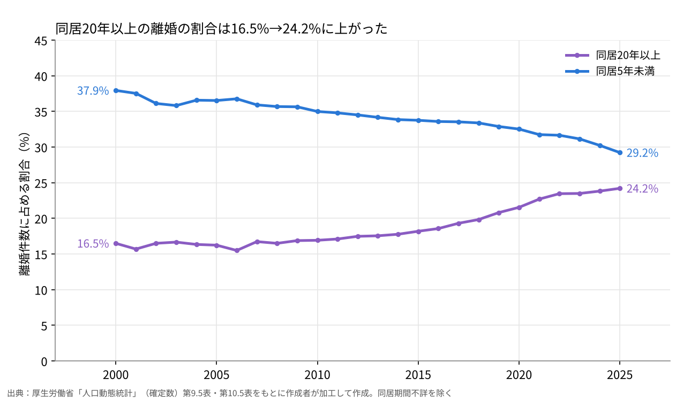

# F397 「3組に1組が離婚する」は本当か？ その年の比は36.6%だが、同居期間を考えると29.5%。2000年に結婚した夫婦は26年目までに30.4%が離婚

## 結論（先に）

- 「3組に1組」のもとになる「その年の離婚件数 ÷ その年の婚姻件数」（見かけの比）は、2025年に36.6%（離婚17.9万÷婚姻48.9万）でした。2000年以降、ほぼ毎年33%を超えています。
- ただし、その年の離婚の7割は同居5年以上、半分は10年以上の夫婦で、ずっと前に結婚した夫婦です。結婚の件数が減っている時期には、見かけの比は大きく出ます。同居期間ごとに「その年数前の婚姻件数」で割って足した「期間の合計離婚率」は、2025年に29.5%で、見かけの比より7.1ポイント低くなりました。
- 結婚した年ごとに追うと、2000年に結婚した夫婦のうち、2025年まで（26年目まで）に離婚したのは30.4%でした。まだ少しずつ増えているので、最終的に3割を少し超える水準になると考えられます（推測）。計画の仮説（30%未満）は外れました。
- 結婚して10年目までの累積は、2000年結婚20.4%、2005年19.8%、2010年18.1%、2015年17.3%と、後の年に結婚した夫婦ほど少し低くなっています。
- 問い直しとして同居期間の内訳を見ると、同居20年以上の離婚の割合は2000年16.5%から2025年24.2%に上がり、5年未満は37.9%から29.2%に下がりました。

## 問い

「3組に1組が離婚する」という言い方をよく聞きます。家族や暮らしの記事を書く人、家計や住宅の相談で家族の形の数字を使う人にとっては、この数字がどう計算されたもので、何を表しているのかが大事です。

多くの場合、この数字は「その年の離婚件数 ÷ その年の婚姻件数」から来ています。しかし、その年に離婚する夫婦の多くは何年も前に結婚した夫婦です。そこで、厚生労働省の人口動態統計の同居期間別の離婚件数を使い、(1) 見かけの比、(2) 期間の合計離婚率、(3) 結婚した年ごとに追った割合、の3つを比べました。離婚の良し悪しや理由は扱いません。

既存の看板記事（F322 ひとり暮らし、F396 職業別の未婚割合）に、離婚の比の計算を扱ったものはありません。

## データ（出典）

- 厚生労働省「人口動態統計」（確定数、令和7年）上巻
  - 第10.5表 年次別にみた同居期間別離婚件数（1947〜2025年。2000年以降は毎年。同居期間は1年未満〜4〜5年の1年刻み、5〜10年以降は5年刻み、35年以上、不詳）
  - 第9.5表 夫妻の初婚－再婚の組合せ別にみた年次別婚姻件数（1966年以降は毎年。それより前は5年おきなので、1961〜1965年は直線でつないだ値を使いました。35年以上の区分の計算に少し使うだけです）
- 2ファイル（約13KB）を `data/raw/` に同梱しています。URL と取得日は `data/raw/SOURCES.md` にあります。

## 事前の計画

計画は [PLAN.md](PLAN.md)（2026-11-16、比率や結婚した年ごとの計算の前に作成）です。表の形を確かめるときに件数の表を見ていたので、H1 は見たうえでの仮説だと書いています。

| 仮説 | 外れの基準 | 結果 | 判定 |
|---|---|---|---|
| H1 見かけの比は2025年に33%以上 | 33%未満 | 36.6% | 支持（見たうえでの仮説） |
| H2 期間の合計離婚率は見かけの比より3ポイント以上低い | 差が3ポイント未満 | 29.5%（差7.1） | 支持 |
| H3 2000年に結婚した夫婦の2025年までの累積は30%未満 | 30%以上 | 30.4% | **外れ** |
| H4 10年目までの累積は2010年結婚のほうが2000年結婚より低い | 高いか同じ | 18.1% 対 20.4% | 支持 |

## やったこと

1. 見かけの比 ＝ その年の離婚件数 ÷ その年の婚姻件数。
2. 期間の合計離婚率（年 Y）＝ Σ（同居期間 d の離婚件数 ÷ d 年前ごろの婚姻件数）。1年刻みの区分は (Y−d) 年と (Y−d−1) 年の婚姻件数の平均、5年刻みの区分はその5年の範囲の婚姻件数の平均で割りました。35年以上は35〜40年前の平均で割りました。同居期間不詳の離婚は、不詳を除いた分布に比例して配りました。
3. 結婚した年ごとの累積（結婚年 M）：同居期間 d の離婚件数を (M+d) 年の表から取り、5年刻みの区分は5で割って各年に配り、M 年の婚姻件数で割って足しました。
4. 2000〜2025年について計算しました。

## 分かったこと

### 図1 見かけの比は36.6%、同居期間を考えると29.5%



- 見かけの比は、2000年33.1%、2002〜2003年38.3%、2010年35.9%、2023年38.7%、2025年36.6%でした。
- 期間の合計離婚率は、2002年の37.0%が最も高く、2010年33.6%、2019年30.6%、2022年27.7%、2025年29.5%でした。
- 2010年代から2つの差が開いています。結婚の件数が2010年70万から2025年49万に減り、分母（その年の婚姻）が小さくなったためです。

### 図2 2000年に結婚した夫婦は、26年目までに30.4%が離婚



- 2000年に結婚した夫婦の累積は、5年目12.9%、10年目20.4%、15年目24.8%、20年目27.8%、25年目30.1%、26年目30.4%でした。
- 2005年結婚は20年目27.1%、2010年結婚は15年目21.7%、2015年結婚は10年目17.3%です。同じ年数で比べると、後の年に結婚した夫婦ほど少し低くなっています。
- 2000年結婚の線は26年目でも少しずつ上がっていて、30年・35年と進めば3割を超えると考えられます（推測。まだ観察できていません）。

### 図3 その年の離婚の多くは、何年も前に結婚した夫婦



- 2025年の離婚（同居期間不詳を除く）のうち、同居5年未満は29.2%、5年以上は71%、10年以上は49%でした。
- このため、その年の離婚を同じ年の婚姻で割ると、結婚の件数が減っている時期ほど見かけの比が大きくなります。

## 問い直し（結果を見てから足した）

見かけの比と期間の合計離婚率の差が開いた理由を探る中で、離婚の同居期間の内訳が変わっていることに気づいたので、「同居20年以上の離婚の割合はどう変わったのか」を足しました。



- 同居20年以上の離婚は、2000年16.5%、2010年16.9%、2020年21.5%、2025年24.2%でした。
- 同居5年未満は37.9%から29.2%に下がりました。
- 長く連れ添った夫婦の離婚の割合が上がると、見かけの比の分子に「ずっと前の結婚」がさらに多く入ることになります。

## 頑健性

| 確かめ | 見かけの比 | 期間の合計離婚率 | 2000年結婚の2025年までの累積 |
|---|---|---|---|
| 0 主（2025年） | 36.6% | 29.5% | 30.4% |
| 1 婚姻件数を d 年前の1年だけで割る | — | 29.6% | — |
| 2 同居期間不詳を配らずに除く | — | 27.1% | — |
| 3 5年刻みを前の年に多く配る（0.3〜0.1） | — | — | 30.7% |
| 4 2015〜2019年の平均 | 35.2% | 30.7% | — |

「見かけの比は期間の合計離婚率より大きい」は、どの確かめでも変わりませんでした。2000年に結婚した夫婦の累積は30.4〜30.7%で、計画の基準（30%未満）をわずかに超えます。

## 言えないこと

- 同居期間は「同居を始めてから同居をやめるまで」で、婚姻届の日からではありません。結婚した年への割り当ては近似です。
- 婚姻件数には再婚も入っています。初婚どうしの夫婦だけの割合ではありません。同じ人が2回離婚することも数えています。
- これから結婚する夫婦のうち何割が離婚するか（将来の割合）は予測していません。
- 理由や、離婚の良し悪しは扱っていません。
- 5年刻みの区分を各年に配るところは近似で、頑健性3で配り方を変えた差は0.3ポイントでした。

## 仕事で使うなら

- 「○組に1組」という数字を見るときは、その年の離婚をその年の婚姻で割ったものか、結婚した年ごとに追ったものかを確かめると、読み違えにくくなります。
- 結婚の件数が減っている時期には、その年どうしの比は大きく出ます。同居期間別の件数があれば、その年数前の婚姻で割る計算で確かめられます。
- 結婚した年ごとの累積は、まだ途中の年を含むので、「何年目まで」を書き添えておくと誤解を避けられます。

## 計画からの変更

- 1961〜1965年の婚姻件数が5年おきだったので、直線でつないだ値を使いました（35年以上の区分の分母に少し使うだけ）。それ以外は計画どおりです。

## 再現のしかた

```sh
pip install -r requirements.txt
python3 src/01_fetch.py   # 取得（ネットが必要。data/raw に同梱済みなので通常は不要）
sh src/run_all.sh         # 02 → 03 → 04（オフライン）
```

| ファイル | 中身 |
|---|---|
| src/01_fetch.py | 元データの取得（e-Stat、2ファイル） |
| src/02_build.py | data/divorce_by_duration.csv・marriages.csv を作る |
| src/03_analysis.py | 見かけの比、期間の合計離婚率、結婚した年ごとの累積、頑健性。results/ に出力 |
| src/04_figures.py | figures/ の4枚 |
| results/main.json | 本文の数字のもと |
| results/yearly_ratios.csv・cohort_cumulative.csv・robustness.csv | 表 |

所要時間は約2秒（CPU 1つ）。`results/repro_check.txt` に、/tmp に写して流し直し、10ファイルがバイト単位で一致した結果を書いています。

## レビューで直したこと

独立レビューで数字の照合・再実行・図を確かめ、直すところはなかった。

## 出典

- 厚生労働省「人口動態統計」（確定数） https://www.e-stat.go.jp/stat-search/files?toukei=00450011&tstat=000001028897

（いずれも 厚生労働省「人口動態統計」 をもとに作成者が加工して作成）
