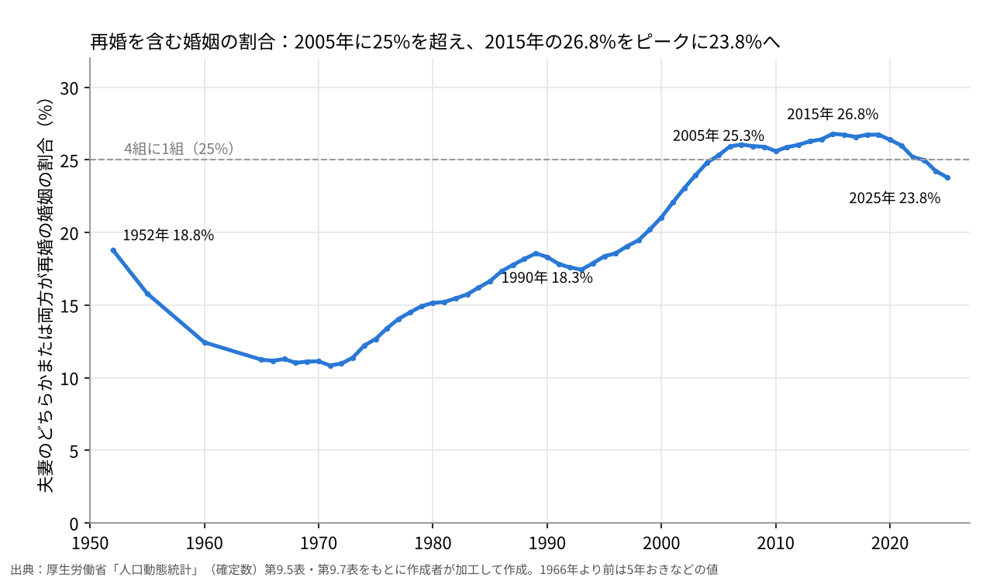
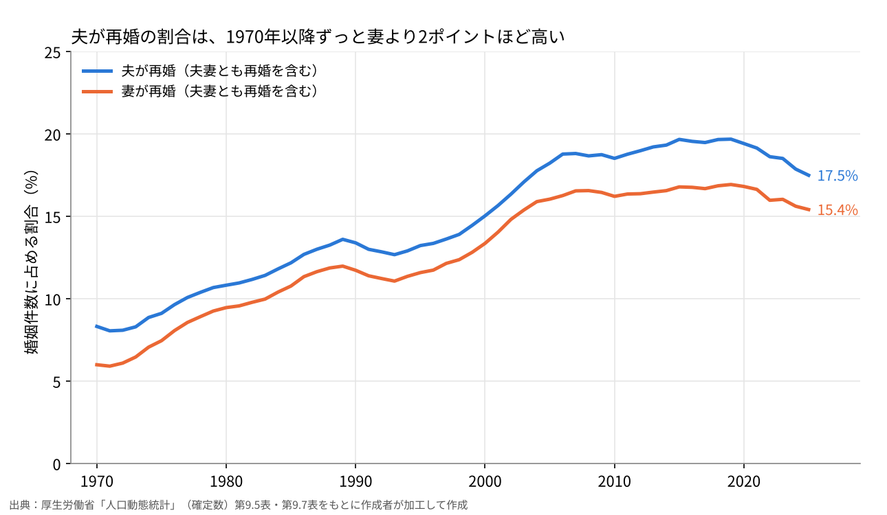
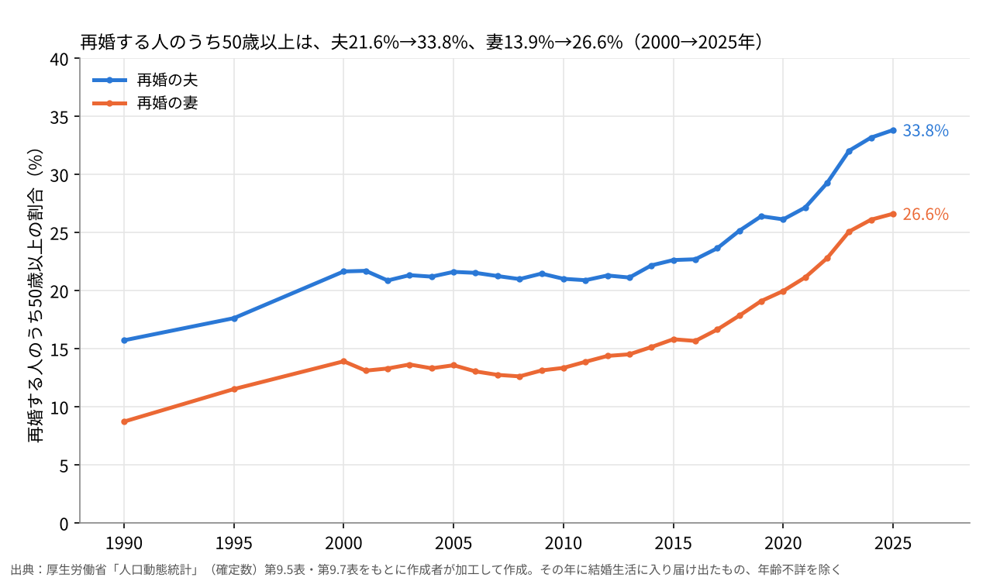
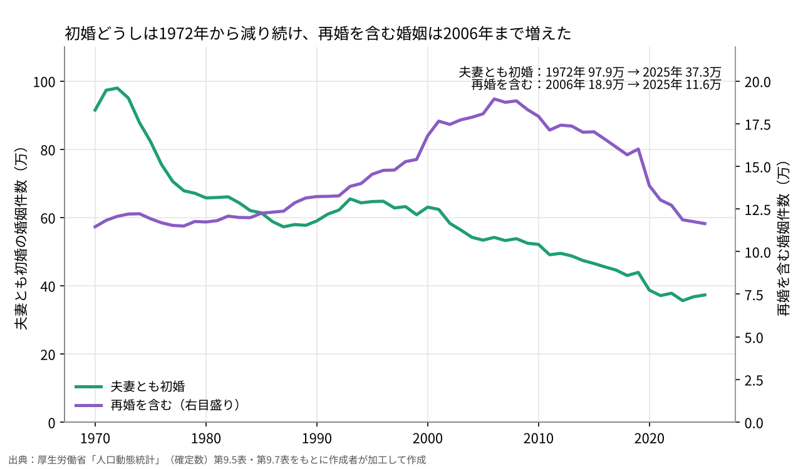

# F398 「結婚の4組に1組は再婚を含む」は、いつからそうなったのか？ 2005年に25%を超え、2015年の26.8%がピーク。2023年からは25%を下回り、2025年は23.8%

## 結論（先に）

- 人口動態統計で、夫妻のどちらかまたは両方が再婚の婚姻の割合は、1970年ごろの11%から上がり、2005年に25.3%と初めて25%を超えました。2015年の26.8%がピークで、2023年に25.0%（25%をわずかに下回る）、2025年は23.8%です。「4組に1組」は2005〜2022年の18年間に当てはまる言い方でした。
- 2000→2025年に、夫妻とも初婚の婚姻は63.0万→37.3万件（−40.9%）、再婚を含む婚姻は16.8万→11.6万件（−30.7%）でした。割合が上がったのは、再婚が増えたからではなく、初婚どうしの結婚のほうが速く減ったためです。ただし2010→2025年に限ると、再婚を含む婚姻のほうが速く減っていて（−35.1% 対 −28.4%）、これが最近の割合の下がりにつながっています。
- 1970年以降のすべての年で、夫が再婚の割合（2025年17.5%）は妻が再婚の割合（15.4%）より高くなっています。
- 問い直しとして件数を見ると、初婚どうしの婚姻は1972年の97.9万件から減り続けたのに対し、再婚を含む婚姻は2006年の18.9万件まで増え、そのあと減りました。
- 再婚する人の年齢も上がりました。再婚の夫のうち50歳以上は2000年21.6%→2025年33.8%、再婚の妻は13.9%→26.6%でした。

## 問い

「結婚の4組に1組は、夫妻のどちらかまたは両方が再婚」という話をよく聞きます。家族や暮らしの記事を書く人、結婚式・住宅・保険など家族の形に関わる仕事の人にとっては、それがいつからの話で、今も当てはまるのか、割合が上がった理由は何なのかが大事です。

そこで、厚生労働省の人口動態統計で、夫妻の初婚・再婚の組み合わせ別の婚姻件数（1952〜2025年）と、再婚する人の年齢（1990〜2025年）を見ました。再婚や結婚の良し悪しは扱いません。

既存の看板記事（F397 離婚の比の計算、F396 職業別の未婚割合）に、再婚の割合を扱ったものはありません。

## データ（出典）

- 厚生労働省「人口動態統計」（確定数、令和7年）上巻
  - 第9.5表 夫妻の初婚－再婚の組合せ別にみた年次別婚姻件数（1952〜2025年。1966年以降は毎年）：夫妻とも初婚／夫妻とも再婚／夫再婚・妻初婚／夫初婚・妻再婚
  - 第9.7表-1・-2 結婚生活に入ったときの年齢（5歳階級）別にみた初婚・再婚、夫・妻別の婚姻件数（各届出年に結婚生活に入り届け出たもの。2000年以降は毎年）
- 3ファイル（約19KB）を `data/raw/` に同梱しています。URL と取得日は `data/raw/SOURCES.md` にあります。

## 事前の計画

計画は [PLAN.md](PLAN.md)（2026-11-16、割合の計算の前に作成）です。表の形を確かめるときに1952〜1966年の行を見ましたが、それ以降の割合は計算前に見ていません。

| 仮説 | 外れの基準 | 結果 | 判定 |
|---|---|---|---|
| H1 初めて25%を超えた年は2000〜2009年 | それ以外 | 2005年 | 支持 |
| H2 2000→2025年に初婚どうしの減り方は再婚を含む婚姻より大きい | 小さければ外れ | −40.9% 対 −30.7% | 支持（2010→2025年では逆） |
| H3 1990年以降、夫が再婚の割合はいつも妻より高い | 1年でも低ければ外れ | すべての年で高い | 支持 |
| H4 再婚の夫の50歳以上の割合は2000→2025年に10ポイント以上上がる | 10ポイント未満 | +12.2ポイント | 支持 |

## やったこと

1. 再婚を含む婚姻の割合 ＝（総数 − 夫妻とも初婚）÷ 総数 を年ごとに出しました。
2. 割合の変化を、初婚どうしの件数の変化と、再婚を含む件数の変化に分けて比べました。
3. 夫が再婚の割合（夫妻とも再婚＋夫再婚・妻初婚）と、妻が再婚の割合を出しました。
4. 再婚する人の年齢の分布から、50歳以上の割合を出しました（年齢不詳を除く）。

## 分かったこと

### 図1 2005年に25%を超え、2015年がピーク



- 再婚を含む婚姻の割合は、1952年18.8%、1971年10.8%（いちばん低い）、1990年18.3%、2000年21.0%、2005年25.3%、2015年26.8%、2025年23.8%でした。
- 25%を超えていたのは2005〜2022年の18年間です。2023年に25.0%と25%をわずかに下回り、2025年は23.8%まで下がりました。
- 1950年代に割合が高いのは、戦争の影響で再婚が多かった時期とみられます（推測）。

### 図2 夫が再婚の割合は、いつも妻より高い



- 夫が再婚の割合は、1970年8.3%、1990年13.4%、2010年18.5%、2025年17.5%でした。
- 妻が再婚の割合は、6.0%、11.7%、16.2%、15.4%で、夫より2ポイントほど低い形が続いています。
- 夫妻の延べ人数で数えた「再婚の人の割合」は、2019年の18.3%が最も高く、2025年は16.4%です。

### 図3 再婚する人の年齢が上がった



- 再婚の夫のうち50歳以上は、1990年15.7%、2000年21.6%、2010年21.0%、2025年33.8%でした。2010年代後半から急に上がっています。
- 再婚の妻も、1990年8.7%、2000年13.9%、2025年26.6%と上がりました。
- 45歳以上で見ると、再婚の夫は2000年31.6%から2025年46.4%で、ほぼ半分になりました。

## 問い直し（結果を見てから足した）

割合が上がった理由が「初婚どうしが減ったため」と分かったので、「それぞれの件数は、いつ増え、いつ減ったのか」を足しました。



- 夫妻とも初婚の婚姻は、1972年の97.9万件が最も多く、2025年は37.3万件でした。
- 再婚を含む婚姻は、1970年代は11〜12万件で、1990年代から増えて2006年に18.9万件になり、そのあと減って2025年は11.6万件でした。
- 2006年ごろまでは「初婚どうしが減り、再婚を含む婚姻が増えた」ので割合が上がり、2010年代以降は両方が減り、2020年代は再婚を含む婚姻のほうが速く減ったので割合が下がった、という流れです。

## 頑健性

| 確かめ | 結果 |
|---|---|
| 0 主：H2（2000→2025年） | 初婚どうし −40.9%、再婚を含む −30.7% |
| 1a H2 を1990→2025年で | 初婚どうし −36.8%、再婚を含む −12.0%（結論は同じ） |
| 1b H2 を2010→2025年で | 初婚どうし −28.4%、再婚を含む −35.1%（**逆**：この期間は再婚を含む婚姻のほうが速く減った） |
| 2 H4 を妻で（50歳以上） | 13.9% → 26.6%（+12.7） |
| 3 H4 の線を45歳以上に（夫） | 31.6% → 46.4%（+14.8） |
| 4 再婚の人の割合（延べ人数） | 2025年 16.4%（最大 18.3%、2019年） |

H2 は期間によって逆になります。長い目で見ると割合の上がりは初婚どうしの減少によるものですが、2010年代からは再婚を含む婚姻のほうが速く減り、それが最近の割合の下がりの理由です。年齢の上がりは、妻でも、線を45歳以上にしても同じでした。

## 言えないこと

- 再婚の前の結婚が離婚で終わったのか死別で終わったのかは、この表では分かりません。
- 年齢の表は「その年に結婚生活に入り届け出たもの」に限られ、第9.5表の総数とは少し違います。
- 割合が上がった・下がった理由（離婚の数の変化、高齢化、意識の変化など）は、このデータでは分かりません。理由についての話はすべて推測です。
- 外国人との婚姻も含む全体の数字です。
- 再婚や結婚の良し悪しは扱っていません。

## 仕事で使うなら

- 「4組に1組」のような割合を引用するときは、何年の数字かを書き添えると、今の状況との違いで誤解を生みにくくなります（2025年は23.8%）。
- 割合の変化は、分子（再婚を含む婚姻）と分母（全体）のどちらが動いたかを件数で並べると、理由の候補を絞りやすくなります。
- 再婚する人の年齢は上がっているので、年齢別の件数と合わせて見ると、家族の形の変化を具体的にとらえられます。

## 計画からの変更

- 計画どおりに計算しました。図1の題名は結果（2023年に25%を下回ったこと）を見てから決めました。

## 再現のしかた

```sh
pip install -r requirements.txt
python3 src/01_fetch.py   # 取得（ネットが必要。data/raw に同梱済みなので通常は不要）
sh src/run_all.sh         # 02 → 03 → 04（オフライン）
```

| ファイル | 中身 |
|---|---|
| src/01_fetch.py | 元データの取得（e-Stat、3ファイル） |
| src/02_build.py | data/combo.csv・age.csv を作る |
| src/03_analysis.py | 割合、分解、夫と妻、年齢、頑健性、問い直し。results/ に出力 |
| src/04_figures.py | figures/ の4枚 |
| results/main.json | 本文の数字のもと |
| results/yearly_shares.csv・remarriage_age_share.csv・requestion_counts.csv・robustness.csv | 表 |

所要時間は約2秒（CPU 1つ）。`results/repro_check.txt` に、/tmp に写して流し直し、11ファイルがバイト単位で一致した結果を書いています。

## レビューで直したこと

独立レビューで数字の照合・再実行・図を確かめ、直すところはなかった。

## 出典

- 厚生労働省「人口動態統計」（確定数） https://www.e-stat.go.jp/stat-search/files?toukei=00450011&tstat=000001028897

（いずれも 厚生労働省「人口動態統計」 をもとに作成者が加工して作成）
